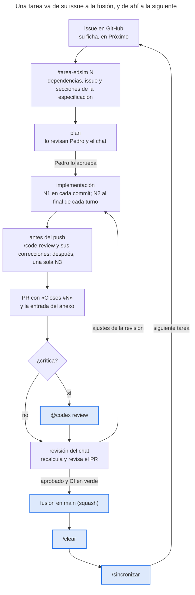
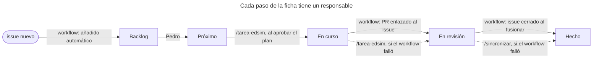
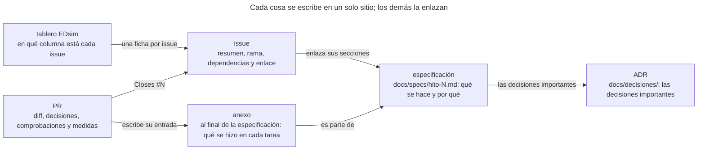

# Flujo de trabajo de EDsim

Este manual es para personas: cómo pasa una tarea del issue a la fusión, quién mueve cada ficha del tablero y dónde vive cada cosa. Los pasos detallados que sigue el agente están en [tarea.md](tarea.md). Para llevar este método a otro proyecto, véase [portabilidad.md](portabilidad.md).

El trabajo vive en GitHub: los [issues](https://github.com/pdromer0/edsim/issues) (uno por tarea, con la plantilla «Tarea»), los milestones (uno por hito o tarea de proceso) y el tablero [«EDsim»](https://github.com/users/pdromer0/projects/1), con las columnas Backlog, Próximo, En curso, En revisión y Hecho.

## El ciclo de una tarea

En azul, lo que hace Pedro tras abrirse el PR: pedir `@codex review` en las tareas críticas, fusionar y, ya con la sesión limpia, sincronizar; los ajustes de la revisión vuelven a la implementación en la misma rama.

## La vida de una ficha en el tablero

Pedro decide qué pasa a Próximo, la skill pone la ficha en curso, y los workflows de GitHub hacen el resto; las flechas punteadas son los respaldos de las skills, que solo actúan si el workflow no movió la ficha.

Los workflows son los del propio tablero: «Auto-add to project» con «Item added to project» (cada issue nuevo entra, en Backlog), «Pull request linked to issue» (configurado para llevar a «En revisión»; de serie lleva a la columna de «en curso») e «Item closed» con «Pull request merged» (a «Hecho»).

## Dónde vive cada cosa

La especificación dice qué hay que hacer y el anexo qué se hizo; el issue y el tablero solo dicen en qué punto está la tarea, y el PR explica el diff y escribe la entrada del anexo.

En las tareas de proceso, la especificación y su anexo son `docs/proceso/<tarea>.md`.

## Dónde corre cada tarea

**En la nube por defecto** (una sesión de Claude Code en claude.ai/code), desde el hito 7. En la 5.7, la N3 tardó allí 10 min 41 s, frente a 13 min 52 s en el portátil, y el portátil queda libre. **En local**, solo lo que la nube no puede hacer:

- lo que necesita Docker: Kafka, Postgres;
- la app en el navegador, cuando Pedro tiene que verla;
- los ficheros que solo están en el portátil;
- crear Releases: GitHub responde HTTP 403 («not permitted for this session type») al crearlas desde la nube o desde el chat.

Cada issue lo dice en «Dónde y modelo». Al abrir una sesión en la nube:

- **la rama**, la del issue: la nube propone una `claude/*`, y Pedro elige la del issue;
- **el entorno** se prepara con `uv sync --all-packages`, con `BASH_DEFAULT_TIMEOUT_MS=900000` para que la N3 quepa en un comando, y el script del entorno busca el repositorio en lugar de suponer dónde está;
- **GitHub, por REST:** las skills usan `gh api`, porque el proxy de la nube da 403 a GraphQL (`gh issue view`, `gh pr view`, `gh project`);
- **el tablero** no se puede mover desde la nube: la skill dice qué ficha mover y a qué columna, y la mueve Pedro.

## Papeles

| Quién | Qué hace |
| --- | --- |
| Pedro | Prioriza (de Backlog a Próximo), aprueba los planes, revisa los PR, escribe `@codex review` en las tareas críticas y fusiona; después, `/clear` y `/sincronizar`. |
| El chat | Lleva la sesión conceptual, escribe las especificaciones y los issues, revisa el plan y el PR, recalcula los valores a mano y completa las métricas del PR. Desde la 5.4 escribe él mismo en GitHub, con `add_repo` y `gh api` REST: las «Notas del chat» de cada issue, su revisión y las métricas en el PR, y los issues del Backlog ([portabilidad.md](portabilidad.md#7-github-como-gestor-de-trabajo-implantado), §7). |
| Claude Code | Con `/tarea-edsim N`: plan, rama, commits con N1, `/code-review` y sus correcciones, una sola N3, entrada del anexo, push, PR y ficha. Con `/sincronizar`: comprueba la fusión, actualiza `main`, borra la rama y revisa el tablero. |
| Codex | Implementa las tareas con la etiqueta `quien:codex` siguiendo [tarea.md](tarea.md) y pide permiso para el push; en las tareas críticas, revisa el PR cuando Pedro escribe `@codex review`. |

## Reglas

- El issue resume la tarea y enlaza las secciones de la especificación; nunca la copia.
- Las decisiones se citan como «decisión 69 (H5-3)», sin almohadilla: con ella, GitHub enlazaría el issue 69.
- Las dependencias van dos veces: la nativa de GitHub («blocked by»), que es la que manda, y el motivo en la sección «Depende de» del cuerpo. Cuando un issue nuevo tiene dependencias, se crean las dos. Si no coinciden, `/tarea-edsim` avisa del descuadre y decide por la nativa.
- Un issue tiene una sola ficha en el tablero, y en cada paso la mueve quien dice el segundo diagrama.

## Tras la fusión

`/sincronizar [N]` hace, en este orden, lo que antes se hacía a mano: comprueba que el árbol está limpio y que el PR está en `MERGED`; actualiza `main` con `git pull --ff-only` y comprueba que contiene la fusión; borra la rama local solo si todos sus commits entraron en el PR; `git fetch --prune`; `uv sync --all-packages --extra kafka` si la fusión cambió `uv.lock` o `pyproject.toml`; comprueba que los issues que cierra el PR están cerrados y en «Hecho»; y muestra las fichas de «Próximo». La skill está en [.claude/skills/sincronizar/SKILL.md](../../.claude/skills/sincronizar/SKILL.md).
