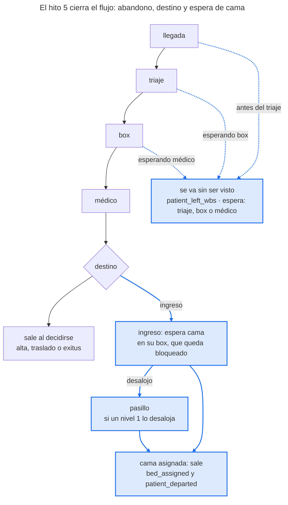

# Hito 5 — Cierre del flujo

> **Estado:** en curso. Especificación aprobada el 10 de noviembre de 2026; el original está en este repositorio.

Al terminar el hito 5, cada paciente de EDsim termina como en un hospital de verdad: puede irse sin ser visto si su espera supera su paciencia, sale con uno de cuatro destinos (alta, ingreso, traslado o exitus) que dependen de su gravedad real, su edad, su motivo y sus pruebas, y si ingresa espera la cama dentro de su box, que queda bloqueado. Es una pestaña didáctica, con el formato de la del hito 6: cada pieza explica para qué sirve, cómo funciona, cómo se usa en EDsim y cómo aprender más. Las decisiones son candidatas (H5-n) y su número definitivo será 66 + n (H5-1 = 67, H5-13 = 79); la tarea de cierre escribe sus ADR 0067 a 0079. La sesión conceptual fue el 9 y el 10 de noviembre de 2026, y la implementación empieza con la etiqueta `v0.6-hito6`.

## Objetivo y alcance

Al cerrar el hito 5, `edsim motor simular` sin opciones simula el modelo del hito 5: con `config/` calibrado, alrededor del 2 % de los pacientes se va sin ser visto, alrededor del 10 % ingresa y espera cama en su box, y las colas largas de enero se cortan solas, porque los más impacientes se van. Lo que se guarda del modelo del hito 4 sigue significando lo mismo, byte a byte (H5-2).

**Por qué ahora.** El hito 6 se adelantó (decisión 48), pero la persistencia (hito 7) y la analítica (hito 8) no deben construirse sobre un modelo sin abandono ni boarding. La decisión 34 dejó este hito escrito: sin destino, boarding ni abandono, el ingreso, la estancia y la cola de los días punta salen mal por construcción. En la peor semana de enero de la semilla 2026 el nivel 5 llegaba a 3.897 min de espera.

**Dentro del alcance**

- **Abandono sin ser visto** (H5-3, H5-4): cada paciente sortea al llegar su paciencia (lognormal por nivel real, con un factor por banda de edad) y se va si su espera antes del primer médico la alcanza, desde tres sitios: antes del triaje, esperando box y esperando médico en el box.
- **Destino real** (H5-5): alta, ingreso, traslado o exitus, con una logística multinomial sobre la gravedad real G, la edad, el motivo (en el ingreso) y el número de pruebas alteradas, sorteada con Gumbel-max.
- **Espera de cama** (H5-6, H5-7): el ingresado pide cama y la espera en su box, que queda bloqueado; si un nivel 1 lo desaloja, la espera en el pasillo.
- **Catálogo versión 4** (H5-7) con `patient_left_wbs`, `bed_requested` y `bed_assigned`, `TERMINAL_EVENTS` de la versión 4 y su esquema `eventos-v4` generado.
- **Compatibilidad** (H5-2): sin los bloques nuevos, el modelo clínico del hito 4 escribe la versión 3 byte a byte; las huellas de las versiones 1 a 3 no cambian.
- **Métricas con abandono** (H5-8) y **ground truth** con todo lo sorteado, también lo que no llegó a usarse (H5-10).
- **Calibración** (H5-9): ingreso, traslado y exitus derivados; abandono y estancia de los ingresados ajustados; plantilla de la 4.6c medida de nuevo; la semana del 19 al 25 de enero, revisada.
- **Directo** (H5-11): el consumidor y «directo = batch» con la versión 4.
- **App** (H5-12): el núcleo en `runs/` (Claude Code) y las páginas (Codex).
- **Notebook** `05_cierre_del_flujo.ipynb`, ADR 0067 a 0079 y etiqueta `v0.5-hito5`.

**Fuera del alcance**

| Qué | Adónde va |
| --- | --- |
| Ruido de triaje que crece con la saturación (H5-1) | v2, con el re-triaje |
| Alta voluntaria: irse después de ver al médico | v2 |
| Camas de planta finitas, UCI con camas propias, espera de la ambulancia del traslado (boarding realista) | v2 |
| Observación y reconsultas en 72 h | v2 |
| Saturación que cambia decisiones clínicas (ingresos defensivos, valoraciones más cortas) | v2 |
| Circuitos de críticos y de leves | v1 |
| Rendimiento de la app (doble lectura del Replay, tabla de Episodios) | Tarea de proceso |
| Editar los perfiles desde la app | Fase 2 de la app |

Las tareas con código empiezan con `v0.6-hito6`. El núcleo lo implementa Claude Code y las páginas de la app, Codex. Los dos ejecutan git (rama, commits, push y PR) y Pedro siempre fusiona.

## Cómo encajan las piezas

El motor del hito 3, con el muestreador clínico del hito 4, sigue llevando al paciente de la llegada al médico; lo nuevo está en las esperas, donde puede irse, y en el final, donde cada destino tiene su camino.



En azul, lo nuevo del hito 5: el abandono, la espera de cama, el pasillo y la salida con cama.

Diagrama original: [pestaña archivada](https://claude.ai/artifact/8pd9CbSV9JTCm7MghHtMV9#b5b8255f-6e17).

Las tres flechas discontinuas son el abandono: solo antes del primer médico (pieza 1). Alta, traslado y exitus salen en el instante de la decisión, como hoy; el ingreso pide cama y la espera en su box (pieza 3). Todo lo sorteado sale del muestreador al llegar, con un flujo aleatorio por fuente (pieza 6), y lo oculto va al ground truth (pieza 7).

## Sesión conceptual resumida

La sesión conceptual está escrita en las piezas 1 a 7; esta tabla es el resumen de referencia. Si una fila no se entiende, la pieza la explica paso a paso.

| Concepto | Qué hay que entender | Pieza |
| --- | --- | --- |
| Paciencia | Los minutos que un paciente está dispuesto a esperar al médico. Nadie la ve; si su espera la alcanza, se va | 1 |
| Abandono sin ser visto | Irse antes del primer médico, desde tres sitios; SEMES lo mide antes y después del triaje | 1 |
| Lo observado no es la paciencia | De los que se van solo se ve cuánto esperaron, y solo se van los que tenían poca | 1 |
| Bucle saturación → abandono | Más cola, más esperas que superan la paciencia, más abandonos; y el abandono acorta la cola | 1 |
| Logística multinomial | Varias opciones, cada una con sus odds frente a una de referencia (el alta); la probabilidad es su parte del total | 2 |
| Odds ratio | El factor que multiplica las odds por cada unidad de una variable: multiplica, no suma | 2 |
| Gumbel-max (repaso) | Un sorteo por categoría y gana el mayor log w + g; al cambiar un peso solo cambian los que entran o salen de esa categoría | 2 |
| Boarding | El ingresado espera cama dentro de su box y lo bloquea | 3 |
| Ley de Little | Ocupación media = llegadas por unidad de tiempo × tiempo medio dentro | 3 |
| Sesgo de supervivencia | Medir solo a los que aguantaron hace parecer mejor un servicio que va peor | 4 |
| Censura | Saber solo que algo duró al menos X, no cuánto | 4 |
| Derivado, de ajuste y de comprobación | Lo que se calcula sin simular, lo que un mando ajusta simulando y lo que solo se mira | 5 |
| Mandos acoplados | Un mando mueve el objetivo de otro: se ajustan en orden, con una vuelta como máximo | 5 |
| Versión de un modelo | La configuración elige el modelo; lo antiguo se lee con su significado | 6 |
| Contrafactual | Lo que habría pasado: el simulador lo sabe, el hospital no | 7 |

## Pieza 1 — Abandono y paciencia

Cada paciente llega con una paciencia que nadie ve; si su espera hasta el primer médico la alcanza, se va sin ser visto. Con eso, las colas largas se cortan solas y EDsim tiene el indicador de calidad que todo servicio de urgencias vigila (H5-3, H5-4).

### Para qué sirve

- **Realismo de las colas.** Sin abandono, una cola que crece no se corta nunca: en la peor semana de enero de la semilla 2026 el nivel 5 llegaba a 3.897 min de espera (anexo de la 4.6c). En un hospital real, a partir de cierta espera la gente se va.
- **Un indicador que se mide en España.** SEMES pide dos: el índice de fugas antes de ser triados y el de fugas antes de ser visitados por el médico, con un estándar de como mucho el 2 % de los que acuden.
- **Seguridad.** Los que se van suelen ser jóvenes y leves, pero no todos: el ground truth sabe cuántos graves de verdad se fueron (pieza 7).
- **El bucle del diseño «saturación → abandono»**, sin programarlo: sale solo de las colas.

### Cómo funciona

**La paciencia es una variable oculta**, como la gravedad G. Se sortea al llegar con una lognormal por nivel real, con la conversión de siempre:

```latex
\mu = \ln(f_b \cdot \text{mediana}_n), \qquad \sigma_n = \frac{\ln(p_{90,n}) - \ln(\text{mediana}_n)}{1{,}28155}, \qquad \text{paciencia} = e^{\mu + \sigma_n z}
```

Con n el nivel real, f\_b el factor de su banda de edad (vale 1 si no se escribe) y z una normal estándar de su propio flujo. Ejemplo a mano con `[120, 360]`: σ = ln 3 / 1,28155 = 0,8573. El 20,9 % de esos pacientes tiene una paciencia de 60 min o menos, el 50 % de 120 o menos y el 79,1 % de 240 o menos. Con un factor 0,8 en la banda de 15 a 44 años, la mediana baja a 96 min y el 29,2 % aguanta 60 min o menos.

**Por qué el nivel real y no el asignado.** Antes del triaje el nivel asignado no existe, y el paciente no suele saber cuál le han puesto; lo que nota es cómo está. Así, un grave infratriado espera como un 4 pero casi nunca se va, y un leve sobretriado espera menos pero tiene poca paciencia.

**Dónde se puede ir** (H5-3). Solo antes de ser visto, es decir, antes de su primer `assessment_started` de tipo `inicial`, y en tres sitios:

| Sitio | Estado | `espera` en el evento |
| --- | --- | --- |
| Sala de espera, antes del triaje | Esperando enfermera | `triaje` |
| Sala de espera, después del triaje | Esperando box (también tras un desalojo, si aún no lo vio un médico) | `box` |
| Dentro del box | Esperando médico | `medico` |

No se va durante el triaje ni durante una valoración. El nivel 1 asignado nunca abandona: se clasifica en la puerta y va directo al box. Irse después de ver al médico es un alta voluntaria, de la v2.

**El reloj de la paciencia empieza en la llegada**, no en el triaje, porque la gente cuenta desde que cruza la puerta. En SimPy, cada espera pasa a ser «el recurso o la paciencia, lo que llegue antes»: una petición y un `timeout` hasta llegada + paciencia, unidos con `|` (un evento de condición). **Empate:** si la paciencia vence en el mismo instante en que le conceden el recurso, el paciente se queda. Es una regla nuestra, no del orden interno de SimPy, y el plan de la 5.1 comprueba en el código de SimPy 4.1.2 cómo garantizarla.

**Lo que se observa no es la paciencia.** Los estudios dan cuánto esperaron los que se fueron: una mediana de 70 min en Florencia y de 103 min en Ontario, el doble de lo que esperaron los que se quedaron (51 min). Pero solo se van los que tenían poca paciencia: la de todos es mayor. Por eso la paciencia no se copia de un estudio, sino que se calibra para que salga el porcentaje de abandono observado (pieza 5).

**El bucle.** Si el servicio se satura, las esperas crecen, más esperas alcanzan su paciencia y más gente se va. Y al irse, la cola se acorta: es una realimentación negativa, que estabiliza. En Bellvitge, al bajar la permanencia media de 5,9 a 5,1 h, los que se iban sin ser visitados pasaron del 4,1 % al 1,7 %; en Ontario, la estancia mediana del centro fue lo que más se correlacionaba con su tasa de abandono (r = 0,62).

**Qué se sabe en España.** En el Clínic, el 1,8 % de 21.022 pacientes se fue sin ser atendido, con más riesgo por debajo de los 50 años. En el SAS de 2013, la «salida voluntaria» fue el 1,82 % de las urgencias; el informe no separa fugas, abandonos y altas voluntarias. En el Aljarafe, entre 2007 y 2017, las fugas fueron de 22 a 36 por 1.000 urgencias y las altas voluntarias, de 0,7 a 1,7 por 1.000. Un cuadro de mando publicado reparte una fuga del 4,5 % en 0,14 % antes del triaje, 3,2 % después del triaje y 1,2 % después de la evaluación, y el 90 % eran no críticos.

### En EDsim

- Los parámetros van en `perfiles.toml`, en `[abandono]`: `paciencia`, cinco pares `[mediana, p90]` por nivel real, y `paciencia_edad`, cuatro factores por banda (opcional, vale 1). Es un rasgo de los pacientes, no del hospital.
- La z de la paciencia sale del flujo 8, una normal por paciente, se use o no: los flujos 0 a 7 no cambian ni un bit (pieza 6).
- El evento `patient_left_wbs` lleva `espera`. Si el paciente estaba en un box, lo libera en ese instante, como una salida.
- El ground truth guarda la paciencia en minutos y su z (pieza 7). Una invariante nueva comprueba con él que cada abandono ocurre exactamente en llegada + paciencia y que nadie esperó más que su paciencia sin irse.

### Para aprender más

- Colas con abandono: el modelo Erlang-A, en Garnett, Mandelbaum y Reiman, «Designing a call center with impatient customers» (*Manufacturing & Service Operations Management*, 2002). Es la teoría de las centralitas, que se aplica igual a una sala de espera.
- SimPy, [eventos de condición](https://simpy.readthedocs.io/en/latest/topical_guides/events.html) (`|` y `&`): cómo esperar a lo primero que ocurra.
- [Shaikh et al., *Western Journal of Emergency Medicine* 2012](https://pmc.ncbi.nlm.nih.gov/articles/PMC3555587): una encuesta en la sala de espera; la mitad estaba dispuesta a esperar hasta 2 horas.
- Ejercicio propuesto: con el notebook 05, dibujar el porcentaje de abandono por hora de llegada frente a la espera media de esa hora.

## Pieza 2 — Destinos con logística multinomial

Cada paciente atendido sale con uno de cuatro destinos (alta, ingreso, traslado o exitus), elegido por una logística multinomial sobre su gravedad real, su edad, su motivo y sus pruebas alteradas (H5-5). Sustituye al destino provisional del hito 3, que solo miraba el nivel asignado.

### Para qué sirve

- **El caso de uso «predecir el ingreso desde el triaje»** necesita un ingreso que dependa de lo que de verdad lo causa, y que el triaje solo ve en parte.
- **El resultado de las pruebas, por fin con efecto.** Se sortea desde el hito 4 para que el flujo de pruebas no cambiara de consumo entre hitos (decisión 34).
- **Cada destino tiene su camino** en el motor: el ingreso espera cama (pieza 3); alta, traslado y exitus salen al decidirse.

### Cómo funciona

**Odds frente a una referencia.** El alta es la referencia. Cada uno de los otros tres destinos tiene unas odds frente al alta (cuántas veces más probable es que el alta), que parten de un valor base y se multiplican por un odds ratio por cada cosa que empuja hacia él:

```latex
\frac{P(d)}{P(\text{alta})} = \frac{p_{d,m}}{p_{\text{alta},m}} \cdot OR_{G,d}^{\,G} \cdot OR_{\text{mayor},d}^{\,\text{mayor}} \cdot OR_{\text{alt},d}^{\,k}, \qquad P(d) = \frac{\text{odds}_d}{1 + \sum_{d'} \text{odds}_{d'}}
```

Con G la gravedad real, mayor = 1 en las bandas desde 65 años, k el número de pruebas alteradas (0 a 4) y p\_{d,m} los porcentajes base de un adulto menor de 65 años con G = 0 y sin pruebas alteradas. Solo el ingreso tiene porcentaje base por motivo; traslado y exitus tienen uno global. Un odds ratio que no se escribe vale 1.

**Ejemplo a mano** (valores inventados para ver el mecanismo): base 6 % de ingreso, 0,5 % de traslado y 0,05 % de exitus; odds ratios de G de 3, 2 y 6; en el ingreso, 1,5 por prueba alterada y 2 para los mayores.

| Paciente | Alta | Ingreso | Traslado | Exitus |
| --- | --- | --- | --- | --- |
| Adulto, G = 0, sin alteradas | 93,45 % | 6,00 % | 0,50 % | 0,05 % |
| Adulto, G = 1 | 82,88 % | 15,96 % | 0,89 % | 0,27 % |
| Adulto, G = 2 | 61,79 % | 35,70 % | 1,32 % | 1,19 % |
| Adulto, G = 1, 2 alteradas | 69,09 % | 29,94 % | 0,74 % | 0,22 % |
| Mayor, G = 1 | 71,47 % | 27,53 % | 0,76 % | 0,23 % |
| Mayor, G = 1, 2 alteradas | 53,17 % | 46,09 % | 0,57 % | 0,17 % |

Los odds ratios multiplican odds, no suman puntos. Por eso subir el ingreso baja un poco el traslado y el exitus: se reparten el mismo 100 %.

**El sorteo, con Gumbel-max** (decisión 43). Al llegar se sortean cuatro Gumbel estándar g, una por destino, en el orden alta, ingreso, traslado, exitus; gana el destino de mayor log odds + g (el alta tiene log odds 0). Con g = (0,10; 1,90; 0,50; 0,20), un adulto con G = 1 tiene log odds (0; −1,6471; −4,5374; −5,7414), sumas (0,10; 0,2529; −4,0374; −5,5414) e ingresa. Con G = 0, el ingreso vale −2,7457 + 1,90 = −0,8457 y gana el alta. Mismos sorteos, otra gravedad: cambia el destino, y al cambiar un odds ratio solo cambian los pacientes que entran o salen de ese destino.

**Por qué la gravedad real.** El médico atiende al paciente que tiene delante: la regla del hito 4 (decisión 38) es el nivel asignado para la prioridad y la gravedad real para la clínica. Un nivel 2 infratriado como 4 espera como un 4 e ingresa como un 2.

**Las pruebas alteradas añaden información.** Que salgan alteradas ya depende de G; como cuentan aparte, de dos pacientes igual de graves ingresa más el que tiene la analítica alterada. Un paciente sin pruebas tiene k = 0.

**Los porcentajes del TOML no son los del paciente típico del motivo**, como en las pruebas del hito 4: son los de un adulto con G = 0. Lo que se lee clínicamente es la marginal de un año de cada motivo, que va en un comentario. Y el ingreso global no se elige a mano: los 17 porcentajes se eligen por su orden (la columna «Ingreso» del catálogo), y un factor común sobre sus odds se deriva para que el ingreso de un año sea el objetivo (pieza 5), con los valores escritos en el TOML. Lo mismo para traslado y exitus.

### En EDsim

- `perfiles.toml` gana `[destinos]` (los odds ratios de cada destino y las bases de traslado y exitus) y, en cada motivo, `ingreso`, el porcentaje base. Es un bloque de todo o nada (pieza 6).
- El destino usa el flujo 4: en el modelo del hito 5, cuatro Gumbel por paciente; en el del hito 4, la uniforme de siempre.
- `profiles/` gana las funciones exactas: la probabilidad de cada destino de un paciente y las marginales de un año, integrando sobre la mezcla de G y sobre el número de pruebas alteradas, sin simular.
- `config/centro.toml` pierde `[destino]`, que se sigue leyendo en los centros antiguos con su significado.

### Para aprender más

- Agresti, *An Introduction to Categorical Data Analysis*, el capítulo de modelos logit para respuestas multinomiales: la parametrización con categoría de referencia de esta pieza.
- El truco de Gumbel-max: la pieza de motivos de la pestaña del hito 4 y el notebook 04.
- Ejercicio propuesto: con el notebook 05, ajustar una regresión logística de ingreso con lo que ve el hospital (nivel asignado, edad, motivo, pruebas) y comparar sus coeficientes con los odds ratios verdaderos del TOML.

## Pieza 3 — La espera de cama y los boxes bloqueados

Un paciente con destino «ingreso» no se va al decidirse: pide cama y la espera dentro de su box, que nadie más puede usar. La espera es una lognormal multiplicada por un factor del turno en que se pide (H5-6), y si un nivel 1 desaloja al paciente, la espera sigue en el pasillo (H5-7).

### Para qué sirve

- **El tercer bucle del diseño:** más ingresos esperando cama, menos boxes libres, más cola, más abandono. En la literatura se llama *boarding* o *access block*, y es la causa más citada de la saturación.
- **La estancia de los ingresados.** En el SAS de 2013, un ingresado sin observación pasaba de media 472,5 min en urgencias y el 49,69 % más de 4 horas, frente a 162,2 min de media de todos los pacientes sin observación.
- **Un experimento estrella** para la app: «¿y si dieran las camas más rápido?».

### Cómo funciona

**La espera de cada ingresado.** Se sortea al llegar una normal z de su propio flujo y se transforma cuando se pide la cama, igual que la respuesta de las pruebas con la franja del pedido (hito 4):

```latex
\text{espera} = c_{\text{turno}(t)} \cdot c_{\text{estación}} \cdot e^{\mu + \sigma z}, \qquad \mu = \ln(\text{mediana}), \quad \sigma = \frac{\ln(p_{90}) - \ln(\text{mediana})}{1{,}28155}
```

Con t el instante de `bed_requested` y el turno, el de `[turnos]` del centro en ese instante: la espera de cama es del hospital, no del paciente. Ejemplo a mano con `[240, 720]` (σ = 0,8573): con z = 0, 240 min; si se pide de noche con un factor 1,5, 360 min; con z = 1,28155, 720 min y, de noche, 1.080. El factor de estación es opcional y vale 1.

**Por qué un factor por turno.** Las camas de planta se liberan sobre todo con las altas de la mañana: quien pide cama de madrugada espera hasta que alguien se vaya de planta. Multiplicar una lognormal por un factor equivale a multiplicar su mediana, así que el paciente conserva su percentil (pieza de pruebas del hito 4).

**Cuántos boxes bloquea: la ley de Little.** En cualquier sistema estable, el número medio de clientes dentro es la tasa de llegada por el tiempo medio que pasan dentro: L = λ · W. Aquí, los «clientes» son los ingresados esperando cama:

- llegan unos 317 pacientes al día y el 9,90 % ingresa: λ = 31,4 ingresos al día;
- la media de una lognormal es mediana · e^{σ²/2}: con `[240, 720]`, W = 346,6 min;
- L = 31,4 · 346,6 / 1.440 = **7,55 boxes ocupados de media por pacientes esperando cama**, de 30.

Hoy hay 16,5 boxes ocupados de media (tarea 4.6a). Con la espera de cama, las horas punta se llenan, y como los boxes siguen fijos en 30 (decisión 41), parte de la espera hasta el médico pasará a ser espera de box. Es una estimación de orden de magnitud, sin los factores de turno; la 5.6 la mide.

**El pasillo.** El ingresado sigue en su box con su clave de prioridad, así que un nivel 1 que llega con todo lleno puede desalojarlo (decisión 25). Ya está atendido, así que no vuelve a pedir box: sale al pasillo y espera allí la cama. La espera corre por su cuenta, como el laboratorio, y la cama le llega igual. Un ingresado de nivel 1 nunca es desalojado.

**Por qué no camas finitas** (la opción descartada en H5-6). Una planta de N camas con estancias de unos 7 días (6,82 de media en Valencia, 2023) arranca vacía y tarda semanas en llenarse: el calentamiento pasaría de 2 días a unas 4 semanas, y cada evaluación de la calibración, a más del triple. Faltarían también los ingresos programados y la hora de las altas de planta. Es el boarding realista de la v2.

**Qué se sabe en España.** Depende mucho del hospital: en un comarcal de Zaragoza, 5 h 57 min de demora del ingreso; en Valencia, el 68,9 % de 13.214 ingresos estuvo más de 6 horas; en un terciario, una estancia media de los ingresados de 22,8 horas, con el 15 % por encima de 24; en La Paz, 4.064 de 8.439 mayores de 75 años esperaron cama más de 24 horas.

### En EDsim

- `centro.toml` gana `[camas]`: `espera = [mediana, p90]`, `factor_turno` (tres factores, mañana, tarde y noche) y `factor_estacion` (cuatro, opcional, vale 1). Sustituye a `[destino]` en los centros del hito 5 (pieza 6).
- La z sale del flujo 9, una normal por paciente, ingrese o no.
- En el motor, la espera es un proceso aparte, como `_lab`: al acabar emite `bed_assigned` y el paciente sale, esté en el box o en el pasillo.
- El estado del consumidor gana «esperando cama», con una marca «en el pasillo» (H5-11).

### Para aprender más

- La ley de Little: J. D. C. Little, «A proof for the queuing formula L = λW» (*Operations Research*, 1961), y cualquier introducción a la teoría de colas; la usamos ya en el hito 1 con la M/M/1.
- Forero, McCarthy y Hillman, «Access block and emergency department overcrowding» (*Critical Care*, 2011): qué es el bloqueo de acceso y por qué satura las urgencias.
- [Carballo et al., *Emergencias* 2026](https://revistaemergencias.org/wp-content/uploads/2026/06/5345_ORIGINAL_Carballo_V3.pdf): el límite de 24 horas y la mortalidad atribuible al retraso del ingreso.
- Ejercicio propuesto: con el notebook 05, comprobar la ley de Little en una ejecución: boxes ocupados por ingresados de media frente a ingresos por minuto × espera media.

## Pieza 4 — Medir con abandono: supervivencia y censura

Con el abandono, los pacientes que más esperan son los que se van, y quitarlos de las métricas haría parecer mejor un servicio que va peor. Cada métrica sigue la regla de su fuente, el cumplimiento cuenta los incumplimientos seguros y el abandono tiene sus propios indicadores (H5-8).

### Para qué sirve

Para que un día malo parezca malo. Si el abandono mejorara el cumplimiento, un panel del hito 8 premiaría los días en que más gente se fue, y un modelo entrenado con esos datos aprendería lo contrario de lo que pasa.

### Cómo funciona

**Sesgo de supervivencia.** Si solo se mide a los que llegaron al final, el resultado depende de quién llegó. Tres pacientes de nivel 4 (máximo de Manchester, 120 min):

| Paciente | Qué pasa | Para la media de espera | Para el cumplimiento |
| --- | --- | --- | --- |
| 1 | Ve al médico a los 30 min | 30 | Cumple |
| 2 | Ve al médico a los 90 min | 90 | Cumple |
| 3 | Se va a los 150 min sin ser visto | No cuenta (no tiene médico) | Incumple: esperó al menos 150 > 120 |

Media de espera de los atendidos: 60 min. Cumplimiento: 2 de 3, el 66,7 %. Quitando al paciente 3 del cumplimiento saldría un 100 %.

**Censura.** Un dato censurado es uno del que solo sabemos que duró al menos X. El paciente 3 es un dato censurado de «tiempo hasta el médico»: no sabemos cuánto habría esperado, pero sí que fueron más de 150 min, y eso basta para saber que incumplió. Si se hubiera ido a los 20 min, no sabríamos si lo habrían atendido antes de 120: no cuenta ni como cumplimiento ni como incumplimiento. Es la misma idea que los censurados del día de vaciado de la 4.6c, los que siguen dentro al final del horizonte.

**Las reglas** (H5-8):

| Métrica | Regla con abandono | Por qué |
| --- | --- | --- |
| Medias de los relojes A, B y C | Solo los atendidos | Como el TPAM del SAS, que mide a los que vio un médico: la calibración compara lo mismo con lo mismo |
| Pretriaje medio y porcentaje > 5 min | Solo los triados | Como el indicador del SAS |
| Cumplimiento Manchester (reloj C) | Quien se va después de su máximo, incumplimiento; quien se va antes, censurado (no cuenta) | Más abandono nunca mejora el cumplimiento |
| Estancia en urgencias | Por destino; los que se van, aparte, con su tiempo hasta irse | Como el TPU del SAS por tipo de alta |

Para el cumplimiento con el reloj C hace falta la clasificación: quien se va antes del triaje no tiene nivel y no entra; su abandono cuenta en el indicador de «antes del triaje».

**Indicadores nuevos** (los observables, desde el log):

- porcentaje de abandono, global y por nivel asignado, separado en antes y después del triaje (los dos indicadores de SEMES), y por sitio (`espera`);
- porcentaje de ingreso, de traslado y de exitus, global y por nivel asignado;
- espera de cama (de `bed_requested` a `bed_assigned`): mediana, p90 y porcentaje por encima de 6, 12 y 24 horas;
- estancia en urgencias por destino, y porcentaje de ingresados con más de 4 horas;
- boxes ocupados por pacientes esperando cama, y pacientes en el pasillo.

**Indicadores que solo da el ground truth** (nunca en el log ni en los KPI observables, como el cumplimiento por nivel real del hito 4): abandono por nivel real, cuántos de los que se fueron eran graves de verdad, y cuántos habrían ingresado (pieza 7).

### En EDsim

- `EpisodeRecord` gana el abandono (instante y sitio), el destino con cuatro valores, la espera de cama y la marca de pasillo. Los relojes de quien se va quedan vacíos, como los de quien sigue dentro al final.
- `manchester_compliance` y `window_compliance` aplican la regla de la censura; con el modelo del hito 4 (sin abandono) dan exactamente lo de antes.
- `runs/` gana los indicadores nuevos para la app, de forma aditiva: campos al final y parámetros con el valor de antes por defecto.

### Para aprender más

- El estimador de Kaplan–Meier, la herramienta clásica para datos censurados. En Python, la biblioteca [lifelines](https://lifelines.readthedocs.io/) lo explica con ejemplos.
- Sesgo de supervivencia: el ejemplo de Abraham Wald y los aviones de la Segunda Guerra Mundial, que reforzaba las zonas sin impactos de los que volvían.
- Ejercicio propuesto: con el log de una ejecución, estimar con Kaplan–Meier la paciencia de los pacientes (el abandono es el evento; ver al médico, la censura) y compararla con la paciencia verdadera del ground truth. Es la forma correcta de responder a la pregunta de la pieza 1: cuánto aguanta la gente.

## Pieza 5 — Calibrar con mandos acoplados

El hito 5 añade cinco objetivos del SAS a los del hito 4: tres se calculan sin simular, dos se ajustan con un mando propio cada uno, y el resto solo se comprueba. Como los mandos se influyen entre sí, se ajustan en un orden fijo, y la plantilla de la 4.6c solo cambia si se sale de su horquilla (H5-9).

### Para qué sirve

Para que el centro base siga pareciéndose a un hospital andaluz real cuando sus pacientes empiezan a irse y a esperar cama. Un modelo con abandono y boarding pero calibrado como si no los tuviera señalaría el problema equivocado.

### Cómo funciona

**Tres tipos de objetivo.**

1. **Derivado.** El porcentaje depende solo de cómo es el paciente (G, edad, motivo, pruebas), no de las colas. Se calcula exacto una vez, se escribe en el TOML con el comando en un comentario y un test comprueba «escritos = recalculados», como los umbrales del triaje (patrón «derivado y escrito»).
2. **De ajuste.** Depende de las esperas, así que solo se sabe simulando. Un mando lo mueve y se elige con las reglas de la decisión 41: ventana anual (una réplica de 14 días por mes), semilla 2026 para elegir, 2027 que puede vetar y 2028 para confirmar después de un veto.
3. **De comprobación.** Nunca elige; si encaja, el modelo tiene algo de verdad.

**Los objetivos nuevos** (SAS, CMBD de urgencias 2013, sin observación, que EDsim no tiene; incluye menores salvo el ingreso convertido):

| Objetivo | Referencia | Horquilla | Tipo | Qué lo mueve |
| --- | --- | --- | --- | --- |
| Ingreso, adultos | 9,90 % | 8–13 % | Derivado (y comprobado en la simulación) | Un factor común sobre las odds base de ingreso por motivo |
| Traslado | 0,75 % | — | Derivado | Su odds base |
| Exitus | 0,11 % | — | Derivado | Su odds base |
| Abandono | 1,82 % | 1–4 % | Ajuste | Un factor común sobre las medianas y los p90 de paciencia |
| Estancia media de los ingresados | 472,5 min | 360–600 | Ajuste | La mediana de la espera de cama (el p90, por criterio) |
| Ingresados con más de 4 h | 49,69 % | 35–65 % | Comprobación | — |
| Estancia media, todos los atendidos | 162,2 min | 120–210 | Comprobación | Las duraciones, fijas por criterio (decisión 41) |
| Ingreso por nivel asignado | 46,5 / 25,1 / 11,0 / 3,9 / 7,4 % | — | Informe | Nada directo: sale de G y del triaje |

**El ingreso de adultos, cálculo propio.** El SAS da un 8,55 % de ingresos en todas las edades y un 3,47 % en los menores de 15 años. Con la regla del hito 4 de que los menores son una de cada cinco urgencias: (8,55 − 0,21 × 3,47) / 0,79 = 9,90 %. El SNS de 2024 da un 10,1 % en todas las edades (Andalucía, 7,5 %).

**Las horquillas del abandono** van del 1,8 % del Clínic al 3,6 % del peor año del Aljarafe, con el 4,1 % de Bellvitge antes de su reorganización como referencia alta; el estándar es como mucho el 2 %.

**Por qué la estancia de todos no se ajusta.** El único mando que la movería son las duraciones de valoración y reevaluación, y moverlas obliga a repetir la calibración de los médicos del hito 4: más duración es más carga. Como comprobación, dice si las duraciones elegidas por criterio eran razonables. Estimación a mano, sin simular: unos 42 min hasta el médico, 24 de valoración, el 72,75 % con una ronda de pruebas de una hora larga y 8 de reevaluación, del orden de 130 a 150 min sin la espera de cama. Lo mide la 5.6.

**Mandos acoplados y orden.** La paciencia se ajusta mirando cuánta gente se va; eso depende de la espera, que depende de los médicos y de los boxes bloqueados por la espera de cama. Y el tiempo hasta el médico, objetivo de los médicos, cambia en sentidos opuestos: lo baja el abandono (quedan menos en la cola y solo se mide a los atendidos) y lo sube la espera de cama (menos boxes libres). El orden (H5-9):

1. Los destinos, derivados, sin simular.
2. Con la plantilla de la 4.6c fija (`[3, 2, 1]` y `[12, 11, 4]`), la paciencia contra el abandono y la espera de cama contra la estancia de los ingresados.
3. Se vuelven a medir los objetivos del hito 4 (pretriaje y reloj A de los niveles 2 a 5) con el modelo nuevo, con las reglas de la 4.6c. Si pasan, la plantilla no cambia.
4. Si alguno se sale, se repite la sensibilidad de ese mando con la regla de la plantilla equivalente y se vuelven a comprobar el abandono y la estancia de los ingresados. Una sola vuelta: si no cuadra, la tarea para y se decide con Pedro.
5. El centro cumplidor vuelve a elegir sus médicos con su regla de siempre (como mucho el 10 % de días fuera con el reloj C, con días enteros).

Si los boxes pasan a ser el cuello de botella por la espera de cama, siguen fijos en 30 (decisión 41): cambiarlos se decide con Pedro, con los resultados delante. Y la semana del 19 al 25 de enero de la semilla 2026 se vuelve a medir con el modelo nuevo y se escribe en el registro, sin objetivo: es el pendiente del hito 4.

### En EDsim

- `config/objetivos.toml` gana los objetivos nuevos, con medidas nuevas (abandono y estancia por destino); el plan de la 5.6 propone sus nombres y el esquema.
- `calibration/` gana los dos mandos nuevos (paciencia y espera de cama) y conserva la regla, la ventana y el veto. Cada valor elegido se escribe en `config/` con el comando que lo calcula, y el registro de calibración gana una sección de la 5.6.
- Es la tarea que pone los bloques del hito 5 en `config/`: desde su PR, el modelo por defecto es el del hito 5.

### Para aprender más

- La sección «Calibración» de la pestaña del hito 4 y el [registro de calibración](https://github.com/pdromer0/edsim/blob/main/docs/calibracion/registro.md): las reglas contra el sobreajuste y la identificabilidad.
- Ejercicio propuesto: dibujar el abandono frente al factor de paciencia con dos plantillas de médicos; las dos curvas muestran el acoplamiento.

## Pieza 6 — Versiones de un modelo

El hito 5 no sustituye al modelo del hito 4: lo añade. Unos ficheros con los bloques nuevos eligen el modelo del hito 5 y escriben la versión 4 del catálogo; sin ellos, todo es exactamente como antes, byte a byte (H5-2).

### Para qué sirve

Para que lo ya escrito no cambie de significado. Hay tres cosas escritas con el modelo del hito 4: las huellas SHA-256 de los tests, las ejecuciones guardadas en `resultados/ejecuciones/` (con sus copias de `centro.toml` y `perfiles.toml`) y las variantes que la app guardó en `resultados/variantes/`. Con esta regla, las tres siguen valiendo, y lo nuevo es el modelo por defecto sin que haya que pedirlo.

### Cómo funciona

**La regla, por tercera vez.** Escribir lo nuevo y leer lo antiguo con su significado: ya la aplicamos con `espera_resultados_fuera` (si falta, vale `[]`) y con el bloque provisional del centro (tarea 4.9). Ahora la aplicamos a un bloque de dos ficheros:

| Modelo | `perfiles.toml` | `centro.toml` | Escribe | Flujos |
| --- | --- | --- | --- | --- |
| Provisional (hito 3) | No se usa | Bloque provisional y `[destino]` | Versión 1 | `child_streams(seed, 5)` |
| Clínico del hito 4 | Sin `[abandono]`, sin `[destinos]` y sin `ingreso` en los motivos | `[destino]`, sin `[camas]` | Versión 3 | `child_streams(seed, 8)` |
| Clínico del hito 5 | Con `[abandono]`, `[destinos]` e `ingreso` en los 17 motivos | `[camas]`, sin `[destino]` | Versión 4 | `child_streams(seed, 10)` |

Un bloque a medias (`[abandono]` sin `[destinos]`, `ingreso` en algunos motivos y no en otros, o unos perfiles del hito 5 con un centro del hito 4) es un error que dice qué falta y en qué fichero. Un centro con `[destino]` y `[camas]` a la vez, también.

**Los flujos.** Cada hijo de `child_streams` depende solo de su índice, así que pedir 10 hijos da los mismos 8 primeros que pedir 8: las llegadas, la persona, el motivo, la gravedad, el triaje, las pruebas y las duraciones no cambian ni un bit al pasar al hito 5 (decisión 43). Lo que cambia:

| Flujo | Fuente | Hito 4 | Hito 5 |
| --- | --- | --- | --- |
| 4 | Destino | 1 uniforme (provisional, con el nivel asignado) | 4 Gumbel (multinomial) |
| 8 | Paciencia | — | 1 normal |
| 9 | Espera de cama | — | 1 normal |

**El catálogo versión 4** entra en `CATALOGS`, con su `TERMINAL_EVENTS` (`patient_departed` y `patient_left_wbs`), y su esquema `schemas/eventos-v4.schema.json` sale del generador de la 6.4. Los logs de las versiones 1 a 3 se siguen leyendo y validando con el catálogo de su versión, como hasta ahora.

**Lo que hay que releer.** `CLINICAL_SCHEMA_VERSIONS` (las versiones con payloads clínicos) gana la 4. Es una constante que leen varios módulos, y la lección del hito 4 es que un supuesto implícito se rompe cuando entra un valor nuevo: el plan de la 5.1 busca a todos sus lectores. Las huellas de las versiones 1 a 3 no cambian, y un test lo comprueba con la suite completa; el modelo del hito 5 tiene las suyas, con ficheros de ejemplo nuevos en `tests/data/`.

### En EDsim

- La elección del modelo vive en la carga de los ficheros, como la del bloque provisional, y el motor tiene una rama explícita: sin los sorteos del hito 5, exactamente el código del hito 4, como ya hay una rama exacta para el provisional.
- `config/` lleva los bloques desde la 5.6: hasta entonces, el modelo por defecto sigue siendo el del hito 4 (decisión 44: el modelo nuevo no pasa a ser el de por defecto hasta que la app lo soporta).
- «Directo = batch» gana un caso de la versión 4.

### Para aprender más

- La pieza 4 de la pestaña del hito 6 (contratos y versiones del catálogo), con la compatibilidad hacia atrás y hacia delante.
- *Designing Data-Intensive Applications*, el capítulo de codificación y evolución.
- Ejercicio propuesto: validar una línea de un log de la versión 4 contra el esquema de la versión 3 y leer el error.

## Pieza 7 — El ground truth contrafactual

El ground truth guarda todo lo que se sorteó para cada paciente, también lo que no llegó a usarse: la paciencia de quien vio al médico, el destino de quien se fue y la espera de cama de quien no ingresó (H5-10). Así EDsim sabe algo que ningún hospital sabe: qué le habría pasado a cada paciente si se hubiera quedado.

### Para qué sirve

- **El daño oculto del abandono.** «¿Cuántos de los que se fueron habrían ingresado?» Ningún hospital lo sabe, porque el que se va no vuelve a pasar por la decisión. En el Clínic ya avisaban de que los remitidos por otro médico y valorados como graves a su llegada son los que más riesgo tienen de ingresar después.
- **Validar modelos con una verdad completa.** Un modelo de «predecir el ingreso» o «predecir el abandono» se puede evaluar también con los que se fueron.
- **Reconstruir cada paciente bit a bit** desde una fila del CSV, como hoy.

### Cómo funciona

**Todo se sortea al llegar**, en orden fijo y con un número fijo de sorteos por flujo (decisión 24): la paciencia, el destino y la espera de cama existen para todos los pacientes desde el primer instante, aunque luego solo se use una parte. El motor decide qué se usa; el ground truth guarda todo.

**Qué gana cada episodio:**

| Campo | Contenido | Para quién se usa |
| --- | --- | --- |
| `z_paciencia`, `paciencia` | La normal del flujo 8 y la paciencia en minutos | Para todos los que esperan; los que ven al médico no la agotan |
| `sorteo_destino_<d>` (4) y `destino` | Las cuatro Gumbel del flujo 4 y el destino que salió | Para los que llegan a la decisión; para los que se fueron, es el contrafactual |
| `z_cama`, `espera_cama_base` | La normal del flujo 9 y la espera base (factor 1) | Para los ingresados; la de su turno se reconstruye con el instante de `bed_requested` |

**Lo observado frente a lo verdadero**, el patrón del hito 4 con el nivel asignado y el real:

| Pregunta | El log (lo que ve el hospital) | El ground truth |
| --- | --- | --- |
| ¿Se fue? | `patient_left_wbs` y su `espera` | La paciencia, y que se fue exactamente en llegada + paciencia |
| ¿A dónde iba? | Solo si llegó a la decisión | Siempre: el destino sorteado |
| ¿Cuánto esperó la cama? | De `bed_requested` a `bed_assigned` | La espera base y su z |

**Nada de esto va al log** (decisión 28): ningún catálogo lleva la paciencia ni el destino de quien se fue, y un test lo comprueba, como con G y el nivel real.

### En EDsim

- `EpisodeTruth` gana un campo con la verdad del hito 5 (`None` con los modelos anteriores, sin otros cambios), y el CSV del ground truth clínico gana sus columnas al final. Un CSV antiguo, sin ellas, se lee como del hito 4 (pieza 6).
- `run.json` dice que la ejecución es del modelo del hito 5; un `run.json` antiguo se lee como hasta ahora.
- «Ver la verdad» de la app enseña la paciencia y, a quien se fue, el destino que habría tenido (H5-12).
- El emparejamiento de la tarea 4.8a (`pairing_category`) sigue funcionando: dos ejecuciones de modelos distintos no son los mismos pacientes.

### Para aprender más

- Inferencia causal con resultados potenciales: Hernán y Robins, *Causal Inference: What If* (libro gratuito en la web de Harvard), capítulo 1. El contrafactual de esta pieza es exactamente un «resultado potencial» que en datos reales nunca se observa.
- El caso de uso «Inferencia causal con respuesta conocida» de la pestaña de diseño.
- Ejercicio propuesto: con el notebook 05, comparar el porcentaje de ingreso de los que se quedaron con el de los que se fueron (con su destino contrafactual), por nivel asignado.

## Especificación: catálogo v4 y máquina de estados

La versión 4 es la versión 3 más tres eventos y dos destinos (H5-7); la escribe solo el modelo del hito 5. Los demás tipos son los mismos objetos de la versión 3.

### Eventos

| Evento | Sistema | Cuándo | Payload |
| --- | --- | --- | --- |
| `patient_left_wbs` (nuevo) | `his` | Su paciencia vence antes del primer médico | `espera`: `"triaje"`, `"box"` o `"medico"` |
| `disposition_decided` | `his` | Al acabar la última valoración, como hoy | `destino`: `"alta"`, `"ingreso"`, `"traslado"` o `"exitus"` |
| `bed_requested` (nuevo) | `his` | En el mismo instante de una decisión de ingreso | `servicio`: `"planta"` |
| `bed_assigned` (nuevo) | `admision` | Al acabar la espera de cama | `servicio`: `"planta"` |
| `patient_departed` | `his` | Al decidirse (alta, traslado, exitus) o con la cama (ingreso) | `destino`, el mismo de la decisión |

`servicio` tiene un solo valor: está en el catálogo del diseño, y la UCI de la v2 lo ampliará en otra versión. `TERMINAL_EVENTS[4]` = {`patient_departed`, `patient_left_wbs`}. El literal de valores aceptados de la versión 4 es el de la 3 más `espera` (los tres sitios), los cuatro destinos y `servicio`.

### Cómo termina cada paciente

| Final | Secuencia | El box |
| --- | --- | --- |
| Alta, traslado o exitus | `disposition_decided` y `patient_departed` en el mismo instante | Libre al salir, como hoy |
| Ingreso | `disposition_decided` y `bed_requested` en el mismo instante; después, `bed_assigned` y `patient_departed` en el mismo instante | Ocupado hasta la salida |
| Ingreso desalojado | Lo anterior, con un `patient_displaced` en medio y sin otro `box_assigned` | Pasa al nivel 1 que desaloja; el paciente espera en el pasillo |
| Abandono | `patient_left_wbs`, sin decisión de destino | Si tenía box, libre en ese instante |

Como hoy, un evento que libera un box se emite antes de devolverlo: quien lo recibe va detrás en el log, en el mismo instante.

### Reglas del abandono (H5-3, H5-4)

- **Visto** = tiene un `assessment_started` de tipo `inicial`. Antes, el paciente puede irse; después, nunca, aunque luego espere en la sala de resultados, en un desalojo o en la espera de cama.
- **Plazo:** llegada + paciencia, en minutos de simulación. Cada espera de enfermera, de box o de médico antes de ser visto es «el recurso o el plazo, lo que llegue antes». Al vencer el plazo se cancela la petición (o se libera, si ya estaba concedida en ese instante) y se emite `patient_left_wbs` con el sitio:
  - `triaje`: sin `triage_started`;
  - `box`: triado y sin box, también tras un desalojo antes de ser visto;
  - `medico`: en un box, esperando la valoración inicial.
- **Empate:** si el plazo vence en el mismo instante en que se le concede el recurso, se queda.
- **Nunca abandona** el nivel 1 asignado (puerta y box con desalojo) ni nadie durante el triaje o una valoración.
- La reserva de capacidad por turnos (`shifts.py`) no cambia: un abandono solo quita una petición de la cola.

### Reglas de la espera de cama (H5-6, H5-7)

- Con la decisión de ingreso, el paciente pide cama y un proceso aparte, como `_lab`, espera `base × factor_turno(t) × factor_estacion`, con t el instante de `bed_requested`, el turno de `[turnos]` del centro en t y la estación de la fecha de t.
- Mientras espera, el paciente conserva su box y su petición con su clave de siempre, `priority_key(nivel, llegada)`, y no usa médico.
- **Desalojo:** si un nivel 1 lo desaloja (la regla de `should_displace` no cambia), emite `patient_displaced`, el box pasa al nivel 1 y el paciente espera en el pasillo, sin recurso y sin volver a pedir box. Un ingresado de nivel 1 nunca es desalojado.
- Al acabar la espera: `bed_assigned` y `patient_departed` con destino `ingreso`, esté en el box o en el pasillo.

### Invariantes

Nuevas o ampliadas, en `CHECKS`, solo con logs de la versión 4 salvo que se diga otra cosa:

| Invariante | Qué exige |
| --- | --- |
| `transitions` | Los estados nuevos: el abandono desde la espera de enfermera, la espera de box antes de ser visto y la espera de médico antes de la valoración inicial; tras una decisión de ingreso, la espera de cama (en el box o, tras un desalojo, en el pasillo) y la salida solo con `bed_assigned` |
| `conservation` | Llegadas = salidas + abandonos + dentro; un solo evento terminal por episodio |
| `time` | Ningún evento del episodio después de su evento terminal |
| `capacity` y `displacement` | El box se libera también con un `patient_left_wbs` desde el box y con el desalojo de un ingresado; un ingresado desalojado no vuelve a tener `box_assigned` |
| `abandonment` (nueva) | Ningún `patient_left_wbs` después de ser visto ni de un nivel 1 asignado; la `espera` coincide con el estado; con el ground truth, el abandono ocurre en llegada + paciencia (tolerancia 1e-8) y nadie es visto después de ese plazo |
| `outcome` (nueva) | `bed_requested` solo tras una decisión de ingreso y en su instante; `bed_assigned` y la salida en el mismo instante; el destino de la salida es el de la decisión; con el ground truth, la decisión es el destino sorteado; con el ground truth y el centro, la espera de cama es base × factores (tolerancia 1e-8) |
| `door`, `schema_version`, `clinical`, `results_wait` | Igual que en la versión 3; la 4 entra en las versiones con payloads clínicos y en `results_wait` |

Las invariantes de las versiones 1 a 3 no cambian: un log de la 3 da exactamente las mismas violaciones que hoy.

## Especificación: muestreadores, flujos y ficheros

El modelo del hito 5 es el muestreador clínico del hito 4 más un muestreador de desenlace (paciencia, destino y espera de cama), con tres flujos; el motor lee sus sorteos por un campo nuevo de `PatientDraws`, y sin él hace exactamente lo del hito 4. Los nombres son propuestos: el plan de cada tarea los confirma.

### Flujos y consumo

`child_streams(seed, 10)`; los hijos 0 a 7 son los del hito 4 bit a bit (decisión 43):

| Flujo | Fuente | Sorteos fijos por paciente | Lo usa |
| --- | --- | --- | --- |
| 0 a 3, 5 a 7 | Llegadas, triaje, duraciones, pruebas, persona, motivo, gravedad | Los del hito 4 | Igual que en el hito 4 |
| 4 | Destino | 4 Gumbel, en el orden alta, ingreso, traslado, exitus | `[destinos]` |
| 8 | Paciencia | 1 normal | `[abandono]` |
| 9 | Espera de cama | 1 normal | `[camas]` del centro |

Todo se sortea al llegar, antes de transformar, y se consume aunque no se use: un paciente que no ingresa consume su normal de cama, y uno que se va, sus cuatro Gumbel. El muestreador de desenlace recibe la persona, el motivo, G, el nivel real y las pruebas (para contar las alteradas) y devuelve un dataclass congelado con lo sorteado y lo transformado.

### El contrato con el motor

`PatientDraws` gana `outcome` al final (`None` con los modelos provisional y del hito 4): la paciencia en minutos, el destino y un `bed_wait(t)` que da la espera de cama de un pedido en el instante t con el turno y la estación de ese instante, como `round_turnaround(t)` del hito 4. Con `outcome`, `admitted` deja de usarse; `patient.py` tiene una rama explícita: sin `outcome`, exactamente el código del hito 4.

### `perfiles.toml`: el bloque del hito 5

Todo o nada: `[abandono]`, `[destinos]` e `ingreso` en los 17 motivos. Valores de abajo orientativos (ver «Valores orientativos de partida»); lo que fija la especificación es la forma.

```toml
[abandono]
# Paciencia por nivel real: [mediana, p90] en minutos (decisión 70). Forma orientativa;
# un factor común sobre medianas y p90 se calibra al abandono (tarea 5.6).
paciencia = [[1440, 4320], [480, 1440], [240, 720], [150, 450], [120, 360]]
paciencia_edad = [0.8, 1.0, 1.0, 1.0]   # factor sobre la mediana por banda; opcional, vale 1

[destinos]
# Logística multinomial con el alta de referencia (decisión 71).
ingreso = { objetivo = 9.90, or_gravedad = 2.0, or_mayor = 1.5, or_alterada = 1.5 }
traslado = { objetivo = 0.75, base = 0.5, or_gravedad = 1.5 }   # base derivada
exitus = { objetivo = 0.11, base = 0.02, or_gravedad = 6.0 }      # base derivada

[motivos.dolor_toracico]
# … lo del hito 4 …
ingreso = 5.0   # % en adulto < 65 con G = 0 y sin pruebas alteradas; derivado; marginal del año …
```

- `objetivo` es el porcentaje de un año del perfil de llegadas (sobre todos los llegados, con el destino sorteado); las `base` y los `ingreso` de los motivos se derivan una vez para darlo y se escriben, sin recalcularse al cargar. Los `ingreso` conservan su orden: un factor común sobre sus odds.
- `or_gravedad` es obligatorio; `or_mayor` y `or_alterada`, opcionales (valen 1). Porcentajes en el intervalo abierto (0, 100); claves desconocidas prohibidas, con la clave completa en el error.
- `derive_written_values` (la cascada de la 4.6a) gana los derivados del destino, y un test comprueba que la cascada reproduce el fichero.

### `centro.toml`: `[camas]` en lugar de `[destino]`

```toml
[camas]
# Espera de cama de los ingresados, en su box (decisión 72): [mediana, p90] en minutos.
# Mediana calibrada a la estancia de los ingresados (tarea 5.6); p90 por criterio.
espera = [240, 720]
factor_turno = [0.8, 1.0, 1.5]           # mañana, tarde, noche, con los turnos de [turnos]
factor_estacion = [1.0, 1.0, 1.0, 1.0]   # invierno, primavera, verano, otoño; opcional, vale 1
```

Un centro lleva `[destino]` (modelos provisional y del hito 4) o `[camas]` (hito 5), nunca los dos. `[destino]` deja de ser obligatoria; si falta y tampoco hay `[camas]`, el error dice cuál falta para qué modelo. El provisional no cambia. La app conserva las claves que no edita, como hoy.

### Ground truth y ficheros en disco

- **`EpisodeTruth`** gana al final la verdad del desenlace (`None` con los modelos anteriores).
- **CSV del ground truth clínico:** con el hito 5, `destino` toma los cuatro valores sorteados (también el contrafactual de quien se fue) y se añaden al final `z_paciencia`, `paciencia`, `sorteo_destino_alta`, `sorteo_destino_ingreso`, `sorteo_destino_traslado`, `sorteo_destino_exitus`, `z_cama` y `espera_cama_base`. Leerlo da el mismo `EpisodeTruth` con `==`, floats bit a bit. Un CSV de 57 columnas es del hito 4 y se lee como hasta ahora.
- **`run.json`** registra el modelo del hito 5 (el plan de la 5.3 propone cómo: una versión 3 con el modelo clínico y su versión de catálogo, por ejemplo). Las versiones 1 y 2 se leen como hoy; el emparejamiento no empareja modelos distintos.
- **Ejemplos para los tests:** `tests/data/perfiles_h5_ejemplo.toml` y `tests/data/centro_h5_ejemplo.toml` (con sala), con sus huellas del log y del ground truth. Los ficheros de ejemplo de hoy no cambian ni un byte.

### CLI

- `edsim motor simular` usa `config/`: el modelo del hito 4 hasta la 5.6 y el del hito 5 después; con `--perfiles` y `--centro` del hito 5, el del hito 5. La cabecera dice el modelo. Un bloque a medias es código 2, antes de escribir nada.
- `edsim perfiles validar` gana `check_patience` y `check_destinations`, con el patrón de `check_workup`.
- `edsim calibracion evaluar` y `sensibilidad` ganan los objetivos y los mandos nuevos (5.6).

## Especificación: calibración y objetivos

La tarea 5.6 calibra el modelo del hito 5 en el orden de la pieza 5, con las reglas de la decisión 41 sin cambios (ventana anual, regla 4 con t₁₁ = 2,201, semillas 2026, 2027 con veto y 2028), y escribe los bloques en `config/`.

### Objetivos nuevos en `config/objetivos.toml`

| Nombre propuesto | Medida | Estadístico | Referencia | Horquilla | Uso |
| --- | --- | --- | --- | --- | --- |
| `abandono` | Pacientes con `patient_left_wbs` sobre los llegados en la ventana | Porcentaje | 1,82 | 1–4 | Ajuste (mando: paciencia) |
| `estancia_ingresados` | De la llegada a la salida, destino ingreso | Media | 472,5 | 360–600 | Ajuste (mando: espera de cama) |
| `ingresados_mas_4h` | Estancia de los ingresados > 240 min | Porcentaje | 49,69 | 35–65 | Comprobación |
| `estancia_atendidos` | De la llegada a la salida, todos los que salen | Media | 162,2 | 120–210 | Comprobación |
| `ingreso_observado` | Salidas con destino ingreso sobre los llegados | Porcentaje | 9,90 | 8–13 | Comprobación (el ingreso se deriva en `perfiles.toml`) |

Fuente de todos: SAS, CMBD de urgencias 2013, con las cifras «sin observación», porque EDsim no tiene observación; incluye menores salvo el 9,90 %, convertido a adultos. El esquema de `objetivos.toml` gana las medidas nuevas y, si hace falta, un filtro por destino; el plan de la 5.6 propone las claves, con las reglas de la 4.6b (claves desconocidas prohibidas, errores con la clave completa). Los objetivos del hito 4 no cambian.

### Los dos mandos nuevos

- **Espera de cama:** la mediana m, con p90 = 3 · m (el cociente, por criterio) y los factores de turno fijos; rejilla de 15 en 15 min. Se elige la m que pasa `estancia_ingresados` más cerca de 472,5.
- **Paciencia:** un factor común k sobre las medianas y los p90 de los cinco niveles (σ no cambia), en una rejilla geométrica que el plan propone; se elige el k que pasa `abandono` más cerca de 1,82.

Dentro del paso 2 de la pieza 5, primero la cama (con la paciencia de partida) y después la paciencia, porque el abandono depende de los boxes bloqueados y la estancia de los ingresados casi no depende del abandono; después se vuelve a comprobar la cama. Cada elección con 2026, el veto con 2027 y la confirmación con 2028 tras un veto, como la plantilla en la 4.6c.

### Qué escribe la 5.6

- `config/perfiles.toml`: el bloque del hito 5 con la paciencia calibrada y los destinos derivados (que ya calculó la 5.2).
- `config/centro.toml` y `config/centro_cumplidor.toml`: `[camas]` en lugar de `[destino]`; la plantilla, solo si el paso 3 o 4 de la pieza 5 la cambia; los médicos del cumplidor, con su regla.
- `config/objetivos.toml`: los objetivos nuevos.
- `docs/calibracion/registro.md`: una sección de la 5.6 con cada mando (antes, después, KPI y motivo), las sensibilidades, el veto si lo hubo, el perfil por mes y la semana del 19 al 25 de enero de 2026 frente al anexo de la 4.6c.
- Cada valor escrito, con el comando que lo calcula en un comentario.

### Cuándo parar y preguntar

- Si ningún valor de un mando pasa su objetivo con las dos semillas.
- Si tras la vuelta del paso 4 la plantilla o el abandono siguen fuera.
- Si los boxes pasan a ser el cuello de botella (la espera de box de los niveles 2 a 5 supera a la de médico en el año): se informa con las cifras y se decide con Pedro antes de tocarlos.

## Valores orientativos de partida, con su criterio

No hay fuente pública para la paciencia por nivel, los odds ratios del destino ni la forma de la espera de cama: estos son los valores de partida, cada uno con su criterio escrito. La 5.2 elige los definitivos del destino y la 5.6 calibra la paciencia y la espera de cama; los dos se revisan en el plan, como los de la 4.4.

### Paciencia (`[abandono]`, nivel real)

| Nivel real | `[mediana, p90]` (min) | Criterio |
| --- | --- | --- |
| 1 | \[1440, 4320\] | Un crítico de verdad casi nunca se va: un día de mediana |
| 2 | \[480, 1440\] | Muy urgente: se encuentra mal y aguanta |
| 3 | \[240, 720\] | La mitad de lo anterior |
| 4 | \[150, 450\] | Encuesta de Shaikh: la mitad de los ESI 3 a 5 esperaría hasta 2 horas |
| 5 | \[120, 360\] | El más leve, el menos paciente |

- **p90 = 3 × mediana** en todos (σ = 0,857): una paciencia muy dispersa, como en la encuesta (un 17 % esperaría de 2 a 8 horas). Sin dato de forma; se mantiene en la calibración.
- **Edad:** 0,8 en la banda de 15 a 44 años y 1 en las demás (en Ontario abandonan más los de 15 a 35 años; en el Clínic, los menores de 50).
- **Calibración:** el nivel absoluto lo fija el factor k de la 5.6 contra el 1,82 % de abandono; lo de esta tabla es la forma (cuánto más paciente es cada nivel).

### Destinos (`[destinos]` e `ingreso` por motivo)

| Parámetro | Partida | Criterio |
| --- | --- | --- |
| `ingreso` por motivo (adulto < 65, G = 0, sin alteradas) | Por la columna «Ingreso» del catálogo: muy bajo 1 %, bajo 2 %, medio 5 %, alto 10 %, muy alto 25 % | Solo el orden es dato; el nivel lo deriva el objetivo del 9,90 %. La 5.2 lo afina motivo a motivo por su marginal, como las pruebas en la 4.4 |
| `ingreso.or_gravedad` | 2,0 | En el SAS, el nivel 1 ingresa un 46,5 % y el 4 un 3,9 %: unas odds 22 veces mayores, con unas cuatro desviaciones de G entre los centros de esos niveles, así que un odds ratio de orden 2 por unidad de G. La 5.2 lo comprueba con la tabla exacta de ingreso por nivel asignado |
| `ingreso.or_mayor` | 1,5 | Odds brutas del SAS de ≥ 65 frente a 45–64 años: 2,1 en hombres y 2,8 en mujeres, pero incluyen la gravedad (los mayores ya tienen más G por su `por_edad`): el efecto ajustado es menor |
| `ingreso.or_alterada` | 1,5 por prueba | Sin dato: una prueba alterada es una evidencia moderada. Se comprueba el ingreso por número de alteradas en el PR |
| `traslado` | objetivo 0,75 %, `or_gravedad` 1,5 | Se trasladan pacientes que necesitan un centro de referencia, algo más graves; sin dato de gradiente |
| `exitus` | objetivo 0,11 %, `or_gravedad` 6,0 | Concentra el exitus en las paradas: con G = 4,21, las odds frente a G = 0 se multiplican por unas 1.900. El PR informa del exitus entre las paradas como comprobación clínica |

### Espera de cama (`[camas]`)

| Parámetro | Partida | Criterio |
| --- | --- | --- |
| `espera` | \[240, 720\] min | Un hospital general medio: por encima del comarcal de Zaragoza (6 h de demora total) y muy por debajo de los terciarios con más de 24 h. La mediana la calibra la 5.6; el cociente p90 / mediana = 3, por criterio |
| `factor_turno` | \[0,8; 1,0; 1,5\] | Las altas de planta salen por la mañana: de mañana la cama llega antes; de noche, casi nunca hasta la mañana siguiente |
| `factor_estacion` | \[1; 1; 1; 1\] | Sin dato de estacionalidad de la espera de cama: neutro. Queda para escenarios («bloqueo de camas en invierno») |

Con estos valores, la estimación de la pieza 3 da unos 7,5 boxes ocupados de media por ingresados esperando cama; la estancia de los ingresados sería de unos 130 a 150 min de atención más unos 350 de cama, cerca de los 472,5 del SAS. Son órdenes de magnitud para detectar errores gruesos, no predicciones.

## Estructura del código

El hito no crea subpaquetes: amplía los del hito 4 en sus mismos sitios, con las funciones exactas en `profiles/` (sin SimPy ni el motor, como siempre) y los cambios del motor en los puntos de la especificación. Entre paréntesis, la tarea.

```
edsim/
├── schemas/eventos-v4.schema.json      # nuevo, generado (5.1)
├── src/edsim/
│   ├── engine/
│   │   ├── events.py            # CATALOG_V4, TERMINAL_EVENTS[4], destinos y sitios de abandono (5.1)
│   │   ├── clinical.py          # PatientDraws.outcome (5.1)
│   │   ├── patient.py           # abandono, espera de cama y pasillo; rama exacta del hito 4 (5.1)
│   │   ├── scenarios.py         # pacientes a mano con desenlace (5.1)
│   │   ├── invariants.py        # transitions, conservation, capacity, displacement; abandonment y outcome (5.1, 5.3)
│   │   ├── analysis.py          # EpisodeRecord: abandono, destino, espera de cama, pasillo (5.1, 5.4)
│   │   ├── center.py            # [camas]; [destino] opcional; uno de los dos (5.2)
│   │   ├── clinical_sampler.py  # el modelo del hito 5 y su elección por bloques (5.3)
│   │   ├── ground_truth.py      # la verdad del desenlace (5.3)
│   │   ├── report.py            # CSV del ground truth con las columnas nuevas (5.3)
│   │   └── targets.py           # cumplimiento con censura (5.4)
│   ├── profiles/
│   │   ├── config.py            # [abandono], [destinos] e ingreso por motivo (5.2)
│   │   ├── outcome.py           # nuevo: paciencia y destinos exactos, marginales del año (5.2)
│   │   ├── derivation.py        # la cascada gana los derivados del destino (5.2)
│   │   ├── sampler.py           # muestreador de desenlace: flujos 4, 8 y 9 (5.2)
│   │   └── validation.py        # check_patience y check_destinations (5.2)
│   ├── calibration/             # objetivos y mandos nuevos (5.6)
│   ├── runs/                    # métricas, filtros, verdad, _location, run.json (5.3, 5.4)
│   ├── live/tracker.py          # «esperando cama», pasillo y abandonos (5.4)
│   └── cli.py                   # modelo por bloques, perfiles validar, calibración (5.3, 5.6)
├── config/                      # bloques del hito 5 y objetivos nuevos (5.6)
├── tests/data/                  # perfiles_h5_ejemplo.toml y centro_h5_ejemplo.toml (5.3)
├── app/                         # páginas (5.5, Codex)
└── notebooks/05_cierre_del_flujo.ipynb   # nuevo (5.7)
```

**Interfaces principales** (nombres propuestos):

- **Catálogo (5.1):** `CATALOG_V4`; `DESTINATIONS = ("alta", "ingreso", "traslado", "exitus")`, en el orden de los sorteos; `LWBS_WAITS = ("triaje", "box", "medico")`; la constante de la versión que escribe el modelo del hito 5, sin cambiar el valor ni el significado de `CURRENT_CLINICAL_SCHEMA_VERSION` (3), que sigue siendo la del modelo del hito 4 (un cambio de significado con el mismo nombre rompe en silencio).
- **Sorteos (5.1):** `OutcomeDraws(patience, destination, bed_base, …)` con `bed_wait(t)`, inyectable a mano en los escenarios del motor sin perfiles.
- **Exacto (5.2):** `destination_probabilities(persona, G, alteradas)`, `patience_cdf(nivel real, banda, minutos)`, las marginales de un año por motivo y por nivel, y los derivados (`destination_bases_for(...)`), con el integrador de Gauss-Legendre del hito 4 y la distribución exacta del número de alteradas (cuatro Bernoulli distintas por nodo de G).
- **Muestreador (5.2):** `OutcomeSampler`, que recibe los `SeedSequence` de los flujos 4, 8 y 9 y no los modifica, con consumo fijo.
- **Métricas (5.4):** campos nuevos al final de `EpisodeRecord`; `left_without_being_seen_shares`, `bed_wait_quantiles`, `stay_by_destination` y el cumplimiento con censura, en `edsim.runs.__all__`, de forma aditiva.

**Reglas que se mantienen:** paquete en inglés; tests del núcleo en español; claves TOML, payloads y opciones de la CLI en español; `profiles/` no importa SimPy ni el motor (test en un subproceso); el núcleo no importa `streamlit`, `pandas`, `edsim_app` ni, al importarse, `confluent_kafka`; lógica en el paquete y CLI fina; «derivado y escrito» para todo lo que se calcula una vez.

## Tests y validación

La validación del hito tiene tres capas: escenarios del motor a mano, con pacientes inyectados y cada instante calculado sin el código; funciones exactas de `profiles/` contra valores a mano; y validaciones estadísticas del muestreador contra lo exacto, con su potencia. Las referencias no usan la función probada.

### Motor (5.1), con pacientes a mano

**Escenario M: los tres sitios del abandono.** Dos enfermeras, dos boxes y un médico en todos los turnos; triaje de 5 min.

| Paciente | Llega | Nivel | Paciencia | Qué pasa |
| --- | --- | --- | --- | --- |
| Q1 | 0 | 3 | 10.000 | Triaje 0–5, box 1 en 5, valoración 5–45 (40 min), alta en 45 |
| Q2 | 1 | 4 | 25 | Triaje 1–6, box 2 en 6, espera médico; en 26, `patient_left_wbs` con `espera: "medico"` y el box 2 libre |
| Q3 | 2 | 4 | 43 | Espera enfermera hasta 5, triaje 5–10, espera box; box 2 en 26; médico en 45, el mismo instante en que vence su plazo: se queda (empate) |
| Q4 | 3 | 5 | 1 | Espera enfermera; en 4, `patient_left_wbs` con `espera: "triaje"`, sin eventos de triaje |

Variante: con la paciencia de Q3 en 42, se va en 44 con `espera: "medico"`. Variante del sitio `box`: con un solo box, Q2 se va esperando box en 26.

**Escenario C: la espera de cama y el pasillo.** Una enfermera, un box y un médico; el minuto 0 son las 0:00 (noche, factor 1,5 con `factor_turno = [0.8, 1.0, 1.5]`).

| Paciente | Llega | Nivel | Qué pasa |
| --- | --- | --- | --- |
| R1 | 0 | 3 | Triaje 0–5, box 1 en 5, valoración 5–35, sin pruebas, ingreso con espera base 100: `bed_requested` en 35 (0:35, noche), cama en 35 + 150 = 185 |
| R2 | 10 | 4 | Triaje 10–15 y espera box; sin R3, lo recibe en 185 |
| R3 | 60 | 1 | En la puerta; desaloja a R1 en 60 (`patient_displaced`, box 1 para R3); valoración 60–80 y alta; R2 recibe el box 1 en 80 |

Con R3, R1 espera en el pasillo y en 185 emite `bed_assigned` y `patient_departed` con destino `ingreso`, sin otro `box_assigned`. Variante del turno: un ingresado que llega a las 7:30 y pide cama a las 8:10 usa el factor de mañana (0,8 × 100 = 80), no el de su llegada.

**Otros obligatorios del motor:**

- Alta, traslado y exitus: decisión y salida en el mismo instante; un nivel 1 asignado con paciencia 0 no abandona.
- Nadie se va después de ser visto: un nivel 4 con paciencia 50 que ve al médico en 20 y espera resultados en la sala hasta 90 no emite `patient_left_wbs`.
- **Censo de la versión 4**, con el log a mano de la 6.2 más EP-000004 (llega en 70 y se va sin ser visto en 110) y EP-000005 (llega en 80, decisión de ingreso y `bed_requested` en 100, cama en 150), W = 120: abiertos EP-000002, EP-000003 y EP-000005; EP-000004 no está en el censo.
- Las huellas SHA-256 de `main` no cambian (provisional, clínicas, con sala, llegadas y M/M/1), con la suite completa; `schemas/eventos-v4.schema.json` = generado.
- Las invariantes nuevas ven el error que buscan: un log a mano con un abandono después de un `assessment_started` inicial, otro con un `bed_assigned` sin `bed_requested`, y otro con un ingresado desalojado que vuelve a tener box.

### Exactos y muestreador (5.2)

- **Paciencia** `[120, 360]`: σ = 0,8573; P(≤ 60) = 20,94 %, P(≤ 120) = 50 %, P(≤ 240) = 79,06 %; con factor de edad 0,8, P(≤ 60) = 29,18 %.
- **Destino**, con los valores de la pieza 2 (base 6 / 0,5 / 0,05 %; odds ratios de G 3, 2 y 6; alterada 1,5 y mayor 2 en el ingreso): las seis filas de su tabla a 0,01 puntos. Gumbel-max con g = (0,10; 1,90; 0,50; 0,20): G = 1 ingresa (0,2529 frente a 0,10) y G = 0 recibe el alta (−0,8457 frente a 0,10).
- **Espera de cama** `[240, 720]`: media 346,57 min; z = 0 → 240; de noche, 360; z = 1,28155 → 720 y, de noche, 1.080.
- **Derivados:** «escritos = recalculados» para las bases de traslado y exitus y los 17 `ingreso`; la cascada de `derive_written_values` reproduce el fichero; con los valores escritos, un escenario con la disnea × 1,5 da más ingreso que el base (no se recalculan al cargar).
- **Números comunes:** cambiar un odds ratio del traslado solo cambia el destino de los pacientes que entran o salen del traslado; cambiar la paciencia o la espera de cama no cambia ningún otro sorteo; con otra plantilla, ningún sorteo cambia. Consumo fijo comprobado contando sorteos.
- `profiles` sigue sin cargar SimPy ni el motor.
- **Validación estadística** (`check_patience`, `check_destinations`), con el patrón de `check_workup`: cuantiles de la paciencia por nivel real y banda (binomial), destino por quintiles de G, por número de alteradas y por motivo, con Bonferroni, la potencia escrita y las guardas de pacientes suficientes; el plan elige el número de pacientes por potencia y tiempo.

### Modelo, formatos y métricas (5.3, 5.4)

- **Elección del modelo:** cada bloque a medias es un error con su clave y su fichero; con `tests/data` de siempre, el log y el ground truth del hito 4 byte a byte; con los ejemplos del hito 5, sus huellas nuevas.
- **Ground truth:** ida y vuelta del CSV con `==` (también el destino de quien se fue); un CSV de 57 columnas se lee como del hito 4; `run.json` antiguos se leen como hoy.
- **Censura** (5.4), con los tres pacientes de la pieza 4: media de los atendidos 60 min; cumplimiento 66,7 %; con el abandono en 20 min, 100 % y un censurado.
- **Consumidor:** un log a mano de la versión 4 con un ingresado desalojado da «esperando cama» con la marca de pasillo y un abandono cerrado aparte; «directo = batch» y «consumidor = batch» con la versión 4.

### Versiones incorrectas (temporales, con predicción firme)

Como en los hitos 3, 4 y 6: el plan escribe la predicción firme de cada una con los tests que diseñe, se aplica y se deshace en el mismo turno, y si falla se entiende por qué y se añade el test que faltaba. Predicciones de partida:

| # | Tarea | Versión incorrecta | Predicción de partida |
| --- | --- | --- | --- |
| V1 | 5.1 | La paciencia cuenta desde el fin del triaje | Fallan Q4 (no se va), Q2 (se iría en 31) y el empate de Q3 |
| V2 | 5.1 | Se puede abandonar después de ser visto | Falla el paciente de la sala de resultados y la invariante `abandonment` |
| V3 | 5.1 | El que se va desde el box no lo libera | Falla el escenario M (Q3 no recibe el box 2 en 26) y `capacity` en el log |
| V4 | 5.1 | En el empate, el paciente se va | Falla Q3 (sale en 45 sin valoración) |
| V5 | 5.1 | El ingresado libera el box al decidirse | Falla el escenario C (R2 recibe el box en 35) |
| V6 | 5.1 | El ingresado desalojado vuelve a pedir box | Falla el escenario C (R1 recibe box en 80, antes que R2) |
| V7 | 5.1 | El factor de turno con la hora de la llegada | Falla la variante del turno (150 en vez de 80) |
| V8 | 5.1 | `TERMINAL_EVENTS[4]` sin `patient_left_wbs` | Falla el censo a mano (EP-000004 dentro) |
| V9 | 5.2 | Paciencia por nivel asignado | Falla `check_patience` por nivel real |
| V10 | 5.2 | Destino con G + ε en lugar de G | Falla `check_destinations` por quintiles de G |
| V11 | 5.2 | Alteradas como «alguna» (0 o 1) en lugar de su número | Falla la fila «G = 1, 2 alteradas»: 22,18 % en vez de 29,94 % |
| V12 | 5.2 | Los derivados se recalculan al cargar | Falla el escenario de la disnea × 1,5 |
| V13 | 5.3 | El modelo del hito 4 consume cuatro Gumbel en el flujo 4 | Fallan las tres huellas clínicas de la versión 3 |
| V14 | 5.3 | Un bloque a medias se acepta | Falla el test de errores de la elección del modelo |
| V15 | 5.3 | El destino de quien se fue no se guarda | Falla la ida y vuelta del CSV |
| V16 | 5.4 | Los abandonos se quitan del cumplimiento | Falla el ejemplo de la censura (100 % en vez de 66,7 %) |
| V17 | 5.4 | Las medias incluyen a los que se van, con su tiempo hasta irse | Falla la media a mano (90 en vez de 60) |
| V18 | 5.4 | El estado del consumidor sin la marca de pasillo | Falla el log a mano del consumidor |
| V19 | 5.6 | El factor de paciencia se aplica a σ | Falla el test de la regla (la mediana no cambia) |
| V20 | 5.6 | La elección ignora el veto de 2027 | Falla el test de la elección con una semilla que veta |

### Comprobaciones clínicas y medidas (en el PR, sin test)

- **5.2:** marginales de ingreso por motivo frente a la columna «Ingreso» del catálogo; ingreso por nivel asignado frente al SAS (46,5 / 25,1 / 11,0 / 3,9 / 7,4 %); exitus entre las paradas; ingreso por número de alteradas; porcentaje de pacientes que aguantaría 1, 2 y 4 horas por nivel real.
- **5.3:** con los ejemplos del hito 5, 14 días: abandono por sitio y nivel, boxes ocupados por ingresados frente a la ley de Little, eventos por paciente y tiempo de `simulate_ed` frente al del hito 4.
- **5.6:** los objetivos con su IC por semilla, el perfil por mes, la semana del 19 al 25 de enero (espera del nivel 5, abandonos y boxes bloqueados) y el cuello de botella (espera de box frente a espera de médico).

## Decisiones del hito

Trece decisiones candidatas, tomadas con Pedro en la sesión conceptual del 9 y el 10 de noviembre de 2026, cada una con la recomendación de Claude. Su número definitivo es 66 + n; la tarea 5.8 escribe sus ADR 0067 a 0079 con lo que cambió al implementarlas y las añade al registro de la pestaña de diseño.

| # | Decisión | Motivo |
| --- | --- | --- |
| 67 (H5-1) | El ruido de triaje que crece con la saturación va a la v2, junto al re-triaje | La evidencia es mixta y no da un coeficiente: no se calibraría, se decidiría; cambia cuándo se fija el nivel; el hito se queda con los dos bucles que tienen dato |
| 68 (H5-2) | Bloque del hito 5 de todo o nada en `perfiles.toml` y `centro.toml`; sin él, el modelo clínico del hito 4 byte a byte (versión 3); con él, el del hito 5 (versión 4); un bloque a medias es un error | Lo antiguo se lee con su significado: las huellas, las ejecuciones guardadas y las variantes siguen valiendo; es la regla de `espera_resultados_fuera` y del bloque provisional |
| 69 (H5-3) | Abandono solo antes del primer médico, desde tres sitios (`espera`: triaje, box, médico), con el box liberado; el nivel 1 asignado nunca abandona; el alta voluntaria va a la v2 | SEMES mide las fugas antes y después del triaje; con los médicos de cuello de botella, la cola está dentro del box; irse después de ser visto es mucho más raro |
| 70 (H5-4) | Paciencia lognormal `[mediana, p90]` por nivel real, con un factor opcional por banda de edad, sorteada en el flujo 8 y contada desde la llegada; en el empate, el paciente se queda | Los que se van son los leves y los jóvenes; el nivel real existe antes del triaje; la forma de todas las duraciones de EDsim; números comunes |
| 71 (H5-5) | Cuatro destinos (alta, ingreso, traslado, exitus; la UCI dentro del ingreso), con una logística multinomial sobre G, mayor, el motivo (en el ingreso) y el número de pruebas alteradas, sorteada con Gumbel-max en el flujo 4; parámetros en `perfiles.toml` y `[destino]` fuera de `config/centro.toml` | El médico atiende la gravedad real; el resultado de las pruebas por fin tiene efecto; la UCI necesitaría camas propias sin datos (v2) |
| 72 (H5-6) | Espera de cama lognormal `[mediana, p90]` por un factor del turno del pedido (y uno opcional de estación), en `[camas]` de `centro.toml`, con su z en el flujo 9 | Boarding simple y calibrable; el patrón de la respuesta de las pruebas; las camas finitas pedirían semanas de calentamiento (v2) |
| 73 (H5-7) | Catálogo versión 4: `patient_left_wbs`, `bed_requested`, `bed_assigned` y cuatro destinos; `TERMINAL_EVENTS[4]` con el abandono; traslado sin espera; un ingresado desalojado espera la cama en el pasillo | Un evento por hecho; el censo del directo funciona sin tocarlo; un atendido no compite por un box con quien no lo está |
| 74 (H5-8) | Medias de los atendidos; cumplimiento con censura (quien se va después de su máximo incumple, quien se va antes no cuenta); indicadores propios del abandono, la cama y el destino; los de nivel real, solo con el ground truth | Cada métrica como su fuente; más abandono nunca mejora el cumplimiento |
| 75 (H5-9) | Ingreso, traslado y exitus derivados y escritos; abandono (mando: paciencia) y estancia de los ingresados (mando: espera de cama) de ajuste; el resto, de comprobación; en orden, con la plantilla de la 4.6c fija y medida de nuevo, y cambiada solo si sale de su horquilla, con una vuelta como máximo | Un mando por objetivo (identificabilidad); las duraciones siguen fijas; los mandos están acoplados |
| 76 (H5-10) | El ground truth guarda todo lo sorteado, también lo que no se usó, con el destino contrafactual de quien se fue; CSV con columnas nuevas y `run.json` que registra el modelo, con los antiguos leídos como hoy | Reconstruir cada paciente bit a bit; medir el daño oculto del abandono; validar modelos con una verdad completa |
| 77 (H5-11) | En el consumidor y el Replay, un estado nuevo «esperando cama» con una marca de pasillo y el abandono como cierre contado aparte | La misma solución que la sala de resultados (4.8a): el estado dice qué hace el paciente; la marca, dónde está |
| 78 (H5-12) | La app enseña el hito 5 entero (estados, filtros, indicadores, «ver la verdad», espera de cama editable) y resuelve los pendientes pequeños del hito 4; el núcleo lo hace Claude Code y las páginas, Codex; rendimiento y edición de perfiles, fuera | Ver el modelo en la app; una tarea con dos temas se revisa peor |
| 79 (H5-13) | Ocho tareas (5.1 a 5.8) en orden: motor con pacientes a mano, perfiles, el modelo en el motor, núcleo de la app, páginas, calibración (que pone los bloques en `config/`), notebook y cierre; `@codex review` en la 5.1, la 5.3 y la 5.6; etiqueta `v0.5-hito5` | Lo exacto y aislado antes que lo que lo junta; el modelo nuevo no es el de por defecto hasta que la app lo soporta (decisión 44) |

## Tareas, ramas y orden de ejecución

Ocho tareas en orden estricto, con una sola rama abierta a la vez. Cada una deja `main` funcionando, y `config/` sigue siendo el modelo del hito 4 hasta la 5.6 (H5-13).

| Tarea | Contenido | Quién | Rama | `@codex review` |
| --- | --- | --- | --- | --- |
| 5.1 | Primer commit: exportación de esta pestaña a `docs/specs/hito-5.md` y «Hito en curso» de `AGENTS.md`. Motor: catálogo v4 y su esquema, `TERMINAL_EVENTS[4]`, `PatientDraws.outcome`, abandono en tres sitios con el empate, cuatro destinos, espera de cama en el box y en el pasillo, invariantes nuevas; escenarios M y C y el censo v4, todo con pacientes a mano, sin perfiles. Huellas de las versiones 1 a 3 intactas | Claude Code | `feat/h5-motor` | Sí (motor) |
| 5.2 | `perfiles.toml` (`[abandono]`, `[destinos]`, `ingreso` por motivo) y `centro.toml` (`[camas]`, `[destino]` opcional) con sus reglas; `profiles/outcome.py` exacto; derivados escritos en la cascada; `OutcomeSampler`; `check_patience` y `check_destinations`; valores orientativos del destino. Sin el motor | Claude Code | `feat/h5-perfiles` | No |
| 5.3 | El modelo del hito 5 en el motor, elegido por los bloques; `child_streams(seed, 10)`; ground truth del desenlace, CSV y `run.json`; CLI (`motor simular`, `perfiles validar`); `tests/data` del hito 5 con sus huellas; las invariantes con el ground truth. `config/` sin los bloques | Claude Code | `feat/h5-muestreador` | Sí (motor y formatos) |
| 5.4 | Núcleo de la app en `runs/`: métricas con censura, indicadores nuevos, filtros, `_location` con «esperando cama» y pasillo, «ver la verdad». Directo: «directo = batch» v4, consumidor y `LiveTracker`. `scripts/tests-integracion.sh` antes del push | Claude Code | `feat/h5-app-nucleo` | No |
| 5.5 | Páginas de la app (H5-12) y pendientes pequeños del hito 4, probadas con ejecuciones de `tests/data` del hito 5; manual y ayudas «¿Qué estoy viendo?»; etiqueta `app-v0.3.0` | Codex | `feat/app-h5-paginas` | No |
| 5.6 | Calibración (H5-9): objetivos nuevos, mandos de paciencia y espera de cama, medición de la plantilla, cumplidor y registro; escribe los bloques en `config/`, así que el modelo por defecto pasa a ser el del hito 5; semana del 19 al 25 de enero | Claude Code | `feat/h5-calibracion` | Sí (cambia el modelo por defecto) |
| 5.7 | Notebook `05_cierre_del_flujo.ipynb`: abandono frente a saturación, destinos frente a G, boxes bloqueados y ley de Little, la semana de enero antes y después, el contrafactual y Kaplan–Meier de la paciencia; modo rápido para el CI | Claude Code | `feat/h5-notebook` | No |
| 5.8 | Cierre: ADR 0067 a 0079, diario `docs/diario/hito-5.md` con «Reflexiones de Pedro» vacía, exportación de esta pestaña, ajustes de la pestaña de diseño (catálogo de eventos, objetivos, hoja de ruta, registro de decisiones) con el visto bueno de Pedro, README y `AGENTS.md`. Pedro crea `v0.5-hito5` | Claude Code | `docs/h5-cierre` | No |

**Por qué este orden.** Primero el motor con pacientes a mano (5.1), donde está la lógica difícil y los escenarios con cada instante calculado; después lo exacto de los perfiles, sin el motor (5.2); después se juntan (5.3), como en el hito 4 (4.2 a 4.4 antes de la 4.5a). La app va antes de la calibración porque la calibración cambia el modelo por defecto, y ese cambio espera a que la app lo soporte (decisión 44): si no, durante la 5.5 los tests de la app correrían contra un modelo que la app aún no sabe mostrar. Partir el modelo y la calibración en PR distintos deja cada uno revisable (lección del hito 4).

**Precisiones:**

- La 5.1 inyecta los sorteos a mano (`engine/scenarios.py`), así que no necesita los perfiles de la 5.2: el motor se prueba con instantes calculados, no con el muestreador.
- La 5.3 no cambia `config/`: las ejecuciones del hito 5 de sus tests salen de `tests/data`.
- La 5.5 es de Codex con las reglas de `app/AGENTS.md`; si una tarea del núcleo rompe un test de `app/tests`, para y lo explica en lugar de arreglarlo.
- La 5.6 puede pararse en los puntos de «Cuándo parar y preguntar» de su especificación; el plan trae antes las sensibilidades y Pedro decide con las tablas delante, como en la 4.6c.

## Flujo de git y reparto entre agentes

El flujo es el de los hitos 4 y 6. El núcleo (`src/edsim/`, `tests/`, `tests_integracion/`, `config/`, `schemas/`, `notebooks/`, `docs/`) lo implementa Claude Code; las páginas de la app (`app/`), Codex, con las reglas de `app/AGENTS.md`. Ninguno toca la zona del otro.

En cada tarea:

1. El chat prepara los conceptos y el prompt; Pedro exporta esta pestaña si ha cambiado y la deja sin commitear en `docs/specs/hito-5.md` (primer commit, limpio: 100644, sin la línea de firma, sin realineados).
2. El agente parte de `main` actualizado (`git switch main && git pull && uv sync --all-packages --extra kafka && git switch -c <rama>`) y arranca en modo `plan`. El plan empieza por «Contexto» y trae las predicciones firmes de las versiones incorrectas.
3. El chat revisa el plan recalculando las cifras; Pedro aprueba con «Yes, and use auto mode».
4. Un commit por paso lógico (prefijos `feat`, `test`, `refactor`, `docs`, `chore`; mensajes en español), con ruff y los tests del área tocada en verde antes de cada uno (N1); el hook `Stop` ejecuta la rápida con sello (N2). Antes de cada push, `scripts/tests-completos.sh` (N3) sin contenedores, con sus tiempos en el PR, y, en la 5.4, `scripts/tests-integracion.sh`.
5. `git push -u origin <rama>` y `gh pr create`, con «Ajustes de la aprobación», medidas, versiones incorrectas (predicción frente a observado) y comprobaciones clínicas.
6. Pedro escribe `@codex review` en la 5.1, la 5.3 y la 5.6; el chat revisa el PR y los comentarios; Pedro comprueba el CI (`tests`, `notebooks`, `tests-app` y `tests-kafka`) y fusiona con *squash and merge*.
7. «Cierra, documenta y prepara la siguiente»: sincronizar esta pestaña con `docs/specs/hito-5.md`, escribir el anexo de la tarea y actualizar el traspaso y la nota del hito.

Permisos: los de Claude Code no cambian (los del hito 6 bastan). Siguen denegados `gh pr merge`, el push forzado y el push a `main`.

**Coordinación.** La sesión del hito 5 escribe en esta pestaña, en `claude/hito-5-preparacion.md` y en el traspaso al cerrar cada tarea, releyendo el traspaso antes de escribirlo; los cambios en otras pestañas (diseño, app), con el visto bueno de Pedro.

## Criterios de aceptación

El hito 5 está cerrado cuando se cumplen todos:

- `uv run pytest` pasa, incluidos los `slow`; los tests de la app y de integración pasan; el CI está en verde con sus cuatro jobs.
- Las huellas SHA-256 de las versiones 1 a 3 son las mismas que en `v0.6-hito6`; el modelo del hito 5 tiene las suyas.
- `edsim motor simular` sin opciones simula el modelo del hito 5, con un log de la versión 4 sin invariantes violadas y sin campos fuera del catálogo; con los ficheros del hito 4, el log de la versión 3 byte a byte.
- `edsim perfiles validar` pasa todas sus comprobaciones con los perfiles reales, también la paciencia y los destinos.
- `edsim calibracion evaluar` deja dentro de su horquilla los objetivos de ajuste del hito 4 y del 5 con la semilla de ajuste, informa los de comprobación y el registro explica cada cambio.
- Con la misma semilla, dos ejecuciones dan el mismo log y el mismo ground truth bit a bit; con otra plantilla, ningún sorteo del paciente cambia.
- «Directo = batch» pasa con las versiones 1 a 4, y el consumidor reconstruye la versión 4.
- La app abre las ejecuciones del hito 4 y las del hito 5 y muestra lo de H5-12.
- `notebooks/05_cierre_del_flujo.ipynb` se ejecuta en el CI en modo rápido.
- Pedro sabe explicar por qué lo observado de los que se van no es su paciencia, por qué el destino usa la gravedad real, qué dice la ley de Little de los boxes bloqueados, por qué un abandono antes del máximo no cuenta en el cumplimiento y por qué la calibración va en orden.
- `docs/` contiene esta especificación, los ADR 0067 a 0079, la entrada del diario y el anexo del hito, y la etiqueta `v0.5-hito5` existe en GitHub.

## Para versiones posteriores

Lo que este hito aplaza a propósito, con su destino. La tarea de cierre lo lleva a la hoja de ruta de la pestaña de diseño.

| Qué | Adónde | Nota |
| --- | --- | --- |
| Ruido de triaje que crece con la saturación, re-triaje | v2 | H5-1: sin coeficiente publicado; exige fijar el nivel al empezar el triaje y no al llegar |
| Alta voluntaria (irse después de ver al médico) | v2 | En el Aljarafe, de 0,7 a 1,7 por 1.000 urgencias |
| Camas de planta finitas, UCI con camas propias, espera de la ambulancia del traslado | v2 (boarding realista) | Necesita semanas de calentamiento, ingresos programados y la hora de las altas de planta |
| Observación y reconsultas en 72 h | v2 | Las cifras «con observación» del SAS quedan para entonces |
| Ingresos defensivos y valoraciones más cortas con la saturación | v2 | Necesitan un índice de saturación en el paciente |
| Irse al ver la sala llena sin registrarse (*balking*) | Por decidir | No deja rastro en los datos del hospital |
| Factor de estación de la espera de cama distinto de 1 | Cuando haya fuente | Existe en el fichero para escenarios |
| Refuerzo de invierno (plantilla por temporada) | Versiones posteriores | Pendiente del hito 4 |
| Rendimiento de la app | Tarea de proceso | Doble lectura del Replay, tabla de Episodios, límite de `AppTest` |

## Fuentes y para aprender más

Consultadas el 9 y el 10 de noviembre de 2026. Las de «para aprender más» están en cada pieza.

| Tema | Fuente | Qué se tomó |
| --- | --- | --- |
| Ingreso, traslado, exitus, salida voluntaria, estancias | [SAS — Urgencias hospitalarias, CMBD 2013](https://www.sspa.juntadeandalucia.es/servicioandaluzdesalud/sites/default/files/sincfiles/wsas-media-pdf_publicacion/2020/UrgenciasHospitalariasenelServicioAndaluzdeSalud.CMBD2013_0.pdf) | 8,55 % de ingreso (3,47 % en menores de 15 años) y por prioridad; traslado 0,75 %; exitus 0,11 %; salida voluntaria 1,82 %; TPU sin observación 162,21 min, 472,5 en los ingresados; 49,69 % de los ingresados por encima de 4 h |
| Ingreso en el SNS | [Ministerio de Sanidad — tabla 27 (2024)](https://www.sanidad.gob.es/estadEstudios/sanidadDatos/tablas/tabla27.htm) | 10,1 % en el SNS, 7,5 % en Andalucía; la tabla no dice si incluye menores |
| Destinos | [Urgencias hospitalarias a partir del CMBD, Murcia 2013](https://www.murciasalud.es/archivo.php?id=324836) | 11,2 % de ingreso, 0,9 % de traslado, 0,1 % de exitus |
| UCI desde urgencias | [EDEN-12, *Medicina Intensiva* 2023](https://pesquisa.bvsalud.org/portal/resource/pt/ibc-227049) | 186 de 6.120 mayores de 65 años hospitalizados fueron a la UCI desde urgencias |
| Abandono | [Ortega et al., *Medicina Clínica* 2000](https://www.elsevier.es/es-revista-neurologia-295-articulo-estudio-prospectivo-enfermos-que-abandonan-S0025775300714497) | 1,8 % sin ser atendidos; más riesgo por debajo de 50 años; graves remitidos con más riesgo de ingreso |
| Abandono y permanencia | [Salazar et al., carta en *Medicina Clínica*](https://www.elsevier.es/es-revista-neurologia-295-pdf-download-S0025775301717071) | Bellvitge: permanencia de 5,9 a 5,1 h y abandono del 4,1 % al 1,7 % |
| Indicadores de fugas | [SEMES — Recomendaciones sobre el triaje](https://www.redaccionmedica.com/contenido/images/Recomendaciones_sobre_el_triaje_%20final.pdf) y [*Anales del Sistema Sanitario de Navarra* 2010](https://recyt.fecyt.es/index.php/ASSN/article/download/9391/7014/20917) | Fugas antes de ser triados y antes de ser visitados; estándar ≤ 2 % |
| Reparto de las fugas | [Cuadro de mando publicado en Dialnet](https://dialnet.unirioja.es/descarga/articulo/5191829.pdf) | 4,5 %: 0,14 % antes del triaje, 3,2 % después, 1,2 % tras la evaluación; no comprobado si es de adultos, solo para el reparto |
| Fugas y altas voluntarias | [Hospital San Juan de Dios del Aljarafe — cuadro de mandos 2007–2017](https://hsjda.studio128k.com/wp-content/uploads/2026/02/indicadores-calidad.pdf) | Fugas de 22 a 36 por 1.000; altas voluntarias de 0,7 a 1,7 por 1.000 |
| Tiempo hasta irse | [Bambi et al., Careggi](https://flore.unifi.it/handle/2158/1458298) y [*Ontario, en Longwoods*](https://www.longwoods.com/product/download/code/18242) | Medianas de 70 y 103 min; en Ontario, más abandono de 15 a 35 años y correlación con la estancia del centro (r = 0,62) |
| Paciencia declarada | [Shaikh et al., *Western Journal of Emergency Medicine* 2012](https://pmc.ncbi.nlm.nih.gov/articles/PMC3555587) | La mitad de los ESI 3 a 5 esperaría hasta 2 horas; un 17 %, de 2 a 8 |
| Espera de cama | [*Revista Clínica Española* 2024](https://revclinesp.es/es-congresos-45-congreso-sociedad-espanola-medicina-168-sesion-gestion-clinica-g--8190-influencia-del-tiempo-de-estancia-99510-pdf), [Carballo et al., *Emergencias* 2026](https://revistaemergencias.org/wp-content/uploads/2026/06/5345_ORIGINAL_Carballo_V3.pdf), [TFM del Royo Villanova, 2013](https://zaguan.unizar.es/record/13094/files/TAZ-TFM-2013-1178.pdf) y [Jornadas AES, Valencia 2023](https://www.aes.es/jornadas/docs/presentaciones/OC68_URG-EM_OC_68.pdf) | 22,8 h de estancia de los ingresados en un terciario; 4.064 de 8.439 mayores de 75 años más de 24 h; 5 h 57 min de demora en un comarcal; 68,9 % de más de 6 h y estancia en planta de 6,82 días en Valencia |
| Triaje y saturación (H5-1) | [Chen et al.](https://nta.web.unc.edu/wp-content/uploads/sites/14577/2021/08/Wanyi-census.pdf) y [revisión en JOHM](https://johm.ubb.ac.id/index.php/home/article/view/16) | Evidencia mixta, sin coeficiente |

**Cálculos propios de esta pestaña.** El ingreso de adultos (9,90 %), los ejemplos a mano de la paciencia, del destino, de Gumbel-max y de la espera de cama, la ley de Little (7,55 boxes) y los escenarios M y C, calculados en Python en el chat. Las estimaciones de la estancia (130 a 150 min sin la cama) son órdenes de magnitud sin simular.

## Anexo: guía de referencia del hito 5

Una entrada por tarea, escrita al cerrarla: qué se hizo, conceptos, decisiones del diff, medidas, versiones incorrectas (predicción frente a observado), revisión, lecciones y pendientes.
