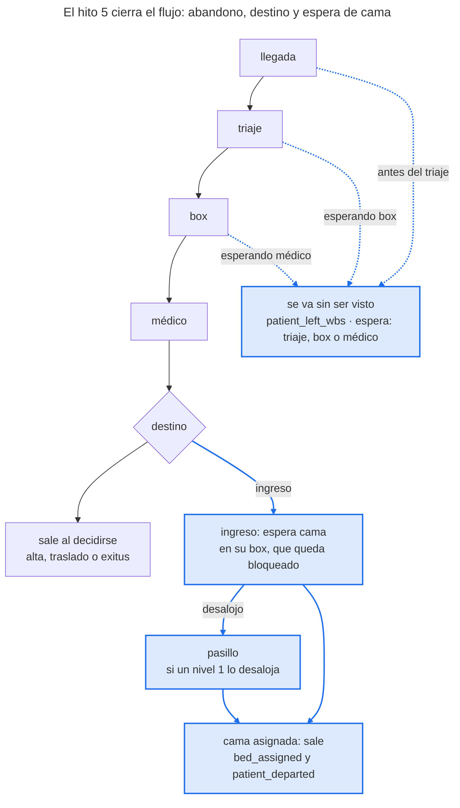

# Hito 5 — Cierre del flujo

> **Estado:** en curso. Especificación aprobada el 10 de noviembre de 2026; el original está en este repositorio.

Al terminar el hito 5, cada paciente de EDsim termina como en un hospital de verdad: puede irse sin ser visto si su espera supera su paciencia, sale con uno de cuatro destinos (alta, ingreso, traslado o exitus) que dependen de su gravedad real, su edad, su motivo y sus pruebas, y si ingresa espera la cama dentro de su box, que queda bloqueado. Es una especificación didáctica, con el formato de la del hito 6: cada pieza explica para qué sirve, cómo funciona, cómo se usa en EDsim y cómo aprender más. Las decisiones son candidatas (H5-n) y su número definitivo será 66 + n (H5-1 = 67, H5-13 = 79); la tarea de cierre escribe sus ADR 0067 a 0079. La sesión conceptual fue el 9 y el 10 de noviembre de 2026, y la implementación empieza con la etiqueta `v0.6-hito6`.

## Objetivo y alcance

Al cerrar el hito 5, `edsim motor simular` sin opciones simula el modelo del hito 5: con `config/` calibrado, alrededor del 2 % de los pacientes se va sin ser visto, alrededor del 10 % ingresa y espera cama en su box, y las colas largas de enero se cortan solas, porque los más impacientes se van. Lo que se guarda del modelo del hito 4 sigue significando lo mismo, byte a byte (H5-2).

**Por qué ahora.** El hito 6 se adelantó (decisión 48), pero la persistencia (hito 7) y la analítica (hito 8) no deben construirse sobre un modelo sin abandono ni boarding. La decisión 34 dejó este hito escrito: sin destino, boarding ni abandono, el ingreso, la estancia y la cola de los días punta salen mal por construcción. En la peor semana de enero de la semilla 2026 el nivel 5 llegaba a 3.897 min de espera.

**Dentro del alcance**

- **Abandono sin ser visto** (H5-3, H5-4): cada paciente sortea al llegar su paciencia (lognormal por nivel real, con un factor por banda de edad) y se va si su espera antes del primer médico la alcanza, desde tres sitios: antes del triaje, esperando box y esperando médico en el box.
- **Destino real** (H5-5): alta, ingreso, traslado o exitus, con una logística multinomial sobre la gravedad real G, la edad, el motivo (en el ingreso) y el número de pruebas alteradas, sorteada con Gumbel-max.
- **Espera de cama** (H5-6, H5-7): el ingresado pide cama y la espera en su box, que queda bloqueado; si un nivel 1 lo desaloja, la espera en el pasillo.
- **Catálogo versión 4** (H5-7) con `patient_left_wbs`, `bed_requested` y `bed_assigned`, `TERMINAL_EVENTS` de la versión 4 y su esquema `eventos-v4` generado.
- **Compatibilidad** (H5-2): sin los bloques nuevos, el modelo clínico del hito 4 escribe la versión 3 byte a byte; las huellas de las versiones 1 a 3 no cambian.
- **Métricas con abandono** (H5-8) y **ground truth** con todo lo sorteado, también lo que no llegó a usarse (H5-10).
- **Calibración** (H5-9): ingreso, traslado y exitus derivados; abandono y estancia de los ingresados ajustados; plantilla de la 4.6c medida de nuevo; la semana del 19 al 25 de enero, revisada.
- **Directo** (H5-11): el consumidor y «directo = batch» con la versión 4.
- **App** (H5-12): el núcleo en `runs/` y las páginas, los dos de Claude Code (cambio de Pedro del 12 de noviembre; antes, Codex).
- **Notebook** `05_cierre_del_flujo.ipynb`, ADR 0067 a 0079 y etiqueta `v0.5-hito5`.

**Fuera del alcance**

| Qué | Adónde va |
| --- | --- |
| Ruido de triaje que crece con la saturación (H5-1) | v2, con el re-triaje |
| Alta voluntaria: irse después de ver al médico | v2 |
| Camas de planta finitas, UCI con camas propias, espera de la ambulancia del traslado (boarding realista) | v2 |
| Observación y reconsultas en 72 h | v2 |
| Saturación que cambia decisiones clínicas (ingresos defensivos, valoraciones más cortas) | v2 |
| Circuitos de críticos y de leves | v1 |
| Rendimiento de la app (doble lectura del Replay, tabla de Episodios) | Tarea de proceso |
| Editar los perfiles desde la app | Fase 2 de la app |

Las tareas con código empiezan con `v0.6-hito6`. El núcleo y las páginas de la app los implementa Claude Code; las páginas eran de Codex hasta el cambio de Pedro del 12 de noviembre. Codex sigue en el hito con `@codex review` en las tareas críticas (la 5.6). Claude Code ejecuta git (rama, commits, push y PR) y Pedro siempre fusiona.

## Cómo encajan las piezas

El motor del hito 3, con el muestreador clínico del hito 4, sigue llevando al paciente de la llegada al médico; lo nuevo está en las esperas, donde puede irse, y en el final, donde cada destino tiene su camino.



En azul, lo nuevo del hito 5: el abandono, la espera de cama, el pasillo y la salida con cama.

Diagrama original: [pestaña archivada](https://claude.ai/artifact/8pd9CbSV9JTCm7MghHtMV9#b5b8255f-6e17).

Las tres flechas discontinuas son el abandono: solo antes del primer médico (pieza 1). Alta, traslado y exitus salen en el instante de la decisión, como hoy; el ingreso pide cama y la espera en su box (pieza 3). Todo lo sorteado sale del muestreador al llegar, con un flujo aleatorio por fuente (pieza 6), y lo oculto va al ground truth (pieza 7).

## Sesión conceptual resumida

La sesión conceptual está escrita en las piezas 1 a 7; esta tabla es el resumen de referencia. Si una fila no se entiende, la pieza la explica paso a paso.

| Concepto | Qué hay que entender | Pieza |
| --- | --- | --- |
| Paciencia | Los minutos que un paciente está dispuesto a esperar al médico. Nadie la ve; si su espera la alcanza, se va | 1 |
| Abandono sin ser visto | Irse antes del primer médico, desde tres sitios; SEMES lo mide antes y después del triaje | 1 |
| Lo observado no es la paciencia | De los que se van solo se ve cuánto esperaron, y solo se van los que tenían poca | 1 |
| Bucle saturación → abandono | Más cola, más esperas que superan la paciencia, más abandonos; y el abandono acorta la cola | 1 |
| Logística multinomial | Varias opciones, cada una con sus odds frente a una de referencia (el alta); la probabilidad es su parte del total | 2 |
| Odds ratio | El factor que multiplica las odds por cada unidad de una variable: multiplica, no suma | 2 |
| Gumbel-max (repaso) | Un sorteo por categoría y gana el mayor log w + g; al cambiar un peso solo cambian los que entran o salen de esa categoría | 2 |
| Boarding | El ingresado espera cama dentro de su box y lo bloquea | 3 |
| Ley de Little | Ocupación media = llegadas por unidad de tiempo × tiempo medio dentro | 3 |
| Sesgo de supervivencia | Medir solo a los que aguantaron hace parecer mejor un servicio que va peor | 4 |
| Censura | Saber solo que algo duró al menos X, no cuánto | 4 |
| Derivado, de ajuste y de comprobación | Lo que se calcula sin simular, lo que un mando ajusta simulando y lo que solo se mira | 5 |
| Mandos acoplados | Un mando mueve el objetivo de otro: se ajustan en orden, con una vuelta como máximo | 5 |
| Versión de un modelo | La configuración elige el modelo; lo antiguo se lee con su significado | 6 |
| Contrafactual | Lo que habría pasado: el simulador lo sabe, el hospital no | 7 |

## Pieza 1 — Abandono y paciencia

Cada paciente llega con una paciencia que nadie ve; si su espera hasta el primer médico la alcanza, se va sin ser visto. Con eso, las colas largas se cortan solas y EDsim tiene el indicador de calidad que todo servicio de urgencias vigila (H5-3, H5-4).

### Para qué sirve

- **Realismo de las colas.** Sin abandono, una cola que crece no se corta nunca: en la peor semana de enero de la semilla 2026 el nivel 5 llegaba a 3.897 min de espera (anexo de la 4.6c). En un hospital real, a partir de cierta espera la gente se va.
- **Un indicador que se mide en España.** SEMES pide dos: el índice de fugas antes de ser triados y el de fugas antes de ser visitados por el médico, con un estándar de como mucho el 2 % de los que acuden.
- **Seguridad.** Los que se van suelen ser jóvenes y leves, pero no todos: el ground truth sabe cuántos graves de verdad se fueron (pieza 7).
- **El bucle del diseño «saturación → abandono»**, sin programarlo: sale solo de las colas.

### Cómo funciona

**La paciencia es una variable oculta**, como la gravedad G. Se sortea al llegar con una lognormal por nivel real, con la conversión de siempre:

```latex
\mu = \ln(f_b \cdot \text{mediana}_n), \qquad \sigma_n = \frac{\ln(p_{90,n}) - \ln(\text{mediana}_n)}{1{,}28155}, \qquad \text{paciencia} = e^{\mu + \sigma_n z}
```

Con n el nivel real, f\_b el factor de su banda de edad (vale 1 si no se escribe) y z una normal estándar de su propio flujo. Ejemplo a mano con `[120, 360]`: σ = ln 3 / 1,28155 = 0,8573. El 20,9 % de esos pacientes tiene una paciencia de 60 min o menos, el 50 % de 120 o menos y el 79,1 % de 240 o menos. Con un factor 0,8 en la banda de 15 a 44 años, la mediana baja a 96 min y el 29,2 % aguanta 60 min o menos.

**Por qué el nivel real y no el asignado.** Antes del triaje el nivel asignado no existe, y el paciente no suele saber cuál le han puesto; lo que nota es cómo está. Así, un grave infratriado espera como un 4 pero casi nunca se va, y un leve sobretriado espera menos pero tiene poca paciencia.

**Dónde se puede ir** (H5-3). Solo antes de ser visto, es decir, antes de su primer `assessment_started` de tipo `inicial`, y en tres sitios:

| Sitio | Estado | `espera` en el evento |
| --- | --- | --- |
| Sala de espera, antes del triaje | Esperando enfermera | `triaje` |
| Sala de espera, después del triaje | Esperando box (también tras un desalojo, si aún no lo vio un médico) | `box` |
| Dentro del box | Esperando médico | `medico` |

No se va durante el triaje ni durante una valoración. El nivel 1 asignado nunca abandona: se clasifica en la puerta y va directo al box. Irse después de ver al médico es un alta voluntaria, de la v2.

**El reloj de la paciencia empieza en la llegada**, no en el triaje, porque la gente cuenta desde que cruza la puerta. En SimPy, cada espera pasa a ser «el recurso o la paciencia, lo que llegue antes»: una petición y un `timeout` hasta llegada + paciencia, unidos con `|` (un evento de condición). **Empate:** si la paciencia vence en el mismo instante en que le conceden el recurso, el paciente se queda. Es una regla nuestra, no del orden interno de SimPy, y la 5.1 la garantiza con un plazo que SimPy procesa al final de su instante, después de cualquier concesión de ese instante (ver «Reglas del abandono»).

**Lo que se observa no es la paciencia.** Los estudios dan cuánto esperaron los que se fueron: una mediana de 70 min en Florencia y de 103 min en Ontario, el doble de lo que esperaron los que se quedaron (51 min). Pero solo se van los que tenían poca paciencia: la de todos es mayor. Por eso la paciencia no se copia de un estudio, sino que se calibra para que salga el porcentaje de abandono observado (pieza 5).

**El bucle.** Si el servicio se satura, las esperas crecen, más esperas alcanzan su paciencia y más gente se va. Y al irse, la cola se acorta: es una realimentación negativa, que estabiliza. En Bellvitge, al bajar la permanencia media de 5,9 a 5,1 h, los que se iban sin ser visitados pasaron del 4,1 % al 1,7 %; en Ontario, la estancia mediana del centro fue lo que más se correlacionaba con su tasa de abandono (r = 0,62).

**Qué se sabe en España.** En el Clínic, el 1,8 % de 21.022 pacientes se fue sin ser atendido, con más riesgo por debajo de los 50 años. En el SAS de 2013, la «salida voluntaria» fue el 1,82 % de las urgencias; el informe no separa fugas, abandonos y altas voluntarias. En el Aljarafe, entre 2007 y 2017, las fugas fueron de 22 a 36 por 1.000 urgencias y las altas voluntarias, de 0,7 a 1,7 por 1.000. Un cuadro de mando publicado reparte una fuga del 4,5 % en 0,14 % antes del triaje, 3,2 % después del triaje y 1,2 % después de la evaluación, y el 90 % eran no críticos.

### En EDsim

- Los parámetros van en `perfiles.toml`, en `[abandono]`: `paciencia`, cinco pares `[mediana, p90]` por nivel real, y `paciencia_edad`, cuatro factores por banda (opcional, vale 1). Es un rasgo de los pacientes, no del hospital.
- La z de la paciencia sale del flujo 8, una normal por paciente, se use o no: los flujos 0 a 7 no cambian ni un bit (pieza 6).
- El evento `patient_left_wbs` lleva `espera`. Si el paciente estaba en un box, lo libera en ese instante, como una salida.
- El ground truth guarda la paciencia en minutos y su z (pieza 7). Una invariante nueva comprueba con él que cada abandono ocurre exactamente en llegada + paciencia y que nadie esperó más que su paciencia sin irse.

### Para aprender más

- Colas con abandono: el modelo Erlang-A, en Garnett, Mandelbaum y Reiman, «Designing a call center with impatient customers» (*Manufacturing & Service Operations Management*, 2002). Es la teoría de las centralitas, que se aplica igual a una sala de espera.
- SimPy, [eventos de condición](https://simpy.readthedocs.io/en/latest/topical_guides/events.html) (`|` y `&`): cómo esperar a lo primero que ocurra.
- [Shaikh et al., *Western Journal of Emergency Medicine* 2012](https://pmc.ncbi.nlm.nih.gov/articles/PMC3555587): una encuesta en la sala de espera; la mitad estaba dispuesta a esperar hasta 2 horas.
- Ejercicio propuesto: con el notebook 05, dibujar el porcentaje de abandono por hora de llegada frente a la espera media de esa hora.

## Pieza 2 — Destinos con logística multinomial

Cada paciente atendido sale con uno de cuatro destinos (alta, ingreso, traslado o exitus), elegido por una logística multinomial sobre su gravedad real, su edad, su motivo y sus pruebas alteradas (H5-5). Sustituye al destino provisional del hito 3, que solo miraba el nivel asignado.

### Para qué sirve

- **El caso de uso «predecir el ingreso desde el triaje»** necesita un ingreso que dependa de lo que de verdad lo causa, y que el triaje solo ve en parte.
- **El resultado de las pruebas, por fin con efecto.** Se sortea desde el hito 4 para que el flujo de pruebas no cambiara de consumo entre hitos (decisión 34).
- **Cada destino tiene su camino** en el motor: el ingreso espera cama (pieza 3); alta, traslado y exitus salen al decidirse.

### Cómo funciona

**Odds frente a una referencia.** El alta es la referencia. Cada uno de los otros tres destinos tiene unas odds frente al alta (cuántas veces más probable es que el alta), que parten de un valor base y se multiplican por un odds ratio por cada cosa que empuja hacia él:

```latex
\frac{P(d)}{P(\text{alta})} = \frac{p_{d,m}}{p_{\text{alta},m}} \cdot OR_{G,d}^{\,G} \cdot OR_{\text{mayor},d}^{\,\text{mayor}} \cdot OR_{\text{alt},d}^{\,k}, \qquad P(d) = \frac{\text{odds}_d}{1 + \sum_{d'} \text{odds}_{d'}}
```

Con G la gravedad real, mayor = 1 en las bandas desde 65 años, k el número de pruebas alteradas (0 a 4) y p\_{d,m} los porcentajes base de un adulto menor de 65 años con G = 0 y sin pruebas alteradas. Solo el ingreso tiene porcentaje base por motivo; traslado y exitus tienen uno global. Un odds ratio que no se escribe vale 1.

**Ejemplo a mano** (valores inventados para ver el mecanismo): base 6 % de ingreso, 0,5 % de traslado y 0,05 % de exitus; odds ratios de G de 3, 2 y 6; en el ingreso, 1,5 por prueba alterada y 2 para los mayores.

| Paciente | Alta | Ingreso | Traslado | Exitus |
| --- | --- | --- | --- | --- |
| Adulto, G = 0, sin alteradas | 93,45 % | 6,00 % | 0,50 % | 0,05 % |
| Adulto, G = 1 | 82,88 % | 15,96 % | 0,89 % | 0,27 % |
| Adulto, G = 2 | 61,79 % | 35,70 % | 1,32 % | 1,19 % |
| Adulto, G = 1, 2 alteradas | 69,09 % | 29,94 % | 0,74 % | 0,22 % |
| Mayor, G = 1 | 71,47 % | 27,53 % | 0,76 % | 0,23 % |
| Mayor, G = 1, 2 alteradas | 53,17 % | 46,09 % | 0,57 % | 0,17 % |

Los odds ratios multiplican odds, no suman puntos. Por eso subir el ingreso baja un poco el traslado y el exitus: se reparten el mismo 100 %.

**El sorteo, con Gumbel-max** (decisión 43). Al llegar se sortean cuatro Gumbel estándar g, una por destino, en el orden alta, ingreso, traslado, exitus; gana el destino de mayor log odds + g (el alta tiene log odds 0). Con g = (0,10; 1,90; 0,50; 0,20), un adulto con G = 1 tiene log odds (0; −1,6471; −4,5374; −5,7414), sumas (0,10; 0,2529; −4,0374; −5,5414) e ingresa. Con G = 0, el ingreso vale −2,7457 + 1,90 = −0,8457 y gana el alta. Mismos sorteos, otra gravedad: cambia el destino, y al cambiar un odds ratio solo cambian los pacientes que entran o salen de ese destino.

**Por qué la gravedad real.** El médico atiende al paciente que tiene delante: la regla del hito 4 (decisión 38) es el nivel asignado para la prioridad y la gravedad real para la clínica. Un nivel 2 infratriado como 4 espera como un 4 e ingresa como un 2.

**Las pruebas alteradas añaden información.** Que salgan alteradas ya depende de G; como cuentan aparte, de dos pacientes igual de graves ingresa más el que tiene la analítica alterada. Un paciente sin pruebas tiene k = 0.

**Los porcentajes del TOML no son los del paciente típico del motivo**, como en las pruebas del hito 4: son los de un adulto con G = 0. Lo que se lee clínicamente es la marginal de un año de cada motivo, que va en un comentario. Y el ingreso global no se elige a mano: los 17 porcentajes se eligen por su orden (la columna «Ingreso» del catálogo), y un factor común sobre sus odds se deriva para que el ingreso de un año sea el objetivo (pieza 5), con los valores escritos en el TOML. Lo mismo para traslado y exitus.

### En EDsim

- `perfiles.toml` gana `[destinos]` (los odds ratios de cada destino y las bases de traslado y exitus) y, en cada motivo, `ingreso`, el porcentaje base. Es un bloque de todo o nada (pieza 6).
- El destino usa el flujo 4: en el modelo del hito 5, cuatro Gumbel por paciente; en el del hito 4, la uniforme de siempre.
- `profiles/` gana las funciones exactas: la probabilidad de cada destino de un paciente y las marginales de un año, integrando sobre la mezcla de G y sobre el número de pruebas alteradas, sin simular.
- `config/centro.toml` pierde `[destino]`, que se sigue leyendo en los centros antiguos con su significado.

### Para aprender más

- Agresti, *An Introduction to Categorical Data Analysis*, el capítulo de modelos logit para respuestas multinomiales: la parametrización con categoría de referencia de esta pieza.
- El truco de Gumbel-max: la sección [«Motivos de consulta»](hito-4.md#motivos-de-consulta) de la especificación del hito 4 y el notebook 04.
- Ejercicio propuesto: con el notebook 05, ajustar una regresión logística de ingreso con lo que ve el hospital (nivel asignado, edad, motivo, pruebas) y comparar sus coeficientes con los odds ratios verdaderos del TOML.

## Pieza 3 — La espera de cama y los boxes bloqueados

Un paciente con destino «ingreso» no se va al decidirse: pide cama y la espera dentro de su box, que nadie más puede usar. La espera es una lognormal multiplicada por un factor del turno en que se pide (H5-6), y si un nivel 1 desaloja al paciente, la espera sigue en el pasillo (H5-7).

### Para qué sirve

- **El tercer bucle del diseño:** más ingresos esperando cama, menos boxes libres, más cola, más abandono. En la literatura se llama *boarding* o *access block*, y es la causa más citada de la saturación.
- **La estancia de los ingresados.** En el SAS de 2013, un ingresado sin observación pasaba de media 472,5 min en urgencias y el 49,69 % más de 4 horas, frente a 162,2 min de media de todos los pacientes sin observación.
- **Un experimento estrella** para la app: «¿y si dieran las camas más rápido?».

### Cómo funciona

**La espera de cada ingresado.** Se sortea al llegar una normal z de su propio flujo y se transforma cuando se pide la cama, igual que la respuesta de las pruebas con la franja del pedido (hito 4):

```latex
\text{espera} = c_{\text{turno}(t)} \cdot c_{\text{estación}} \cdot e^{\mu + \sigma z}, \qquad \mu = \ln(\text{mediana}), \quad \sigma = \frac{\ln(p_{90}) - \ln(\text{mediana})}{1{,}28155}
```

Con t el instante de `bed_requested` y el turno, el de `[turnos]` del centro en ese instante: la espera de cama es del hospital, no del paciente. Ejemplo a mano con `[240, 720]` (σ = 0,8573): con z = 0, 240 min; si se pide de noche con un factor 1,5, 360 min; con z = 1,28155, 720 min y, de noche, 1.080. El factor de estación es opcional y vale 1.

**Por qué un factor por turno.** Las camas de planta se liberan sobre todo con las altas de la mañana: quien pide cama de madrugada espera hasta que alguien se vaya de planta. Multiplicar una lognormal por un factor equivale a multiplicar su mediana, así que el paciente conserva su percentil (pieza de pruebas del hito 4).

**Cuántos boxes bloquea: la ley de Little.** En cualquier sistema estable, el número medio de clientes dentro es la tasa de llegada por el tiempo medio que pasan dentro: L = λ · W. Aquí, los «clientes» son los ingresados esperando cama:

- llegan unos 317 pacientes al día y el 9,90 % ingresa: λ = 31,4 ingresos al día;
- la media de una lognormal es mediana · e^{σ²/2}: con `[240, 720]`, W = 346,6 min;
- L = 31,4 · 346,6 / 1.440 = **7,55 boxes ocupados de media por pacientes esperando cama**, de 30.

Hoy hay 16,5 boxes ocupados de media (tarea 4.6a). Con la espera de cama, las horas punta se llenan, y como los boxes siguen fijos en 30 (decisión 41), parte de la espera hasta el médico pasará a ser espera de box. Es una estimación de orden de magnitud, sin los factores de turno; la 5.6 la mide.

**El pasillo.** El ingresado sigue en su box con su clave de prioridad, así que un nivel 1 que llega con todo lleno puede desalojarlo (decisión 25). Ya está atendido, así que no vuelve a pedir box: sale al pasillo y espera allí la cama. La espera corre por su cuenta, como el laboratorio, y la cama le llega igual. Un ingresado de nivel 1 nunca es desalojado.

**Por qué no camas finitas** (la opción descartada en H5-6). Una planta de N camas con estancias de unos 7 días (6,82 de media en Valencia, 2023) arranca vacía y tarda semanas en llenarse: el calentamiento pasaría de 2 días a unas 4 semanas, y cada evaluación de la calibración, a más del triple. Faltarían también los ingresos programados y la hora de las altas de planta. Es el boarding realista de la v2.

**Qué se sabe en España.** Depende mucho del hospital: en un comarcal de Zaragoza, 5 h 57 min de demora del ingreso; en Valencia, el 68,9 % de 13.214 ingresos estuvo más de 6 horas; en un terciario, una estancia media de los ingresados de 22,8 horas, con el 15 % por encima de 24; en La Paz, 4.064 de 8.439 mayores de 75 años esperaron cama más de 24 horas.

### En EDsim

- `centro.toml` gana `[camas]`: `espera = [mediana, p90]`, `factor_turno` (tres factores, mañana, tarde y noche) y `factor_estacion` (cuatro, opcional, vale 1). Sustituye a `[destino]` en los centros del hito 5 (pieza 6).
- La z sale del flujo 9, una normal por paciente, ingrese o no.
- En el motor, la espera es un `timeout` del propio paciente (ajuste de la 5.1, ver «Reglas de la espera de cama»): al acabar emite `bed_assigned` y `patient_departed` en el mismo paso, esté en el box o en el pasillo; tras un desalojo, espera el mismo `timeout` en el pasillo.
- El estado del consumidor gana «esperando cama», con una marca «en el pasillo» (H5-11).

### Para aprender más

- La ley de Little: J. D. C. Little, «A proof for the queuing formula L = λW» (*Operations Research*, 1961), y cualquier introducción a la teoría de colas; la usamos ya en el hito 1 con la M/M/1.
- Forero, McCarthy y Hillman, «Access block and emergency department overcrowding» (*Critical Care*, 2011): qué es el bloqueo de acceso y por qué satura las urgencias.
- [Carballo et al., *Emergencias* 2026](https://revistaemergencias.org/wp-content/uploads/2026/06/5345_ORIGINAL_Carballo_V3.pdf): el límite de 24 horas y la mortalidad atribuible al retraso del ingreso.
- Ejercicio propuesto: con el notebook 05, comprobar la ley de Little en una ejecución: boxes ocupados por ingresados de media frente a ingresos por minuto × espera media.

## Pieza 4 — Medir con abandono: supervivencia y censura

Con el abandono, los pacientes que más esperan son los que se van, y quitarlos de las métricas haría parecer mejor un servicio que va peor. Cada métrica sigue la regla de su fuente, el cumplimiento cuenta los incumplimientos seguros y el abandono tiene sus propios indicadores (H5-8).

### Para qué sirve

Para que un día malo parezca malo. Si el abandono mejorara el cumplimiento, un panel del hito 8 premiaría los días en que más gente se fue, y un modelo entrenado con esos datos aprendería lo contrario de lo que pasa.

### Cómo funciona

**Sesgo de supervivencia.** Si solo se mide a los que llegaron al final, el resultado depende de quién llegó. Tres pacientes de nivel 4 (máximo de Manchester, 120 min):

| Paciente | Qué pasa | Para la media de espera | Para el cumplimiento |
| --- | --- | --- | --- |
| 1 | Ve al médico a los 30 min | 30 | Cumple |
| 2 | Ve al médico a los 90 min | 90 | Cumple |
| 3 | Se va a los 150 min sin ser visto | No cuenta (no tiene médico) | Incumple: esperó al menos 150 > 120 |

Media de espera de los atendidos: 60 min. Cumplimiento: 2 de 3, el 66,7 %. Quitando al paciente 3 del cumplimiento saldría un 100 %.

**Censura.** Un dato censurado es uno del que solo sabemos que duró al menos X. El paciente 3 es un dato censurado de «tiempo hasta el médico»: no sabemos cuánto habría esperado, pero sí que fueron más de 150 min, y eso basta para saber que incumplió. Si se hubiera ido a los 20 min, no sabríamos si lo habrían atendido antes de 120: no cuenta ni como cumplimiento ni como incumplimiento. Es la misma idea que los censurados del día de vaciado de la 4.6c, los que siguen dentro al final del horizonte.

**Las reglas** (H5-8):

| Métrica | Regla con abandono | Por qué |
| --- | --- | --- |
| Medias de los relojes A, B y C | Solo los atendidos | Como el TPAM del SAS, que mide a los que vio un médico: la calibración compara lo mismo con lo mismo |
| Pretriaje medio y porcentaje > 5 min | Solo los triados | Como el indicador del SAS |
| Cumplimiento Manchester (reloj C) | Quien se va después de su máximo, incumplimiento; quien se va antes, censurado (no cuenta) | Más abandono nunca mejora el cumplimiento |
| Estancia en urgencias | Por destino; los que se van, aparte, con su tiempo hasta irse | Como el TPU del SAS por tipo de alta |

Para el cumplimiento con el reloj C hace falta la clasificación: quien se va antes del triaje no tiene nivel y no entra, con ningún reloj y tampoco en el cumplimiento por nivel real, aunque el ground truth le dé nivel. Su abandono cuenta en el indicador de «antes del triaje».

**Precisiones de la 5.4:**

- **El máximo exacto.** Quien se va con su reloj justo en el máximo incumple. Quien se va en el instante t no fue visto en t (con el empate, se habría quedado), así que su espera hasta el médico habría sido mayor que el máximo.
- **El reloj de quien se va depende de la medida:** con C, desde la clasificación; con B, desde el inicio del triaje, y con A, desde la llegada.
- **Medias y cuantiles con censurados** (la espera de cama y la estancia de quien sigue dentro en el horizonte). Un cuantil crece cuando crece uno de sus valores. Con los censurados en su cota inferior sale el mínimo posible y, con ellos por encima de todo, el máximo. Si coinciden, el valor es exacto; si no, se da la cota («≥»). La media con censurados es siempre una cota.
- **Umbrales con censurados.** Para un porcentaje por encima de un umbral (las 6, 12 y 24 horas de cama, las 4 horas de los ingresados), el censurado que ya lo pasó cuenta por encima, y el que no, como desconocido. Quitar a los censurados acortaría las esperas.
- **Denominadores.** Los porcentajes globales de abandono y de destino van sobre las llegadas de la ventana; los de nivel asignado, sobre los clasificados con ese nivel.

**Indicadores nuevos** (los observables, desde el log):

- porcentaje de abandono, global y por nivel asignado, separado en antes y después del triaje (los dos indicadores de SEMES), y por sitio (`espera`);
- porcentaje de ingreso, de traslado y de exitus, global y por nivel asignado;
- espera de cama (de `bed_requested` a `bed_assigned`): mediana, p90 y porcentaje por encima de 6, 12 y 24 horas;
- estancia en urgencias por destino, y porcentaje de ingresados con más de 4 horas;
- boxes ocupados por pacientes esperando cama, y pacientes en el pasillo.

**Indicadores que solo da el ground truth** (nunca en el log ni en los KPI observables, como el cumplimiento por nivel real del hito 4): abandono por nivel real, cuántos de los que se fueron eran graves de verdad, y cuántos habrían ingresado (pieza 7).

### En EDsim

- `EpisodeRecord` gana el abandono (instante y sitio), el destino con cuatro valores, la espera de cama y la marca de pasillo. Los relojes de quien se va quedan vacíos, como los de quien sigue dentro al final.
- `manchester_compliance` y `window_compliance` aplican la regla de la censura; con el modelo del hito 4 (sin abandono) dan exactamente lo de antes.
- `runs/` gana los indicadores nuevos para la app, de forma aditiva: campos al final y parámetros con el valor de antes por defecto.

### Para aprender más

- El estimador de Kaplan–Meier, la herramienta clásica para datos censurados. En Python, la biblioteca [lifelines](https://lifelines.readthedocs.io/) lo explica con ejemplos.
- Sesgo de supervivencia: el ejemplo de Abraham Wald y los aviones de la Segunda Guerra Mundial, que reforzaba las zonas sin impactos de los que volvían.
- Ejercicio propuesto: con el log de una ejecución, estimar con Kaplan–Meier la paciencia de los pacientes (el abandono es el evento; ver al médico, la censura) y compararla con la paciencia verdadera del ground truth. Es la forma correcta de responder a la pregunta de la pieza 1: cuánto aguanta la gente.

## Pieza 5 — Calibrar con mandos acoplados

El hito 5 añade cinco objetivos del SAS a los del hito 4: tres se calculan sin simular, dos se ajustan con un mando propio cada uno, y el resto solo se comprueba. Como los mandos se influyen entre sí, se ajustan en un orden fijo, y la plantilla de la 4.6c solo cambia si se sale de su horquilla (H5-9).

### Para qué sirve

Para que el centro base siga pareciéndose a un hospital andaluz real cuando sus pacientes empiezan a irse y a esperar cama. Un modelo con abandono y boarding pero calibrado como si no los tuviera señalaría el problema equivocado.

### Cómo funciona

**Tres tipos de objetivo.**

1. **Derivado.** El porcentaje depende solo de cómo es el paciente (G, edad, motivo, pruebas), no de las colas. Se calcula exacto una vez, se escribe en el TOML con el comando en un comentario y un test comprueba «escritos = recalculados», como los umbrales del triaje (patrón «derivado y escrito»).
2. **De ajuste.** Depende de las esperas, así que solo se sabe simulando. Un mando lo mueve y se elige con las reglas de la decisión 41: ventana anual (una réplica de 14 días por mes), semilla 2026 para elegir, 2027 que puede vetar y 2028 para confirmar después de un veto.
3. **De comprobación.** Nunca elige; si encaja, el modelo tiene algo de verdad.

**Los objetivos nuevos** (SAS, CMBD de urgencias 2013, sin observación, que EDsim no tiene; incluye menores salvo el ingreso convertido):

| Objetivo | Referencia | Horquilla | Tipo | Qué lo mueve |
| --- | --- | --- | --- | --- |
| Ingreso, adultos | 9,90 % | 8–13 % | Derivado (y comprobado en la simulación) | Un factor común sobre las odds base de ingreso por motivo |
| Traslado | 0,75 % | — | Derivado | Su odds base |
| Exitus | 0,11 % | — | Derivado | Su odds base |
| Abandono | 1,82 % | 1–4 % | Ajuste | Un factor común sobre las medianas y los p90 de paciencia |
| Estancia media de los ingresados | 472,5 min | 360–600 | Ajuste | La mediana de la espera de cama (el p90, por criterio) |
| Ingresados con más de 4 h | 49,69 % | 35–65 % | Comprobación | — |
| Estancia media, todos los atendidos | 162,2 min | 120–210 | Comprobación | Las duraciones, fijas por criterio (decisión 41) |
| Ingreso por nivel asignado | 46,5 / 25,1 / 11,0 / 3,9 / 7,4 % | — | Informe | Nada directo: sale de G y del triaje |

**El ingreso de adultos, cálculo propio.** El SAS da un 8,55 % de ingresos en todas las edades y un 3,47 % en los menores de 15 años. Con la regla del hito 4 de que los menores son una de cada cinco urgencias: (8,55 − 0,21 × 3,47) / 0,79 = 9,90 %. El SNS de 2024 da un 10,1 % en todas las edades (Andalucía, 7,5 %).

**Las horquillas del abandono** van del 1,8 % del Clínic al 3,6 % del peor año del Aljarafe, con el 4,1 % de Bellvitge antes de su reorganización como referencia alta; el estándar es como mucho el 2 %.

**Por qué la estancia de todos no se ajusta.** El único mando que la movería son las duraciones de valoración y reevaluación, y moverlas obliga a repetir la calibración de los médicos del hito 4: más duración es más carga. Como comprobación, dice si las duraciones elegidas por criterio eran razonables. Estimación a mano, sin simular: unos 42 min hasta el médico, 24 de valoración, el 72,75 % con una ronda de pruebas de una hora larga y 8 de reevaluación, del orden de 130 a 150 min sin la espera de cama. Lo mide la 5.6.

**Mandos acoplados y orden.** La paciencia se ajusta mirando cuánta gente se va; eso depende de la espera, que depende de los médicos y de los boxes bloqueados por la espera de cama. Y el tiempo hasta el médico, objetivo de los médicos, cambia en sentidos opuestos: lo baja el abandono (quedan menos en la cola y solo se mide a los atendidos) y lo sube la espera de cama (menos boxes libres). El orden (H5-9):

1. Los destinos, derivados, sin simular.
2. Con la plantilla de la 4.6c fija (`[3, 2, 1]` y `[12, 11, 4]`), la paciencia contra el abandono y la espera de cama contra la estancia de los ingresados.
3. Se vuelven a medir los objetivos del hito 4 (pretriaje y reloj A de los niveles 2 a 5) con el modelo nuevo, con las reglas de la 4.6c. Si pasan, la plantilla no cambia.
4. Si alguno se sale, se repite la sensibilidad de ese mando con la regla de la plantilla equivalente y se vuelven a comprobar el abandono y la estancia de los ingresados. Una sola vuelta: si no cuadra, la tarea para y se decide con Pedro.
5. El centro cumplidor vuelve a elegir sus médicos con su regla de siempre (como mucho el 10 % de días fuera con el reloj C, con días enteros).

Si los boxes pasan a ser el cuello de botella por la espera de cama, siguen fijos en 30 (decisión 41): cambiarlos se decide con Pedro, con los resultados delante. Pasó en la 5.6, y Pedro decidió el 12 de noviembre que los boxes son un derivado: los 30 del hito 4, calibrado sin boxes ocupados por ingresados, más los que ocupa de media la espera de cama (ley de Little, λ · W redondeado), 36 con la cama y la paciencia calibradas ([registro](../calibracion/registro.md), «Tarea 5.6»). Y la semana del 19 al 25 de enero de la semilla 2026 se vuelve a medir con el modelo nuevo y se escribe en el registro, sin objetivo: es el pendiente del hito 4.

### En EDsim

- `config/objetivos.toml` gana los objetivos nuevos, con medidas nuevas (abandono y estancia por destino); el plan de la 5.6 propone sus nombres y el esquema.
- `calibration/` gana los dos mandos nuevos (paciencia y espera de cama) y conserva la regla, la ventana y el veto. Cada valor elegido se escribe en `config/` con el comando que lo calcula, y el registro de calibración gana una sección de la 5.6.
- Es la tarea que pone los bloques del hito 5 en `config/`: desde su PR, el modelo por defecto es el del hito 5.

### Para aprender más

- La sección [«Calibración»](hito-4.md#calibración) de la especificación del hito 4 y el [registro de calibración](https://github.com/pdromer0/edsim/blob/main/docs/calibracion/registro.md): las reglas contra el sobreajuste y la identificabilidad.
- Ejercicio propuesto: dibujar el abandono frente al factor de paciencia con dos plantillas de médicos; las dos curvas muestran el acoplamiento.

## Pieza 6 — Versiones de un modelo

El hito 5 no sustituye al modelo del hito 4: lo añade. Unos ficheros con los bloques nuevos eligen el modelo del hito 5 y escriben la versión 4 del catálogo; sin ellos, todo es exactamente como antes, byte a byte (H5-2).

### Para qué sirve

Para que lo ya escrito no cambie de significado. Hay tres cosas escritas con el modelo del hito 4: las huellas SHA-256 de los tests, las ejecuciones guardadas en `resultados/ejecuciones/` (con sus copias de `centro.toml` y `perfiles.toml`) y las variantes que la app guardó en `resultados/variantes/`. Con esta regla, las tres siguen valiendo, y lo nuevo es el modelo por defecto sin que haya que pedirlo.

### Cómo funciona

**La regla, por tercera vez.** Escribir lo nuevo y leer lo antiguo con su significado: ya la aplicamos con `espera_resultados_fuera` (si falta, vale `[]`) y con el bloque provisional del centro (tarea 4.9). Ahora la aplicamos a un bloque de dos ficheros:

| Modelo | `perfiles.toml` | `centro.toml` | Escribe | Flujos |
| --- | --- | --- | --- | --- |
| Provisional (hito 3) | No se usa | Bloque provisional y `[destino]` | Versión 1 | `child_streams(seed, 5)` |
| Clínico del hito 4 | Sin `[abandono]`, sin `[destinos]` y sin `ingreso` en los motivos | `[destino]`, sin `[camas]` | Versión 3 | `child_streams(seed, 8)` |
| Clínico del hito 5 | Con `[abandono]`, `[destinos]` e `ingreso` en los 17 motivos | `[camas]`, sin `[destino]` | Versión 4 | `child_streams(seed, 10)` |

Un bloque a medias (`[abandono]` sin `[destinos]`, `ingreso` en algunos motivos y no en otros, o unos perfiles del hito 5 con un centro del hito 4) es un error que dice qué falta y en qué fichero. Un centro con `[destino]` y `[camas]` a la vez, también.

**Los flujos.** Cada hijo de `child_streams` depende solo de su índice, así que pedir 10 hijos da los mismos 8 primeros que pedir 8: las llegadas, la persona, el motivo, la gravedad, el triaje, las pruebas y las duraciones no cambian ni un bit al pasar al hito 5 (decisión 43). Lo que cambia:

| Flujo | Fuente | Hito 4 | Hito 5 |
| --- | --- | --- | --- |
| 4 | Destino | 1 uniforme (provisional, con el nivel asignado) | 4 Gumbel (multinomial) |
| 8 | Paciencia | — | 1 normal |
| 9 | Espera de cama | — | 1 normal |

**El catálogo versión 4** entra en `CATALOGS`, con su `TERMINAL_EVENTS` (`patient_departed` y `patient_left_wbs`), y su esquema `schemas/eventos-v4.schema.json` sale del generador de la 6.4. Los logs de las versiones 1 a 3 se siguen leyendo y validando con el catálogo de su versión, como hasta ahora.

**Lo que hay que releer.** `CLINICAL_SCHEMA_VERSIONS` (las versiones con payloads clínicos) gana la 4. Es una constante que leen varios módulos, y la lección del hito 4 es que un supuesto implícito se rompe cuando entra un valor nuevo: el plan de la 5.1 busca a todos sus lectores. Las huellas de las versiones 1 a 3 no cambian, y un test lo comprueba con la suite completa; el modelo del hito 5 tiene las suyas, con ficheros de ejemplo nuevos en `tests/data/`.

### En EDsim

- La elección del modelo vive en la carga de los ficheros, como la del bloque provisional, y el motor tiene una rama explícita: sin los sorteos del hito 5, exactamente el código del hito 4, como ya hay una rama exacta para el provisional.
- `config/` lleva los bloques desde la 5.6: hasta entonces, el modelo por defecto sigue siendo el del hito 4 (decisión 44: el modelo nuevo no pasa a ser el de por defecto hasta que la app lo soporta).
- «Directo = batch» gana un caso de la versión 4.

### Para aprender más

- La [pieza 4](hito-6.md#pieza-4--contratos-json-schema-y-versiones-del-catálogo) de la especificación del hito 6 (contratos y versiones del catálogo), con la compatibilidad hacia atrás y hacia delante.
- *Designing Data-Intensive Applications*, el capítulo de codificación y evolución.
- Ejercicio propuesto: validar una línea de un log de la versión 4 contra el esquema de la versión 3 y leer el error.

## Pieza 7 — El ground truth contrafactual

El ground truth guarda todo lo que se sorteó para cada paciente, también lo que no llegó a usarse: la paciencia de quien vio al médico, el destino de quien se fue y la espera de cama de quien no ingresó (H5-10). Así EDsim sabe algo que ningún hospital sabe: qué le habría pasado a cada paciente si se hubiera quedado.

### Para qué sirve

- **El daño oculto del abandono.** «¿Cuántos de los que se fueron habrían ingresado?» Ningún hospital lo sabe, porque el que se va no vuelve a pasar por la decisión. En el Clínic ya avisaban de que los remitidos por otro médico y valorados como graves a su llegada son los que más riesgo tienen de ingresar después.
- **Validar modelos con una verdad completa.** Un modelo de «predecir el ingreso» o «predecir el abandono» se puede evaluar también con los que se fueron.
- **Reconstruir cada paciente bit a bit** desde una fila del CSV, como hoy.

### Cómo funciona

**Todo se sortea al llegar**, en orden fijo y con un número fijo de sorteos por flujo (decisión 24): la paciencia, el destino y la espera de cama existen para todos los pacientes desde el primer instante, aunque luego solo se use una parte. El motor decide qué se usa; el ground truth guarda todo.

**Qué gana cada episodio:**

| Campo | Contenido | Para quién se usa |
| --- | --- | --- |
| `z_paciencia`, `paciencia` | La normal del flujo 8 y la paciencia en minutos | Para todos los que esperan; los que ven al médico no la agotan |
| `sorteo_destino_<d>` (4) y `destino` | Las cuatro Gumbel del flujo 4 y el destino que salió | Para los que llegan a la decisión; para los que se fueron, es el contrafactual |
| `z_cama`, `espera_cama_base` | La normal del flujo 9 y la espera base (factor 1) | Para los ingresados; la de su turno se reconstruye con el instante de `bed_requested` |

**Lo observado frente a lo verdadero**, el patrón del hito 4 con el nivel asignado y el real:

| Pregunta | El log (lo que ve el hospital) | El ground truth |
| --- | --- | --- |
| ¿Se fue? | `patient_left_wbs` y su `espera` | La paciencia, y que se fue exactamente en llegada + paciencia |
| ¿A dónde iba? | Solo si llegó a la decisión | Siempre: el destino sorteado |
| ¿Cuánto esperó la cama? | De `bed_requested` a `bed_assigned` | La espera base y su z |

**Nada de esto va al log** (decisión 28): ningún catálogo lleva la paciencia ni el destino de quien se fue, y un test lo comprueba, como con G y el nivel real.

### En EDsim

- `EpisodeTruth` gana un campo con la verdad del hito 5 (`None` con los modelos anteriores, sin otros cambios), y el CSV del ground truth clínico gana sus columnas al final. Un CSV antiguo, sin ellas, se lee como del hito 4 (pieza 6).
- `run.json` dice que la ejecución es del modelo del hito 5; un `run.json` antiguo se lee como hasta ahora.
- «Ver la verdad» de la app enseña la paciencia y, a quien se fue, el destino que habría tenido (H5-12).
- El emparejamiento de la tarea 4.8a (`pairing_category`) sigue funcionando: dos ejecuciones de modelos distintos no son los mismos pacientes.

### Para aprender más

- Inferencia causal con resultados potenciales: Hernán y Robins, *Causal Inference: What If* (libro gratuito en la web de Harvard), capítulo 1. El contrafactual de esta pieza es exactamente un «resultado potencial» que en datos reales nunca se observa.
- El caso de uso «Inferencia causal con respuesta conocida» de los [casos de uso](../diseno.md#casos-de-uso) del diseño.
- Ejercicio propuesto: con el notebook 05, comparar el porcentaje de ingreso de los que se quedaron con el de los que se fueron (con su destino contrafactual), por nivel asignado.

## Especificación: catálogo v4 y máquina de estados

La versión 4 es la versión 3 más tres eventos y dos destinos (H5-7); la escribe solo el modelo del hito 5. Los demás tipos son los mismos objetos de la versión 3.

### Eventos

| Evento | Sistema | Cuándo | Payload |
| --- | --- | --- | --- |
| `patient_left_wbs` (nuevo) | `his` | Su paciencia vence antes del primer médico | `espera`: `"triaje"`, `"box"` o `"medico"` |
| `disposition_decided` | `his` | Al acabar la última valoración, como hoy | `destino`: `"alta"`, `"ingreso"`, `"traslado"` o `"exitus"` |
| `bed_requested` (nuevo) | `his` | En el mismo instante de una decisión de ingreso | `servicio`: `"planta"` |
| `bed_assigned` (nuevo) | `admision` | Al acabar la espera de cama | `servicio`: `"planta"` |
| `patient_departed` | `his` | Al decidirse (alta, traslado, exitus) o con la cama (ingreso) | `destino`, el mismo de la decisión |

`servicio` tiene un solo valor: está en el catálogo del diseño, y la UCI de la v2 lo ampliará en otra versión. `TERMINAL_EVENTS[4]` = {`patient_departed`, `patient_left_wbs`}. El literal de valores aceptados de la versión 4 es el de la 3 más `espera` (los tres sitios), los cuatro destinos y `servicio`.

### Cómo termina cada paciente

| Final | Secuencia | El box |
| --- | --- | --- |
| Alta, traslado o exitus | `disposition_decided` y `patient_departed` en el mismo instante | Libre al salir, como hoy |
| Ingreso | `disposition_decided` y `bed_requested` en el mismo instante; después, `bed_assigned` y `patient_departed` en el mismo instante | Ocupado hasta la salida |
| Ingreso desalojado | Lo anterior, con un `patient_displaced` en medio y sin otro `box_assigned` | Pasa al nivel 1 que desaloja; el paciente espera en el pasillo |
| Abandono | `patient_left_wbs`, sin decisión de destino | Si tenía box, libre en ese instante |

Como hoy, un evento que libera un box se emite antes de devolverlo: quien lo recibe va detrás en el log, en el mismo instante.

### Reglas del abandono (H5-3, H5-4)

- **Visto** = tiene un `assessment_started` de tipo `inicial`. Antes, el paciente puede irse; después, nunca, aunque luego espere en la sala de resultados, en un desalojo o en la espera de cama.
- **Plazo:** llegada + paciencia, en minutos de simulación. Cada espera de enfermera, de box o de médico antes de ser visto es «el recurso o el plazo, lo que llegue antes». Al vencer el plazo se cancela la petición pendiente y se emite `patient_left_wbs` con el sitio; si el paciente se va desde un box (sitio `medico`), libera ese box, el que ya tenía. Por el empate, nunca se va con una petición recién concedida. Los sitios:
  - `triaje`: sin `triage_started`;
  - `box`: triado y sin box, también tras un desalojo antes de ser visto;
  - `medico`: en un box, esperando la valoración inicial.
- **Empate:** si el plazo vence en el mismo instante en que se le concede el recurso, se queda. En SimPy 4.1.2 el orden de los eventos de un instante es la prioridad y después el orden de creación (`Environment.schedule`), así que un `timeout` normal haría depender el empate de quién se creó antes; el plazo es un evento de prioridad propia, posterior a la normal, que se procesa después de todo lo demás de su instante.
- **Plazo vencido durante el triaje** (ajuste de la 5.1, decisión 70): nadie abandona en el triaje, pero el plazo sigue corriendo. Si vence durante él, al acabar el triaje el paciente se va en ese mismo instante, con el sitio de la espera en que esté (`box`, o `medico` si recibe box pero no médico), salvo que reciba box y médico en ese instante. El abandono ocurre así en max(llegada + paciencia, fin del triaje).
- **Nunca abandona** el nivel 1 asignado (puerta y box con desalojo) ni nadie durante el triaje o una valoración.
- La reserva de capacidad por turnos (`shifts.py`) no cambia: un abandono solo quita una petición de la cola.

### Reglas de la espera de cama (H5-6, H5-7)

- Con la decisión de ingreso, el paciente pide cama y espera un `timeout` propio de `base × factor_turno(t) × factor_estacion`, con t el instante de `bed_requested`, el turno de `[turnos]` del centro en t y la estación de la fecha de t.
- Mientras espera, el paciente conserva su box y su petición con su clave de siempre, `priority_key(nivel, llegada)`, y no usa médico.
- **Desalojo:** si un nivel 1 lo desaloja (la regla de `should_displace` no cambia), emite `patient_displaced`, el box pasa al nivel 1 y el paciente espera en el pasillo, sin recurso y sin volver a pedir box. Un ingresado de nivel 1 nunca es desalojado.
- Al acabar la espera: `bed_assigned` y `patient_departed` con destino `ingreso`, esté en el box o en el pasillo. Los emite el paciente en el mismo paso de SimPy (ajuste de la 5.1, en lugar de un proceso aparte como `_lab`): entre los dos no se cuela ningún evento, ni el desalojo de un nivel 1 que llegue en el instante exacto de la cama. El `timeout` de la cama sigue en la cola durante el desalojo, y el paciente lo vuelve a esperar en el pasillo.

### Invariantes

Nuevas o ampliadas, en `CHECKS`, solo con logs de la versión 4 salvo que se diga otra cosa:

| Invariante | Qué exige |
| --- | --- |
| `transitions` | Los estados nuevos: el abandono desde la espera de enfermera, la espera de box antes de ser visto y la espera de médico antes de la valoración inicial; tras una decisión de ingreso, la espera de cama (en el box o, tras un desalojo, en el pasillo) y la salida solo con `bed_assigned` |
| `conservation` | Llegadas = salidas + abandonos + dentro; un solo evento terminal por episodio |
| `time` | Ningún evento del episodio después de su evento terminal |
| `capacity` y `displacement` | El box se libera también con un `patient_left_wbs` desde el box y con el desalojo de un ingresado; un ingresado desalojado no vuelve a tener `box_assigned` |
| `abandonment` (nueva) | Ningún `patient_left_wbs` después de ser visto ni de un nivel 1 asignado; la `espera` coincide con el estado; con el ground truth, el abandono ocurre en llegada + paciencia si el plazo vence antes de empezar el triaje, y en max(llegada + paciencia, fin del triaje) si vence durante él (tolerancia 1e-8); nadie es visto después de su plazo, salvo quien, tras un triaje durante el cual venció, recibe box y médico en el instante en que lo acaba; y nadie sigue esperando sin ser visto al final con ese instante antes del horizonte (ajustes de la 5.3) |
| `outcome` (nueva) | `bed_requested` solo tras una decisión de ingreso y en su instante; `bed_assigned` y la salida en el mismo instante; el destino de la salida es el de la decisión; con el ground truth, la decisión es el destino sorteado; con el ground truth y el centro, la espera de cama es base × factores (tolerancia 1e-8) |
| `door`, `schema_version`, `clinical`, `results_wait` | Igual que en la versión 3; la 4 entra en las versiones con payloads clínicos y en `results_wait` |

Las invariantes de las versiones 1 a 3 no cambian: un log de la 3 da exactamente las mismas violaciones que hoy.

## Especificación: muestreadores, flujos y ficheros

El modelo del hito 5 es el muestreador clínico del hito 4 más un muestreador de desenlace (paciencia, destino y espera de cama), con tres flujos; el motor lee sus sorteos por un campo nuevo de `PatientDraws`, y sin él hace exactamente lo del hito 4. Los nombres son propuestos: el plan de cada tarea los confirma.

### Flujos y consumo

`child_streams(seed, 10)`; los hijos 0 a 7 son los del hito 4 bit a bit (decisión 43):

| Flujo | Fuente | Sorteos fijos por paciente | Lo usa |
| --- | --- | --- | --- |
| 0 a 3, 5 a 7 | Llegadas, triaje, duraciones, pruebas, persona, motivo, gravedad | Los del hito 4 | Igual que en el hito 4 |
| 4 | Destino | 4 Gumbel, en el orden alta, ingreso, traslado, exitus | `[destinos]` |
| 8 | Paciencia | 1 normal | `[abandono]` |
| 9 | Espera de cama | 1 normal | `[camas]` del centro |

Todo se sortea al llegar, antes de transformar, y se consume aunque no se use: un paciente que no ingresa consume su normal de cama, y uno que se va, sus cuatro Gumbel. El muestreador de desenlace recibe la persona, el motivo, G, el nivel real y las pruebas (para contar las alteradas) y devuelve un dataclass congelado con lo sorteado y lo transformado.

### El contrato con el motor

`PatientDraws` gana `outcome` al final (`None` con los modelos provisional y del hito 4): la paciencia en minutos, el destino y un `bed_wait(t)` que da la espera de cama de un pedido en el instante t con el turno y la estación de ese instante, como `round_turnaround(t)` del hito 4. Con `outcome`, `admitted` deja de usarse; `patient.py` tiene una rama explícita: sin `outcome`, exactamente el código del hito 4. La 5.3 añade `OutcomeDraws.truth`, el `Outcome` sorteado entero (con lo que no se usa), que pasa a `EpisodeTruth.outcome`; `OutcomeDraws.from_outcome` construye lo que lee el motor desde él. Una sola función elige el modelo por los bloques de los dos ficheros, `choose_model` (`engine/clinical_sampler.py`), que da un `PatientModel` (versión del catálogo y número de flujos) o un `ModelChoiceError` con la clave que falta y su fichero; la usan el motor, el servicio de ejecuciones, la CLI, el directo y la carga ofrecida. Con el hito 5, el flujo 4 tiene un solo dueño: el `ClinicalSampler` no crea el generador de la uniforme del hito 4.

### `perfiles.toml`: el bloque del hito 5

Todo o nada: `[abandono]`, `[destinos]` e `ingreso` en los 17 motivos. Los valores son los de `tests/data/perfiles_h5_ejemplo.toml`, que crea la 5.2 (ver «Valores orientativos de partida»); la 5.6 los lleva a `config/perfiles.toml` con la paciencia calibrada.

```toml
[abandono]
# Paciencia por nivel real: [mediana, p90] en minutos (decisión 70). Forma orientativa;
# un factor común sobre medianas y p90 se calibra al abandono (tarea 5.6).
paciencia = [[1440, 4320], [480, 1440], [240, 720], [150, 450], [120, 360]]
paciencia_edad = [0.8, 1.0, 1.0, 1.0]   # factor sobre la mediana por banda; opcional, vale 1

[destinos]
# Logística multinomial con el alta de referencia (decisión 71).
ingreso = { objetivo = 9.90, or_gravedad = 1.5, or_mayor = 1.5, or_alterada = 1.5 }
traslado = { objetivo = 0.75, base = 0.7639, or_gravedad = 1.5 }   # base derivada
exitus = { objetivo = 0.11, base = 0.001937, or_gravedad = 15.0 }  # base derivada

[motivos.dolor_toracico]
# … lo del hito 4 …
ingreso = 6.527   # % en adulto < 65 con G = 0 y sin alteradas; derivado (catálogo: medio); marginal del año: 17,96 %
```

- `objetivo` es el porcentaje de un año del perfil de llegadas (sobre todos los llegados, con el destino sorteado); las `base` y los `ingreso` de los motivos se derivan una vez para darlo y se escriben, sin recalcularse al cargar. Los `ingreso` conservan su orden: un factor común sobre las odds binarias de su porcentaje de partida, `ingreso_m = 100 · expit(logit(partida_m / 100) + λ)`, con la partida de la columna «Ingreso» del catálogo (`ADMISSION_CATALOG` y `ADMISSION_START_PCT` en `profiles/config.py`, entrada de la derivación como el reparto del catálogo lo es de los pesos base).
- Las tres incógnitas (λ y las bases del traslado y el exitus) comparten el alta, la referencia de las tres odds: ajustadas una tras otra, la primera queda fuera de su objetivo. `destination_bases_for` las resuelve juntas con `optimize.root`, como `triage_error_for` (tarea 5.2).
- `or_gravedad` es obligatorio; `or_mayor` y `or_alterada`, opcionales (valen 1), en los tres destinos. `base`, obligatoria en el traslado y el exitus y desconocida en el ingreso, cuya base va en cada motivo. Porcentajes en el intervalo abierto (0, 100); en cada motivo, `ingreso` más las dos bases por debajo de 100; claves desconocidas prohibidas, con la clave completa en el error.
- `derive_written_values` (la cascada de la 4.6a) gana los derivados del destino como paso 4, con **4 cifras significativas** (los otros siguen con 3 decimales): la base del exitus es del 0,002 %, y con 3 decimales se escribiría 0,002, un 3 % de más. Un test comprueba que la cascada reproduce el fichero.

### `centro.toml`: `[camas]` en lugar de `[destino]`

```toml
[camas]
# Espera de cama de los ingresados, en su box (decisión 72): [mediana, p90] en minutos.
# Mediana calibrada a la estancia de los ingresados (tarea 5.6); p90 por criterio.
espera = [240, 720]
factor_turno = [0.8, 1.0, 1.5]           # mañana, tarde, noche, con los turnos de [turnos]
factor_estacion = [1.0, 1.0, 1.0, 1.0]   # invierno, primavera, verano, otoño; opcional, vale 1
```

Un centro lleva `[destino]` (modelos provisional y del hito 4) o `[camas]` (hito 5), nunca los dos. `[destino]` deja de ser obligatoria; si falta y tampoco hay `[camas]`, el error dice cuál falta para qué modelo. El provisional no cambia. La app conserva las claves que no edita, como hoy. `[camas]` vacía cuenta como ausente, como el bloque provisional. Los lectores de `destino.probabilidad_ingreso` (el muestreador provisional, el del hito 4 y el resumen del centro) llaman a `require_destination`: con un centro de `[camas]` fallan con un error claro (tarea 5.2).

### Ground truth y ficheros en disco

- **`EpisodeTruth`** gana al final la verdad del desenlace (`None` con los modelos anteriores).
- **CSV del ground truth clínico:** con el hito 5, `destino` toma los cuatro valores sorteados (también el contrafactual de quien se fue) y se añaden al final `z_paciencia`, `paciencia`, `sorteo_destino_alta`, `sorteo_destino_ingreso`, `sorteo_destino_traslado`, `sorteo_destino_exitus`, `z_cama` y `espera_cama_base`. Leerlo da el mismo `EpisodeTruth` con `==`, floats bit a bit. Un CSV de 57 columnas es del hito 4 y se lee como hasta ahora.
- **`run.json`** registra el modelo del hito 5 con la versión 3 (decidido en el plan de la 5.3): la 2 más la clave `schema_version`, que exige `model = "clinico"` y `schema_version = 4`, una sola forma de escribir cada cosa. Las ejecuciones provisionales y del hito 4 siguen escribiendo la 2, igual que antes. `RunInfo.catalog_version` da la versión del catálogo de cualquier `run.json`: 1 con la versión 1 y con la 2 provisional, 3 con la 2 clínica y 4 con la 3. Las versiones 1 y 2 se leen como hoy; el emparejamiento no empareja un run del hito 4 con uno del hito 5 (bloqueo `catalog_version`, solo cuando el modelo es el mismo).
- **Ejemplos para los tests:** `tests/data/perfiles_h5_ejemplo.toml` (de la 5.2: `perfiles_ejemplo.toml` sin tocar más el bloque del hito 5, con los derivados) y `tests/data/centro_h5_ejemplo.toml` (con sala, de la 5.3), con sus huellas del log y del ground truth (5.3). Los ficheros de ejemplo de hoy no cambian ni un byte.

### CLI

- `edsim motor simular` usa `config/`: el modelo del hito 4 hasta la 5.6 y el del hito 5 después; con `--perfiles` y `--centro` del hito 5, el del hito 5. La cabecera dice el modelo. Un bloque a medias es código 2, antes de escribir nada. Con el hito 5, la salida da el resumen completo más una sección «Desenlace» (tarea 5.4): abandono, cumplimiento con censura, destinos, espera de cama, estancia por destino y boxes bloqueados. En la 5.3 daba los recuentos del desenlace (`outcome_counts`).
- El directo (`edsim directo lanzar`) acepta los ficheros del hito 5 desde la 5.4 y escribe la versión 4; hasta entonces los rechazaba, para no etiquetar nunca un log de la versión 4 como versión 3. La carga ofrecida los sigue rechazando con un error claro: va en su propio issue (#103).
- `edsim perfiles validar` gana `check_patience` y `check_destinations`, con el patrón de `check_workup`.
- `edsim calibracion evaluar` y `sensibilidad` ganan los objetivos y los mandos nuevos (5.6).

## Especificación: calibración y objetivos

La tarea 5.6 calibra el modelo del hito 5 en el orden de la pieza 5, con las reglas de la decisión 41 sin cambios (ventana anual, regla 4 con t₁₁ = 2,201, semillas 2026, 2027 con veto y 2028), y escribe los bloques en `config/`.

### Objetivos nuevos en `config/objetivos.toml`

| Nombre | Medida | Estadístico | Referencia | Horquilla | Uso |
| --- | --- | --- | --- | --- | --- |
| `abandono` | Pacientes con `patient_left_wbs` sobre los llegados en la ventana | Porcentaje | 1,82 | 1–4 | Ajuste (mando: paciencia) |
| `estancia_ingresados` | De la llegada a la salida, destino ingreso | Media | 472,5 | 360–600 | Ajuste (mando: espera de cama) |
| `ingresados_mas_4h` | Estancia de los ingresados > 240 min | Porcentaje | 49,69 | 35–65 | Comprobación |
| `estancia_atendidos` | De la llegada a la salida, todos los que salen | Media | 162,2 | 120–210 | Comprobación |
| `ingreso_observado` | Salidas con destino ingreso sobre los llegados | Porcentaje | 9,90 | 8–13 | Comprobación (el ingreso se deriva en `perfiles.toml`) |

Fuente de todos: SAS, CMBD de urgencias 2013, con las cifras «sin observación», porque EDsim no tiene observación; incluye menores salvo el 9,90 %, convertido a adultos. Los objetivos del hito 4 no cambian.

El esquema de `objetivos.toml` (tarea 5.6, con las reglas de la 4.6b: claves desconocidas prohibidas, errores con la clave completa) gana:

- **`estadistico = "porcentaje_de_llegadas"`**: el porcentaje de los llegados a la ventana, clasificados o no, con un suceso. Con él, `medida` es `"left"` (se fue sin ser visto, para `abandono`) o `"departure"` (salió, para `ingreso_observado`), y `niveles` y `umbral` están prohibidos.
- **`destino`**: opcional, solo con `medida = "stay"` o `"departure"`, para los que salen a ese destino (`estancia_ingresados`, `ingresados_mas_4h`, `ingreso_observado`).
- **Quién cuenta, con el abandono** (reglas de la 5.4):
  - el pretriaje, los triados;
  - los relojes, los atendidos;
  - sus porcentajes, con la censura del cumplimiento;
  - la estancia, también quien sigue dentro al final del vaciado, con su cota.
- **Modelo:** los objetivos del abandono y de los destinos solo aplican al modelo del hito 5. Con otro modelo, `calibracion evaluar` los lista como «no aplican», nunca como un 0 %.

### Los dos mandos nuevos

- **Espera de cama:** la mediana m, con p90 = 3 · m (el cociente, por criterio) y los factores de turno fijos; rejilla de 15 en 15 min. Se elige la m que pasa `estancia_ingresados` más cerca de 472,5.
- **Paciencia:** un factor común k sobre las medianas y los p90 de los cinco niveles (σ no cambia), en una rejilla geométrica que el plan propone; se elige el k que pasa `abandono` más cerca de 1,82.

Dentro del paso 2 de la pieza 5, primero la cama (con la paciencia de partida) y después la paciencia, porque el abandono depende de los boxes bloqueados y la estancia de los ingresados casi no depende del abandono; después se vuelve a comprobar la cama. Cada elección con 2026, el veto con 2027 y la confirmación con 2028 tras un veto, como la plantilla en la 4.6c.

### Qué escribe la 5.6

- `config/perfiles.toml`: el bloque del hito 5 con la paciencia calibrada y los destinos derivados (que ya calculó la 5.2).
- `config/centro.toml` y `config/centro_cumplidor.toml`: `[camas]` en lugar de `[destino]`; la plantilla, solo si el paso 3 o 4 de la pieza 5 la cambia; los médicos del cumplidor, con su regla.
- `config/objetivos.toml`: los objetivos nuevos.
- `docs/calibracion/registro.md`: una sección de la 5.6 con cada mando (antes, después, KPI y motivo), las sensibilidades, el veto si lo hubo, el perfil por mes y la semana del 19 al 25 de enero de 2026 frente al anexo de la 4.6c.
- Cada valor escrito, con el comando que lo calcula en un comentario.

### Cuándo parar y preguntar

- Si ningún valor de un mando pasa su objetivo con las dos semillas.
- Si tras la vuelta del paso 4 la plantilla o el abandono siguen fuera.
- Si los boxes pasan a ser el cuello de botella (la espera de box de los niveles 2 a 5 supera a la de médico en el año): se informa con las cifras y se decide con Pedro antes de tocarlos.

## Valores orientativos de partida, con su criterio

No hay fuente pública para la paciencia por nivel, los odds ratios del destino ni la forma de la espera de cama: estos son los valores de partida, cada uno con su criterio escrito. La 5.2 elige los definitivos del destino y la 5.6 calibra la paciencia y la espera de cama; los dos se revisan en el plan, como los de la 4.4.

### Paciencia (`[abandono]`, nivel real)

| Nivel real | `[mediana, p90]` (min) | Criterio |
| --- | --- | --- |
| 1 | \[1440, 4320\] | Un crítico de verdad casi nunca se va: un día de mediana |
| 2 | \[480, 1440\] | Muy urgente: se encuentra mal y aguanta |
| 3 | \[240, 720\] | La mitad de lo anterior |
| 4 | \[150, 450\] | Encuesta de Shaikh: la mitad de los ESI 3 a 5 esperaría hasta 2 horas |
| 5 | \[120, 360\] | El más leve, el menos paciente |

- **p90 = 3 × mediana** en todos (σ = 0,857): una paciencia muy dispersa, como en la encuesta (un 17 % esperaría de 2 a 8 horas). Sin dato de forma; se mantiene en la calibración.
- **Edad:** 0,8 en la banda de 15 a 44 años y 1 en las demás (en Ontario abandonan más los de 15 a 35 años; en el Clínic, los menores de 50).
- **Calibración:** el nivel absoluto lo fija el factor k de la 5.6 contra el 1,82 % de abandono; lo de esta tabla es la forma (cuánto más paciente es cada nivel). La 5.6 eligió k = 4 (medianas de 10 h en el nivel 4 y 8 h en el 5), una discrepancia estructural aceptada por Pedro tras un diagnóstico de la forma ([registro](../calibracion/registro.md), «La paciencia: k = 4»).

### Destinos (`[destinos]` e `ingreso` por motivo)

| Parámetro | Partida | Criterio |
| --- | --- | --- |
| `ingreso` por motivo (adulto < 65, G = 0, sin alteradas) | Por la columna «Ingreso» del catálogo: muy bajo 1 %, bajo 2 %, medio 5 %, alto 10 %, muy alto 25 %. Escrito (5.2): 1,322 / 2,636 / 6,527 / 12,85 / 30,66, con el factor común 1,3266 | Solo el orden es dato; el nivel lo deriva el objetivo del 9,90 %. La 5.2 no los afina: con la partida, las marginales del año (orl 1,16; bajos 2,40 a 3,76; medios 9,32 a 17,96; disnea 33,46; parada 74,21 %) ya respetan el orden del catálogo |
| `ingreso.or_gravedad` | ~~2,0~~ **1,5** (5.2) | En el SAS, el nivel 1 ingresa un 46,5 % y el 4 un 3,9 %: unas odds 21 veces mayores, con 4,67 unidades de G entre las medias de esos niveles asignados. Pero la tabla exacta de la 5.2 con 2,0 da 87,8 / 33,1 / 11,5 / 3,2 / 0,9 %, con unas odds 220 veces mayores: `or_mayor`, `or_alterada` y la base de la parada también crecen con G. Con 1,5 (decisión de Pedro en el plan de la 5.2): 68,05 / 28,06 / 11,78 / 4,29 / 1,86 %, unas odds 48 veces mayores. El nivel 5 del SAS (7,4 %, más que el 4) no se fuerza |
| `ingreso.or_mayor` | 1,5 | Odds brutas del SAS de ≥ 65 frente a 45–64 años: 2,1 en hombres y 2,8 en mujeres, pero incluyen la gravedad (los mayores ya tienen más G por su `por_edad`): el efecto ajustado es menor |
| `ingreso.or_alterada` | 1,5 por prueba | Sin dato: una prueba alterada es una evidencia moderada. Se comprueba el ingreso por número de alteradas en el PR |
| `traslado` | objetivo 0,75 %, `or_gravedad` 1,5 | Se trasladan pacientes que necesitan un centro de referencia, algo más graves; sin dato de gradiente |
| `exitus` | objetivo 0,11 %, `or_gravedad` ~~6,0~~ **15** (5.2) | Concentrar el exitus en las paradas. Con 6, las odds de la parada (G = 4,21) se multiplican por unas 1.900, pero el ingreso de la parada crece aún más (base del 25 %, `or_mayor` y `or_alterada`): el exitus de las paradas sale del 2,6 % y solo el 7 % de los exitus son paradas. Con 15 (decisión de Pedro), el 18,5 % de las paradas y el 51 % de los exitus; la base escrita es 0,001937 % |

### Espera de cama (`[camas]`)

| Parámetro | Partida | Criterio |
| --- | --- | --- |
| `espera` | \[240, 720\] min | Un hospital general medio: por encima del comarcal de Zaragoza (6 h de demora total) y muy por debajo de los terciarios con más de 24 h. La mediana la calibra la 5.6 (210 min: \[210, 630\]); el cociente p90 / mediana = 3, por criterio |
| `factor_turno` | \[0,8; 1,0; 1,5\] | Las altas de planta salen por la mañana: de mañana la cama llega antes; de noche, casi nunca hasta la mañana siguiente |
| `factor_estacion` | \[1; 1; 1; 1\] | Sin dato de estacionalidad de la espera de cama: neutro. Queda para escenarios («bloqueo de camas en invierno») |

Con estos valores, la estimación de la pieza 3 da unos 7,5 boxes ocupados de media por ingresados esperando cama; la estancia de los ingresados sería de unos 130 a 150 min de atención más unos 350 de cama, cerca de los 472,5 del SAS. Son órdenes de magnitud para detectar errores gruesos, no predicciones.

## Estructura del código

El hito no crea subpaquetes: amplía los del hito 4 en sus mismos sitios, con las funciones exactas en `profiles/` (sin SimPy ni el motor, como siempre) y los cambios del motor en los puntos de la especificación. Entre paréntesis, la tarea.

```
edsim/
├── schemas/eventos-v4.schema.json      # nuevo, generado (5.1)
├── src/edsim/
│   ├── engine/
│   │   ├── events.py            # CATALOG_V4, TERMINAL_EVENTS[4], destinos y sitios de abandono (5.1)
│   │   ├── clinical.py          # PatientDraws.outcome (5.1)
│   │   ├── patient.py           # abandono, espera de cama y pasillo; rama exacta del hito 4 (5.1)
│   │   ├── scenarios.py         # pacientes a mano con desenlace (5.1)
│   │   ├── invariants.py        # transitions, conservation, capacity, displacement; abandonment y outcome (5.1, 5.3)
│   │   ├── analysis.py          # EpisodeRecord: abandono, destino, espera de cama, pasillo (5.4)
│   │   ├── center.py            # [camas]; [destino] opcional; uno de los dos (5.2)
│   │   ├── clinical_sampler.py  # el modelo del hito 5 y su elección por bloques (5.3)
│   │   ├── ground_truth.py      # la verdad del desenlace (5.3)
│   │   ├── report.py            # CSV del ground truth con las columnas nuevas (5.3)
│   │   └── targets.py           # cumplimiento con censura (5.4)
│   ├── profiles/
│   │   ├── config.py            # [abandono], [destinos] e ingreso por motivo (5.2)
│   │   ├── outcome.py           # nuevo: paciencia y destinos exactos, marginales del año (5.2)
│   │   ├── derivation.py        # la cascada gana los derivados del destino (5.2)
│   │   ├── sampler.py           # muestreador de desenlace: flujos 4, 8 y 9 (5.2)
│   │   └── validation.py        # check_patience y check_destinations (5.2)
│   ├── calibration/             # objetivos y mandos nuevos (5.6)
│   ├── runs/                    # métricas, filtros, verdad, _location, run.json (5.3, 5.4)
│   ├── live/tracker.py          # «esperando cama», pasillo y abandonos (5.4)
│   └── cli.py                   # modelo por bloques, perfiles validar, calibración (5.3, 5.6)
├── config/                      # bloques del hito 5 y objetivos nuevos (5.6)
├── tests/data/                  # perfiles_h5_ejemplo.toml (5.2) y centro_h5_ejemplo.toml (5.3)
├── app/                         # páginas (5.5, Claude Code)
└── notebooks/05_cierre_del_flujo.ipynb   # nuevo (5.7)
```

**Interfaces principales** (nombres propuestos):

- **Catálogo (5.1):** `CATALOG_V4`; `DESTINATIONS = ("alta", "ingreso", "traslado", "exitus")`, en el orden de los sorteos; `LWBS_WAITS = ("triaje", "box", "medico")`; la constante de la versión que escribe el modelo del hito 5, sin cambiar el valor ni el significado de `CURRENT_CLINICAL_SCHEMA_VERSION` (3), que sigue siendo la del modelo del hito 4 (un cambio de significado con el mismo nombre rompe en silencio).
- **Sorteos (5.1):** `OutcomeDraws(patience, destination, bed_base, …)` con `bed_wait(t)`, inyectable a mano en los escenarios del motor sin perfiles.
- **Exacto (5.2):** `destination_probabilities(outcome, ingreso, mayor, G, k)`, `patience_cdf(abandono, nivel real, banda, minutos)`, `OutcomeModel` (`outcome_model`) con las marginales de un año por motivo, nivel real y asignado, quintil de G y número de alteradas, y los derivados (`destination_bases_for`), con el integrador de Gauss-Legendre del hito 4 y la distribución exacta del número de alteradas entre las pedidas (`abnormal_count_distribution`: la Poisson-binomial de cuatro Bernoulli `P(pedida) · P(alterada)` por nodo de G).
- **Muestreador (5.2):** `OutcomeSampler(perfiles, [mediana, p90] de la cama, flujos 4, 8 y 9)`, que no modifica los `SeedSequence`, con consumo fijo y un dataclass propio, `Outcome`; la 5.3 lo convierte en `OutcomeDraws`.
- **Métricas (5.4):** campos nuevos al final de `EpisodeRecord`; `left_without_being_seen_shares`, `bed_wait_quantiles`, `stay_by_destination` y el cumplimiento con censura, en `edsim.runs.__all__`, de forma aditiva.

**Reglas que se mantienen:** paquete en inglés; tests del núcleo en español; claves TOML, payloads y opciones de la CLI en español; `profiles/` no importa SimPy ni el motor (test en un subproceso); el núcleo no importa `streamlit`, `pandas`, `edsim_app` ni, al importarse, `confluent_kafka`; lógica en el paquete y CLI fina; «derivado y escrito» para todo lo que se calcula una vez.

## Tests y validación

La validación del hito tiene tres capas: escenarios del motor a mano, con pacientes inyectados y cada instante calculado sin el código; funciones exactas de `profiles/` contra valores a mano; y validaciones estadísticas del muestreador contra lo exacto, con su potencia. Las referencias no usan la función probada.

### Motor (5.1), con pacientes a mano

**Escenario M: los tres sitios del abandono.** Dos enfermeras, dos boxes y un médico en todos los turnos; triaje de 5 min.

| Paciente | Llega | Nivel | Paciencia | Qué pasa |
| --- | --- | --- | --- | --- |
| Q1 | 0 | 3 | 10.000 | Triaje 0–5, box 1 en 5, valoración 5–45 (40 min), alta en 45 |
| Q2 | 1 | 4 | 25 | Triaje 1–6, box 2 en 6, espera médico; en 26, `patient_left_wbs` con `espera: "medico"` y el box 2 libre |
| Q3 | 2 | 4 | 43 | Espera enfermera hasta 5, triaje 5–10, espera box; box 2 en 26; médico en 45, el mismo instante en que vence su plazo: se queda (empate) |
| Q4 | 3 | 5 | 1 | Espera enfermera; en 4, `patient_left_wbs` con `espera: "triaje"`, sin eventos de triaje |

Variante: con la paciencia de Q3 en 42, se va en 44 con `espera: "medico"`. Variante del sitio `box`: con un solo box, Q2 se va esperando box en 26.

**Escenario T: el plazo vence durante el triaje** (ajuste de la 5.1). Una enfermera y un médico. T0 llega en 0 (nivel 3), triaje 0–55, box 1 en 55 y valoración 55–115. T1 llega en 1 (nivel 5, paciencia 60, plazo 61), espera enfermera hasta 55 y se tria de 55 a 62: el plazo vence en 61, durante el triaje. Con un box, en 62 emite `patient_left_wbs` con `espera: "box"`. Con dos boxes, recibe el box 2 en 62 y, sin médico, emite `patient_left_wbs` con `espera: "medico"` en 62 y libera el box 2. Con dos boxes y dos médicos, recibe los dos en 62 y se queda.

**Escenario X: desalojo antes de ser visto** (ajuste de la 5.1). Una enfermera, dos boxes y un médico; triaje de 5. X1 llega en 0 (nivel 3): box 1 en 5 y valoración 5–45. X2 llega en 1 (nivel 4, paciencia 30, plazo 31): triaje 5–10, box 2 en 10 y espera médico. X3 llega en 20 (nivel 1) y desaloja a X2 del box 2; X2, sin ser vista, espera box y en 31 emite `patient_left_wbs` con `espera: "box"`, sin box que liberar. X3 valora 45–55. Variante X-visto: con dos médicos, X2 (paciencia 15, valoración 30) es vista en 10; X3 la interrumpe en 20 y valora 20–30; X2 recibe el box 2 en 30, reanuda la valoración 30–50 y no abandona, aunque su plazo venció en 16.

**Escenario C: la espera de cama y el pasillo.** Una enfermera, un box y un médico; el minuto 0 son las 0:00 (noche, factor 1,5 con `factor_turno = [0.8, 1.0, 1.5]`).

| Paciente | Llega | Nivel | Qué pasa |
| --- | --- | --- | --- |
| R1 | 0 | 3 | Triaje 0–5, box 1 en 5, valoración 5–35, sin pruebas, ingreso con espera base 100: `bed_requested` en 35 (0:35, noche), cama en 35 + 150 = 185 |
| R2 | 10 | 4 | Triaje 10–15 y espera box; sin R3, lo recibe en 185 |
| R3 | 60 | 1 | En la puerta; desaloja a R1 en 60 (`patient_displaced`, box 1 para R3); valoración 60–80 y alta; R2 recibe el box 1 en 80 |

Con R3, R1 espera en el pasillo y en 185 emite `bed_assigned` y `patient_departed` con destino `ingreso`, sin otro `box_assigned`. Variante del turno: un ingresado que llega a las 7:30 y pide cama a las 8:10 usa el factor de mañana (0,8 × 100 = 80), no el de su llegada.

**Otros obligatorios del motor:**

- Alta, traslado y exitus: decisión y salida en el mismo instante; un nivel 1 asignado con paciencia 0 no abandona.
- Nadie se va después de ser visto: un nivel 4 con paciencia 50 que ve al médico en 20 y espera resultados en la sala hasta 90 no emite `patient_left_wbs`.
- **Censo de la versión 4**, con el log a mano de la 6.2 más EP-000004 (llega en 70 y se va sin ser visto en 110) y EP-000005 (llega en 80, decisión de ingreso y `bed_requested` en 100, cama en 150), W = 120: abiertos EP-000002, EP-000003 y EP-000005; EP-000004 no está en el censo.
- Las huellas SHA-256 de `main` no cambian (provisional, clínicas, con sala, llegadas y M/M/1), con la suite completa; `schemas/eventos-v4.schema.json` = generado.
- Las invariantes nuevas ven el error que buscan: un log a mano con un abandono después de un `assessment_started` inicial, otro con un `bed_assigned` sin `bed_requested`, y otro con un ingresado desalojado que vuelve a tener box.

### Exactos y muestreador (5.2)

- **Paciencia** `[120, 360]`: σ = 0,8573; P(≤ 60) = 20,94 %, P(≤ 120) = 50 %, P(≤ 240) = 79,06 %; con factor de edad 0,8, P(≤ 60) = 29,18 %.
- **Destino**, con los valores de la pieza 2 (base 6 / 0,5 / 0,05 %; odds ratios de G 3, 2 y 6; alterada 1,5 y mayor 2 en el ingreso): las seis filas de su tabla a 0,01 puntos. Gumbel-max con g = (0,10; 1,90; 0,50; 0,20): G = 1 ingresa (0,2529 frente a 0,10) y G = 0 recibe el alta (−0,8457 frente a 0,10).
- **Espera de cama** `[240, 720]`: media 346,57 min; z = 0 → 240; de noche, 360; z = 1,28155 → 720 y, de noche, 1.080.
- **Derivados:** «escritos = recalculados» para las bases de traslado y exitus y los 17 `ingreso`; la cascada de `derive_written_values` reproduce el fichero; con los valores escritos, un escenario con la disnea × 1,5 da más ingreso que el base (no se recalculan al cargar).
- **Números comunes:** cambiar un odds ratio del traslado solo cambia el destino de los pacientes que entran o salen del traslado; cambiar la paciencia o la espera de cama no cambia ningún otro sorteo; con otra plantilla, ningún sorteo cambia. Consumo fijo comprobado contando sorteos.
- `profiles` sigue sin cargar SimPy ni el motor.
- **Validación estadística** (`check_patience`, `check_destinations`), con el patrón de `check_workup`: cuantiles de la paciencia por nivel real y banda (binomial), destino por quintiles de G, por número de alteradas y por motivo, con Bonferroni, la potencia escrita y las guardas de pacientes suficientes; el plan elige el número de pacientes por potencia y tiempo. Elegido en la 5.2: `check_patience`, 40 categorías y **2 años** (el nivel real 1 de 15 a 44 años espera 37 pacientes al año, menos que la guarda de 50; 41,5 s); `check_destinations`, 108 categorías y **un año** (18,3 s). Con un año, V10 queda por debajo de lo detectable (la mejor categoría, potencia 0,011).
- **El destino usa G, no G + ε** (decisión de Pedro en el plan de la 5.2): un test determinista con un paciente de `child_streams(1, 10)` (traumatismo, G = −1,256993, ε = +0,749217) y las Gumbel (0; 3,7; 0; 0), que con G da alta y con G + ε daría ingreso; y el de números comunes: cambiar solo el ruido del triaje no cambia ningún destino ni ninguna paciencia.

### Modelo, formatos y métricas (5.3, 5.4)

- **Elección del modelo:** cada bloque a medias es un error con su clave y su fichero; con `tests/data` de siempre, el log y el ground truth del hito 4 byte a byte; con los ejemplos del hito 5, sus huellas nuevas.
- **Ground truth:** ida y vuelta del CSV con `==` (también el destino de quien se fue); un CSV de 57 columnas se lee como del hito 4; `run.json` antiguos se leen como hoy.
- **Censura** (5.4), con los tres pacientes de la pieza 4: media de los atendidos 60 min; cumplimiento 66,7 %; con el abandono en 20 min, 100 % y un censurado.
- **Consumidor:** un log a mano de la versión 4 con un ingresado desalojado da «esperando cama» con la marca de pasillo y un abandono cerrado aparte; «directo = batch» y «consumidor = batch» con la versión 4.

### Versiones incorrectas (temporales, con predicción firme)

Como en los hitos 3, 4 y 6: el plan escribe la predicción firme de cada una con los tests que diseñe, se aplica y se deshace en el mismo turno, y si falla se entiende por qué y se añade el test que faltaba. Predicciones de partida:

| # | Tarea | Versión incorrecta | Predicción de partida |
| --- | --- | --- | --- |
| V1 | 5.1 | La paciencia cuenta desde el fin del triaje | Fallan Q4 (no se va), Q2 (se iría en 31) y el empate de Q3 |
| V2 | 5.1 | Se puede abandonar después de ser visto | Falla el paciente de la sala de resultados y la invariante `abandonment` |
| V3 | 5.1 | El que se va desde el box no lo libera | Falla el escenario M (Q3 no recibe el box 2 en 26) y `capacity` en el log |
| V4 | 5.1 | En el empate, el paciente se va | Falla Q3 (sale en 45 sin valoración) |
| V5 | 5.1 | El ingresado libera el box al decidirse | Falla el escenario C (R2 recibe el box en 35) |
| V6 | 5.1 | El ingresado desalojado vuelve a pedir box | Falla el escenario C (R1 recibe box en 80, antes que R2) |
| V7 | 5.1 | El factor de turno con la hora de la llegada | Falla la variante del turno (150 en vez de 80) |
| V8 | 5.1 | `TERMINAL_EVENTS[4]` sin `patient_left_wbs` | Falla el censo a mano (EP-000004 dentro) |
| V21 | 5.1 | Con el plazo vencido en el triaje, ya no abandona | Fallan el escenario T (T1 recibe box y médico en 115) y su variante del médico |
| V9 | 5.2 | Paciencia por nivel asignado | Falla `check_patience` por nivel real |
| V10 | 5.2 | Destino con G + ε en lugar de G | ~~Falla `check_destinations` por quintiles de G~~ No la ve `check_destinations` con un año (potencia 0,011); fallan el test determinista del muestreador y el de números comunes con ε (5.2) |
| V11 | 5.2 | Alteradas como «alguna» (0 o 1) en lugar de su número | Falla la fila «G = 1, 2 alteradas»: 22,18 % en vez de 29,94 % |
| V12 | 5.2 | Los derivados se recalculan al cargar | Falla el escenario de la disnea × 1,5 |
| V22 | 5.2 | Contar las alteradas de las pruebas no pedidas (nota del chat en el issue #69) | Fallan el unitario de `abnormal_count` y `check_destinations` por número de alteradas |
| V13 | 5.3 | El modelo del hito 4 consume cuatro Gumbel en el flujo 4 | Fallan las tres huellas clínicas de la versión 3 |
| V14 | 5.3 | Un bloque a medias se acepta | Falla el test de errores de la elección del modelo |
| V15 | 5.3 | El destino de quien se fue no se guarda | Falla la ida y vuelta del CSV. Escrita como «`destino` desde `admitted`»: la verdad se fija al llegar, antes de que nadie se vaya, así que la forma real de perder el contrafactual es quedarse con alta o ingreso |
| V23 | 5.3 | Con el hito 5, el `ClinicalSampler` sigue sorteando su uniforme del flujo 4 (nota del chat en el issue #70) | Solo falla el test espía: las Gumbel son las mismas, porque dos generadores del mismo `SeedSequence` son copias |
| V24 | 5.3 | `abandonment` compara con llegada + paciencia, sin el fin del triaje | Falla el escenario T y los runs del hito 5 con abandonos al acabar un triaje |
| V25 | 5.3 | `outcome` compara la espera de cama con la base, sin factores | Fallan los escenarios con ingreso y los runs del hito 5 |
| V26 | 5.3 | El motor ignora el plazo mientras el paciente espera enfermera (ajuste de Pedro al plan) | Falla el escenario M: Q4 se tría tarde y la invariante ve que su plazo era 4 |
| V16 | 5.4 | Los abandonos se quitan del cumplimiento | Falla el ejemplo de la censura (100 % en vez de 66,7 %) |
| V17 | 5.4 | Las medias incluyen a los que se van, con su tiempo hasta irse | Falla la media a mano (90 en vez de 60) |
| V18 | 5.4 | El estado del consumidor sin la marca de pasillo | Falla el log a mano del consumidor |
| V19 | 5.6 | El factor de paciencia se aplica a σ | Falla el test de la regla (la mediana no cambia) |
| V20 | 5.6 | La elección ignora el veto de 2027 | Falla el test de la elección con una semilla que veta |

### Comprobaciones clínicas y medidas (en el PR, sin test)

- **5.2:** marginales de ingreso por motivo frente a la columna «Ingreso» del catálogo; ingreso por nivel asignado frente al SAS (46,5 / 25,1 / 11,0 / 3,9 / 7,4 %); exitus entre las paradas; ingreso por número de alteradas; porcentaje de pacientes que aguantaría 1, 2 y 4 horas por nivel real.
- **5.3:** con los ejemplos del hito 5, 14 días: abandono por sitio y nivel, boxes ocupados por ingresados frente a la ley de Little, eventos por paciente y tiempo de `simulate_ed` frente al del hito 4.
- **5.6:** los objetivos con su IC por semilla, el perfil por mes, la semana del 19 al 25 de enero (espera del nivel 5, abandonos y boxes bloqueados) y el cuello de botella (espera de box frente a espera de médico).

## Decisiones del hito

Trece decisiones candidatas, tomadas con Pedro en la sesión conceptual del 9 y el 10 de noviembre de 2026, cada una con la recomendación de Claude. Su número definitivo es 66 + n; la tarea 5.8 escribe sus ADR 0067 a 0079 con lo que cambió al implementarlas y las añade al [registro de decisiones](../diseno.md#registro-de-decisiones-y-preguntas-abiertas) de `docs/diseno.md`.

| # | Decisión | Motivo |
| --- | --- | --- |
| 67 (H5-1) | El ruido de triaje que crece con la saturación va a la v2, junto al re-triaje | La evidencia es mixta y no da un coeficiente: no se calibraría, se decidiría; cambia cuándo se fija el nivel; el hito se queda con los dos bucles que tienen dato |
| 68 (H5-2) | Bloque del hito 5 de todo o nada en `perfiles.toml` y `centro.toml`; sin él, el modelo clínico del hito 4 byte a byte (versión 3); con él, el del hito 5 (versión 4); un bloque a medias es un error | Lo antiguo se lee con su significado: las huellas, las ejecuciones guardadas y las variantes siguen valiendo; es la regla de `espera_resultados_fuera` y del bloque provisional |
| 69 (H5-3) | Abandono solo antes del primer médico, desde tres sitios (`espera`: triaje, box, médico), con el box liberado; el nivel 1 asignado nunca abandona; el alta voluntaria va a la v2 | SEMES mide las fugas antes y después del triaje; con los médicos de cuello de botella, la cola está dentro del box; irse después de ser visto es mucho más raro |
| 70 (H5-4) | Paciencia lognormal `[mediana, p90]` por nivel real, con un factor opcional por banda de edad, sorteada en el flujo 8 y contada desde la llegada; en el empate, el paciente se queda; con el plazo vencido durante el triaje, se va al acabarlo salvo que reciba box y médico en ese instante (ajuste de la 5.1) | Los que se van son los leves y los jóvenes; el nivel real existe antes del triaje; la forma de todas las duraciones de EDsim; números comunes |
| 71 (H5-5) | Cuatro destinos (alta, ingreso, traslado, exitus; la UCI dentro del ingreso), con una logística multinomial sobre G, mayor, el motivo (en el ingreso) y el número de pruebas alteradas, sorteada con Gumbel-max en el flujo 4; parámetros en `perfiles.toml` y `[destino]` fuera de `config/centro.toml` | El médico atiende la gravedad real; el resultado de las pruebas por fin tiene efecto; la UCI necesitaría camas propias sin datos (v2) |
| 72 (H5-6) | Espera de cama lognormal `[mediana, p90]` por un factor del turno del pedido (y uno opcional de estación), en `[camas]` de `centro.toml`, con su z en el flujo 9 | Boarding simple y calibrable; el patrón de la respuesta de las pruebas; las camas finitas pedirían semanas de calentamiento (v2) |
| 73 (H5-7) | Catálogo versión 4: `patient_left_wbs`, `bed_requested`, `bed_assigned` y cuatro destinos; `TERMINAL_EVENTS[4]` con el abandono; traslado sin espera; un ingresado desalojado espera la cama en el pasillo | Un evento por hecho; el censo del directo funciona sin tocarlo; un atendido no compite por un box con quien no lo está |
| 74 (H5-8) | Medias de los atendidos; cumplimiento con censura (quien se va después de su máximo incumple, quien se va antes no cuenta); indicadores propios del abandono, la cama y el destino; los de nivel real, solo con el ground truth | Cada métrica como su fuente; más abandono nunca mejora el cumplimiento |
| 75 (H5-9) | Ingreso, traslado y exitus derivados y escritos; abandono (mando: paciencia) y estancia de los ingresados (mando: espera de cama) de ajuste; el resto, de comprobación; en orden, con la plantilla de la 4.6c fija y medida de nuevo, y cambiada solo si sale de su horquilla, con una vuelta como máximo | Un mando por objetivo (identificabilidad); las duraciones siguen fijas; los mandos están acoplados |
| 76 (H5-10) | El ground truth guarda todo lo sorteado, también lo que no se usó, con el destino contrafactual de quien se fue; CSV con columnas nuevas y `run.json` que registra el modelo, con los antiguos leídos como hoy | Reconstruir cada paciente bit a bit; medir el daño oculto del abandono; validar modelos con una verdad completa |
| 77 (H5-11) | En el consumidor y el Replay, un estado nuevo «esperando cama» con una marca de pasillo y el abandono como cierre contado aparte | La misma solución que la sala de resultados (4.8a): el estado dice qué hace el paciente; la marca, dónde está |
| 78 (H5-12) | La app enseña el hito 5 entero (estados, filtros, indicadores, «ver la verdad», espera de cama editable) y resuelve los pendientes pequeños del hito 4; el núcleo y las páginas los hace Claude Code (las páginas eran de Codex hasta el cambio de Pedro del 12 de noviembre); rendimiento y edición de perfiles, fuera | Ver el modelo en la app; una tarea con dos temas se revisa peor |
| 79 (H5-13) | Ocho tareas (5.1 a 5.8) en orden: motor con pacientes a mano, perfiles, el modelo en el motor, núcleo de la app, páginas, calibración (que pone los bloques en `config/`), notebook y cierre; `@codex review` en la 5.1, la 5.3 y la 5.6; etiqueta `v0.5-hito5` | Lo exacto y aislado antes que lo que lo junta; el modelo nuevo no es el de por defecto hasta que la app lo soporta (decisión 44) |

## Tareas, ramas y orden de ejecución

Ocho tareas en orden estricto, con una sola rama abierta a la vez. Cada una deja `main` funcionando, y `config/` sigue siendo el modelo del hito 4 hasta la 5.6 (H5-13).

| Tarea | Contenido | Quién | Rama | `@codex review` |
| --- | --- | --- | --- | --- |
| 5.1 | Motor: catálogo v4 y su esquema, `TERMINAL_EVENTS[4]`, `PatientDraws.outcome`, abandono en tres sitios con el empate, cuatro destinos, espera de cama en el box y en el pasillo, invariantes nuevas; escenarios M y C y el censo v4, todo con pacientes a mano, sin perfiles. Huellas de las versiones 1 a 3 intactas | Claude Code | `feat/h5-motor` | Sí (motor) |
| 5.2 | `perfiles.toml` (`[abandono]`, `[destinos]`, `ingreso` por motivo) y `centro.toml` (`[camas]`, `[destino]` opcional) con sus reglas; `profiles/outcome.py` exacto; derivados escritos en la cascada; `OutcomeSampler`; `check_patience` y `check_destinations`; valores orientativos del destino. Sin el motor | Claude Code | `feat/h5-perfiles` | No |
| 5.3 | El modelo del hito 5 en el motor, elegido por los bloques; `child_streams(seed, 10)`; ground truth del desenlace, CSV y `run.json`; CLI (`motor simular`, `perfiles validar`); `tests/data` del hito 5 con sus huellas; las invariantes con el ground truth. `config/` sin los bloques | Claude Code | `feat/h5-muestreador` | Sí (motor y formatos) |
| 5.4 | Núcleo de la app en `runs/`: métricas con censura, indicadores nuevos, filtros, `_location` con «esperando cama» y pasillo, «ver la verdad». Directo: «directo = batch» v4, consumidor y `LiveTracker`. `scripts/tests-integracion.sh` antes del push | Claude Code | `feat/h5-app-nucleo` | No |
| 5.5 | Páginas de la app (H5-12) y pendientes pequeños del hito 4, probadas con ejecuciones de `tests/data` del hito 5; manual y ayudas «¿Qué estoy viendo?»; etiqueta `app-v0.3.0` | Claude Code (cambio de Pedro del 12 de noviembre; antes, Codex) | `feat/app-h5-paginas` | No |
| 5.6 | Calibración (H5-9): objetivos nuevos, mandos de paciencia y espera de cama, medición de la plantilla, cumplidor y registro; escribe los bloques en `config/`, así que el modelo por defecto pasa a ser el del hito 5; semana del 19 al 25 de enero | Claude Code | `feat/h5-calibracion` | Sí (cambia el modelo por defecto) |
| 5.7 | Notebook `05_cierre_del_flujo.ipynb`: abandono frente a saturación, destinos frente a G, boxes bloqueados y ley de Little, la semana de enero antes y después, el contrafactual y Kaplan–Meier de la paciencia; modo rápido para el CI | Claude Code | `feat/h5-notebook` | No |
| 5.8 | Cierre: ADR 0067 a 0079, diario `docs/diario/hito-5.md` con «Reflexiones de Pedro» vacía, ajustes de `docs/diseno.md` (catálogo de eventos, objetivos, hoja de ruta, registro de decisiones) con el visto bueno de Pedro, README y `AGENTS.md`. Pedro crea `v0.5-hito5` | Claude Code | `docs/h5-cierre` | No |

**Por qué este orden.** Primero el motor con pacientes a mano (5.1), donde está la lógica difícil y los escenarios con cada instante calculado; después lo exacto de los perfiles, sin el motor (5.2); después se juntan (5.3), como en el hito 4 (4.2 a 4.4 antes de la 4.5a). La app va antes de la calibración porque la calibración cambia el modelo por defecto, y ese cambio espera a que la app lo soporte (decisión 44): si no, durante la 5.5 los tests de la app correrían contra un modelo que la app aún no sabe mostrar. Partir el modelo y la calibración en PR distintos deja cada uno revisable (lección del hito 4).

**Precisiones:**

- La 5.1 inyecta los sorteos a mano (`engine/scenarios.py`), así que no necesita los perfiles de la 5.2: el motor se prueba con instantes calculados, no con el muestreador.
- La 5.3 no cambia `config/`: las ejecuciones del hito 5 de sus tests salen de `tests/data`.
- La 5.5 es de Claude Code (cambio de Pedro del 12 de noviembre; antes, Codex), con las reglas de `app/AGENTS.md`. Si una función nueva del núcleo hace falta para una página, va antes, con sus tests, en un commit propio.
- La 5.6 puede pararse en los puntos de «Cuándo parar y preguntar» de su especificación; el plan trae antes las sensibilidades y Pedro decide con las tablas delante, como en la 4.6c.

## Flujo de git y reparto entre agentes

El núcleo (`src/edsim/`, `tests/`, `tests_integracion/`, `config/`, `schemas/`, `notebooks/`, `docs/`) y las páginas de la app (`app/`, con las reglas de `app/AGENTS.md`) los implementa Claude Code. Las páginas eran de Codex hasta el cambio de Pedro del 12 de noviembre; Codex sigue con `@codex review` en la 5.6.

Cada tarea sale de su issue de GitHub y sigue el ciclo de [docs/proceso/tarea.md](../proceso/tarea.md): arranque desde el issue y sus comentarios, plan con sus seis apartados (con las predicciones firmes de las versiones incorrectas), un commit por paso lógico con los niveles de tests N1 y N2, la revisión adversaria del propio diff y una sola N3 antes del push, la entrada del anexo de esta especificación en el mismo PR y la fusión, siempre de Pedro. El manual del flujo para personas (tablero, papeles y diagramas) está en [docs/proceso/flujo.md](../proceso/flujo.md).

Lo propio de este hito:

- `@codex review` en la 5.1, la 5.3 y la 5.6 (H5-13), las tareas con la etiqueta `critica`.
- En la 5.4, `scripts/tests-integracion.sh` antes del push, además de la N3.
- Esta especificación se cambia en el repositorio, en el mismo PR que el código que la cambia; el documento online es un archivo y no se edita.

## Criterios de aceptación

El hito 5 está cerrado cuando se cumplen todos:

- `uv run pytest` pasa, incluidos los `slow`; los tests de la app y de integración pasan; el CI está en verde con sus cuatro jobs.
- Las huellas SHA-256 de las versiones 1 a 3 son las mismas que en `v0.6-hito6`; el modelo del hito 5 tiene las suyas.
- `edsim motor simular` sin opciones simula el modelo del hito 5, con un log de la versión 4 sin invariantes violadas y sin campos fuera del catálogo; con los ficheros del hito 4, el log de la versión 3 byte a byte.
- `edsim perfiles validar` pasa todas sus comprobaciones con los perfiles reales, también la paciencia y los destinos.
- `edsim calibracion evaluar` deja dentro de su horquilla los objetivos de ajuste del hito 4 y del 5 con la semilla de ajuste, informa los de comprobación y el registro explica cada cambio.
- Con la misma semilla, dos ejecuciones dan el mismo log y el mismo ground truth bit a bit; con otra plantilla, ningún sorteo del paciente cambia.
- «Directo = batch» pasa con las versiones 1 a 4, y el consumidor reconstruye la versión 4.
- La app abre las ejecuciones del hito 4 y las del hito 5 y muestra lo de H5-12.
- `notebooks/05_cierre_del_flujo.ipynb` se ejecuta en el CI en modo rápido.
- Pedro sabe explicar por qué lo observado de los que se van no es su paciencia, por qué el destino usa la gravedad real, qué dice la ley de Little de los boxes bloqueados, por qué un abandono antes del máximo no cuenta en el cumplimiento y por qué la calibración va en orden.
- `docs/` contiene esta especificación, los ADR 0067 a 0079, la entrada del diario y el anexo del hito, y la etiqueta `v0.5-hito5` existe en GitHub.

## Para versiones posteriores

Lo que este hito aplaza a propósito, con su destino. La tarea de cierre lo lleva a la [hoja de ruta](../diseno.md#hoja-de-ruta) de `docs/diseno.md`.

| Qué | Adónde | Nota |
| --- | --- | --- |
| Ruido de triaje que crece con la saturación, re-triaje | v2 | H5-1: sin coeficiente publicado; exige fijar el nivel al empezar el triaje y no al llegar |
| Alta voluntaria (irse después de ver al médico) | v2 | En el Aljarafe, de 0,7 a 1,7 por 1.000 urgencias |
| Camas de planta finitas, UCI con camas propias, espera de la ambulancia del traslado | v2 (boarding realista) | Necesita semanas de calentamiento, ingresos programados y la hora de las altas de planta |
| Observación y reconsultas en 72 h | v2 | Las cifras «con observación» del SAS quedan para entonces |
| Ingresos defensivos y valoraciones más cortas con la saturación | v2 | Necesitan un índice de saturación en el paciente |
| Irse al ver la sala llena sin registrarse (*balking*) | Por decidir | No deja rastro en los datos del hospital |
| Factor de estación de la espera de cama distinto de 1 | Cuando haya fuente | Existe en el fichero para escenarios |
| Refuerzo de invierno (plantilla por temporada) | Versiones posteriores | Pendiente del hito 4 |
| Rendimiento de la app | Tarea de proceso | Doble lectura del Replay, tabla de Episodios, límite de `AppTest` |

## Fuentes y para aprender más

Consultadas el 9 y el 10 de noviembre de 2026. Las de «para aprender más» están en cada pieza.

| Tema | Fuente | Qué se tomó |
| --- | --- | --- |
| Ingreso, traslado, exitus, salida voluntaria, estancias | [SAS — Urgencias hospitalarias, CMBD 2013](https://www.sspa.juntadeandalucia.es/servicioandaluzdesalud/sites/default/files/sincfiles/wsas-media-pdf_publicacion/2020/UrgenciasHospitalariasenelServicioAndaluzdeSalud.CMBD2013_0.pdf) | 8,55 % de ingreso (3,47 % en menores de 15 años) y por prioridad; traslado 0,75 %; exitus 0,11 %; salida voluntaria 1,82 %; TPU sin observación 162,21 min, 472,5 en los ingresados; 49,69 % de los ingresados por encima de 4 h |
| Ingreso en el SNS | [Ministerio de Sanidad — tabla 27 (2024)](https://www.sanidad.gob.es/estadEstudios/sanidadDatos/tablas/tabla27.htm) | 10,1 % en el SNS, 7,5 % en Andalucía; la tabla no dice si incluye menores |
| Destinos | [Urgencias hospitalarias a partir del CMBD, Murcia 2013](https://www.murciasalud.es/archivo.php?id=324836) | 11,2 % de ingreso, 0,9 % de traslado, 0,1 % de exitus |
| UCI desde urgencias | [EDEN-12, *Medicina Intensiva* 2023](https://pesquisa.bvsalud.org/portal/resource/pt/ibc-227049) | 186 de 6.120 mayores de 65 años hospitalizados fueron a la UCI desde urgencias |
| Abandono | [Ortega et al., *Medicina Clínica* 2000](https://www.elsevier.es/es-revista-neurologia-295-articulo-estudio-prospectivo-enfermos-que-abandonan-S0025775300714497) | 1,8 % sin ser atendidos; más riesgo por debajo de 50 años; graves remitidos con más riesgo de ingreso |
| Abandono y permanencia | [Salazar et al., carta en *Medicina Clínica*](https://www.elsevier.es/es-revista-neurologia-295-pdf-download-S0025775301717071) | Bellvitge: permanencia de 5,9 a 5,1 h y abandono del 4,1 % al 1,7 % |
| Indicadores de fugas | [SEMES — Recomendaciones sobre el triaje](https://www.redaccionmedica.com/contenido/images/Recomendaciones_sobre_el_triaje_%20final.pdf) y [*Anales del Sistema Sanitario de Navarra* 2010](https://recyt.fecyt.es/index.php/ASSN/article/download/9391/7014/20917) | Fugas antes de ser triados y antes de ser visitados; estándar ≤ 2 % |
| Reparto de las fugas | [Cuadro de mando publicado en Dialnet](https://dialnet.unirioja.es/descarga/articulo/5191829.pdf) | 4,5 %: 0,14 % antes del triaje, 3,2 % después, 1,2 % tras la evaluación; no comprobado si es de adultos, solo para el reparto |
| Fugas y altas voluntarias | [Hospital San Juan de Dios del Aljarafe — cuadro de mandos 2007–2017](https://hsjda.studio128k.com/wp-content/uploads/2026/02/indicadores-calidad.pdf) | Fugas de 22 a 36 por 1.000; altas voluntarias de 0,7 a 1,7 por 1.000 |
| Tiempo hasta irse | [Bambi et al., Careggi](https://flore.unifi.it/handle/2158/1458298) y [*Ontario, en Longwoods*](https://www.longwoods.com/product/download/code/18242) | Medianas de 70 y 103 min; en Ontario, más abandono de 15 a 35 años y correlación con la estancia del centro (r = 0,62) |
| Paciencia declarada | [Shaikh et al., *Western Journal of Emergency Medicine* 2012](https://pmc.ncbi.nlm.nih.gov/articles/PMC3555587) | La mitad de los ESI 3 a 5 esperaría hasta 2 horas; un 17 %, de 2 a 8 |
| Espera de cama | [*Revista Clínica Española* 2024](https://revclinesp.es/es-congresos-45-congreso-sociedad-espanola-medicina-168-sesion-gestion-clinica-g--8190-influencia-del-tiempo-de-estancia-99510-pdf), [Carballo et al., *Emergencias* 2026](https://revistaemergencias.org/wp-content/uploads/2026/06/5345_ORIGINAL_Carballo_V3.pdf), [TFM del Royo Villanova, 2013](https://zaguan.unizar.es/record/13094/files/TAZ-TFM-2013-1178.pdf) y [Jornadas AES, Valencia 2023](https://www.aes.es/jornadas/docs/presentaciones/OC68_URG-EM_OC_68.pdf) | 22,8 h de estancia de los ingresados en un terciario; 4.064 de 8.439 mayores de 75 años más de 24 h; 5 h 57 min de demora en un comarcal; 68,9 % de más de 6 h y estancia en planta de 6,82 días en Valencia |
| Triaje y saturación (H5-1) | [Chen et al.](https://nta.web.unc.edu/wp-content/uploads/sites/14577/2021/08/Wanyi-census.pdf) y [revisión en JOHM](https://johm.ubb.ac.id/index.php/home/article/view/16) | Evidencia mixta, sin coeficiente |

**Cálculos propios de esta especificación.** El ingreso de adultos (9,90 %), los ejemplos a mano de la paciencia, del destino, de Gumbel-max y de la espera de cama, la ley de Little (7,55 boxes) y los escenarios M y C, calculados en Python en el chat. Las estimaciones de la estancia (130 a 150 min sin la cama) son órdenes de magnitud sin simular.

## Anexo: guía de referencia del hito 5

Una entrada por tarea, escrita al cerrarla: qué se hizo, conceptos, decisiones del diff, medidas, versiones incorrectas (predicción frente a observado), revisión, lecciones y pendientes.

### Tarea 5.1: Motor con pacientes a mano

**Qué se hizo**

PR #98 (rama `feat/h5-motor`, Claude Code, con `@codex review`; issue #68): once commits, con las huellas de las versiones 1 a 3 intactas.

- **Especificación:** al ciclo de la P.2 («esta especificación», el «Flujo de git» remite a `docs/proceso/tarea.md`), y los ajustes de la aprobación: el plazo vencido durante el triaje, la cama como `timeout` del propio paciente, los escenarios T, X y X-visto y la V21.
- **Catálogo v4** (`events.py`): `OUTCOME_SCHEMA_VERSION = 4`, `CATALOG_V4`, `DESTINATIONS`, `LWBS_WAITS`, `WARD`, `TERMINAL_EVENTS[4]` con el abandono y `CLINICAL_SCHEMA_VERSIONS = {2, 3, 4}`; `CURRENT_CLINICAL_SCHEMA_VERSION` sigue en 3. `schemas/eventos-v4.schema.json`, generado.
- **Sorteos** (`clinical.py`): `BedWaitFactors` (turno de `[turnos]` y estación de la fecha del instante del pedido), `OutcomeDraws` con `bed_wait(t)` y `PatientDraws.outcome`, que exige el modelo clínico y un `admitted` coherente con el destino. `EpisodeTruth` aún no guarda el desenlace (5.3).
- **Paciente** (`patient.py`): con `outcome`, `_patient_with_outcome`; sin él, el código del hito 4 línea a línea. `Deadline` (prioridad `LATE = 2`) y `_granted` resuelven «el recurso o el plazo» con el empate a favor del recurso.
- **Invariantes** (`invariants.py`): `TRANSITIONS_V4`, las ampliaciones de `conservation`, `time`, `capacity`, `displacement`, `nobody_jumps_the_queue` y `results_wait`, y dos nuevas, `abandonment` y `outcome`; todo solo con eventos de la versión 4.
- **Escenarios** (`scenarios.py`): `outcome_draws` y los escenarios M, T, X, L, S, C, el del turno de la cama y D.
- **Tests:** `test_outcome_engine.py` (17, cada instante a mano), `test_invariants_v4.py` (16, con los tres logs erróneos), `test_outcome_draws.py` (51), el contrato de SimPy (6 nuevos), el catálogo 4 en `test_events.py`, los esquemas y el censo v4.

**Decisiones del diff**

- **El empate, leído en SimPy 4.1.2.** `Environment.schedule` ordena por `(instante, prioridad, orden de creación)`. Una liberación concede la petición en espera con dos o tres eventos `NORMAL` creados en ese instante (el `Release`, la concesión y, con `AnyOf`, la condición). Un `timeout` normal haría depender el empate de quién se creó antes: el plazo de Q3, creado en 2, ganaría al fin de la valoración de Q1, creado en 5. El plazo es un evento propio de prioridad 2, que va después de toda la cascada; el test de contrato muestra los dos resultados.
- **Un solo plazo por paciente, creado al llegar.** Así, entre dos plazos del mismo instante decide el orden de llegada. Límite conocido: si el abandono de uno libera el recurso del otro, el primero en llegar decide antes (probabilidad 0 con sorteos continuos). El plazo queda en la cola aunque el paciente ya esté visto: `peek()` puede dar un instante sin eventos del log, algo que la 5.4 tiene en cuenta en el directo.
- **El plazo vencido durante el triaje** (ajuste de la aprobación): `_granted` ve el plazo ya procesado y pide uno nuevo en el instante (`Deadline(0)`), así que el paciente se queda solo si recibe el recurso en ese mismo instante.
- **La cama, `timeout` del propio paciente** (ajuste de la aprobación): `bed_assigned` y `patient_departed` salen en el mismo paso; tras un desalojo, el mismo `timeout` se espera en el pasillo (fijado en el contrato de SimPy).
- **Lo visto se lleva en `_Stay.seen`,** que pasa a verdadero con el `assessment_started` inicial; las esperas de después ya no reciben el plazo.
- **Las invariantes nuevas solo miran eventos v4,** y los mensajes de las versiones 1 a 3 quedan literales. «El destino de la salida es el de la decisión» lo sigue comprobando `transitions` en todas las versiones, y `outcome` no lo repite. El segundo evento terminal lo marca `conservation`, no `time`.
- **Tests que usaban la 4 como versión desconocida** pasan a la 5 (`test_events.py`, `test_schemas.py`, `test_directo.py`).

**Medidas**

| Medida | Valor |
| --- | --- |
| Tests nuevos | 17 + 16 + 51 + 6 del contrato, más los del catálogo 4, los esquemas y el censo; cada fichero nuevo, menos de 0,2 s |
| `scripts/tests-completos.sh` con Docker parado | 16 min 20 s en verde: núcleo 3.466 tests en 12:12, app 287 en 3:03, notebooks 5 en 0:59. La 6.6: 13 min 44 s (núcleo 3.334 en 8:54, app 3:46). La app, que no cambia, sale 43 s más rápida, y una primera N3, en paralelo con la revisión, tardó 13:51 en el núcleo: la diferencia es sobre todo del portátil |
| `simulate_ed`, 14 días con `config/` (modelo del hito 4), `main` frente a la rama | mejor de 5 en tres rondas alternadas: `main` 1,766, 2,048 y 1,969 s; la rama 1,994, 1,897 y 2,066 s. Se solapan: sin regresión medible del camino del hito 4 |
| Idas y vueltas del plan | 1: un «No, keep planning» con seis ajustes |
| Rondas de revisión | 1: Codex, sin hallazgos; el chat, con ajustes aplazados a la 5.2 y la 5.3 |

**Versiones incorrectas**

| # | Versión incorrecta | Predicción | Observado |
| --- | --- | --- | --- |
| V1 | Paciencia desde el fin del triaje | M, M-42, M-1box, T, T-médico y X | Exacta (6) |
| V2 | Abandono tras ser visto | S y X-visto | Exacta (2) |
| V3 | Quien se va desde el box no lo libera | M, M-42 y T-médico, este por `conservation`; `capacity` no lo ve | Exacta (3) |
| V4 | En el empate se va (`timeout` normal) | M y M-1box | Exacta (2) |
| V5 | El ingresado libera el box al decidirse | C y C-sin-R3; `capacity` marca «already taken» | **Detecta más** (4): también C-185 y el pasillo en el horizonte, escritos después del plan; R2 recibe el box en 35 y `capacity` lo marca |
| V6 | El desalojado vuelve a pedir box | C (R1 recibe el box en 80) | **Detecta más** (3): también C-185 y el pasillo; lo marcan `displacement` y `transitions` |
| V7 | Factor de turno con la hora de la llegada | Solo el del turno de la cama | Exacta (1) |
| V8 | `TERMINAL_EVENTS[4]` sin el abandono | Censo v4, eventos terminales, M, M-42, M-1box, T, T-médico y X | **Detecta más** (11): también tres logs a mano de `test_invariants_v4.py`, escritos después del plan |
| V21 | Con el plazo vencido en el triaje, ya no abandona | T y T-médico | Exacta (2) |

**Revisión**

`/code-review high` (tarea crítica) dio ocho hallazgos, sin verificar, según la receta del esfuerzo alto:

| Hallazgo | Destino |
| --- | --- |
| `check_transitions` lanza `KeyError` si un log mezcla versiones y un evento de la 3 llega a un estado que solo tiene la 4 | **Corregido** (`a23e910`), con test de regresión; reproducido antes con un abandono seguido de un `triage_started` de la versión 3 |
| `BedWaitFactors` repite la validación de los inicios de turno del centro | **Corregido:** usa `_check_shift_starts`. `_finite` se queda, porque `check_number` lanza `OverflowError` con `10**400` |
| `factor_at` calcula el turno dos veces | **Corregido:** un solo `arrival_context`; un test comprueba, minuto a minuto, que su turno es el de `shift_at` |
| Dos plazos en el mismo instante, cuando el abandono de uno libera el recurso del otro, se resuelven por orden de creación | **Explicado:** es el límite conocido del plan. Exige dos plazos en el mismo instante exacto en coma flotante, de probabilidad 0 con sorteos continuos. Como el plazo se crea al llegar, decide el orden de llegada |
| `analysis`, `runs/` y el Replay no saben de la versión 4 | **Explicado:** ningún log v4 les llega hasta la 5.3; es de la 5.4 (pendiente) |
| Los plazos sin efecto se quedan en la cola hasta vencer y retienen objetos | **Explicado:** decisión del plan; la 5.3 mide eventos y tiempo con la paciencia real y la 5.4 el directo (pendiente) |
| `_patient_with_outcome` repite el flujo de `patient()` | **Explicado:** es la rama explícita de la especificación, con el código del hito 4 sin tocar; comparten `_in_box`, `_assessment`, `_lab` y `_preempted` |
| `Deadline` fija `_ok` y `_value`, privados de SimPy | **Explicado:** es lo mismo que hace `Timeout.__init__`; el contrato de `test_simpy_contract.py` lo fija y fallaría con una versión de SimPy que lo cambie |

**Pendiente**

- 5.3: la verdad del desenlace en `EpisodeTruth` y las comparaciones de `abandonment` (abandono en max(llegada + paciencia, fin del triaje)) y `outcome` (destino sorteado, espera = base × factores) con ella.
- 5.4: `analysis.episode_table`, `runs/` (filtros, métricas, verdad) y el `LiveTracker` con la versión 4; el directo, con los plazos sin evento del log en la cola.
- 5.8: el catálogo de eventos v4 en `docs/diseno.md`.

### Tarea 5.2: Perfiles del abandono, los destinos y la espera de cama

**Qué se hizo**

PR #99 (rama `feat/h5-perfiles`, Claude Code, sin `@codex review`; issue #69): catorce commits, sin tocar la simulación (`patient.py` y `engine.py`) ni `config/`; del motor solo cambian las reglas del centro y la guarda de dos muestreadores. Las huellas de las versiones 1 a 3 siguen intactas.

- **Lo aplazado de la 5.1** (nota 1 del chat): la cama como `timeout` del paciente en la pieza 3, `analysis.py` en la 5.4 y las métricas de la 5.1.
- **`DESTINATIONS` en `profiles/config.py`** (nota 3): `events.py` lo importa de ahí, como `TEST_TYPES` y `REASON_KEYS`.
- **`centro.toml`** (`engine/center.py`): `[camas]` (`espera`, `factor_turno`, `factor_estacion` opcional) y `[destino]` opcional. Un centro lleva uno de los dos, nunca los dos, y sin ninguno el error dice qué falta para qué modelo. `require_destination` da un error claro a los lectores de `destino.probabilidad_ingreso` (nota 4).
- **`perfiles.toml`** (`profiles/config.py`): `Abandonment`, `DestinationOdds` y `OutcomeProfile`; `ReasonProfile.admission_pct` y `ClinicalProfiles.outcome`, al final y con `None` por defecto. El bloque es de todo o nada, y en cada motivo `ingreso` más las dos bases suma menos de 100. `ADMISSION_CATALOG` y `ADMISSION_START_PCT` dan los porcentajes de partida.
- **`profiles/outcome.py`**, los exactos:
  - la paciencia, los destinos y la cama;
  - `abnormal_count_distribution`, la Poisson-binomial de las alteradas entre las pedidas;
  - `OutcomeModel`, sobre los nodos de `WorkupModel`;
  - `destination_bases_for`, las tres incógnitas resueltas juntas.
- **La cascada** (`profiles/derivation.py`): el paso 4, con `SIGNIFICANT_DIGITS = 4`. `tests/data/perfiles_h5_ejemplo.toml` es `perfiles_ejemplo.toml` más el bloque, escrito por un script.
- **`OutcomeSampler`** (`profiles/sampler.py`): flujos 4, 8 y 9 con consumo fijo, y un dataclass propio, `Outcome`.
- **`check_patience` y `check_destinations`** (`profiles/validation.py`). `validate_profiles` y la CLI no cambian: los integra la 5.3.
- **`check_number`** rechaza `10**400` con su `ValueError`; antes lanzaba `OverflowError`. Es un caso límite del plan.
- **El subagente `mutante`** (`.claude/agents/mutante.md`), con `worktree.baseRef = "head"` y `.claude/worktrees/` en `.gitignore` (nota 2).
- **Tests:**
  - `test_center_beds.py` (24);
  - `test_profiles_outcome_config.py` (38);
  - `test_outcome_exact.py` (26);
  - `test_destination_bases.py` (17);
  - `test_outcome_sampler.py` (10);
  - `test_outcome_validation.py` (10, tres de ellos `slow`);
  - el fichero h5 en `test_derivation.py`, un enorme en `test_numeros_enormes.py` y uno en `test_events.py`.

**Decisiones del diff**

- **Los odds ratios del destino, decididos por Pedro en el plan** (ingreso 1,5 y exitus 15, en lugar de 2,0 y 6,0): con la tabla exacta, los de partida no cuadraban con el SAS ni concentraban el exitus en las paradas (ver «Valores orientativos»).
- **Las bases, con 4 cifras significativas**, porque la del exitus es del 0,001937 %. Los derivados del hito 4 siguen con 3 decimales.
- **Un factor común sobre las odds binarias de la partida**, `100 · expit(logit(partida/100) + λ)`, en lugar de sobre las odds frente al alta: estas dependen de las otras dos bases, y la partida dejaría de ser una entrada fija.
- **La partida, en el código** (`ADMISSION_CATALOG`), como el reparto del catálogo para los pesos base. Así «la cascada no depende de lo ya derivado» se cumple también para el ingreso.
- **El fichero h5 se crea ya en la 5.2** (decisión de Pedro): sin él, «escritos = recalculados» no tenía dónde vivir. La 5.3 añade el centro h5 y las huellas.
- **`[camas]` en `_KEYS`, pero `DRAW_EFFECTS` sin cambios**: el test de las claves de un centro del hito 4 sigue en pie, y una diferencia en `camas.*` solo existe entre ejecuciones del hito 5 (5.3).
- **`CenterConfig.admission_probability` sin valor por defecto, pero con `None`**: los constructores de hoy no cambian. `[camas]` vacía cuenta como ausente, como el bloque provisional.
- **El muestreador recibe `[mediana, p90]` de la cama como números**, sin `CenterConfig` (nota 3). Las comprobaciones le pasan un par fijo que no miran.
- **`destination_from_draws` busca el máximo de log odds + Gumbel**, que es `gumbel_max` sobre las odds sin pasar por `exp` y `log`. `destination_log_odds`, en una sola expresión. Son la misma función para lo exacto y el muestreador, así que un error en ella (V11) no lo ve la validación estadística, solo los valores a mano.
- **V10 no puede escribirse sin tocar `SeverityAndTriage`:** el muestreador no ve ε. Esa garantía de diseño es lo que fija el test determinista; la versión incorrecta añade ε como campo temporal.

**Medidas**

| Medida | Valor |
| --- | --- |
| Tests nuevos | 125 en seis ficheros nuevos, más 3 en ficheros que ya existían |
| `check_patience`, 2 años (219.084 pacientes) | 41,5 s |
| `check_destinations`, 1 año (109.542) | 18,3 s |
| Sorteo de 10.000 pacientes, sin y con el desenlace | 1,38 s y 1,84 s |
| `scripts/tests-completos.sh` con Docker parado | Dos veces en verde. La primera (antes de los ajustes de la revisión): 14:00 de pared, con el núcleo (3.595 tests) en 9:46, la app (287) en 3:00 y los notebooks (5) en 1:05. La segunda (con los ajustes): 18:03, con el núcleo (3.598) en 14:13, la app en 2:53 y los notebooks en 0:51. La 5.1: el núcleo en 12:12. El núcleo gana los dos tests `slow` de las comprobaciones (41,5 + 18,3 s en serie); la diferencia entre las dos N3, con el mismo código salvo los ajustes, es del portátil |

**Comprobaciones clínicas** (exactas, con `perfiles_h5_ejemplo` y `llegadas_ejemplo`):

- **Ingreso por motivo:**
  - muy bajo: orl 1,16 %;
  - bajo: de 2,40 a 3,76 %;
  - medio: de 9,32 a 17,96 %;
  - alto: disnea 33,46 %;
  - muy alto: parada 74,21 %.
  - El orden del catálogo se mantiene, y lo fija un test.
- **Por nivel asignado:** 68,05 / 28,06 / 11,78 / 4,29 / 1,86 %, frente al 46,5 / 25,1 / 11,0 / 3,9 / 7,4 % del SAS. El nivel 5 no se fuerza.
- **Exitus de las paradas:** 18,50 %, la mitad (50,8 %) de los exitus del año.
- **Ingreso por número de alteradas:** 4,91 / 14,02 / 29,02 / 47,82 / 69,06 %.
- **Paciencia, cuántos aguantan 1, 2 y 4 h por nivel real:**
  - nivel 1: 100 / 99,8 / 98,2 %;
  - nivel 2: 99,2 / 94,7 / 79,1 %;
  - nivel 3: 94,7 / 79,1 / 50,0 %;
  - nivel 4: 85,7 / 60,3 / 29,2 %;
  - nivel 5: 79,1 / 50,0 / 20,9 %.

**Versiones incorrectas**

Las aplicó un subagente en un worktree propio, una por subagente y cuatro en paralelo (ver «Piloto»).

| # | Versión incorrecta | Predicción | Observado |
| --- | --- | --- | --- |
| V11 (piloto) | `min(k, 1)` en `destination_log_odds` | 10 tests: las dos filas con k = 2 (22,18 y 36,30), los arrays, «escritos = recalculados», el año, la disnea, las clínicas, la cascada h5, la potencia escrita y el de detección | Exacta (10) |
| V9 | La paciencia con el nivel asignado | `test_los_sorteos_son_los_del_flujo` (asignado 3, real 4), números comunes con ε y `check_patience` de dos años | Exacta (3): falla el nivel real 2, con p = 6,8e-25 en 15-44 |
| V10 | El destino con G + ε (campo temporal en `SeverityAndTriage`) | El test determinista (ingreso en vez de alta) y los números comunes con ε; `check_destinations` de un año no la ve; incierto: la cadena de 300 | Exacta: fallan los dos firmes y el incierto; `check_destinations` pasa |
| V12 | `outcome_model` rederiva las bases | El año (9,9000 frente a 9,9007), la disnea (se queda en 9,90) y el de detección | **Detecta más** (4): también la potencia escrita, que quedaba a 3,5e-6 del borde de su tolerancia; arreglada en `ea8ab4d` |
| V22 | Contar las alteradas no pedidas | El unitario (2 frente a 1), la cadena y `check_destinations` con 30.000 | Exacta (3): fallan 6 categorías de alta e ingreso de los quintiles 2 a 4 |

**Piloto del subagente `mutante`**

- **Lo que funcionó:**
  - El worktree nació del `HEAD` local, con `baseRef: "head"`: los cinco vieron `d8fae1b`.
  - `uv sync --offline --frozen --all-packages` funcionó en todos. `uv` avisó de que `VIRTUAL_ENV` apunta al `.venv` principal y lo ignoró.
  - En los cinco, `edsim.__file__` estaba dentro del worktree.
  - El árbol principal no cambió.
  - Claude Code borró solo los worktrees que terminaron limpios. El hook `PostToolUse` formatea también los ficheros del worktree.
- **Lo que no funcionó:**
  - Claude Code carga `.claude/agents/` al arrancar la sesión, y el tipo `mutante`, creado a mitad de sesión, no estaba disponible. Se usó `general-purpose` con Sonnet, `isolation: worktree` y las instrucciones de `mutante.md` en el prompt. Desde la próxima sesión, el tipo existe.
  - El worktree de V9, que dejó trabajo propio en segundo plano, siguió bloqueado al acabar.
  - Dos informes dieron por no ejecutado un test que sí corrió (`test_destinos_con_30000_pacientes` no es `slow`): el recuento de tests lo aclara.
- **Tiempo de pared:** unos 5 min en paralelo, frente a unos 12 en serie. V9, con los tests lentos y la CPU compartida, tardó 335 s.

**Revisión**

`/code-review medium` dio diez hallazgos, sin verificar, como pide la receta del esfuerzo medio.

| Hallazgo | Destino |
| --- | --- |
| `DRAW_EFFECTS` no tiene las claves de `[camas]`: emparejar dos ejecuciones con centros que difieren en ellas daría `KeyError` | **Explicado:** ninguna ejecución usa todavía un centro con `[camas]`, porque los dos muestreadores lo rechazan con `require_destination`. `test_run_comparison.py:76` fija las claves de un centro del hito 4. Pendiente de la 5.3, con el modelo del hito 5 |
| `severity_mean_for` hace el paso 4 de la cascada, que no lee, en cada candidato | **Corregido** (`c83bdc3`): `derive_written_values(destinations=False)`, con test |
| `destination_bases_for` recalcula los nodos y la Poisson-binomial en cada evaluación | **Explicado:** la derivación entera tarda 0,2 s; separar la parte fija complicaría `OutcomeModel` sin ganar nada visible |
| `_destinations_result` calcula la tabla por quintiles cinco veces | **Corregido** (`c83bdc3`) |
| `center._check_factors` repite el de `profiles.config` | **Explicado:** `center.py` tiene sus propios validadores con sus mensajes, como `_check_duration` frente a `_check_median_p90`, que ya estaban duplicados desde el hito 4. Unificarlos cambiaría mensajes que fijan tests de la app y del centro |
| `OutcomeSampler` valida `camas.espera` con el `_check_median_p90` privado de los perfiles, con otro texto que el centro | **Explicado:** el muestreador vive en `profiles/` y usa su validador; el centro ya la ha validado al cargarse. Es la misma duplicación anterior |
| `by_assigned_level` copia la fórmula de `triage_matrix`, y `joint` rehace lo que ya da `WorkupModel._abnormal` | **Corregido** (`c83bdc3`): `severity.assigned_level_probabilities`, compartida por los dos; `joint` usa `_abnormal` |
| Nada comprueba que los tres objetivos sumen menos de 100 | **Corregido** (`c83bdc3`): error al construir `OutcomeProfile`, con sus claves y con test |
| Si una iteración llega a una suma de 100, `shares` devuelve una meseta sin gradiente | **Explicado:** con objetivos que suman menos de 100 (ahora es una regla), la solución queda lejos de ese borde: la suma mayor es 31,43. Si el método se atasca, `RuntimeError` lo dice |
| `load_profiles` comprueba el bloque del hito 5 dos veces | **Corregido** (`c83bdc3`): una sola, al construir `ClinicalProfiles`, con la ruta en el error |

**Pendiente**

- 5.3:
  - `OutcomeDraws` y `BedWaitFactors` desde `Outcome` y `[camas]`;
  - `check_patience` y `check_destinations` en `validate_profiles` y `edsim perfiles validar`;
  - `DRAW_EFFECTS` con `camas.*` para emparejar ejecuciones del hito 5;
  - el bloque a medias entre los dos ficheros (perfiles del hito 5 con un centro del hito 4);
  - `centro_h5_ejemplo.toml` y las huellas.
- 5.6: el bloque en `config/perfiles.toml` con los derivados de la 5.2 recalculados sobre `config/`.

### Tarea 5.3: El modelo del hito 5 en el motor

**Qué se hizo**

Issue #70, rama `feat/h5-muestreador`, Claude Code, con `@codex review` (tarea crítica): diecisiete commits más el de esta entrada, sin tocar `config/` (sigue siendo el modelo del hito 4) ni `app/`. Las huellas de las versiones 1 a 3 siguen intactas; el modelo del hito 5 tiene las suyas.

- **Una sola función elige el modelo** (nota 3 del chat): `choose_model(center, profiles)` en `engine/clinical_sampler.py` da un `PatientModel` con la versión del catálogo y el número de flujos (provisional 1 y 5, hito 4 3 y 8, hito 5 4 y 10) o un `ModelChoiceError` con la clave que falta y su fichero. La usan `start_ed`, el `ClinicalSampler`, `simulate_run` (antes de crear nada), la CLI (código 2), el directo y la carga ofrecida; las rutas provisionales también, para rechazar un centro con `[camas]`.
- **El flujo 4 tiene un solo dueño** (nota 4): con el hito 5, el `ClinicalSampler` recibe los hijos 1 a 9, pasa el 4, el 8 y el 9 al `OutcomeSampler` y no crea el generador de la uniforme del hito 4. `BedWaitFactors` sale de la `start_date` de las llegadas y de los `[turnos]` y `[camas]` del centro.
- **La verdad del desenlace:** `OutcomeDraws.truth` lleva el `Outcome` sorteado entero (con `from_outcome`), y `EpisodeTruth.outcome` lo guarda al final. Los pacientes a mano de los escenarios llevan su `Outcome`, con los sorteos estándar a 0.
- **Invariantes con la verdad** (pendiente de la 5.1): `abandonment` compara cada abandono con su instante (el plazo, o el fin de un triaje durante el cual venció), que nadie sea visto después de su plazo (salvo la excepción del triaje) y, por el ajuste de Pedro al plan, que nadie siga esperando sin ser visto con ese instante antes del horizonte; `outcome`, el destino sorteado y la espera de cama, base × factores del centro en el instante del pedido. Los escenarios del desenlace llevan un centro con `[camas]` (`with_beds`) y su ground truth con los días (`scenario_days`).
- **El CSV del ground truth:** con `outcome=True`, las 57 columnas más las 8 de la especificación (65); `destino` con los cuatro valores, también el contrafactual. El lector elige por la cabecera.
- **`run.json` versión 3** (decisión de Pedro en el plan): la 2 más `schema_version`, que exige `model = "clinico"` y `schema_version = 4`; las ejecuciones provisionales y del hito 4 siguen escribiendo la 2. `RunInfo.catalog_version` da la versión del catálogo de cualquier `run.json`. La verdad guardada se lee con la cabecera de su catálogo.
- **Emparejamiento:** bloqueo `catalog_version` entre un run del hito 4 y uno del hito 5 (solo con el mismo modelo); `DRAW_EFFECTS` con las claves de `[camas]`; con los mismos perfiles, el desenlace no cambia salvo la espera base, y esta solo con `camas.espera`; con otros perfiles, sus sorteos estándar son los mismos.
- **CLI:** `motor simular` dice «Modelo del hito 5» y, en lugar del resumen, da los recuentos del desenlace (`outcome_counts`, decisión de Pedro en el plan); `perfiles validar` gana `check_patience` y `check_destinations` con el bloque (hijos 2 y 3 de `child_streams(semilla, 4)`: las cuatro filas de siempre son `==`), y dice que no se comprueban sin él.
- **`tests/data/centro_h5_ejemplo.toml`:** `centro_sala_ejemplo.toml` con `[camas]` en lugar de `[destino]`, escrito con un script.
- **Tests:** `test_model_choice.py` (17), `test_outcome_model.py` (60), `test_outcome_runs.py` (27) y casos nuevos en `test_outcome_engine.py`, `test_outcome_draws.py`, `test_outcome_validation.py` (2 `slow`), `test_cli_characterization.py`, `test_cli.py`, `test_launch.py`, `test_offered_work_clinical.py`, `test_center.py`, `test_events.py`, `test_runs.py` y `test_run_comparison.py`.

**Decisiones del diff**

- **La huella del ground truth del hito 4** (decisión de Pedro): `truth_lines`, que pasa a `clinical_factory`, omite solo la clave `outcome` y solo cuando vale `None`; `CLINICAL_TRUTH_FINGERPRINT` no cambia, y un test comprueba que `outcome` es `None` en el hito 4 y en el provisional.
- **La verdad del desenlace va en `OutcomeDraws.truth`**, no en `ClinicalDraws`: es lo que lee el motor más lo que no usa, y su `__post_init__` exige que coincidan.
- **El CSV lo decide el modelo, no los episodios** (`outcome=True`): un run del hito 5 sin episodios tiene sus 65 columnas.
- **El bloqueo `catalog_version` solo con el mismo modelo:** con modelos distintos ya bloquea `model`, y la vista de comparación de la app indexa una etiqueta por bloqueo; así, un provisional frente a un clínico sigue como hoy.
- **El directo y la carga ofrecida rechazan el hito 5** con un error claro: el directo nunca escribe un log de la versión 4 como versión 3, y la carga del hito 5 tiene boxes bloqueados por la espera de cama que la del hito 4 no ve.
- **Dos ajustes de la regla del abandono** al escribirla, los dos en la especificación: el plazo vencido *antes* de empezar el triaje no espera a su fin (`0c20622`; con la regla max(plazo, fin del triaje) siempre, un motor que ignorase el plazo esperando enfermera la pasaba), y la tercera regla de Pedro.
- **La errata de σ en el plan:** ln 3 / 1,2815516 = 0,8572517, no 0,857249; lo vio el test (`05762c4`).

**Medidas**

| Medida | Valor |
| --- | --- |
| `simulate_ed`, 14 días, mejor de 5 en rondas alternas | Hito 4: 3,44 s; hito 5: 4,14 s (× 1,20) |
| Eventos por paciente, 14 días | Hito 4: 12,53; hito 5: 11,51 (quien se va tiene menos eventos) |
| `edsim perfiles validar` con el bloque | 66 s de pared: paciencia 29,3 s (219.084 pacientes) y destinos 13,8 s (109.542); pasan las 6 |
| Tests `slow` nuevos de `perfiles validar` | 125 s en serie (repiten las dos comprobaciones para el `==`) |
| `scripts/tests-completos.sh` con Docker parado | En verde a la primera: 18:52 de pared, con el núcleo (3.731 tests) en 14:59, la app (287) en 2:36 y los notebooks (5) en 1:10. La 5.2: el núcleo en 9:46 y en 14:13, con el mismo código; sin medir main frente a la rama en la misma sesión, la diferencia no se atribuye |

**Comprobaciones clínicas** (ejemplos del hito 5, 14 días, semilla 2026, ventana desde el día 2):

- **Abandono:** 478 de 3.681 llegadas, el 13,0 %: 456 esperando box y 22 en el box esperando médico; ninguno en el triaje. Por nivel asignado: 0 / 0 / 0,9 / 23,8 / 29,6 %. Muy variable por día (del 0 al 28 %). Las esperas de box de los ejemplos sin calibrar ya eran largas en el hito 4 (nivel 4, mediana de 237 min hasta el médico el día 0, frente a una paciencia mediana de 150): es el punto de partida de la calibración (5.6), no un error del motor.
- **Boxes bloqueados por ingresados (ley de Little):** L medida = 8,10 boxes de 30; λ = 31,2 pedidos de cama al día y W = 364,9 min en el box esperando cama, λ·W = 7,90 (+2,6 %, del orden del borde de la ventana: W / ventana ≈ 2 %). 10 desalojos en todo el log.
- **Espera de cama / base por turno del pedido:** 0,8 / 1,0 / 1,5 exactos (mañana, tarde, noche).
- **El contrafactual:** de los que se fueron, 23 de 478 habrían ingresado (4,8 %), frente al 10,7 % de todas las llegadas; casi todos los que se van son niveles 4 y 5.

**Versiones incorrectas**

Las aplicó el subagente `mutante`, una por worktree y las siete en paralelo, sobre `0c20622`.

| # | Versión incorrecta | Predicción | Observado |
| --- | --- | --- | --- |
| V13 | El hito 4 sortea 4 Gumbel del flujo 4 antes de su uniforme | Las tres huellas de `test_clinical_engine.py`, las dos caracterizaciones clínicas de la CLI y directo = batch | Exacta: 5 fallos y los 4 casos de `test_directo_igual_a_batch` en ERROR (falla su fixture común, que comprueba la huella) |
| V14 | `choose_model` sin los dos errores entre ficheros | 10 casos: los de entre ficheros, la CLI, el servicio, el muestreador del hito 4, el directo y la carga ofrecida | Exacta (10) |
| V15 | `destino` del CSV desde `admitted` | La ida y vuelta y la huella del CSV de la CLI | Exacta (2) |
| V23 | Con el hito 5, el `ClinicalSampler` sigue sorteando su uniforme del flujo 4 | Solo el test espía | Exacta (1): el hijo 4 se convierte en generador dos veces; las Gumbel y las huellas, iguales |
| V24 | `abandonment` sin el fin del triaje | El escenario T (2) y los runs del hito 5 de 3 y 2 días | Exacta (4); en el de 2 días, 2 abandonos al acabar un triaje |
| V25 | `outcome` compara la espera de cama con la base, sin factores | 5 escenarios con ingreso y los dos runs del hito 5 | Exacta (7); 37 violaciones en el run de la CLI |
| V26 | El motor ignora el plazo esperando enfermera | 7 tests del escenario M | **Detecta más** (9): también las huellas del log del hito 5 (3 días y CLI). Con la versión incorrecta, los eventos y la verdad son los mismos, pero 146 eventos simultáneos cambian de orden: esperar con plazo crea un `request \| deadline`, un evento de SimPy más, que mueve los desempates de otros pacientes. La predicción miraba los desenlaces, no el orden |

**Revisión**

`/code-review high` dio ocho hallazgos, sin verificar salvo el 3.

| Hallazgo | Destino |
| --- | --- |
| «Ver la verdad» tomaba el destino sorteado de `admitted`: un traslado del hito 5 salía como discrepancia | **Corregido** (`f913973`), con test; el plan lo dejaba para la 5.4 |
| La app da `KeyError` con el bloqueo `catalog_version` (`views/compare.py:204`) | **Explicado:** zona de Codex; solo al comparar en la app un run del hito 4 con uno del hito 5, que hoy solo crea la CLI con `tests/data`. Pendiente de la 5.5, como decía el plan |
| `--provisional` con un centro con el bloque provisional y `[camas]` moría dentro del motor | **Corregido** (`2ad326d`): las rutas provisionales llaman a `choose_model(center, None)`; código 2 o `RunConfigurationError` antes de escribir nada |
| Las métricas de un run del hito 5 en la app cuentan como dentro a quien se fue | **Explicado:** son de la 5.4; la CLI ya no las enseña |
| Las violaciones con la verdad iban delante de las del log | **Corregido** (`06944dc`), con test |
| `outcome_model` se construye tres veces en `perfiles validar` | **Explicado:** unas décimas de segundo frente a 45 s de sorteo; evitarlo cambiaría la firma de los `check_*` de la 5.2 |
| `choose_model` se llama varias veces y `N_CLINICAL_STREAMS` / `N_SAMPLER_STREAMS` repiten `PatientModel` | **Corregidas** las constantes (`b03bcb8`); las llamadas repetidas se quedan: garantizan la coherencia de quien construye un `ClinicalSampler` directamente, y cuestan nada |
| `perfiles validar --pacientes` no limita la paciencia ni los destinos, y la cabecera no lo decía | **Corregido** (`7643e15`): la cabecera da sus pacientes y avisa |

Dos errores los vieron los tests antes de la revisión: el lector del CSV del desenlace tapaba `_outcome` de la tabla de `motor validar` (`bc1be7d`; la N1 de `dbb3fa1` no ejecutó `test_cli.py`), y el hueco de la regla del triaje (`0c20622`), al escribir la predicción de la V26.

**Pendiente**

- 5.4: el resumen completo de `motor simular` con el hito 5 (y el cambio de la huella de su salida que trae); las métricas, los KPI y las curvas de un run del hito 5 (`analyze_run`, `episode_table`); el directo de la versión 4; la carga ofrecida del hito 5 (la especificación no la asigna; se propone aquí).
- 5.5: la etiqueta de `catalog_version` en `METADATA_LABELS` de la app.
- 5.6: los bloques en `config/`.

### Tarea 5.4: Núcleo de la app y directo con la versión 4

**Qué se hizo**

Issue #71, rama `feat/h5-app-nucleo`, Claude Code, sin `@codex review` (tarea no crítica). Son catorce commits más el de esta entrada: ocho del plan, cinco de la revisión propia y uno de la primera N3. No toca `config/` (sigue con el modelo del hito 4 hasta la 5.6) ni `app/` (la 5.5, de Codex). Las huellas de las versiones 1 a 3 y de los KPI no cambian; la salida estándar de `motor simular` con el hito 5 tiene huella nueva.

- **La tabla y las curvas** (`engine/analysis.py`):
  - `EpisodeRecord` gana al final `left`, `left_from`, `bed_requested`, `bed_assigned`, `bed_wait` y `hallway`, y las propiedades `end` y `time_to_leave`. Los relojes de quien se va quedan vacíos; sus esperas son definitivas al irse.
  - `step_curves` saca del censo y de su cola o su box a quien se va. El ingresado desalojado no entra en la cola de box y, al salir del pasillo, no resta un box.
  - Dos curvas nuevas fuera de `CURVES` (`OUTCOME_CURVES`): `boxes_waiting_bed` y `hallway`.
  - `busy_intervals` cierra el box con `patient_left_wbs`, y la ley de Little cuenta a todos los que terminan (`ended_in_window`).
- **El cumplimiento con censura** (`engine/targets.py`, H5-8). `compliance_cases` clasifica cada paciente como `within`, `exceeded` o `censored` (pieza 4, «Precisiones de la 5.4»). La usan `manchester_compliance`, `true_level_compliance`, `window_compliance` y `true_level_window_compliance`. `Compliance` gana `left_late` y `censored`, y `LevelCompliance` gana `censored`. El pretriaje cuenta a los triados.
- **Los indicadores del desenlace** (`engine/outcome_metrics.py`, módulo nuevo):
  - `left_without_being_seen_shares`, `destination_shares`, `bed_wait_quantiles`, `stay_by_destination` y `bed_occupancy`, todos juntos en `window_outcome` (`WindowOutcome`);
  - `censored_quantile` y `censored_mean`, con la cota «≥», y `over_threshold`.
- **`runs/`:**
  - `LocationState` gana el estado `waiting_bed` y las marcas `hallway` y `left` (H5-11). Es el mismo reductor para el Replay, los episodios y el `LiveTracker`.
  - El Replay cierra el abandono aparte (`ReplayAbandonment`) y da los cuatro destinos.
  - `EpisodeFilters` acepta los cuatro destinos y gana `left`, `left_from`, `bed` y `hallway`.
  - `RunResults.outcome` y `SimulationResult.outcome` traen el desenlace con un log de la versión 4.
  - `compare_run_summary` no cuenta como dentro a quien se fue.
- **«Ver la verdad»** (`runs/truth.py`, H5-10):
  - `compare_episode_truth` da como `unused` el destino de quien se fue y, con `center`, las filas `patience` y `bed_wait`.
  - `episode_outcome_truth` devuelve `OutcomeTruthView`.
  - `true_level_abandonment` da el abandono por nivel real, los graves que se fueron y los que habrían ingresado.
- **CLI:** `motor simular` con el hito 5 da el resumen completo más la sección «Desenlace». Desaparecen `format_outcome_counts` y su aviso.
- **Directo:**
  - `prepare_live` acepta el hito 5 (versión 4).
  - `Occupancy` del `LiveTracker` gana `hallway`, `departed` y `left`.
  - «Directo = batch» y «consumidor = batch» tienen caso v4, y el consumidor contra Kafka real también (`tests_integracion`).
- **Tests nuevos:** `test_analysis_v4.py`, `test_censura.py`, `test_outcome_metrics.py`, `test_runs_v4.py`, `test_outcome_truth.py` y `tests/v4_logs.py` (`HandLog`, logs a mano de la versión 4). Además, casos nuevos en `test_tracker.py`, `test_directo.py` y `test_launch.py`.
- **`refactor(tests)`:** los cuatro `test_simulate_cli_characterization*` pasan al español (P1 de idioma de Codex en el PR #102), sin tocar huellas.
- **Issue #103:** la carga ofrecida del hito 5.
- **Comentario en el #72:** la API nueva para la 5.5.

**Decisiones del diff**

- **Las curvas de la cama van fuera de `CURVES`:** sus lectores (las medias de `WindowMetrics`, `ReplayCounts`, la app) siguen igual con los logs antiguos. `ReplayCounts` las gana como campos con valor por defecto.
- **El máximo exacto incumple, y el reloj de quien se va depende de la medida** (ajuste de Pedro al plan, A2). Un paciente clasificado de 0 a 5 que se va en 122 queda censurado con C (117) e incumple con A (122).
- **La media con censurados es una cota**, con la misma regla que los cuantiles (ajuste de Pedro al plan). Para el máximo de un cuantil, los censurados se sustituyen por un valor finito mayor que todos: con infinito, numpy interpola `inf − inf`.
- **Los destinos por nivel asignado van sobre los clasificados de cada nivel**, como el abandono (ajuste de Pedro al plan). Los globales van sobre las llegadas, como el `objetivo` de `perfiles.toml`.
- **La primera línea del resumen separa a los que se van** siempre que los haya, con o sin la sección del desenlace. Así un log de la versión 4 nunca dice «salidos + dentro» sin cuadrar. Con las versiones 1 a 3 no cambia.
- **«Directo = batch» v4:** quien se fue antes de W está cerrado y no entra en el censo. La guarda comprueba eso, no que haya abandonos en el censo.
- **El notebook 06**, otro lector de `LOCATIONS`, emparejaba siete colores con las ubicaciones (`zip(strict=True)`). La primera N3 lo vio, y ahora tiene «espera cama» y el hueco 8 de la paleta (`#e34948`). El plan buscó los lectores de `EpisodeRecord` y del tracker, pero no los de los notebooks.
- **Pasos vacíos:** el pacer no espera por ellos ni publica nada. El test compara un directo a mano con y sin pasos vacíos: mismos mensajes y mismos instantes del reloj.

**Medidas**

| Medida | Valor |
| --- | --- |
| Pasos del motor sin eventos del log, 3 días, semilla 2026 | Hito 4: 8.841 de 18.001 (8,03 por paciente); hito 5: 9.889 de 17.861 (8,98). Los pasos internos de SimPy ya estaban; el hito 5 añade ~0,95 por paciente, casi uno: el plazo de su paciencia |
| `read_run_results`, 14 días, mínimo de 3 | Hito 4: 1,37 s; hito 5: 1,87 s |
| Vistos por el médico y dentro en el horizonte, llegados en [2, 14) | Hito 4: 12 de 12 dentro (por nivel 0 / 2 / 7 / 3 / 0). Hito 5: 28 de 39 dentro (0 / 6 / 14 / 8 / 0), 11 de ellos esperando cama. Quedan fuera de los relojes y del cumplimiento; es un dato para la 5.6 |
| N3 (`scripts/tests-completos.sh`, Docker parado) | La primera, en rojo por el notebook 06 (núcleo 15:13, app 2:56, total 18:59). La segunda, en verde: 14:33 de pared, con el núcleo (3.813 tests) en 10:45, la app (287) en 2:52 y los notebooks (5) en 0:56 |
| `scripts/tests-integracion.sh`, después de la N3 | En verde: 24 tests en 1:01 (1:18 de pared, con el arranque y la bajada de Kafka), incluido el consumidor en vivo con la versión 4 |

**Comprobaciones clínicas** (ejemplos del hito 5, 14 días, semilla 2026, ventana [2, 14)), con lo que da el paquete frente a los recuentos de la 5.3:

- **Abandono:** 478 de 3.681 (13,0 %): triaje 0, box 456, médico 22. Por nivel asignado, sobre los clasificados: 0 / 0 / 0,9 / 23,8 / 29,6 % (12 de 1.265, 450 de 1.889 y 16 de 54). Igual que la 5.3.
- **Nivel real:**
  - abandono 0 / 0 / 58 / 412 / 8, con 0 graves (niveles 1 y 2);
  - 23 habrían ingresado, igual que la 5.3.
- **Boxes con ingresados esperando cama:** media 8,101, como la L de la 5.3 (8,10); máximo 17.
- **Pasillo:** media 0,0077, máximo 1.
- **Espera de cama:** 368 pedidos, 357 con cama y 11 esperando al final; mediana ≥ 250,6 y p90 ≥ 789,9.
- **Destinos sobre las llegadas:** alta 75,33 %, ingreso 9,70 %, traslado 0,79 % y exitus 0,14 %.
- **Cumplimiento con C:** 141 se van después de su máximo (3, 136 y 2 en los niveles 3, 4 y 5) y 337 antes (9, 314 y 14).
- **En el directo de 3 días de «consumidor = batch»** hay 3 desalojos al pasillo.
- **«Ver la verdad», a mano:**
  - EP-000738 llega en 2.778,791 con paciencia 105,674 y se va esperando box en 2.884,465, justo en el plazo (el triaje acabó en 2.787,4). Su destino sorteado (alta) sale como contrafactual: `unused`.
  - EP-000011 pide cama a las 2:55, de noche: 545,42 × 1,5 = 818,13, igual que la espera observada, desde el pasillo.
  - EP-000071 sale en traslado, el sorteado, con la cama `unused`.

**Versiones incorrectas**

Las aplicó el subagente `mutante`, dos por worktree y cuatro worktrees en paralelo, sobre `b70c859`. Las predicciones de V16 (A2) y V28 (`H5_STDOUT`) se ampliaron antes de aplicarlas, con los tests escritos.

| # | Versión incorrecta | Predicción | Observado |
| --- | --- | --- | --- |
| V16 | Los abandonos se quitan del cumplimiento | El ejemplo A (sus 3 casos), A2 (sus 3 casos) y `H5_STDOUT` | Exacta (7) |
| V17 | Las medias de C incluyen a los que se van | Solo la media de A (90 en vez de 60) | Exacta (1); `H5_STDOUT` pasa |
| V18 | El estado del consumidor sin la marca de pasillo | El log a mano F en 70, su estado, los segmentos y el Replay con pasillo (5) | Exacta (5); «consumidor = batch» y «directo = batch» v4 pasan |
| V27 | La mediana y el p90 de la cama sin censurados | El ejemplo B (300 en vez de 500) y `H5_STDOUT` | Exacta (2) |
| V28 | Little con W solo de los que salen | Little exacto con el escenario M (2) y `H5_STDOUT` | Exacta (3) |
| V29 | Al salir del pasillo se resta un box | Las curvas de C en 185, sus áreas y la identidad de utilización de boxes | Exacta (3) |
| V30 | Quien se va en el máximo exacto queda censurado | Solo el caso límite de A | Exacta (1) |
| V31 | El reloj de quien se va es siempre `left − triage_end` | A2 con los relojes A y B | Exacta (2) |

**Revisión**

`/code-review medium` sobre `main...feat/h5-app-nucleo`, con 10 hallazgos:

| Hallazgo | Destino |
| --- | --- |
| La app da `KeyError` con `waiting_bed` (`EPISODE_STATE_LABELS`, `STATE_LABELS`) | Pendiente de la 5.5 (zona de Codex), en el comentario del #72. `config/` sigue con el hito 4, así que la app no crea ejecuciones v4 por defecto |
| La app solo muestra alta e ingreso (`plan.py:182`, filtro de `views/episodes.py:94`) | Pendiente de la 5.5, en el comentario del #72 |
| La app no pasa `center` a `compare_episode_truth` y no ve las filas `patience` y `bed_wait` | Pendiente de la 5.5, en el comentario del #72 |
| El resumen escondía el cumplimiento de un nivel sin atendidos con incumplimientos seguros | Corregido (`ed0836f`), con un test que falla con la condición vieja |
| `manchester_compliance` dos veces en el mismo resumen | Corregido (`ed0836f`) |
| `window_compliance` y `true_level_window_compliance` clasificaban dos veces | Corregido (`0213599`): `compliance_from_cases` |
| `SimulationResult.outcome_counts` sin lectores | Explicado: es API pública de la 5.3 y sale del log por otro camino; un test comprueba que coincide con `window_outcome` |
| `stay_by_destination` repetía el filtro de los ingresados | Corregido (`c0e98a1`) |
| Dos criterios del desenlace (modelo al simular, catálogo al leer) | Corregido (`617acea`): los dos miran el catálogo |
| El docstring decía que «más abandono nunca mejora el cumplimiento» | Corregido (`2a68045`): un censurado que se habría visto tarde puede subir el porcentaje; la garantía es que irse nunca esconde un incumplimiento seguro. El motivo de H5-8 en «Decisiones del hito» dice lo mismo: para la 5.8 |

**Pendiente**

- **#103:** la carga ofrecida del hito 5.
- **5.5:**
  - las páginas con la API nueva (comentario en el #72);
  - `METADATA_LABELS` con `catalog_version`;
  - `waiting_bed` en `EPISODE_STATE_LABELS` y `STATE_LABELS`;
  - los cuatro destinos en `plan.py` y en el filtro de `views/episodes.py`;
  - la marca de pasillo y el abandono en el plano.
- **5.6:** `calibration/evaluate.py` cuenta como censurado a quien se fue. Los atendidos que siguen dentro en el horizonte quedan fuera de los relojes y del cumplimiento, y con la cama son más que en el hito 4 (28 frente a 12).
- **5.7:** `engine/timeline.py` (notebooks) no sabe de la versión 4.
- **«Ver la verdad»:** en quien se va, las filas de la valoración, la reevaluación y las pruebas quedan `pending` para siempre, como antes el destino. Podrían ser `unused`, como el destino; se vio en la comprobación a mano, después de la N3 en verde. Para la ronda de revisión o la 5.5.
- **5.8:** el motivo de la decisión 74 (H5-8) dice que «más abandono nunca mejora el cumplimiento». La regla garantiza algo más débil (ver «Revisión»), y el ADR 0074 lo puede precisar.

### Tarea 5.5: Páginas de la app del hito 5

**Qué se hizo**

Issue #72, rama `feat/app-h5-paginas`, Claude Code (la tarea era de Codex hasta el cambio de Pedro del 12 de noviembre), sin `@codex review` (tarea no crítica). Son diecinueve commits más el de esta entrada: trece del plan (uno de ellos, la corrección de las curvas, fuera de él) y seis de la revisión propia. Entra también el #105. No toca `config/` (sigue con el hito 4 hasta la 5.6). La sección del incremento está en [app/docs/specs/incrementos.md](../../app/docs/specs/incrementos.md#hito-5--abandono-destinos-y-espera-de-cama).

- **Núcleo (`edsim.runs`), aditivo:**
  - `compare_episode_truth`: lo que quien se va nunca alcanza (valoración, reevaluación y pruebas; si se fue antes del triaje, también el nivel y el triaje) sale `unused`, no `pending` (#105).
  - `LevelCompliance.left_late`, la suma del diario `Compliance.left_late` por nivel.
  - `profiles_diff` y `read_run_profiles_values`: los perfiles de dos ejecuciones, clave a clave.
  - `patient_model(center, profiles)` con `PatientModel` reexportado; `RunConfigurationError` si los ficheros no casan, con sus nombres. `_check_model` de `simulate_run` delega en él.
  - `curve_blocks` y `curve_steps` aceptan las dos curvas de la cama (`OUTCOME_CURVES`), que la 5.4 dejó en `StepCurves`.
- **Páginas:**
  - **Simular:** la espera de cama editable con un centro con `[camas]`, el aviso del #103 en la carga prevista y el centro cumplidor entre los orígenes.
  - **Resultados:** el desenlace, las columnas de la censura en las esperas, las curvas de la cama y la zona «Ver la verdad» con el cumplimiento y el abandono por nivel real.
  - **Episodios:** filtros, columnas, ficha y desenlace sorteado.
  - **Replay:** «Esperando cama», el pasillo, los cuatro destinos, el abandono aparte y la barra de estado.
  - **Comparar:** la versión del catálogo, `[camas]` y los perfiles clave a clave.
- **Manual y ayudas:** `app/README.md` y «¿Qué estoy viendo?» de cinco páginas, más una nueva del Replay.
- **El cambio de agente**, en esta especificación (alcance, reparto, H5-12, tareas) y en `docs/proceso/portabilidad.md`.
- **Tests nuevos:**
  - del núcleo: `test_profiles_diff.py`, `test_patient_model.py` y casos en `test_outcome_truth.py`, `test_censura.py` y `test_curve_blocks.py`;
  - de la app: `test_milestone5_pages.py` (15), `test_outcome_frames.py` y casos en `test_frames.py`, `test_plan.py` y `test_simulate.py`.

**Decisiones del diff**

- **Todo lo del hito 5 aparece solo con un log de la versión 4** (`result.outcome` no es `None`): columnas, filtros, curvas, destinos del plano y del filtro. Con el hito 4 las páginas son las de antes, y los tests del hito 4 no cambian.
- **#105 ampliado:** quien se va antes del triaje tampoco tendrá nivel ni triaje, así que esas dos filas también son `unused` (propuesto en el plan).
- **La app no vuelve a filtrar lo que trae el núcleo** (ajuste de Pedro al plan). El plano cuenta `len(state.abandonments)`, que el núcleo ya recorta a (t − 60, t]. El porcentaje por sitio del abandono no se calcula: el núcleo da los recuentos y la página los enseña sin porcentaje.
- **`patient_model` devuelve el enum `PatientModel`**, no un `Literal` en español (ajuste de Pedro al plan). Sus mensajes de error siguen en inglés, como al simular.
- **Las curvas de la cama en `curve_blocks`** (fuera del plan): `_check` solo aceptaba `CURVES`. Lo vio el test de la curva del pasillo de Resultados; ahora acepta cualquier curva del análisis.
- **Dos humos rápidos** (Replay y Episodios con el pasillo) quedan fuera de `slow`: la fixture tarda 0,9 s por simulación (ajuste 3 de Pedro al plan, umbral de 10 s).
- **Los cinco pendientes del hito 4, cerrados:**
  - el test del aviso «No hay diferencias»;
  - el cumplimiento por nivel real en «Ver la verdad»;
  - los perfiles clave a clave;
  - el cumplidor como origen;
  - `cached_run_results` sin el `replace`.

**Medidas**

| Medida | Valor |
| --- | --- |
| Ejecución del hito 5 de las pruebas: 3 días, semilla 2026, ejemplos de `tests/data` | Simular 0,88 s y leer 0,16 s. 305 abandonos, 107 pedidos de cama, 3 en el pasillo y 9 esperando cama al final. Destinos: 643 altas, 98 ingresos, 12 traslados y 3 exitus |
| Espera de cama en esa ejecución | Mediana ≥ 212,7 min y p90 ≥ 694,5 min. Más de 6 h: 19 de 63 conocidos (6 sin saber); más de 12 h: 6 de 62 (7 sin saber); más de 24 h: 0 de 60 (9 sin saber) |
| Los dos humos rápidos con la fixture | 4,9 s |
| N3 (`scripts/tests-completos.sh`, Docker parado) | En verde, la primera: 18:13 de pared, con el núcleo (3.827 tests) en 13:55, la app (311) en 3:24 y los notebooks (5) en 0:54. La app de la 5.4 tardó 2:52 con 287 tests; los 24 nuevos suman unos 30 s |

**Versiones incorrectas**

Las aplicó el subagente `mutante` sobre `d2a0dbb`, dos por worktree y cuatro worktrees en paralelo. Las predicciones de V4 y V5 se ampliaron antes de aplicarlas, con los tests escritos.

| # | Versión incorrecta | Predicción | Observado |
| --- | --- | --- | --- |
| V1 | `format_censored` ignora `exact` | El unitario «≥» y la espera de cama de Resultados h5 | Exacta (2) |
| V2 | La verdad de Resultados sin el toggle | Solo el test de la verdad tras el toggle | **Más de lo predicho (3).** También fallan `test_distribution_uses_window_arrivals_and_never_true_levels` (aparece una columna «real») y el de Resultados del hito 4 (aparece la columna «Se van después del máximo» de la tabla de nivel real). Los dos detectan la fuga |
| V3 | El porcentaje de los umbrales sobre conocidos y sin saber | El unitario del umbral y Resultados h5 | Exacta (2) |
| V4 | Se revierte el #105 | El test nuevo del núcleo y la ficha de quien se va en Episodios h5 (ampliada) | Exacta (2) |
| V5 | `episode_state_label` ignora el pasillo | El unitario de la etiqueta, el plano con pasillo y el humo del Replay (ampliada: la ficha de Episodios mira el texto «Pasillo», no la etiqueta) | Exacta en los 3. Fallaron además dos `AppTest` antiguos de `test_clinical_replay.py` por el límite de 3 s, con la máquina cargada por los cuatro worktrees. Al repetirlo, los que fallaban cambiaron de una vez a otra; en el árbol principal el fichero pasó entero. Es el pendiente de QA de `app/AGENTS.md`, sin relación con la mutación |
| V6 | Las curvas de la cama también con el hito 4 | El test del selector del hito 4 | Exacta (1) |
| V7 | `left_late = exceeded` | Los dos casos de `test_los_que_se_van_tarde_agrupados` | Exacta (2) |

**Revisión**

`/code-review medium` sobre `main...feat/app-h5-paginas`, con 9 hallazgos:

| Hallazgo | Destino |
| --- | --- |
| Dos `AppTest` con la fixture h5 fuera de `slow` | Explicado: ajuste 3 de Pedro al plan; la fixture tarda 0,9 s por simulación |
| «Ver la verdad» de Resultados no captura el `ValueError` de una verdad incompleta | Corregido (`2cd424c`), con un test que quita un episodio del CSV |
| El filtro de destino ofrece traslado y exitus con el hito 4, y un destino guardado no se quita | Corregido (`96c5a1d`) |
| «— min» en la espera de cama sin valor | Corregido (`fba2498`) |
| `patient_model` nombra «centro.toml» y no el fichero elegido | Corregido (`5cc80aa`) |
| El plano dibuja traslado, exitus y abandonos a 0 con el hito 4 | Corregido (`11363c7`) |
| `left_late` agrupado recuenta con otra condición en vez de sumar el diario | Corregido (`7ba6ac9`) |
| `patient_model` y `_check_model` duplican la traducción del error | Corregido (`5cc80aa`): `_check_model` delega |
| Los indicadores de nivel real y `profiles_diff`, sin caché | Pendiente: tarea de rendimiento de la app (fuera del hito, ver «Objetivo y alcance») |

**Pendiente**

- **#103:** la carga ofrecida del hito 5 (Simular la avisa).
- **Rendimiento de la app:** caché de los indicadores de nivel real de Resultados y de `profiles_diff` en Comparar.
- **QA de `app/tests`:** `default_timeout` en los `AppTest` antiguos. Con la máquina cargada fallan por el límite de 3 s (V5).
- **5.6:** con los bloques en `config/`, las páginas del hito 5 dejan de necesitar los ficheros de `tests/data`.
- **Pedro:** la revisión en el navegador y la etiqueta `app-v0.3.0` tras la fusión.

### Tarea 5.6: Calibración del abandono y la espera de cama

**Qué se hizo**

Issue #73, rama `feat/h5-calibracion`, Claude Code, con `@codex review` (tarea crítica). Son catorce commits más el de esta entrada: los del plan, la corrección de la invariante, la ley de Little (fuera del plan, por la decisión de los boxes) y uno con las correcciones de la revisión propia. Desde esta tarea, `config/` es el modelo del hito 5 y `edsim motor simular` sin opciones lo simula (catálogo versión 4). El registro completo, con cada tabla y su comando, está en [docs/calibracion/registro.md](../calibracion/registro.md), «Tarea 5.6».

- **Las copias del hito 4, antes de tocar `config/`:**
  - `tests/data/centro_h4.toml`, `centro_cumplidor_h4.toml`, `perfiles_h4.toml` y `objetivos_h4.toml`, iguales byte a byte al `config/` de antes, en un commit propio;
  - los lectores que afirman el significado del hito 4 pasan a ellas: el registro de la 4.6c, los valores del centro, el bloque provisional, la carga ofrecida, el cumplimiento por nivel real, la sala de resultados, `perfiles validar` rápido, el notebook 04 y, en la app, las ejecuciones clínicas de plantilla, el editor de `[destino]` y la carga prevista;
  - siguen a `config/` la derivación («escritos = recalculados»), los objetivos, la ejecución por defecto (ahora versión 4 y sin invariantes violadas), el motor de 14 días y el notebook 06.
- **`calibration/` con las reglas de la 5.4** (pendiente de la 5.4):
  - censurado es quien sigue dentro, no quien no tiene salida;
  - el pretriaje, de los triados (`triaged_in_window`, que sale de `engine/targets.py`);
  - las medias de los relojes, de los atendidos; sus porcentajes, con la censura del cumplimiento (`compliance_cases`);
  - la estancia, con la cota de quien sigue dentro;
  - recuentos de los que se van, los atendidos dentro, los ingresados esperando cama (aviso por encima del 1 %), el cuello de botella y la ley de Little de la espera de cama.
- **El esquema de `objetivos.toml`:** `porcentaje_de_llegadas` (medidas `left` y `departure`), `destino`, y «no aplican» para el abandono y los destinos con otro modelo. Los cinco objetivos nuevos del SAS.
- **Los mandos `espera_cama` y `paciencia`** (`calibration/knobs.py`), con la sensibilidad, la elección y el veto generalizados a los cuatro mandos (`SensitivityRow.setting`, `candidate_inputs`, `evaluate_settings`, `knob_settings`); CLI con `--valores`.
- **La calibración**, con la plantilla de la 4.6c fija:
  - la cama, m = 210 (p90 630);
  - la paciencia, k = 4 sobre la de partida;
  - 36 boxes, derivados por decisión de Pedro;
  - la plantilla y el cumplidor no cambian.
- **Una corrección del motor de validación** (fuera del plan): `nobody_jumps_the_queue` ya no cuenta como salto dos concesiones del mismo recurso en el mismo instante.

**Decisiones del diff**

- **Las copias del hito 4 congeladas** (nota del chat): con ellas, el diff demuestra que ninguna huella ni cifra del hito 4 cambia; los slow de la 4.6c pasan a `rel=1e-12`.
- **El pretriaje es de los triados, no de los atendidos** (ajuste de Pedro al plan): la regla de la 5.4, reutilizada con `triaged_in_window` en vez de reescrita.
- **Los porcentajes de los relojes reutilizan `compliance_cases`** con el umbral de cada nivel como máximo: «exceeded» es «por encima» y los censurados no cuentan; la regla del máximo exacto es la de la 5.4.
- **`estancia_atendidos` se mide también con el hito 4**: es la estancia de los que salen, que existe en los dos modelos. Solo el abandono y los destinos «no aplican».
- **Los boxes, un derivado** (decisión de Pedro del 12 de noviembre, tras la parada del cuello de botella): 30 + λ · W redondeado = 36. Con 30 boxes ningún k de la rejilla pasaba el abandono y la espera de box llegaba a 52 min frente a 16 de médico.
- **k = 4, discrepancia estructural** (decisión de Pedro tras la parada de k ≥ 4 y un diagnóstico): medianas de 10 h en el nivel 4 y 8 h en el 5, frente a las 2 h de Shaikh. El diagnóstico (en `docs/calibracion/tarea-5-6/`) muestra que se van las esperas largas, no la cola izquierda, y que la forma (σ) no lo explica.
- **La invariante del salto de cola:** con el hito 5, quien espera con su paciencia (`request | deadline`) se reanuda un paso después que una reevaluación, y en el mismo instante su `assessment_started` puede salir detrás aunque SimPy se lo concediera antes (comprobado en el orden de concesión). Pedro eligió corregir la invariante y no el motor, cuyas huellas no cambian.
- **`DRAIN_DAYS` sigue en 1**: cambiarlo movería las cifras del hito 4. Con el centro calibrado, los ingresados que esperan cama al final no pasan del 0,62 % de una réplica.
- **Los mandos de plantilla no cambian de forma**: `SensitivityRow.staffing` sigue como propiedad, y `evaluate_staffings` y `sensitivity` como las costuras de siempre de la CLI y sus tests.

**Medidas**

- Objetivos con su IC por semilla, perfil por mes, sensibilidades y cumplidor: el registro.
- **Semana del 19 al 25 de enero de 2026:**
  - reloj A de los niveles 2 a 5: 101,0 min, frente a 306,0 en la 4.6c;
  - del nivel 5: 434,7, frente a 3897,3;
  - abandonos: 240 de 2549 (9,42 %);
  - boxes con ingresados: 7,65 de media, máximo 16.
- **Abandono del año** (2026):
  - por nivel asignado: 0 / 0 / 0,08 / 2,87 / 10,92 %;
  - por nivel real: 0 / 0 / 0,31 / 3,04 / 9,03 %;
  - ningún grave de verdad se fue; 23 de los 729 que se fueron habrían ingresado.
- **Boxes con ingresados:** 6,50 por las curvas y 6,44 por Little (λ · W).
- **Cuello de botella:** los médicos (box 8,69 frente a médico 14,89 min).
- **Censurados al final del vaciado:** 3, todos atendidos (28 en la 5.4 sin vaciado), y 3 ingresados esperando cama.
- **Tiempos:**
  - evaluación anual, 30 s;
  - sensibilidades: cama de 8 min 30 s a 10 min 50 s; paciencia, 6 a 7 min; médicos, 12 min 26 s.

**Versiones incorrectas**

Con el subagente `mutante`, en un worktree del `HEAD` (719dd52), una a una y deshechas.

| # | Versión incorrecta | Predicción (afinada antes de aplicar) | Observado |
| --- | --- | --- | --- |
| V19 | El factor de paciencia se aplica a σ | Fallan 5: el factor y σ, la rejilla, el candidato que solo cambia su mando, la paciencia de `config/` y «más paciencia, menos abandono» | Fallan 4: «más paciencia, menos abandono» pasa. Elevar el cociente a k estira las dos colas y, en esa réplica corta, el abandono también baja; el test solo mira el sentido. V19 la ven los otros cuatro |
| V20 | La elección ignora el veto | Fallan 13: los 3 nuevos, 5 de la sensibilidad, 4 de la CLI y el veto de la 4.6c | Fallan los 13. Pasa la comprobación impresa |
| V32 | Los censurados de la cama, fuera de `estancia_ingresados` | La estancia a mano (500 en vez de 1670), los de más de 4 h (recuentos) y las dos filas del registro | Como se predijo |
| V33 | El abandono sobre los atendidos | El abandono a mano (100 % en vez de 37,5 %), los días, la comprobación cruzada y las dos filas | Como se predijo, más `test_evaluar_el_hito_5_…` de la CLI: el abandono de la fila corta pasa a 2,19 % y no pasa la regla 4 (código 1) |
| V34 | Censurado = sin salida | Solo el recuento a mano (5 en vez de 2); los slow de la 4.6c pasan | Como se predijo |
| V35 | El porcentaje de un reloj sin los que se van | El del nivel 4 a mano (0 % en vez de 66,7 %) y la fila anual; los slow de la 4.6c pasan | Como se predijo |
| V36 | El pretriaje solo con los atendidos | El pretriaje a mano (4,333 en vez de 5,667), su porcentaje y la fila anual; la 4.6c y `test_targets.py` pasan | Como se predijo |

El plan predecía para V20 que `test_sin_veto_la_comprobacion_no_cambia_la_eleccion` seguiría pasando, pero comprueba las llamadas a la comprobación y falla. La predicción se afinó antes de aplicar la versión. Para V34, el test del aviso que preveía el plan no se escribió: el recuento a mano lo cubre.

**Revisión**

`/code-review high main...feat/h5-calibracion`, con diez hallazgos.

- **Corregidos** (`f3aa43f`):
  - el porcentaje de una medida sin regla para quien se va se rechaza antes de simular (código 2);
  - el docstring de «bit a bit»;
  - `waiting_for_bed`, para no confundirse con la curva `boxes_waiting_bed`;
  - el horizonte, explícito;
  - en la sensibilidad, el modelo antes que la rejilla;
  - `evaluate_staffings`, alias.
- **Explicados:**
  - λ · W cuenta el pasillo (raro: las curvas dan 6,50 frente a 6,44 y el mismo redondeo);
  - la regla de la censura duplica la de `stay_by_destination` porque la calibración la necesita por día y por nivel, y la comprobación cruzada con el motor vigila que no se separen;
  - los candidatos se validan antes de simular;
  - las pasadas por la tabla y `_nanmean` cuestan poco frente a la simulación.

**Pendiente**

- **#103:** la carga ofrecida del hito 5. Simular la avisa, y con `config/` en el hito 5 es lo que ve Pedro por defecto.
- **Recalibrar k si llega el refuerzo de invierno:** issue para el Backlog, redactado en el PR.
- **5.7:** el notebook 05 con el `config/` calibrado. El 04 lee las copias del hito 4.
- **5.8:** los ADR, con la decisión de los boxes y la discrepancia de k.
- **Los ingresados de más de 4 h** (78,7 % frente al 49,69 % del SAS): la forma de la espera de cama es por criterio. Queda informada, sin tarea.

### Tarea 5.7: Notebook 05_cierre_del_flujo

**Qué se hizo**

Issue #74, rama `feat/h5-notebook`, Claude Code (sesión en la nube; Sonnet), sin `@codex review` (tarea no crítica). Son cinco commits más el de esta entrada: las funciones del paquete, el error típico de Greenwood, el notebook, y dos de la revisión propia (documentación; guardas y un test con una ejecución real).

- **Seis análisis, cada uno una función pública de `edsim.runs`** (en `__all__`, aditivas, sin dependencias nuevas), con el notebook solo llamando y dibujando:
  - `abandonment_by_arrival_hour` (`engine/outcome_metrics.py`): abandono, espera de los atendidos y tiempo en cola de todos, por hora de llegada;
  - `destinations_by_severity` (`runs/truth.py`): destino sorteado y observado por tramo de G, junto a `OutcomeModel.by_severity` y `destination_probabilities`, que no se copian;
  - `bed_little` (`engine/outcome_metrics.py`): λ, W, λ·W y las curvas de boxes y pasillo;
  - `clock_mean` (`engine/targets.py`): media de un reloj de unos niveles, para la semana de enero;
  - `abandonment_counterfactual` (`runs/truth.py`): el ingreso de los que se quedaron frente al de los que se fueron, por nivel asignado;
  - `kaplan_meier` (con su error típico de Greenwood y `at_risk_at`) y `patience_survival` (por nivel real o asignado, con las paciencias verdaderas al lado).
- **`notebooks/05_cierre_del_flujo.ipynb`:** 30 celdas, versionado sin resultados. Modo rápido (`EDSIM_NB_RAPIDO=1`): 9 días y «la semana» en los días 1 a 7, con el mismo código. En el 04 solo cambia la línea que decía que el hito 5 tendría su notebook.
- **No cambian** `engine/timeline.py` ni el notebook 03: el 05 no usa `episode_timeline` ni `gantt`.

**Decisiones del diff**

- **La saturación de una hora se define de dos maneras** (nota del chat 5): la espera media de los atendidos (reloj A), que es el ejercicio de la pieza 1 pero deja fuera a quien se fue, y el tiempo en cola de todos (hasta ser visto o irse). Se enseñan las dos: se separan justo en las horas de más abandono.
- **El KM trata como censura al que ve al médico y al que sigue esperando en el horizonte.** Quien tenía el plazo vencido durante el triaje (H5-4) se va al acabarlo, con un tiempo mayor que su paciencia; el estimador lo toma como evento en ese tiempo, sin corregirlo, y `late_leavers` los cuenta: 7 de 1.061 (0,7 %).
- **La comparación es contra la supervivencia empírica de las paciencias del ground truth del grupo**, no contra una lognormal: con `paciencia_edad` la de un nivel es una mezcla.
- **El rango que identifica el KM** (ajuste de Pedro al plan): por encima del mayor tiempo observado no estima nada y con pocos en riesgo es ruidoso. `at_risk_at(t)` lo dice, el notebook dibuja en gris el tramo con menos de 10 en riesgo y no compara ahí. Con k = 4 la mediana de la paciencia del nivel 4 es de 600 min y casi nadie espera tanto: el abandono informa de la cola izquierda, y por eso la 5.6 necesitó k = 4.
- **`bed_little.by_curves` suma cajas y pasillo** (ajuste de Pedro): todos los que esperan cama, que es lo que cuenta λ·W; da también las dos partes. Sin parámetro `horizonte`: lo trae `curves.horizon`.
- **Tramos de G con la convención de `interval_nodes`** (`(borde de abajo, borde de arriba]`), probada con una G exactamente en un borde, para que lo observado y lo exacto se comparen en los mismos tramos.
- **Error típico de Greenwood** (fuera del plan): con él, la comparación del KM con la verdad dice cuándo un desvío no es azar (1 celda de 13 a más de 2 errores típicos).
- **Guardas de la revisión:** `patience_survival` rechaza (error del log) a quien se va después de ser visto o sale sin ser visto; `clock_mean` acepta solo los tres relojes.
- **Sustitutos del ground truth en los tests con pacientes a mano** (`tests/episode_factory.py`): solo lo que las funciones leen. Cada función de `runs` tiene además un test con la ejecución real del ejemplo del hito 5, que los cruza entre sí y con `true_level_abandonment`.

**Medidas**

Notebook en modo normal (91 días desde el 5 de enero de 2026, semilla 2026, 2 de calentamiento y un día de vaciado), con las cifras que cita el texto:

- **La semana del 19 al 25 de enero reproduce el registro de la 5.6 al decimal:**

  | | Hito 4 | Hito 5 |
  | --- | --- | --- |
  | Reloj A, niveles 2 a 5 | 306,0 min | 101,0 min |
  | Reloj A, nivel 5 | 3.897,3 min | 434,7 min |
  | Abandonos | 0 | 240 de 2.549 (9,42 %) |
  | Boxes con ingresados | 0 | 7,65 de media, máximo 16 |

- **Ventana de 89 días:** 28.493 llegados, 1.061 se van (3,72 %): 26 antes del triaje, 555 esperando box y 480 esperando médico.
- **Abandono por hora:** correlación con la espera de los atendidos 0,93 y con el tiempo en cola de todos 0,96; el máximo, las 22 h (15,1 %, cola de 169 min) y el mínimo, las 9 h (0,1 %, 11 min).
- **Ingreso por quintil de G** (de más a menos grave), exacto / sorteado / observado: 25,5 / 26,6 / 26,7; 11,0 / 11,5 / 11,5; 6,4 / 6,8 / 6,8; 4,0 / 4,4 / 4,3; 2,5 / 2,1 / 2,1 %. Se van de 5 (tramo más grave) a 433 (menos grave).
- **Little:** 2.940 peticiones (33 al día), W = 326,2 min, λ = 0,02294; λ·W = 7,484 frente a 7,495 por las curvas (7,494 en su box y 0,0008 en el pasillo); el 20,8 % de los 36 boxes. En la ventana anual de la 5.6: 6,44 y 6,50.
- **Contrafactual:** de los 1.061 que se fueron, 55 habrían ingresado (5,2 %); 1 era grave de verdad. Ingreso de los que se quedaron / habrían ingresado, por nivel asignado: 3: 12,5 / 10,3 %; 4: 4,2 / 5,2 %; 5: 2,1 / 2,3 %; antes del triaje, 2 de 26. En la ventana anual de la 5.6: 23 de 729.
- **KM, nivel real 4** (14.157 pacientes, 927 que se van): S(120) = 0,956 ± 0,003 frente a 0,955; S(240) = 0,830 ± 0,007 frente a 0,822; S(480) = 0,525 ± 0,015 frente a 0,549. Mediana de espera de los que se fueron 228 min, mediana del KM 504, paciencia verdadera 534. Una celda de 13 a más de 2 errores típicos: el nivel 3 a los 480 min (−2,5, 61 en riesgo).
- **Tiempos del notebook:** modo normal 44 s (las dos simulaciones de 91 días, 16 s y 22 s; pico de 655 MB); modo rápido 8 s.
- **Tiempos de la N3:** 10 min 41 s en la nube (lint 0 s, formato 0 s, núcleo 6:13, app 3:23, notebooks 1:05; 4 CPU), frente a 13 min 52 s en el portátil (5.6). Un solo lanzamiento, en verde.

**Versiones incorrectas**

Con el subagente `mutante`, en dos worktrees del `HEAD` (7416e67), una a una y deshechas.

| # | Versión incorrecta | Predicción (afinada antes de aplicar) | Observado |
| --- | --- | --- | --- |
| V37 | El KM trata «ve al médico» como evento | Fallan 2, de `patience_survival` (los seis a mano y el de nivel asignado); el KM puro y el resto pasan | Como se predijo |
| V38 | El KM quita a los que siguen esperando en el horizonte | Fallan 6, todos de `patience_survival` (los seis a mano, las paciencias de todos, el horizonte, el nivel asignado, el nivel real y el asignado, la ventana); el KM puro pasa | Como se predijo |
| V39 | En el empate evento–censura, la censura va antes | Falla solo el del empate (0,375 en vez de 0,5) | Como se predijo |
| V40 | Little sin los que siguen pidiendo cama | Falla solo el de `bed_little` con tres ingresados (λ = 0,002, W = 150 y λ·W = 0,3 en vez de 0,003, 133,33 y 0,4) | Como se predijo |
| V41 | La hora de llegada sin el módulo del día | Fallan 3: la hora 0 de dos días, el minuto 1470 y la ejecución real | Como se predijo |
| V42 | El contrafactual con el destino del log | Fallan 5: el de a mano, la suma contra el ground truth, el destino sorteado, la verdad de quien se fue y la ejecución real | Como se predijo |
| V43 | El «observado» por tramo de G con el destino sorteado de quien se fue | Fallan 2: el de a mano y el de la ejecución real | Como se predijo |

La predicción del plan para V37 era que fallaban también los valores a mano del KM puro y no es así: la versión vive en `patience_survival`, no en el estimador, y el KM puro no puede verla. Se afinó antes de aplicar. Las de V38 y V41 a V43 se concretaron con los tests ya escritos.

**Revisión**

`/code-review medium main...feat/h5-notebook`, con ocho hallazgos.

- **Corregidos** (`2a4d4f1` y `5eee65a`):
  - `bed_little`: el docstring explica el efecto de borde (la espera entera de los pacientes de la ventana frente a las curvas dentro de ella);
  - la hora de llegada pide días enteros;
  - `patience_survival` rechaza a quien se va después de ser visto;
  - `clock_mean` solo acepta relojes e ignora los vacíos;
  - un test con la ejecución real de `patience_survival`, la única función de cierre que solo se probaba con sustitutos del ground truth.
- **Explicados:**
  - `patience_survival` falla con una salida sin valoración: es un error del log (las invariantes lo prohíben), con su test;
  - el KM más allá del último tiempo es plano y `at_risk_at` es 0: está documentado y el notebook marca el tramo con pocos en riesgo;
  - `truth.py` importa de `engine/outcome_metrics.py` (`ADMISSION`, el KM): ya importaba de `engine/*`, sin ciclo.

**Nube** (primera tarea en una sesión en la nube; resumen en [portabilidad.md](../proceso/portabilidad.md), §14)

- **Funcionó:** el push a `feat/h5-notebook`, los hooks, las skills y el subagente `mutante` del repositorio, `uv sync --all-packages` (35 s), la N3 en segundo plano y las herramientas REST de GitHub.
- **Falló:** `gh issue view` y todo `gh project` (GraphQL, 403 del proxy): el issue se leyó con la herramienta de GitHub de la sesión y la ficha del tablero no se movió (la mueve Pedro). El script del entorno falló al construir el contenedor porque se ejecutaba fuera del repositorio; Pedro lo corrigió buscando el repositorio con `find`.
- **Rama:** la sesión la limitaba a `claude/hopeful-edison-8vimfe` y el issue fija `feat/h5-notebook`; Pedro eligió la del issue.

**Pendiente**

- **5.8:** los ADR y la entrada del diario; el contrafactual y el KM son material de «Pedro sabe explicar» (el KM no es la paciencia; qué dice Little de los boxes bloqueados).
- **Sin tarea:** el error típico de Greenwood solo existe para el KM; una banda de confianza en el gráfico queda para quien la pida.
