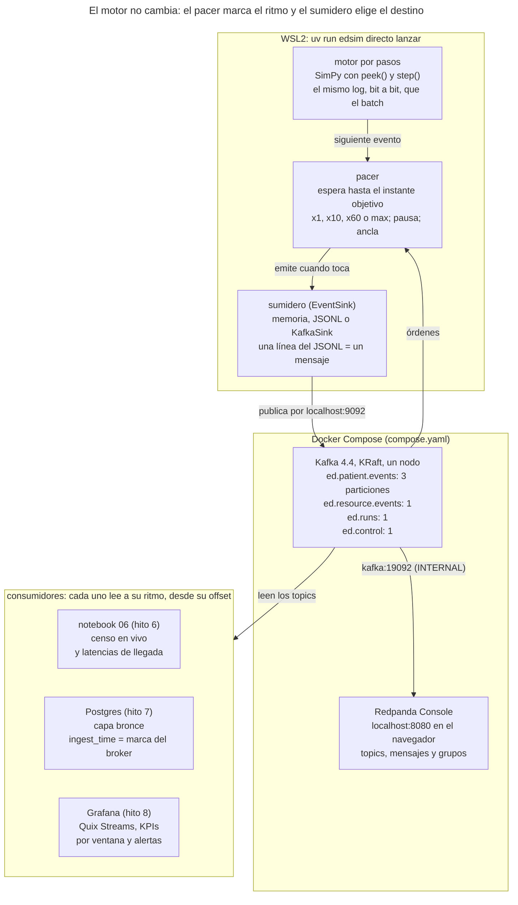

# Hito 6 — Tiempo real

> **Estado:** cerrado (`v0.6-hito6`). Original en este repositorio desde el 10 de noviembre de 2026; la pestaña del documento online es un archivo.

Al terminar el hito 6, EDsim emite sus eventos en vivo: un pacer convierte el tiempo virtual de SimPy en tiempo real (×1, ×10, ×60, pausa) y cada evento del log se publica en Apache Kafka, donde Redpanda Console y cualquier consumidor lo ven llegar. Es una pestaña didáctica: cada pieza explica para qué sirve, su base conceptual, cómo se usa en EDsim y cómo aprender más. Las decisiones (H6-n) son definitivas desde la tarea 6.6, con sus ADR 0048 a 0066, y la implementación empezó con la etiqueta `v0.4-hito4`.

## Objetivo y alcance

Al cerrar el hito 6, Pedro arranca Kafka con `docker compose up --wait`, lanza `edsim directo lanzar --velocidad 60` y ve en Redpanda Console cómo llegan los eventos de los pacientes a medida que «ocurren»: una hora simulada por minuto real. El motor, el catálogo y el modelo clínico no cambian: el hito construye la tubería que llevará los datos a los hitos 7 (persistencia) y 8 (analítica).

**Por qué va antes que el hito 5 (H6-1).** Tras un hito 4 largo y estadístico, cambiar de terreno y ver EDsim en vivo. El hito 6 no depende del 5: transporta lo que el motor produzca, con la versión de catálogo que sea. Por eso todo lo de este hito vale para cualquier versión del catálogo (hoy la 1, la 2 y la 3; el hito 5 traerá la 4). Después del 6 viene el 5, y solo entonces el 7.

**Dentro del alcance**

- **Motor por pasos:** el mismo motor puede avanzar evento a evento, con el mismo log bit a bit que hoy.
- **Pacer:** convierte minutos simulados en segundos reales; velocidad ×1, ×10, ×60 o la máxima, pausa y anclaje al calendario.
- **Modo directo:** calentamiento a toda velocidad sin emitir, censo inicial y emisión en vivo hasta el horizonte o hasta Ctrl+C.
- **Control en vivo:** cambiar la velocidad, pausar, reanudar y parar desde otra terminal, con mensajes en el topic `ed.control`.
- **Replay:** reemitir una ejecución guardada con el mismo pacer.
- **Kafka:** un broker de un nodo en modo KRaft, cuatro topics y Redpanda Console, levantados con Docker Compose.
- **Productor:** un `KafkaSink` idempotente, tercera salida del motor junto a la memoria y el JSONL; el cliente `confluent-kafka` es una dependencia opcional.
- **Contratos:** JSON Schema generado del catálogo, un fichero por versión.
- **Tests:** rápidos sin broker (reloj falso, sumidero en memoria), con el test «directo = batch» por versión de catálogo; integración contra un Kafka real, en local y en el CI.
- **Notebook** `06_tiempo_real.ipynb`: un consumidor que mantiene el censo en vivo y mide latencias.

**Fuera del alcance**

| Qué | Adónde va |
| --- | --- |
| Abandono, boarding y destinos reales (catálogo 4) | Hito 5 |
| Consumidor hacia Postgres/Timescale, `ingest_time` en la capa bronce, capa de observación (`recorded_time` distinto de `event_time`) | Hito 7 |
| Grafana, consumidores con Quix Streams, KPIs por ventana | Hito 8 |
| API de control con FastAPI, shocks, `system_snapshot`, evento `control_command` | Hitos posteriores (con el plano de control) |
| Avro y registro de esquemas | v1 |
| El simulador dentro de un contenedor y los perfiles `analytics`, `realtime` y `ml` de Compose | Cuando haya API y consumidores |
| Páginas nuevas en la app | Después de la v0 |

Las tareas con código empiezan con la etiqueta `v0.4-hito4`. Las implementa Claude Code, porque necesitan Docker y un broker, que Codex no tiene en su entorno. Claude Code ejecuta git (rama, commits, push con permiso y PR) y Pedro siempre fusiona.

## Cómo encajan las piezas

El motor sigue escribiendo hechos en un sumidero, como en el hito 3; lo nuevo es que el pacer decide cuándo avanza y que uno de los sumideros publica en Kafka.



Diagrama original: [pestaña archivada](https://claude.ai/artifact/8pd9CbSV9JTCm7MghHtMV9#9e4b3f9e-01cc).

El simulador corre en WSL2 y entra en Kafka por `localhost:9092`; la consola, dentro de Docker, por `kafka:19092` (pieza 5). Las órdenes de control viajan al revés: de `ed.control` al pacer (pieza 6).

## Sesión conceptual resumida

La sesión conceptual de este hito está escrita en las piezas 1 a 7 de esta pestaña; las dudas se resuelven sobre el texto. Esta tabla es el resumen de referencia: si una fila no se entiende, la pieza correspondiente la explica paso a paso.

| Concepto | Qué hay que entender | Pieza |
| --- | --- | --- |
| Tiempo virtual | SimPy salta de evento en evento: un día simulado no tarda un día, tarda lo que tarde calcularlo | 1 |
| Pacer | Espera entre eventos para que el minuto simulado dure lo que diga la velocidad: a ×60, un minuto simulado es un segundo real | 1 |
| Objetivo absoluto | Se espera hasta un instante calculado desde un ancla, no «la diferencia con el anterior»: así los errores de cada espera no se acumulan | 1 |
| Reloj monótono y reloj de pared | Para medir esperas, uno que nunca va hacia atrás; para decir «qué hora es», el de pared | 1 |
| Broker y topic | Kafka guarda mensajes en registros ordenados (topics) que muchos pueden leer, cada uno a su ritmo, sin borrarlos al leer | 2 |
| Partición, clave y offset | Un topic se reparte en particiones; la clave decide la partición; el orden solo está garantizado dentro de una partición; el offset es la posición | 2 |
| Grupo de consumidores | Varios consumidores se reparten las particiones; cada grupo lleva su propia posición de lectura | 2 |
| KRaft | Kafka 4 guarda sus propios metadatos con un protocolo de consenso interno; ya no necesita ZooKeeper | 2 |
| Garantías de entrega | Como mucho una vez (puede perder), al menos una vez (puede duplicar), exactamente una vez (ni pierde ni duplica, con coste) | 3 |
| Productor idempotente | El broker descarta los reintentos duplicados del productor y conserva el orden dentro de la partición | 3 |
| Consumidor idempotente | Si un mensaje llega dos veces, se ignora el segundo por su identificador (`event_id`) | 3 |
| Contrato de datos | La forma exacta de cada mensaje, escrita como JSON Schema y versionada con el catálogo | 4 |
| Contenedor, servicio, red y volumen | Docker Compose describe en un fichero qué programas corren, cómo se ven entre sí y dónde guardan datos | 5 |
| Listener y listener anunciado | Kafka escucha en una dirección y dice a los clientes a qué dirección volver a llamar; dentro y fuera de Docker esa dirección es distinta | 5 |
| Calentamiento y censo inicial | El directo calcula los primeros días sin emitir y luego publica la historia de quienes siguen dentro, para que el consumidor empiece con el servicio lleno | 6 |
| Event time e ingest time | Cuándo ocurrió en la simulación frente a cuándo llegó al broker; a ×60 se separan | 6 |
| Replay | Volver a emitir una ejecución guardada, siempre igual, al ritmo que se quiera | 6 |
| Reloj falso | En los tests, el reloj «avanza» sin dormir: un día a ×1 se prueba en milisegundos | 7 |
| Directo = batch | El directo publica exactamente las líneas del batch (salvo el calentamiento, sustituido por el censo) | 7 |

## Pieza 1 — Tiempo virtual y tiempo real: el pacer

El pacer hace que la simulación avance al ritmo del reloj de la pared: a ×1 un minuto simulado dura un minuto real, a ×60 dura un segundo. Sin él, el motor calcula 14 días en segundos y los eventos salen todos de golpe.

### Para qué sirve

Un sistema de datos en tiempo real (un panel, una alerta, un modelo que predice la espera) necesita que los datos lleguen poco a poco, como llegarían de un hospital. El pacer convierte la simulación en esa fuente: el consumidor no sabe que detrás hay un modelo. Acelerarla (×10, ×60) permite ver un día entero en 24 minutos.

### Cómo funciona

**El tiempo virtual.** SimPy no cuenta el tiempo: guarda una cola de eventos futuros ordenada por instante y salta al siguiente. Si el siguiente evento es a las 10:42 y ahora son las 10:15, el reloj de la simulación pasa de 10:15 a 10:42 sin calcular nada en medio. Por eso un día simulado cuesta lo que cuesten sus eventos, no un día.

SimPy da dos herramientas para avanzar a mano:

- `env.peek()`: el instante del siguiente evento, sin ejecutarlo (infinito si no queda ninguno).
- `env.step()`: ejecuta ese evento y nada más.

`env.run(until=t)` es, por dentro, un bucle de `step()`. Internamente, cada evento de la cola lleva la clave (instante, prioridad, número de orden), y `run(until=t)` mete un evento de parada en `t` con prioridad urgente, que se ejecuta antes que los eventos normales de ese instante. Avanzar con `peek()` y `step()` mientras `peek() < t` ejecuta los mismos eventos en el mismo orden. En eso se basa el «motor por pasos» (H6-4).

**Por qué es exactamente lo mismo (comprobado en la 6.2 con el código de SimPy 4.1.2).** La cola es un *heap* de claves (instante, prioridad, número de orden) y `step()` saca siempre la menor. `run(until=H)` programa la parada con `schedule(parada, URGENT, H - now)`: su clave es (H, 0, n). Todo lo anterior a H sale antes, porque su instante es menor. Ningún evento en H sale antes que la parada: los normales tienen prioridad 1, y los urgentes (`Initialize` al arrancar un proceso e `Interruption`) se programan siempre con retraso 0, en el instante en que está el reloj; para que uno quedara en H, el reloj tendría que estar ya en H, y solo llega ahí al sacar la parada. El número de orden de la parada desplaza en uno los de lo que se programa después, sin cambiar su orden relativo. Así que `run(until=H)` ejecuta exactamente los eventos con instante menor que H, como el bucle de `peek()` y `step()`. Lo único distinto es `env.now` al final, que nadie usa. No se usa `env.run` por trozos: cada llamada metería otra parada en la cola.

**El pacer.** Antes de cada `step()`, el pacer mira cuándo es el siguiente evento y espera hasta el instante real que le corresponde. Con un ancla (w₀ en segundos reales, s₀ en minutos simulados) y una velocidad v:

```latex
w_{\text{objetivo}}(t) = w_0 + \frac{60\,(t - s_0)}{v}
```

A ×60, un evento 3 minutos simulados después del ancla toca 3 segundos reales después; a ×1, 180 segundos después.

**Objetivos absolutos, no esperas relativas.** La forma ingenua es dormir «la diferencia con el evento anterior». Cada `sleep` se pasa un poco (en este contenedor Linux, 0,1 ms de media para 1 ms y 0,6 ms para 100 ms; en Windows suele ser más), y esos excesos se suman. Con el reloj falso de la pieza 7 se simuló un día a ×60 con 3.800 eventos y un exceso de 0 a 2 ms por espera:

| Estrategia | Retraso al final del día | Peor retraso de un evento |
| --- | --- | --- |
| Dormir la diferencia con el anterior | 3,80 s, y sigue creciendo | crece sin límite |
| Dormir hasta el objetivo absoluto | 0,06 ms | 2,0 ms |

Con el objetivo absoluto, cada error se corrige en la espera siguiente: el retraso nunca pasa de lo que se pasa una sola espera.

**Reloj monótono y reloj de pared.** Para esperar se usa un reloj monótono (`time.monotonic()`): nunca retrocede. El reloj de pared (la hora del sistema) puede saltar si el ordenador se sincroniza por NTP o vuelve de suspensión. El de pared solo se usa una vez, para anclar («qué hora es ahora»).

**Cambiar de velocidad y pausar sin saltos.** Al cambiar de v a v′ en el instante real w, el pacer calcula en qué minuto simulado está ese instante y reancla ahí:

```latex
s_{\text{ahora}} = s_0 + \frac{v\,(w - w_0)}{60}, \qquad (w_0, s_0) \leftarrow (w, s_{\text{ahora}}), \qquad v \leftarrow v'
```

Pausar es congelar s\_ahora; reanudar es reanclar en (instante de la reanudación, s\_ahora). El reloj simulado ni salta ni retrocede.

**Desde la velocidad máxima** no hay fórmula: el reloj simulado está en el `sim_time` del último evento ejecutado, y ahí se reancla al pasar a una velocidad finita. También se reancla así al empezar el directo: en (instante real del arranque, W).

**Esperar escuchando.** A ×1 el siguiente evento puede estar a 10 minutos reales. El pacer no duerme 10 minutos seguidos: espera en tramos cortos (un máximo de 0,2 s) y, entre tramo y tramo, mira si ha llegado una orden (velocidad, pausa, parar). Así responde en menos de 0,2 s.

**Si se queda atrás.** Si publicar tarda más que el hueco entre eventos (por ejemplo, el broker va lento), el objetivo ya ha pasado: el pacer ejecuta el evento enseguida y el siguiente objetivo, que es absoluto, deja que se ponga al día. Nunca salta eventos: el log en vivo es el mismo que el del batch. El retraso se mide y se informa.

**Velocidad máxima.** Sin esperas: el motor corre como en batch. La usan el calentamiento y el replay rápido.

### Las velocidades en números

Con el centro base (300 llegadas al día y unos 12,6 eventos por paciente, estimados con el modelo de la 4.6a: 9 eventos fijos, 4 más con pruebas, en el 72,75 %, y 2 más cuando el paciente sale a la sala de resultados) salen unos 3.800 eventos al día. **Medido en la 6.2** (config/, semilla 2026, 14 días): 55.511 eventos, 3.965 al día; 4.439 pacientes (317 al día) con 12,49 eventos cada uno, y 86 de recursos.

| Velocidad | Un día simulado | 14 días | Eventos por segundo (media) |
| --- | --- | --- | --- |
| ×1 | 24 h | 336 h | 0,04 |
| ×10 | 2,4 h | 33,6 h | 0,44 |
| ×60 | 24 min | 5,6 h | 2,6 |
| Máxima | lo que tarde el motor (segundos) | ídem | miles |

Para Kafka, 2,6 mensajes por segundo es muy poco: un broker de un nodo admite órdenes de magnitud más. El cuello de botella nunca será Kafka.

### Anclaje al calendario

El log del batch empieza en la fecha del perfil de llegadas (`fecha_inicio`) a las 0:00, y `event_time` es esa fecha más `sim_time`. El directo tiene dos arranques (H6-12):

- **Con la fecha del perfil.** Igual que el batch y reproducible: es el que usan los tests.
- **Anclado (`--anclar`).** La simulación empieza unos días antes de hoy a las 0:00 y calienta hasta «ahora». A ×1, el `event_time` del último evento es la hora real, y los patrones horario y semanal coinciden con el día de verdad (un viernes simulado es viernes). A ×60 la simulación se adelanta al reloj: el `event_time` va por el futuro, y por eso la hora de llegada al broker es otra marca (pieza 6).

`event_time` conserva el desfase fijo `+01:00` (decisión 20). El instante es correcto, pero en verano el reloj de Madrid marca una hora más que el texto del `event_time`. Un panel que muestre la hora local debe convertirla.

### En EDsim

- `run_engine` deja de ser «corre hasta el horizonte» y pasa a construir el motor y avanzarlo por pasos; el batch avanza sin esperas hasta el horizonte (H6-4). Las huellas SHA-256 no cambian, y un test comprueba que avanzar por trozos arbitrarios da el mismo log. En la 6.2, `simulate_ed` de 14 días tarda lo mismo antes y después (1,755 s frente a 1,781 s, el mejor de 5).
- El pacer (`edsim.live.pacer`) no sabe nada del motor ni de Kafka: recibe «cuándo es lo siguiente» y «hazlo», un reloj y una fuente de órdenes, todos inyectables (H6-5).
- **En la 6.3.** `Pacer(clock, speed, anchor)` con `wait_until(sim_time, control)`, `set_speed`, `pause`, `resume`, `reanchor(sim_time)` (lo usa el directo tras el censo), `sim_now()` (el s\_ahora de la fórmula: congelado en pausa y, a velocidad máxima, el `sim_time` del último evento liberado) y `lag()`. Cada vuelta del bucle de `wait_until` pide una orden (`poll`) y la aplica antes de decidir si espera, libera o duerme un tramo: así las órdenes llegan también a velocidad máxima o con el objetivo pasado, una por evento. Importar el reloj, las órdenes y el pacer no carga SimPy ni el motor (test de frontera).
- **Anclaje (6.3).** `anchored_start(wall, días)` da la fecha de inicio y W, con el día en `+01:00`. La fecha se pasa al perfil con `ArrivalProfile.with_start_date`, que copia los factores sin renormalizar: `dataclasses.replace` vuelve a normalizar, cambia 16 factores en el último bit y el log, desde el minuto 3.324 con `config/`. `runs/offered.py` todavía usa `replace` para la fecha.
- **Medido en la 6.3** con el reloj del sistema en WSL2 (`config/`, semilla 2026, 3 días, W = 2 días, ×3.600: el día en directo dura 24 s): 24,7 y 24,9 s en dos ejecuciones, con el retraso del último evento en 0,09 y 0,16 ms; el peor evento, 12,1 y 7,1 ms (398 y 372 de los 4.528 pasan de 1 ms); media 0,47 ms. El exceso real de `time.sleep` aquí es de 0,10 ms de media para 1 ms y de 0,15 ms para 0,2 s. A velocidad máxima, el mismo directo tarda 1,15 s, frente a 0,58 s de `simulate_ed` de 3 días (el pacer, el censo y el sumidero, por evento).
- **Por qué no `simpy.rt.RealtimeEnvironment`.** SimPy trae un entorno en tiempo real con un factor fijo y un modo estricto que falla si se queda atrás. Al pacer de EDsim le hace falta más: cambiar de velocidad y pausar en caliente, escuchar órdenes mientras espera, calentar a velocidad máxima con el mismo entorno y un reloj falso para los tests. Es la decisión 5 del diseño («pacer propio»).

### Para aprender más

- SimPy, [referencia de `Environment`](https://simpy.readthedocs.io/en/latest/api_reference/simpy.core.html) (`peek`, `step`, `run`) y [guía de simulaciones en tiempo real](https://simpy.readthedocs.io/en/latest/topical_guides/real-time-simulations.html).
- Python, [`time.monotonic` y `time.sleep`](https://docs.python.org/3/library/time.html): la diferencia entre relojes está explicada en la propia documentación.
- Ejercicio propuesto: con el reloj falso de la tarea 6.3, comparar las dos estrategias de espera de la tabla de arriba con un exceso de 15 ms por `sleep`, típico de Windows.

## Pieza 2 — Kafka

Kafka es un registro compartido de mensajes: el simulador escribe al final y cada lector lee desde donde quiera, a su ritmo, sin borrar nada al leer. Es la pieza que desacopla a EDsim de quien use sus datos.

### Para qué sirve

Sin Kafka, el simulador tendría que conocer a cada destinatario (la base de datos, el panel, el modelo) y esperar a que todos estén listos. Con Kafka publica una vez y se olvida:

- **Varios lectores independientes.** Redpanda Console, el notebook del hito, el consumidor de Postgres del hito 7 y los de Grafana del hito 8 leen los mismos mensajes, cada uno por su lado.
- **Lectores que se caen y vuelven.** Un consumidor parado retoma donde lo dejó, porque los mensajes siguen ahí.
- **Releer.** Un consumidor nuevo puede empezar desde el principio del topic. Es la diferencia con una cola clásica (como RabbitMQ), donde un mensaje leído desaparece.

### Cómo funciona

**Broker.** El servidor de Kafka. En producción hay varios y cada mensaje se copia en varios (replicación); en EDsim hay uno, y todo tiene factor de replicación 1.

**Topic.** Un registro con nombre, como `ed.patient.events`. Los mensajes se añaden al final y no se modifican.

**Partición.** Cada topic se divide en particiones, y cada partición es un registro ordenado por sí mismo. El orden **solo está garantizado dentro de una partición**: dos mensajes de particiones distintas pueden leerse en cualquier orden. Las particiones permiten repartir el trabajo entre varios consumidores.

**Offset.** La posición de un mensaje dentro de su partición: 0, 1, 2… Un consumidor recuerda por qué offset va en cada partición.

**Clave.** Cada mensaje puede llevar una clave, y la clave decide la partición: partición = hash(clave) módulo número de particiones. Todos los mensajes con la misma clave van a la misma partición y, por tanto, se leen en orden. En EDsim la clave es `episode_id`: los eventos de un mismo paciente llegan siempre en orden, aunque los de pacientes distintos se intercalen. Con 3 particiones y el hash murmur2 de Kafka:

| Clave | Partición (murmur2) | Partición (CRC32, el defecto de librdkafka) |
| --- | --- | --- |
| `EP-000184` | 0 | 0 |
| `EP-000185` | 0 | 2 |
| `EP-000186` | 1 | 2 |
| `EP-000187` | 2 | 1 |

Con murmur2, 4.200 episodios seguidos (unas dos semanas) se reparten 1.400, 1.393 y 1.407. La segunda columna enseña una trampa: el cliente de C que usa Python (librdkafka) reparte por defecto con otro hash (CRC32), y el de Java con murmur2. Si dos programas escriben con la misma clave y distinto hash, el orden por episodio se rompe. EDsim configura `partitioner=murmur2_random` para repartir como Java y Kafka Streams (H6-8). Las cifras se calcularon con una implementación de murmur2 comprobada contra los vectores de prueba de Kafka.

**Anatomía de un mensaje.** Clave, valor (los bytes del mensaje; en EDsim, la línea JSON del evento), cabeceras (pares nombre-valor pequeños, para enrutar sin leer el valor) y una marca de tiempo. La marca puede ser del productor (`CreateTime`) o del broker al guardarlo (`LogAppendTime`), según la configuración del topic. EDsim usa la del broker y la llama «hora de llegada» (pieza 6).

**Consumidores y grupos.** Un consumidor se suscribe a topics y pide mensajes con `poll`. Los consumidores con el mismo `group.id` forman un grupo y se reparten las particiones: con 3 particiones y 3 consumidores, cada uno lee una. El grupo guarda («confirma») por qué offset va en cada partición, en un topic interno del propio Kafka. Dos grupos distintos leen todo, cada uno con su posición. Un grupo nuevo sin posición guardada empieza según `auto.offset.reset`: al final por defecto en librdkafka (solo ve lo nuevo) o al principio (`earliest`), que es lo que quiere un consumidor de censo.

**Retención.** Los mensajes no se borran al leerlos, sino por antigüedad o tamaño. Por defecto, Kafka los guarda 7 días (`retention.ms`). Para EDsim basta: una ejecución en directo se lee en el mismo día.

**KRaft.** Un clúster de Kafka necesita guardar sus metadatos (qué topics hay, quién lidera cada partición). Hasta la versión 3 lo hacía con un programa aparte, ZooKeeper; desde la 4.0 lo hace el propio Kafka con un protocolo de consenso (KRaft), y ZooKeeper ya no existe. Un nodo puede ser *broker*, *controller* o ambos. En EDsim es ambos a la vez («modo combinado»), que sirve para desarrollo pero no se recomienda en producción.

**Redpanda Console.** Una interfaz web para ver un clúster de Kafka: topics, particiones, mensajes (con su clave, cabeceras, offset y marca de tiempo), grupos de consumidores y su retraso. Es un cliente más de Kafka; no es el broker Redpanda, aunque sea de la misma empresa (decisión 10).

### En EDsim

- **Cuatro topics** (H6-7): `ed.patient.events` (3 particiones, clave `episode_id`), `ed.resource.events` (1 partición, clave `recurso`), `ed.runs` (1 partición, clave `run_id`: un mensaje al empezar y otro al terminar cada ejecución) y `ed.control` (1 partición, órdenes al simulador). El detalle está en «Especificación: topics y mensajes».
- **Por qué 3 particiones con un solo broker.** Un nodo no gana velocidad con más particiones, pero con una sola el orden sería global y nunca se vería el fenómeno central de Kafka: orden por clave, no global. Con 3 particiones, el consumidor del notebook tiene que ordenar por `sim_time` lo que necesite ordenado, como cualquier consumidor real.
- **Regla de reparto genérica:** un evento con `episode_id` va a `ed.patient.events`; uno sin él (hoy `staffing_changed`) va a `ed.resource.events`. Vale para cualquier versión del catálogo.
- **Topics creados explícitamente** por `edsim directo preparar`, no por Compose, con la autocreación desactivada: un nombre mal escrito da un error en vez de crear un topic nuevo en silencio.
- **Cliente: `confluent-kafka`** (H6-2). Envuelve librdkafka, el cliente en C que mantiene Confluent; tiene productor idempotente y es la base de Quix Streams, el de los consumidores del hito 8. La versión 2.16.1 (28 de octubre de 2026) publica ruedas para Python 3.13 y 3.14. Las alternativas, `kafka-python` (Python puro) y `aiokafka` (asyncio), no aportan nada que EDsim necesite y obligarían a cambiar de cliente en el hito 8.

### Para aprender más

- [Documentación de Apache Kafka](https://kafka.apache.org/documentation/): la introducción y «Design» explican el registro, las particiones y la retención.
- [Kafka 101 de Confluent Developer](https://developer.confluent.io/courses/apache-kafka/events/): curso gratuito con vídeos cortos; los módulos de topics, particiones, productores y consumidores cubren esta pieza.
- [Documentación de `confluent-kafka` para Python](https://docs.confluent.io/platform/current/clients/confluent-kafka-python/html/index.html) y [configuración de librdkafka](https://github.com/confluentinc/librdkafka/blob/master/CONFIGURATION.md).
- [Configurar Redpanda Console](https://docs.redpanda.com/25.3/console/config/configure-console/).
- Libros: *Designing Data-Intensive Applications* (Kleppmann), capítulo de procesamiento de flujos, para la idea de «el log como base de todo»; *Kafka: The Definitive Guide* (O'Reilly) como referencia.

## Pieza 3 — Garantías de entrega

EDsim publica con un productor idempotente: si la red o el broker fallan, el mensaje se reintenta sin duplicarse ni desordenarse, y si no puede entregarse, la simulación se para con un error claro. De extremo a extremo la garantía es «al menos una vez», y los consumidores descartan repetidos por `event_id` (H6-8).

### Para qué sirve

Entre el simulador y el broker hay una red, y cualquiera de los dos puede fallar a mitad de un envío. Hay que decidir qué pasa entonces con un mensaje, por ejemplo el `triage_completed` de `EP-000184`. No hay una respuesta gratis: cada garantía cuesta algo.

### Cómo funciona

**Las tres garantías.**

| Garantía | Qué hace el productor | Qué puede salir mal | Cuándo se usa |
| --- | --- | --- | --- |
| Como mucho una vez | Envía y no espera confirmación (`acks=0`) | Si el mensaje se pierde, nadie se entera | Métricas donde perder alguna da igual |
| Al menos una vez | Espera la confirmación y reintenta si no llega | Si el broker guardó el mensaje pero la confirmación se perdió, el reintento lo duplica | Lo habitual, con consumidores que toleran repetidos |
| Exactamente una vez | Reintenta, y el broker reconoce y descarta los duplicados; con transacciones, varias escrituras se confirman juntas o ninguna | Más configuración; de extremo a extremo exige que el consumidor colabore | Dinero, inventarios, o cuando un duplicado es caro |

**`acks`.** Cuántas copias deben confirmar el mensaje antes de dar el envío por bueno: `0` (ninguna), `1` (el líder de la partición) o `all` (todas las réplicas sincronizadas). En librdkafka el valor por defecto ya es `all`. Con un solo broker, `1` y `all` son lo mismo, pero se deja `all` para que la configuración valga en un clúster de verdad.

**El productor idempotente.** Con `enable.idempotence=true`, el productor recibe un identificador y numera sus mensajes por partición. Si un reintento llega con un número ya guardado, el broker lo descarta; si llega uno fuera de orden, lo rechaza. Resultado: reintentos sin duplicados y con el orden de envío conservado. En librdkafka viene **desactivado** por defecto y, al activarlo, ajusta solo `acks` y los reintentos.

**Enviar es asíncrono.** `produce()` no envía: deja el mensaje en una cola local y vuelve enseguida. librdkafka agrupa mensajes (espera hasta `linger.ms`, 5 ms por defecto) y los manda en lotes. El resultado de cada mensaje llega después, en una función de aviso (`on_delivery`) que se ejecuta cuando el programa llama a `poll()`. Tres consecuencias:

- Hay que llamar a `poll(0)` con frecuencia (EDsim lo hace tras cada evento) para recibir los avisos.
- Si la cola local se llena (100.000 mensajes por defecto), `produce()` lanza `BufferError`. EDsim responde con `poll()` y reintenta: es la contrapresión, y el pacer se queda atrás en lugar de perder mensajes.
- Al terminar hay que llamar a `flush()`, que espera a que se entregue lo pendiente y devuelve cuántos mensajes siguen en la cola. Si devuelve más de 0, algo no se entregó.

**Cuánto se reintenta.** librdkafka reintenta durante `message.timeout.ms`, 300.000 ms (5 minutos) por defecto. Si el broker se cae y vuelve antes, no se pierde nada; si pasa ese tiempo, el aviso de entrega llega con error.

**El primer mensaje tras arrancar Kafka.** Un productor idempotente pide antes un identificador (PID) al broker. Justo después de `docker compose up`, el broker puede contestar «Coordinator load in progress» porque aún carga ese componente: librdkafka lo registra como aviso (`%4|…|GETPID|…`) y reintenta solo. No es un fallo. El healthcheck solo comprueba que el broker responde, no que todo esté cargado. En la 6.1, el primer mensaje de un broker recién levantado tardó 1.031 ms en llegar, y 510 ms en caliente.

### En EDsim

- **Productor idempotente**, `acks=all`, `partitioner=murmur2_random` (pieza 2) y los valores por defecto de `linger.ms` y `message.timeout.ms`.
- **Si un mensaje no se entrega, la simulación se para** con un error que dice cuántos mensajes se entregaron y cuáles fallaron. Seguir sin él rompería la regla del diseño («el log es la fuente de verdad»): un consumidor reconstruiría un censo falso sin saberlo.
- **Al parar** (horizonte o Ctrl+C), el simulador deja de avanzar, publica el fin de la ejecución en `ed.runs` y llama a `flush()` con un límite de 30 s.
- **«Al menos una vez» de extremo a extremo.** El productor no duplica, pero un consumidor que se cae después de procesar un mensaje y antes de confirmar su offset lo volverá a leer. Por eso los consumidores de EDsim son idempotentes: si ya han visto un `event_id`, lo ignoran. Aquí se cobra la decisión 27 del hito 3: `event_id` es determinista (`run_id` y número de orden), y sirve como clave natural para descartar duplicados.
- **Sin transacciones.** Solo hay un productor y cada evento se escribe una vez; las transacciones añadirían un `transactional.id`, consumidores en modo `read_committed` y más fallos posibles, para ganar algo que EDsim no necesita: escribir en varios topics a la vez de forma atómica.

### Para aprender más

- [Documentación de Kafka](https://kafka.apache.org/documentation/), sección «Message Delivery Semantics»: las tres garantías explicadas por sus autores.
- [Configuración de librdkafka](https://github.com/confluentinc/librdkafka/blob/master/CONFIGURATION.md): `enable.idempotence`, `acks`, `linger.ms`, `message.timeout.ms` y `queue.buffering.max.messages`, con sus valores por defecto.
- Kafka 101 de Confluent Developer, módulo de productores.
- Ejercicio propuesto (con la tarea 6.4 hecha): parar el contenedor de Kafka con `docker compose stop kafka` en mitad de un directo a ×60, arrancarlo un minuto después y comprobar en Redpanda Console que no falta ni sobra ningún `event_id`.

## Pieza 4 — Contratos: JSON Schema y versiones del catálogo

Cada versión del catálogo de eventos tiene un contrato escrito en JSON Schema, generado a partir del propio catálogo y guardado en el repositorio. Un consumidor sabe qué esperar de cada mensaje sin leer el código de EDsim (H6-10).

### Para qué sirve

En el batch, quien escribe y quien lee el JSONL es el mismo programa: `read_events` valida con el mismo catálogo que usó `EventLog`. Con Kafka, el lector es otro programa, quizá en otro lenguaje y escrito meses después (el consumidor de Postgres, Grafana, un modelo). Hace falta un acuerdo explícito, legible por máquinas, sobre la forma de cada mensaje: un **contrato de datos**. Sirve para tres cosas:

- **Documentar:** qué campos tiene un `test_resulted` y qué valores puede tomar `resultados`.
- **Validar:** rechazar un mensaje mal formado en la frontera, antes de que contamine una tabla.
- **Evolucionar:** cuando llegue el catálogo 4, saber qué consumidores siguen sirviendo y cuáles no.

### Cómo funciona

**JSON Schema** es un vocabulario estándar, escrito también en JSON, para describir la forma de un documento JSON. La versión actual es la 2020-12. Un esquema dice qué tipo tiene cada campo, cuáles son obligatorios, qué valores admite y si se permiten campos no declarados. Un fragmento del esquema de la versión 3 para `triage_completed`:

```json
{
  "properties": {
    "event_type": { "const": "triage_completed" },
    "schema_version": { "const": 3 },
    "source_system": { "const": "triaje" },
    "episode_id": { "type": "string", "pattern": "^EP-[0-9]{6}$" },
    "ingest_time": { "type": "null" },
    "payload": {
      "type": "object",
      "properties": {
        "nivel": { "type": "integer", "minimum": 1, "maximum": 5 },
        "motivo": { "enum": ["dolor_toracico", "disnea", "..."] }
      },
      "required": ["nivel", "motivo"],
      "additionalProperties": false
    }
  }
}
```

Las palabras clave que bastan para EDsim: `type`, `properties`, `required`, `additionalProperties: false` (ningún campo de más: la misma regla que el test del hito 3 contra campos ocultos), `enum` y `const` (valores cerrados), `minimum` y `maximum`, `pattern` (expresiones regulares) y `oneOf` (el evento es exactamente uno de los tipos del catálogo). Desde Python se valida con la biblioteca `jsonschema` (4.26.0, con soporte completo de 2020-12).

**Versionar un contrato.** Un contrato cambia cuando cambia el catálogo. Hay dos preguntas de compatibilidad:

- **Hacia atrás:** ¿un consumidor nuevo entiende mensajes viejos? (¿el lector de la versión 4 lee un log de la versión 3?)
- **Hacia delante:** ¿un consumidor viejo entiende mensajes nuevos? (¿el lector de la versión 3 lee un log de la versión 4?)

Con `additionalProperties: false`, añadir un campo (como hizo la versión 2 con `medio`, `edad`, `sexo`, `motivo`…) rompe la compatibilidad hacia delante. EDsim no lo esconde: cada mensaje lleva su `schema_version` en el sobre y en una cabecera, y el consumidor elige el esquema de esa versión. Es la misma regla que ya usa `read_events` («cada evento se valida con el catálogo de su versión»).

### En EDsim

- **Un esquema por versión de catálogo**, `schemas/eventos-v1.schema.json` a `eventos-v3.schema.json`, generados por código a partir de `CATALOGS`. Cuando el hito 5 añada la versión 4, su esquema saldrá solo.
- **Patrón «derivado y escrito»**, como los umbrales del hito 4: el esquema se genera una vez, se escribe en el repositorio con el comando que lo genera y un test comprueba que «escritos = generados». Si alguien cambia el catálogo sin regenerar, el test falla.
- **Un cambio en el catálogo que hace falta para generar.** Hasta la 6.3, cada comprobación del catálogo (`_choice`, `_int_range`, `_test_types`…) era una función de Python: validaba, pero no decía qué forma tiene. La tarea 6.4 las convirtió en objetos pequeños que validan igual y, además, describen su esquema (`Check`, un protocolo con `__call__` y `json_schema()`). Fue un refactor sin cambio de comportamiento, en un commit aparte y sin tocar tests: las fábricas `_int_range` y `_choice` y las instancias `_bool`, `_episode`, `_test_types` y `_test_results` conservan su nombre, así que el texto de `CATALOG_V1` a `CATALOG_V3` no cambió, y 1.947 comprobaciones dieron el mismo resultado y el mismo mensaje antes y después.
- **En la 6.4.** `edsim.live.schemas`: `event_schema(versión)` da el diccionario, `schema_text(versión)` el texto del fichero (sangría 2, UTF-8 tal cual, salto final) y `uv run python -m edsim.live.schemas`, desde la raíz, los escribe; el comando va en el `$comment` de cada esquema. Pesan 23, 27 y 29 kB (1.021, 1.169 y 1.252 líneas): cada rama repite el sobre entero, para que un consumidor lea la de su tipo sin saltos. Validar los tres logs de «directo = batch» de la 6.3 (12.173, 12.858 y 13.492 eventos) con `jsonschema` tarda unos 21 s: cada línea prueba las 13 o 14 ramas del `oneOf`, y el test va marcado `slow`.
- **Dos fuentes independientes, comparadas.** Un test pasa los mismos eventos, válidos e inválidos, por el validador de Python y por el esquema, y exige que digan lo mismo. Es la lección de la app: dos fuentes independientes comparadas por un test son un control cruzado.
- **Los mensajes de `ed.runs` y `ed.control`** tienen también su esquema, escrito a mano y con su propio número de versión.
- **Sin registro de esquemas ni Avro** hasta la v1 (diseño): JSON se lee tal cual en Redpanda Console y no necesita otro servicio. Los ficheros del repositorio hacen de registro.

### Para aprender más

- [Understanding JSON Schema](https://json-schema.org/understanding-json-schema): la guía oficial, con ejemplos de cada palabra clave.
- [`jsonschema` en PyPI](https://pypi.org/project/jsonschema/) y su documentación.
- *Designing Data-Intensive Applications*, capítulo de codificación y evolución: compatibilidad hacia atrás y hacia delante, JSON frente a Avro.
- Ejercicio propuesto: validar a mano una línea de un log de la versión 2 contra el esquema de la versión 1 y leer el error.

## Pieza 5 — Docker Compose y los listeners de Kafka

Un fichero, `compose.yaml`, describe el Kafka de EDsim y su consola, y un comando, `docker compose up --wait`, los levanta en cualquier máquina con las mismas versiones. Lo más delicado es que Kafka necesita dos direcciones: una para los programas dentro de Docker y otra para el simulador, que corre fuera (H6-18).

### Para qué sirve

Instalar Kafka a mano en WSL2 (Java, ficheros de configuración, arranque) es lento y no se repite igual en el CI. Docker empaqueta cada programa con todo lo que necesita en una **imagen**; Docker Compose arranca varias imágenes juntas, ya conectadas entre sí. Con versiones fijadas en el fichero (`apache/kafka:4.4.0`, nunca `latest`), el Kafka del portátil, el de Claude Code y el del CI son el mismo (H6-15).

### Cómo funciona

**Los conceptos de Docker.**

| Concepto | Qué es | En EDsim |
| --- | --- | --- |
| Imagen | Plantilla de solo lectura con un programa y sus dependencias | `apache/kafka:4.4.0`, `redpandadata/console:v3.13.1` |
| Contenedor | Una imagen en marcha, aislada | El broker, la consola |
| Servicio | En Compose, un contenedor con su configuración: imagen, variables, puertos | `kafka`, `console` |
| Red | Compose crea una red para el proyecto; cada servicio encuentra a los demás por su nombre | La consola llama al broker `kafka` |
| Puerto publicado | `"9092:9092"` abre un puerto del contenedor en la máquina | El simulador entra por `localhost:9092`; la consola se ve en `localhost:8080` |
| Volumen | Almacenamiento que sobrevive al contenedor | Ninguno en este hito (ver abajo) |
| Healthcheck | Un comando que Docker ejecuta para saber si el servicio está listo, no solo encendido | El broker está sano cuando responde a una petición de versiones |
| Perfil | Etiqueta para arrancar solo un grupo de servicios; los servicios sin perfil arrancan siempre | Kafka y la consola, sin perfil: son la base. Los perfiles `analytics`, `realtime` y `ml` del diseño llegan en sus hitos |

**Los comandos del día a día.** Compose busca `compose.yaml` en la carpeta actual (es el nombre preferido; `docker-compose.yml` se acepta por compatibilidad).

- `docker compose up --wait`: arranca en segundo plano y espera a que los servicios estén en marcha o sanos.
- `docker compose ps` y `docker compose logs -f kafka`: estado y registro.
- `docker compose stop` y `start`: parar y seguir; los topics y mensajes se conservan.
- `docker compose down`: parar y borrar los contenedores. Sin volumen, el broker vuelve vacío la próxima vez.

**Sin volumen, a propósito.** Un directo dura horas y se lee el mismo día; empezar limpio tras `down` es una ventaja para probar. Si más adelante hace falta conservar datos, se añade un volumen con nombre.

**Los listeners de Kafka, el punto delicado.** Un cliente de Kafka se conecta en dos pasos:

1. Llama a la dirección de arranque (`bootstrap.servers`) y pide los metadatos del clúster.
2. El broker le contesta con su **dirección anunciada** (*advertised listener*), y desde entonces el cliente usa esa dirección, no la de arranque.

El problema: el broker tiene un nombre dentro de la red de Docker (`kafka`) y otro desde fuera (`localhost`). Con una sola dirección anunciada, `kafka:9092`, el simulador en WSL2 arranca bien contra `localhost:9092`, recibe «llámame a `kafka:9092`» y falla, porque fuera de Docker el nombre `kafka` no existe. Es el error más típico al empezar con Kafka en Docker. La solución son varios listeners, cada uno con su dirección anunciada:

| Listener | Escucha en | Se anuncia como | Lo usan |
| --- | --- | --- | --- |
| `INTERNAL` | puerto 19092 del contenedor | `kafka:19092` | Redpanda Console y las herramientas dentro de Docker |
| `EXTERNAL` | puerto 9092, publicado | `localhost:9092` | El simulador, los tests de integración y el notebook, en WSL2 |
| `CONTROLLER` | puerto 9093 del contenedor | (no se anuncia a los clientes) | El propio KRaft |

**Configurar la imagen oficial.** La imagen `apache/kafka` se configura con variables de entorno: cada propiedad de Kafka se escribe en mayúsculas, con `KAFKA_` delante, los puntos cambiados por `_`, los `_` por `__` y los guiones por `___` (`advertised.listeners` → `KAFKA_ADVERTISED_LISTENERS`). Sin variables arranca un nodo combinado de prueba. Con un solo nodo hay que bajar a 1 el factor de replicación de los topics internos (por defecto 3, y no hay tres nodos). El identificador del clúster (`CLUSTER_ID`) es opcional.

**Con WSL2.** Docker Desktop con integración en WSL2 publica los puertos de los contenedores en `localhost`, tanto para la distribución de Linux como para el navegador de Windows. La prueba de humo de la tarea 6.1 lo comprueba (publicar y leer un mensaje desde WSL2 contra `localhost:9092`, y abrir `localhost:8080`).

### En EDsim

`compose.yaml` de la raíz, verificado en la tarea 6.1 contra el ejemplo oficial de un nodo en texto plano (`docker/examples/docker-compose-files/single-node/plaintext` de `apache/kafka` 4.4.0) y contra el código de la imagen:

```yaml
# compose.yaml — Kafka de un nodo (KRaft) y Redpanda Console. Ver docs/specs/hito-6.md, pieza 5.
#
# Sin perfiles (son la base) y sin volumen: `docker compose down` deja el broker vacío.
# Los topics no se crean aquí: la autocreación está desactivada y los crea EDsim (H6-7).
name: edsim

services:
  kafka:
    image: apache/kafka:4.4.0
    hostname: kafka
    ports:
      - "9092:9092" # EXTERNAL: simulador, tests y notebook desde WSL2
    environment:
      KAFKA_NODE_ID: 1
      KAFKA_PROCESS_ROLES: broker,controller
      # Dos listeners para clientes: INTERNAL dentro de la red de Docker (la consola) y
      # EXTERNAL fuera (localhost). CONTROLLER es el de KRaft y no se anuncia.
      KAFKA_LISTENERS: INTERNAL://:19092,EXTERNAL://:9092,CONTROLLER://:9093
      KAFKA_ADVERTISED_LISTENERS: INTERNAL://kafka:19092,EXTERNAL://localhost:9092
      KAFKA_LISTENER_SECURITY_PROTOCOL_MAP: INTERNAL:PLAINTEXT,EXTERNAL:PLAINTEXT,CONTROLLER:PLAINTEXT
      KAFKA_INTER_BROKER_LISTENER_NAME: INTERNAL
      KAFKA_CONTROLLER_LISTENER_NAMES: CONTROLLER
      # La imagen formatea el almacenamiento con votantes estáticos.
      KAFKA_CONTROLLER_QUORUM_VOTERS: 1@kafka:9093
      # Con solo variables de entorno, la imagen no aplica su server.properties por defecto.
      KAFKA_LOG_DIRS: /tmp/kraft-combined-logs
      # Un solo nodo: los topics internos con 1 réplica (por defecto, 3).
      KAFKA_OFFSETS_TOPIC_REPLICATION_FACTOR: 1
      KAFKA_TRANSACTION_STATE_LOG_REPLICATION_FACTOR: 1
      KAFKA_TRANSACTION_STATE_LOG_MIN_ISR: 1
      KAFKA_SHARE_COORDINATOR_STATE_TOPIC_REPLICATION_FACTOR: 1
      KAFKA_SHARE_COORDINATOR_STATE_TOPIC_MIN_ISR: 1
      # Un grupo nuevo recibe sus particiones sin los 3 s de espera por defecto.
      KAFKA_GROUP_INITIAL_REBALANCE_DELAY_MS: 0
      KAFKA_AUTO_CREATE_TOPICS_ENABLE: "false"
    healthcheck:
      test: ["CMD-SHELL", "/opt/kafka/bin/kafka-broker-api-versions.sh --bootstrap-server kafka:19092 > /dev/null 2>&1"]
      interval: 5s
      timeout: 10s
      retries: 24

  console:
    image: docker.redpanda.com/redpandadata/console:v3.13.1
    depends_on:
      kafka:
        condition: service_healthy
    ports:
      - "8080:8080"
    environment:
      KAFKA_BROKERS: kafka:19092
```

**Qué cambió respecto al borrador (tarea 6.1).**

- `name: edsim`: el proyecto de Compose se llama igual desde cualquier carpeta, y `scripts/tests-integracion.sh` reconoce su broker.
- `KAFKA_LOG_DIRS`: con solo variables de entorno, la imagen escribe un `server.properties` con lo que se le pasa y nada más, sin sus valores por defecto; se declara el directorio del ejemplo.
- `KAFKA_SHARE_COORDINATOR_STATE_TOPIC_REPLICATION_FACTOR` y `…_MIN_ISR` a 1: el topic interno de los grupos compartidos (KIP-932) también tiene 3 réplicas por defecto.
- `KAFKA_GROUP_INITIAL_REBALANCE_DELAY_MS: 0`: un grupo nuevo recibe sus particiones sin los 3 s de espera por defecto (tests y notebook).
- Se mantiene `KAFKA_CONTROLLER_QUORUM_VOTERS`: la imagen formatea el almacenamiento con votantes estáticos (sin `--standalone`), así que `controller.quorum.bootstrap.servers` no vale con ella. Los scripts de Kafka están en `/opt/kafka/bin`, como suponía el healthcheck.
- Sin `CLUSTER_ID` (la imagen pone uno si falta; sin volumen da igual cuál) y sin `container_name`.

Los topics no se crean en Compose sino con `edsim directo preparar`, que usa el cliente de administración de Kafka y la definición de topics del código (pieza 6 y especificación). Así la lista de topics vive en un solo sitio, los tests de integración crean sus propios topics con la misma función y `up --wait` no tiene que esperar a un contenedor que arranca y termina.

### Para aprender más

- Docker: [modelo de una aplicación de Compose](https://docs.docker.com/compose/intro/compose-application-model/) (servicios, redes, volúmenes), [perfiles](https://docs.docker.com/compose/how-tos/profiles/) y [`docker compose up`](https://docs.docker.com/reference/cli/docker/compose/up/).
- [Ejemplos de la imagen `apache/kafka`](https://github.com/apache/kafka/blob/trunk/docker/examples/README.md): un nodo, varios nodos, SSL y la regla de las variables.
- [Configurar Redpanda Console](https://docs.redpanda.com/25.3/console/config/configure-console/): `KAFKA_BROKERS` y el resto de opciones.
- Ejercicio propuesto: quitar el listener `EXTERNAL`, dejar solo `kafka:9092` y ver con `docker compose logs` y el error del cliente cómo falla la conexión desde WSL2.

## Pieza 6 — El modo directo: calentamiento, censo inicial, control y replay

El directo calcula el calentamiento sin emitir y publica la historia de los pacientes que siguen dentro. Después emite en vivo hasta el horizonte o hasta que se le diga que pare. Lo que publica es exactamente el log del batch, salvo el calentamiento de los pacientes que ya se fueron (H6-11).

### Para qué sirve

Un servicio de urgencias de verdad nunca está vacío. Si el directo empezara a emitir el día 0 a las 0:00, el consumidor vería un hospital vacío que se llena durante horas, algo que no ocurre en la realidad. Por eso el motor calienta antes (decisión 29: 2 días por defecto). Pero si el calentamiento no se emite, a las 0:00 del día 2 aparecerían en el stream pacientes «ya dentro» (un `assessment_ended` sin su llegada) y el consumidor no sabría dónde ponerlos. El **censo inicial** resuelve eso: antes de emitir en vivo, cuenta quién hay dentro y en qué estado.

### Cómo funciona

**La secuencia de un directo.**

1. **Preparar.** Comprueba que los topics existen con la configuración esperada (o los crea con `edsim directo preparar`).
2. **Calentar.** El motor corre a velocidad máxima desde el minuto 0 hasta el inicio del directo, W: 2.880 min (2 días) por defecto, o «ahora» con `--anclar` (pieza 1). Los eventos se guardan en memoria, sin publicar.
3. **Anunciar.** Publica en `ed.runs` un mensaje `inicio` con el `run_id`, la versión del catálogo, la fecha de inicio, W, la velocidad y el modo.
4. **Censo.** Publica, en su orden original, los eventos del calentamiento de los episodios abiertos en W y todos los eventos de recursos del calentamiento (la plantilla vigente).
5. **Directo.** El pacer toma el control: cada evento desde W se publica cuando le toca.
6. **Terminar.** Al llegar al horizonte, con `parar` o con Ctrl+C, publica en `ed.runs` un mensaje `fin` (motivo, último `event_id`, mensajes publicados) y vacía el productor.

**Qué es «abierto».** Un episodio está abierto en W si no tiene evento terminal antes de W. Los eventos terminales dependen del catálogo: en las versiones 1 a 3, solo `patient_departed`; el catálogo 4 del hito 5 añadirá el abandono. Por eso es una constante por versión de catálogo (`TERMINAL_EVENTS`), junto a `CATALOGS`. En el directo, un test la contrasta con la verdad del motor: los episodios abiertos son exactamente los procesos de paciente vivos en W.

**Por qué eventos y no una foto del estado.** Había dos formas de hacer el censo:

| Opción | Qué publica | Ventajas | Inconvenientes |
| --- | --- | --- | --- |
| Foto del estado | Un mensaje nuevo con el estado de cada paciente («EP-000184 esperando médico, box 7») | Corto | Un contrato nuevo que depende de cómo se resume el estado; el consumidor tiene dos caminos (foto y eventos) |
| **Historia de los abiertos (elegida)** | Los eventos del calentamiento de quienes siguen dentro, tal cual | Ningún contrato nuevo; vale para cualquier versión del catálogo; el consumidor deriva el estado con el mismo código para el censo y para el directo | Algunos cientos de mensajes más al arrancar |

La elegida respeta el principio del diseño: el log es la fuente de verdad y los estados se derivan. El consumidor distingue el censo del directo por `sim_time < W`, porque W viene en el mensaje `inicio`.

**Tres horas por evento.** El sobre lleva tres tiempos (diseño): `event_time` (cuándo ocurrió en la simulación), `recorded_time` (cuándo lo anotó el sistema del hospital; igual que `event_time` hasta el hito 7) e `ingest_time` (cuándo llegó al broker). A ×1 y anclado, `event_time` e `ingest_time` casi coinciden. A ×60 se separan: tras una hora real, la simulación ha avanzado 60 horas.

**Por qué `ingest_time` no va dentro del mensaje (H6-9).** El productor no sabe cuándo llegará el mensaje: solo lo sabe el broker. Kafka ya guarda esa hora si el topic usa `message.timestamp.type=LogAppendTime`, en la marca de tiempo del mensaje. Por eso:

- El valor del mensaje es la línea del JSONL byte a byte, con `ingest_time: null`. El test «directo = batch» compara bytes, sin excepciones.
- La hora de llegada se lee de la marca del mensaje (`msg.timestamp()` en el consumidor, de tipo `LogAppendTime`). El consumidor del hito 7 la copiará en `ingest_time` al guardar en la capa bronce.
- **Usar `event_time` como marca de Kafka sería un error.** Desde Kafka 4.0, el broker rechaza por defecto las marcas de más de una hora en el futuro (`message.timestamp.after.max.ms` = 3.600.000 ms), y un directo a ×60 anclado va por delante del reloj enseguida. Además, la retención borra por antigüedad de la marca: un log con fecha del perfil (en el pasado) se borraría casi al llegar. Con `LogAppendTime`, el broker pone su hora y no valida la del productor.

**Control en vivo (H6-6).** Desde otra terminal:

```bash
edsim directo control --run r2026 --velocidad 10
edsim directo control --run r2026 --pausar
edsim directo control --run r2026 --reanudar
edsim directo control --run r2026 --parar
```

Cada orden es un mensaje en `ed.control` con clave `run_id`. El simulador las lee entre evento y evento, y mientras espera, en los tramos de 0,2 s del pacer. El topic es en sí un registro, así que «cada orden queda registrada», como pide el diseño, sin añadir `control_command` al catálogo. Las órdenes del hito 6 solo cambian el ritmo, nunca el modelo: por eso el directo sigue siendo igual al batch con cualquier secuencia de órdenes. Los shocks, que sí cambian el modelo, llegan con el plano de control.

**Replay (H6-13).** `edsim directo reemitir r2026` lee una ejecución guardada (`resultados/ejecuciones/r2026/eventos.jsonl`) y la reemite con el mismo pacer, el mismo censo y el mismo productor. El motor no corre: los instantes salen del `sim_time` de cada evento. Sirve para dar al hito 7 un stream idéntico cada vez, para demostraciones y para cargar Kafka rápido (`--velocidad max`).

### En EDsim

- `edsim.live.directo` orquesta los seis pasos con piezas inyectadas: el motor por pasos (o el lector de un log guardado, en el replay), el pacer, el reloj, la fuente de órdenes y el sumidero. Con un `MemorySink`, un reloj falso y órdenes programadas, todo el directo corre en un test rápido.
- **Cómo llegan los eventos del motor al directo (6.3).** El motor escribe en el sumidero que recibió `start_ed`. El que llama le pasa un `MemorySink` y se lo da también a `EngineSource(ed, buffer)`, que en cada paso saca de él lo que emitió el motor: el calentamiento se queda en memoria, lo demás se publica, y son los mismos objetos `Event` que en batch. Avanzar con `peek()` y `step()` mientras `peek() < W` ejecuta exactamente los eventos anteriores a W, así que `alive_episodes()` es el de W y `run_live` lo compara con `open_episodes` antes de publicar nada (`RuntimeError` si difieren). `LogSource(events, horizon)` es la fuente del replay: lee un log de forma perezosa, un evento por paso.
- **Comprobaciones antes de empezar (6.3).** `run_live` exige 0 ≤ W < horizonte y, si la fuente tiene `horizon` (las dos lo tienen), que sea el mismo: si no, `ValueError` sin avanzar la fuente ni publicar. `fin` nunca pasa del horizonte: con retraso, s\_ahora puede ir por delante, y con `parar` se publica `min(s_ahora, horizonte)`; un Ctrl+C durante el censo da `sim_time` = W.
- El horizonte es finito (`--dias`, H6-14). Un directo de 14 días a ×1 dura dos semanas reales: se puede dejar en marcha, o usar ×10 o ×60.
- El simulador corre en WSL2 con `uv run edsim directo lanzar …`, fuera de Docker (H6-18), y se conecta por `localhost:9092`.

### Para aprender más

- El patrón se llama *event sourcing* (estado = reducción de eventos) y, aplicado al arranque, *snapshot + replay*. El curso «Event Sourcing and Event Storage with Apache Kafka» de Confluent Developer lo explica con ejemplos.
- Tiempo de evento frente a tiempo de proceso, y las marcas de tiempo de Kafka: documentación de Kafka, configuración de topics (`message.timestamp.type`).
- *Designing Data-Intensive Applications*, capítulo de procesamiento de flujos, apartado sobre el razonamiento sobre el tiempo.
- Ejercicio propuesto: lanzar un directo a ×60, abrir dos consumidores (uno desde el principio y otro desde el final) y comparar qué censo puede reconstruir cada uno.

## Pieza 7 — Cómo se prueba un sistema en tiempo real

Casi todo el hito se prueba sin esperar y sin Kafka: el reloj, las órdenes y el productor se sustituyen por dobles deterministas, y un día entero a ×1 se comprueba en milisegundos. Solo lo que depende del broker de verdad se prueba contra un Kafka real, en una carpeta aparte (H6-3).

### Para qué sirve

Un sistema en tiempo real tiene tres enemigos de los tests: el tiempo (no se puede esperar un día), el azar del entorno (hilos, red, planificador del sistema) y las dependencias externas (un broker que hay que levantar). Si los tests dependen de ellos, son lentos, fallan a veces sin motivo y nadie se fía de ellos. La regla del proyecto, «lo exacto antes que lo simulado», se aplica aquí así: todo lo que se pueda probar exacto se prueba exacto.

### Cómo funciona

**Inyección de dependencias.** El pacer no llama a `time.monotonic()` ni a `time.sleep()` directamente: recibe un objeto reloj con esos dos métodos. En producción es el reloj del sistema; en los tests, un **reloj falso**: `monotonic()` devuelve un número guardado y `sleep(d)` lo aumenta en `d` al instante y anota la espera. El pacer no nota la diferencia, y el test puede comprobar cada espera al microsegundo. El reloj falso guarda el tiempo en nanosegundos enteros, como `time.monotonic_ns()`: en coma flotante, 150 tramos de 0,2 s suman 29,999999999999925 s, y una orden programada a los 30 s se vería un tramo tarde. Con enteros, 150 × 0,2 s son 30 s exactos (cada `sleep` se redondea al nanosegundo, y como mínimo 1 ns si `d` es positivo, para que una espera diminuta no deje el bucle parado).

**Los dobles de EDsim.**

| Doble | Sustituye a | Qué permite comprobar |
| --- | --- | --- |
| `FakeClock` | El reloj del sistema | Instantes objetivo, reanclajes, pausas, respuesta en menos de 0,2 s, deriva cero |
| `ScriptedControl` | El consumidor de `ed.control` | Órdenes en instantes exactos: «a los 30 s, ×10; a los 45 s, pausa» |
| `MemorySink` (ya existe) | Kafka | Qué se publicó y en qué orden |
| `FakeProducer` | El productor de `confluent-kafka` | Topic, clave, cabeceras y bytes de cada mensaje; `poll` tras cada evento; `BufferError` y errores de entrega a demanda |

**El test central: «directo = batch».** Con la misma semilla, el directo (reloj falso, órdenes cualesquiera, `MemorySink`) publica exactamente las líneas del batch, salvo los eventos del calentamiento de los episodios cerrados. En fórmula: publicado = {e del batch : `sim_time` ≥ W, o su episodio sigue abierto en W, o no tiene episodio}, en el mismo orden y con los mismos bytes. Se parametriza por versión de catálogo: la 1 con el modelo provisional (`--provisional` y `tests/data/centro_ejemplo.toml`), la 3 con el modelo clínico, que es el de por defecto, y la 2 con el replay de un log guardado de esa versión, que el propio test genera. Cuando el hito 5 traiga la 4, se añade un caso.

**Las tres capas.**

| Capa | Dónde | Qué necesita | Cuándo corre |
| --- | --- | --- | --- |
| Rápidos | `tests/` | Nada | Los del área tocada antes de cada commit (N1); la rápida con sello en el `Stop` (N2, `scripts/tests-rapidos.sh`); antes de cada push (N3, `scripts/tests-completos.sh`); CI (`tests`) |
| Slow | `tests/`, marcados | Nada | N3 y CI (`tests`) |
| Integración | `tests_integracion/` | Docker y el extra `kafka` | `scripts/tests-integracion.sh` antes del PR de las tareas 6.1, 6.4 y 6.5; CI (`tests-kafka`) |

La carpeta aparte evita una trampa de pytest: la rápida del hook ejecuta `pytest -m "not slow"`, y un `-m` en la línea de comandos sustituye al de la configuración. Si los tests de Kafka fueran una marca excluida en la configuración, el hook los ejecutaría sin broker. Fuera de `testpaths`, solo corren cuando se piden: `uv run pytest tests_integracion`.

**Tests de integración independientes.** Cada test crea sus topics con un sufijo único (`test.<nombre>.<uuid8>`, con guiones y sin guiones bajos) y los borra al terminar, también si falla. En la 6.1 los crea una fixture de `tests_integracion/conftest.py`; desde la 6.4, con la misma función que `edsim directo preparar` (`ensure_topics`). Así no se pisan entre sí ni leen restos de otra ejecución.

**Un listener mal anunciado no siempre falla igual (lección de la V1 de la 6.1).** librdkafka cierra la conexión de arranque en cuanto conoce las direcciones anunciadas; si no las alcanza, vuelve a empezar, y el resultado dependía de una carrera: unas veces error a los 10 s, otras a los 3 min 30 s, sin decir la causa. Por eso la fixture `bootstrap` comprueba en tres pasos que la dirección de arranque acepta conexiones, que llegan los metadatos y que cada dirección anunciada se alcanza desde aquí. Con un listener mal anunciado, los tests fallan en menos de 1 s con «El broker se anuncia como kafka:9092, que no se alcanza desde aquí». Un error de configuración se prueba con una comprobación que lo nombra, no esperando a que un tiempo límite venza.

**Test de frontera.** Se amplía el que ya impide que el núcleo importe `streamlit` o `pandas`: importar todos los módulos de `edsim`, incluido `edsim.live.kafka`, no carga `confluent_kafka`, y en el código solo `live/kafka.py` lo importa, dentro de las funciones que crean clientes reales (import perezoso). Así el job `tests`, que no instala el extra, importa todo y ejecuta los tests con `FakeProducer`. Sin el extra, `edsim directo lanzar` dice cómo instalarlo en vez de fallar con un `ImportError`.

**En el CI (H6-16).** Un cuarto job, `tests-kafka`, junto a `tests`, `notebooks` y `tests-app`, en un ejecutor Linux de GitHub Actions: `uv sync --locked --extra kafka` y `scripts/tests-integracion.sh`, que levanta el mismo `compose.yaml` que en local con `docker compose up --wait`, ejecuta `tests_integracion/` y lo baja. Se usa Compose y no los contenedores de servicio de Actions (que también exigen Linux) para que el Kafka del CI sea exactamente el del portátil. Pasa a ser obligatorio cuando se fusione la 6.4.

### Para aprender más

- [Fixtures de pytest](https://docs.pytest.org/en/stable/how-to/fixtures.html): la forma natural de crear y borrar los topics de cada test de integración.
- [Contenedores de servicio de GitHub Actions](https://docs.github.com/en/actions/tutorials/use-containerized-services/use-docker-service-containers), para comparar con Compose en el CI.
- La idea de «reloj inyectable» aparece en cualquier libro sobre tests de código con tiempo; en Python, `time-machine` y `freezegun` la resuelven para el reloj de pared, pero el pacer necesita controlar también las esperas, y por eso EDsim usa su propio reloj falso, pequeño y sin dependencias.
- Ejercicio propuesto: escribir el test del reanclaje (pieza 1) con el reloj falso antes de leer la implementación: «×1 durante 60 s reales, ×60 durante 10 s; ¿en qué minuto simulado está?» (respuesta: 11).

## Especificación: topics y mensajes

Cuatro topics, todos con la marca de tiempo del broker (`LogAppendTime`), retención de 7 días y factor de replicación 1. Los eventos del log viajan tal cual; los mensajes de `ed.runs` y `ed.control` tienen formato propio y versionado (H6-7, H6-9).

### Topics

| Topic | Particiones | Clave | Valor | Quién escribe | Quién lee |
| --- | --- | --- | --- | --- | --- |
| `ed.patient.events` | 3 | `episode_id` | Evento del catálogo con `episode_id` | Simulador | Consola, notebook, hito 7 |
| `ed.resource.events` | 1 | `recurso` del payload | Evento del catálogo sin `episode_id` (hoy, `staffing_changed`) | Simulador | ídem |
| `ed.runs` | 1 | `run_id` | Mensajes `inicio` y `fin` de cada ejecución | Simulador | Consumidores, para saber la versión y W |
| `ed.control` | 1 | `run_id` | Órdenes al simulador | `edsim directo control` | Simulador |

Configuración de los cuatro: `message.timestamp.type=LogAppendTime`, `cleanup.policy=delete` y la retención por defecto (`retention.ms` de 7 días). El broker tiene la autocreación desactivada, y `edsim directo preparar` crea los que falten y comprueba los que existen: si un topic tiene otro número de particiones u otra marca de tiempo, el directo no arranca y dice qué difiere (`TopicMismatchError`, antes de crear nada). Al volver, los topics que creó ya están en los metadatos del broker con todas sus particiones: en la 6.4, justo después de `create_topics`, 7 de 60 topics no aparecían todavía y una segunda llamada los intentaba crear otra vez (`TOPIC_ALREADY_EXISTS`). La definición vive en el código (`edsim.live.topics`), en una tabla literal que un test compara con esta especificación.

### Eventos del log

- **Valor:** la línea del JSONL sin el salto de línea final, en UTF-8: exactamente `to_json(event)`. `ingest_time` es `null`.
- **Reparto:** si el evento tiene `episode_id`, va a `ed.patient.events`; si no, a `ed.resource.events`. Es la única regla y no mira el tipo de evento, para valer con cualquier catálogo.
- **Cabeceras:** `event_type` y `schema_version`, en texto. Permiten filtrar y elegir esquema sin leer el valor.
- **Hora de llegada:** la marca del mensaje, de tipo `LogAppendTime`.
- **Orden:** el de emisión dentro de cada partición. Entre particiones y topics no hay orden; el orden global de emisión es el número final de `event_id`, y el temporal, `sim_time`.

### Mensajes de `ed.runs`

Uno al empezar y otro al terminar cada ejecución publicada. Con ellos, un consumidor sabe qué versión del catálogo leerá y dónde acaba el censo.

```json
{"tipo": "inicio", "version": 1, "run_id": "r2026_20261106T172300", "modo": "directo",
 "schema_version": 3, "semilla": 2026, "fecha_inicio": "2026-01-05",
 "inicio_directo": 2880.0, "horizonte": 20160.0, "velocidad": 60, "anclado": false,
 "censo": {"episodios": 41, "eventos": 388}}
```

```json
{"tipo": "fin", "version": 1, "run_id": "r2026_20261106T172300", "motivo": "horizonte",
 "sim_time": 20160.0, "ultimo_event_id": "r2026_20261106T172300-000052311", "publicados": 49820}
```

- `modo`: `directo` o `replay`. `inicio_directo` y `horizonte`, en minutos de simulación. `velocidad`: número o `"max"`. Las cifras de `censo` y `publicados` del ejemplo son ilustrativas.
- `motivo`: `horizonte`, `parar` (orden de control), `interrupcion` (Ctrl+C) o `error` (un mensaje no se entregó).
- `version` es la del formato de estos mensajes, independiente de la del catálogo.

### Mensajes de `ed.control`

```json
{"version": 1, "run_id": "r2026_20261106T172300", "orden": "velocidad", "valor": 10}
```

`orden`: `velocidad` (con `valor` número positivo o `"max"`), `pausar`, `reanudar` o `parar`. El simulador ignora las órdenes de otro `run_id` y las anteriores a su arranque (lee desde el final del topic), y responde a una orden inválida con un aviso en su terminal, sin pararse.

### Identidad de una ejecución (H6-19)

- **Directo:** `run_id` por defecto = `r`, la semilla, un guión bajo y la hora de arranque (`r2026_20261106T172300`), o el que se pase con `--run-id`. Dos directos con la misma semilla en momentos distintos no comparten `event_id`, así que un consumidor que descarta repetidos no confunde uno con otro.
- **Replay:** conserva el `run_id` y los `event_id` de la ejecución guardada, para publicar los mismos bytes. Para un consumidor idempotente, reemitir la misma ejecución no añade nada, y es lo correcto: son los mismos hechos. Solo el mensaje `inicio` dice que es un replay.
- El test «directo = batch» pasa el mismo `run_id` a los dos.

### Esquemas

`schemas/eventos-v1.schema.json`, `eventos-v2.schema.json` y `eventos-v3.schema.json`, generados de `CATALOGS`; `schemas/ed-runs-v1.schema.json` y `schemas/ed-control-v1.schema.json`, escritos a mano. Todos en JSON Schema 2020-12 (pieza 4).

**Qué dice el esquema de los eventos (6.4).** Lo mismo que `Event(**datos)`, ni más ni menos, salvo lo que JSON Schema no puede expresar. Esas diferencias se escriben en una lista literal y un test las prueba en los dos sentidos: que `patient_id` lleve el número de `episode_id` (el esquema no compara dos campos); y que un entero escrito `3.0` no valga (en 2020-12, un número con parte decimal cero es entero; Python lo rechaza porque `json.loads` da un `float`). Se compara con `Event`, no con `from_json`, que además completa el `circuito` de los logs de la versión 1 anteriores a la 4.1. El orden de `pruebas` sí se expresa: las 15 listas posibles, en un `enum`.

**Lo que se descubrió al compararlos (6.4).** Dos huecos más, que sí se pueden expresar y por eso se expresan: `jsonschema` comprueba `pattern` con `re.search` de Python, donde `$` admite un salto de línea final, así que `"EP-000137\n"` pasaba `^EP-[0-9]{6}$` (Event lo rechaza): los identificadores llevan además `maxLength: 9`. Y `json.loads("1e400")` da infinito, que Event rechaza y un `minimum` sin tope acepta: `sim_time`, y todos los números de `ed.runs` y `ed.control`, llevan como `maximum` el mayor double (`1.7976931348623157e+308`). El esquema de la versión N describe los eventos de la versión N: en la comparación, un evento válido de otra versión cuenta como rechazado. La lista literal (`KNOWN_DIFFERENCES`) va también en la `description` de cada esquema, para el consumidor. Las órdenes tienen el mismo control cruzado: `parse_control` frente a `ed-control-v1` en una misma colección, con una sola diferencia (`KNOWN_CONTROL_DIFFERENCES`): una orden de otro `run_id` se ignora sin aviso, sea válida o no, y el esquema la acepta si lo es. Un `"version": 1.0` vale para los dos, porque `parse_control` compara el número.

**Enteros enormes (revisión del PR #59).** Los enteros de Python no tienen límite: `json.loads` lee un 1 seguido de 400 ceros como un `int`, y con él `float`, `math.isfinite` y `math.isnan` lanzan `OverflowError` en vez de responder. Una orden `velocidad` así salía de `KafkaControl.poll` y paraba el directo sin aviso ni `fin`. La regla: toda comprobación de «número real finito» convierte primero con `edsim.finite.to_float`, que da `None` si el número no cabe en un `float`, y rechaza el entero enorme con el `ValueError` y el mensaje que da con infinito. La siguen `events._check_sim_time`, `control.check_speed` y el instante de `ScriptedControl`, el reloj, `directo._check_minutes`, el pacer y el censo (que admite el infinito y rechaza NaN). Los logs y las huellas no cambian. Fuera del directo quedan comprobaciones con el mismo hueco (`engine.advance_until`, `runs/`, `profiles/context.py`, `checks.check_number`).

## Especificación: Compose, cliente de Kafka y CLI

El Compose es el borrador de la pieza 5; el productor cambia cuatro valores sobre los de librdkafka; la CLI añade el grupo `edsim directo` con cuatro acciones (preparar, lanzar, reemitir y control).

### Compose

- `compose.yaml` en la raíz, con los servicios `kafka` y `console` y sin perfiles (la base del perfil `core` del diseño). El fichero final está en la pieza 5, verificado y con las etiquetas fijadas en la tarea 6.1.
- Versiones fijadas en la 6.1, comprobadas el 8 de noviembre de 2026 (H6-15): `apache/kafka:4.4.0` (22 de octubre de 2026; con soporte, 4.4.0, 4.3.2 y 4.2.2, sin parche 4.4.1), `docker.redpanda.com/redpandadata/console:v3.13.1` (22 de octubre de 2026; la v3.14.0, del 5 de noviembre, es una versión menor nueva y no se adopta en este hito) y el extra `kafka = ["confluent-kafka>=2.16.1,<2.17"]` (2.16.1, del 28 de octubre de 2026, con librdkafka 2.16.0).
- Healthcheck: el broker está sano cuando `kafka-broker-api-versions.sh` responde por `kafka:19092`, cada 5 s y hasta 24 intentos. `docker compose up --wait` tarda unos 10 s con las imágenes descargadas.
- Puertos en la máquina: 9092 (Kafka, listener `EXTERNAL`) y 8080 (Redpanda Console).
- Sin volumen: `docker compose down` deja el broker vacío.

### Productor (`edsim.live.kafka.KafkaSink`)

| Propiedad | Valor | Defecto de librdkafka | Por qué |
| --- | --- | --- | --- |
| `bootstrap.servers` | `localhost:9092` (opción `--kafka`) | — | Listener `EXTERNAL` |
| `enable.idempotence` | `true` | `false` | Reintentos sin duplicados ni desorden (pieza 3) |
| `acks` | `all` | `-1` (= `all`) | Explícito, para que valga en un clúster |
| `partitioner` | `murmur2_random` | `consistent_random` (CRC32) | Mismo reparto que Java y Kafka Streams (pieza 2) |
| `client.id` | `edsim-<run_id>` | `rdkafka` | Se reconoce en Redpanda Console |
| `linger.ms`, `message.timeout.ms`, `queue.buffering.max.messages` | Por defecto (5 ms, 300.000 ms, 100.000) | — | Suficientes a 2,6 mensajes por segundo |

Comportamiento: `poll(0)` tras cada `produce`; con `BufferError`, `poll(0.1)` y reintento; al cerrar, `flush(30)`, y si quedan mensajes, error con el recuento. El `KafkaSink` cumple el protocolo `LiveSink` de la 6.3: `start(RunStart)` publica el `inicio` en `ed.runs`, `write(event)` el evento en su topic y `end(RunEnd)` el `fin`; y se usa como gestor de contexto, como `JsonlSink`. **Un mensaje no entregado (6.4):** el aviso de entrega con error marca el sumidero como fallido, y desde entonces cada `write` lanza `SinkError` (en `edsim.live.directo`) sin enviar nada, con `delivered` (eventos confirmados), `failed` (los `event_id` que fallaron, o `inicio` y `fin`), `pending` y `last_delivered`. `run_live` lo captura mientras publica el censo o el directo, publica el `fin` con motivo `error` y vuelve a lanzarlo: nunca sigue con un hueco en lo publicado. Ese `fin` dice solo lo que el broker confirmó: `publicados` = eventos confirmados y `ultimo_event_id` = el confirmado con el número de orden más alto (las particiones confirman por separado y los avisos pueden llegar desordenados). No promete que todos los anteriores llegaran: dice que la ejecución está incompleta. Si ese `fin` también falla, sale el `SinkError` original con una nota. `end` publica aunque el sumidero haya fallado, y al salir del `with`, si `flush(30)` deja pendientes o hay fallos sin informar, `SinkError` (o una nota, si ya sale otra excepción).

**El fin espera a las confirmaciones (revisión del PR #59).** Una entrega que falla después del último `write` no la ve ningún `write`: el `fin` saldría con motivo `horizonte` y los eventos enviados, y el consumidor daría por completa una ejecución incompleta. Por eso `end` hace primero `flush(30)` y después decide. Si algo falló (un evento o el `inicio`), queda algo pendiente o lo confirmado no es lo publicado, publica un `fin` con motivo `error`, el mismo `sim_time` y lo confirmado, y lanza `SinkError`. Si el `fin` ya era de error (el de `run_live` tras un `SinkError`), lo publica con los valores tras el `flush`, que pueden ser más que los del error, y no lanza. Si todo está confirmado, publica el `fin` tal cual. El `SinkError` de `end` sale de `run_live`, también tras Ctrl+C, con la interrupción como contexto: una ejecución incompleta importa más que cómo se paró. Las cabeceras de los eventos son `[("event_type", …), ("schema_version", b"3")]`; los mensajes de `ed.runs` no llevan.

### Consumidores de EDsim

- **Órdenes (en el simulador):** sin unirse a un grupo. `KafkaControl` lee el offset alto de la partición 0 de `ed.control` al crearse (`get_watermark_offsets`) y se asigna esa partición a mano en ese offset (`assign`). Así lee exactamente las órdenes publicadas después de crearse, sin las viejas y sin esperar a que se forme un grupo: con `subscribe` y `auto.offset.reset=latest`, una orden enviada mientras el grupo se forma podría perderse, y el test de integración dependería de una carrera (la lección de la 6.1). `group.id` = `edsim-control-<run_id>` y `enable.auto.commit=false`: no se confirman offsets. Lee con `poll(0)` entre eventos y con la espera del pacer en los tramos de 0,2 s; ignora las órdenes de otro `run_id` y avisa de las inválidas sin pararse. El aviso es un callback inyectable, `on_invalid(motivo)`, que recibe también los errores del consumidor; la CLI de la 6.5 lo imprimirá.
- **Notebook y tests:** `auto.offset.reset=earliest` y un `group.id` único, para leer cada topic desde el principio.
- **El consumidor del directo (6.6).** `edsim.live.kafka.read_run(bootstrap, run_id, tracker)` se suscribe a `ed.patient.events`, `ed.resource.events` y `ed.runs` en un grupo nuevo por lectura (`edsim-lector-<run_id>-<8 hex>`, `client.id` igual), con `auto.offset.reset=earliest` y la confirmación automática por defecto. Filtra los eventos por el `run_id` de su **valor** (la clave es el `episode_id`) y los mensajes de `ed.runs` por su clave. Pasa cada evento al `LiveTracker` con su topic, partición, offset, marca `LogAppendTime` y hora de recepción. Termina cuando ha visto el `fin` y tantos eventos distintos como dice `publicados` (el `fin` puede llegar antes que los últimos eventos), o cuando vence `timeout` (120 s por defecto), y entonces dice cuántos faltan. Siempre confirma sus offsets y cierra: el grupo queda con retraso 0.
- **El estado del consumidor (6.6).** `edsim.live.tracker.LiveTracker` es un `LiveSink` (en el modo rápido, `run_prepared` publica directamente en él) y recibe los eventos de Kafka con `add`. Un `event_id` ya visto se cuenta como repetido y no cambia nada. Mantiene un `LocationState` por episodio (el de `runs/_location.py`, sin cambios), los abiertos con `TERMINAL_EVENTS`, la ocupación por ubicación ahora o en cualquier minuto, la plantilla, los eventos por partición, los errores de orden dentro de un episodio (deben ser 0), las inversiones entre particiones y las latencias del broker al consumidor.
- **El vigilante de la conexión (6.6).** `BrokerWatch` recibe las líneas (`logger`), los errores (`error_cb`) y las estadísticas (`stats_cb`, cada 1 s) de cada cliente de un comando, en lugar de stderr. Un cliente que ya estuvo conectado se da por caído con `_ALL_BROKERS_DOWN`, o con `_TRANSPORT` si sus últimas estadísticas no tienen ningún broker `UP` (un `_TRANSPORT` con el broker `UP` es el cierre de una conexión inactiva). El primero que cae da **un** aviso y, cuando vuelven todos (estadísticas con un broker `UP`, sin depender de que llegue ningún mensaje), otro. Los demás errores avisan la primera vez de cada código. Al final, en un `finally`, el recuento por cliente y por tipo con la primera línea de cada tipo; con `--registro-kafka FICHERO` (`lanzar`, `reemitir` y `control`), todas las líneas con su hora. `preparar` también lo usa, sin la opción.

### CLI

| Comando | Qué hace |
| --- | --- |
| `edsim directo preparar [--kafka HOST:PUERTO]` | Crea los topics que falten y comprueba los existentes; código 1 si alguno no coincide |
| `edsim directo lanzar [opciones]` | Lanza un directo: calentamiento, censo, emisión en vivo hasta el horizonte |
| `edsim directo reemitir RUN_ID [opciones]` | Replay de una ejecución guardada en `resultados/ejecuciones/` |
| `edsim directo control --run RUN_ID (--velocidad V \| --pausar \| --reanudar \| --parar)` | Publica una orden en `ed.control` |

Opciones de `edsim directo lanzar`: las del modelo de `edsim motor simular` (`--centro`, `--llegadas`, `--perfiles` o `--provisional`, `--semilla`, `--dias`, `--calentamiento`, `--run-id`), con el modelo clínico por defecto como allí, y las del directo: `--velocidad` (número positivo o `max`; 60 por defecto), `--anclar`, `--kafka` (`localhost:9092` por defecto) y `--memoria` (sin Kafka: publica en un sumidero en memoria e imprime un resumen, para probar sin broker). `edsim directo reemitir` admite `--velocidad`, `--calentamiento`, `--kafka` y `--memoria`. Mientras corre, el directo imprime cada 10 s reales una línea de estado: hora simulada, velocidad, eventos publicados, retraso del pacer y mensajes pendientes de confirmar. Sin el extra `kafka`, todo menos `--memoria` termina con un mensaje que dice cómo instalarlo: `uv sync --all-packages --extra kafka`. Un `uv sync` sin `--extra kafka` lo desinstala, porque sincroniza de forma exacta; `uv run --extra kafka` lo instala si falta, sin quitar nada.

La validación de opciones va antes de crear nada ni conectar, como en `motor simular` (lección de la tarea 3.7).

**Precisiones para la 6.5** (decididas al preparar la tarea):

- **`lanzar` y `reemitir` comprueban los topics, pero no los crean:** si falta alguno, terminan con código 1 y dicen que se ejecute `edsim directo preparar`; si alguno difiere, el mismo error que `preparar`. Crear es solo de `preparar`, para que un nombre mal escrito en `--kafka` no deje topics nuevos en otro broker.
- **Códigos de salida:** 0 si el directo acaba con motivo `horizonte` o `parar`; 130 con Ctrl+C (tras publicar el `fin`); 1 si el sumidero falla (`SinkError`), si los topics no están bien o si falta el extra `kafka` (con el mensaje que dice cómo instalarlo); 2 para los errores de uso, antes de conectar.
- **La línea de estado** sale cada 10 s reales mientras el pacer espera o publica: se engancha a la fuente de órdenes, que el pacer consulta en cada tramo de 0,2 s y entre eventos, así que también sale en pausa y a ×1 entre eventos lejanos. Lleva hora simulada (`event_time` del minuto actual), velocidad, eventos publicados, retraso del pacer y mensajes pendientes de confirmar (`pending_messages(producer)`: `poll(0)` y después `len(producer)`; nada con `--memoria`).
- **`run_id` por defecto del directo** (H6-19): `r`, la semilla, un guión bajo y la hora de arranque en `+01:00`, la zona de `event_time` (`r2026_20261106T172300`).
- **`reemitir RUN_ID`** lee `resultados/ejecuciones/RUN_ID/` (`run.json` y `eventos.jsonl`, con la opción `--ejecuciones` para otra carpeta): horizonte = `dias` de `run.json`, W = `--calentamiento` o el de `run.json`, semilla de `run.json` y fecha de inicio = la del primer evento (`event_time` menos `sim_time`, en `+01:00`). Conserva el `run_id` y los `event_id`.
- **El directo no guarda una ejecución en `resultados/`:** lo que publica está en Kafka, y su batch se reproduce con `edsim motor simular` y el mismo `--run-id`.
- **`--memoria`** no usa Kafka ni órdenes (`NoControl`) y al acabar imprime el resumen: `inicio`, eventos publicados (censo y directo) y `fin`.

**Comandos y opciones definitivos (6.5).**

| Comando | Opciones | Qué hace |
| --- | --- | --- |
| `edsim directo preparar` | `--kafka HOST:PUERTO` (`localhost:9092`) | Crea los topics que falten con `ensure_topics` e imprime «Creados: …» y «Ya estaban: …». Código 1 si alguno difiere, sin broker o sin el extra |
| `edsim directo lanzar` | Las del modelo de `motor simular` (`--centro`, `--llegadas`, `--perfiles` o `--provisional`, `--semilla` 2026, `--dias` 14, `--calentamiento` 2, `--run-id`), `--anclar`, `--velocidad V` o `max` (60) y `--kafka HOST:PUERTO` o `--memoria`, excluyentes | Comprueba los topics sin crearlos, crea las órdenes antes del calentamiento y publica con `KafkaSink`; con `--memoria`, sin Kafka ni órdenes. Imprime la cabecera (run_id, velocidad, destino, centro, llegadas, modelo, días, fecha de inicio, W, horizonte y semilla), el censo al anunciar, una línea de estado cada 10 s y el resumen |
| `edsim directo reemitir RUN_ID` | `--calentamiento N` (el de `run.json`), `--ejecuciones DIR` (`resultados/ejecuciones`), `--velocidad`, `--kafka` o `--memoria` | Lo mismo con la ejecución guardada; la cabecera dice la carpeta, el catálogo, la semilla y la fecha del primer evento |
| `edsim directo control --run RUN_ID` | Una de `--velocidad V` o `max`, `--pausar`, `--reanudar` y `--parar`; `--kafka` | Publica la orden con el run_id como clave, espera su confirmación e imprime su offset. Código 1 sin broker, sin el extra o si no se entrega |

Las líneas de un directo de `config/` a ×60 con Kafka, parado con `control --parar` a los 24 s:

```
Censo en W = 2880 min: 113 episodios abiertos, 520 eventos; empieza el directo
+10 s · 2026-01-07T00:10:08.215+01:00 (minuto 2890.1) · ×60 · 533 publicados · retraso 0.6 ms · 0 pendientes
+20 s · 2026-01-07T00:20:10.465+01:00 (minuto 2900.2) · ×60 · 547 publicados · retraso 0.7 ms · 0 pendientes
Fin · motivo parar · 551 publicados (520 de censo y 31 en directo) · minuto 2903.1 · último event_id rejemplo-1794222870-000008659
```

**Decisiones de la 6.5.**

- **Broker sin respuesta (decidido con Pedro en el plan).** La primera consulta al broker espera `CONNECT_TIMEOUT` = 10 s: la de `ensure_topics` en `preparar`, `lanzar` y `reemitir`, y la de `list_topics` del productor en `control`. Es un argumento (`connect_timeout`) para que los tests usen menos; los 30 s se quedan para crear topics y para `flush`. Sin respuesta, `BrokerUnavailableError(bootstrap, timeout)`, y los cuatro comandos dicen lo mismo y salen con 1: «no responde el broker de Kafka en HOST:PUERTO en N s: ¿está levantado? docker compose up --wait». En `control`, también si el `flush` no confirma la orden a tiempo; si el broker responde con un error de entrega, `OrderNotDeliveredError`. `KafkaControl` convierte en el mismo error un fallo al leer el offset alto.
- **La lógica, en el paquete:** `edsim.live.launch` (`prepare_live`, `prepare_replay`, `run_prepared`, `live_run_id` y `log_start_date`), `edsim.live.status` (los envoltorios del estado) y `edsim.live.report` (los textos en español, como `engine/report.py`). La CLI construye el reloj, las órdenes y el sumidero reales, y solo imprime.
- **La línea de estado no toca el pacer.** `StatusControl` envuelve la fuente de órdenes: en cada `poll`, antes de pedir la orden, mira el reloj y, si toca, da un `LiveStatus` con lo que leen las propiedades públicas del pacer (`anchor`, `sim_now()`, `speed`, `paused`, `lag()`). Lo publicado lo cuenta `ReportingSink`, que envuelve el sumidero, y lo pendiente es `pending_messages(producer)` (`poll(0)` y después `len(producer)`). El primer intervalo empieza en el primer `poll`, que llega justo después de anclar el directo tras el censo: la primera línea sale 10 s después del ancla, no del arranque.
- **Los pendientes se cuentan tras servir los avisos** (`pending_messages`: `poll(0)` y `len(producer)`). `len(producer)` solo también cuenta los mensajes cuya confirmación ya llegó pero no se ha servido: `KafkaSink` llama a `poll(0)` tras cada `produce`, y entre dos eventos a ×60 nadie lo hace. Con `len(producer)` solo, un directo de `config/` decía 7 pendientes a los 10 s; ahora dice 0.
- **Los tramos de 0,2 s empiezan en el último evento liberado, no en el 0.** Con un log real no hay un `poll` exactamente a los 10 s: la línea sale en el primer `poll` desde ese instante, como mucho 0,2 s después (con `tests/data` a ×60, a los 10,12 s, minuto 1.450,1). Con el log a mano, cuyos eventos caen en segundos enteros, sale justo a los 10 s.
- **`--anclar` con W ≥ horizonte no puede ocurrir:** tras `check_horizon` (días > calentamiento), W = cal × 1.440 + m < (cal + 1) × 1.440 ≤ días × 1.440. La comprobación se queda en `prepare_live` como defensa.
- `--kafka` y `--memoria` son excluyentes; una `--semilla` negativa es un error de uso. El resumen desglosa lo publicado en censo y directo en los dos modos.
- `reemitir` comprueba que el primer evento es de ese `run_id` y que el log empieza a las 0:00. Lo redondea al minuto, porque `event_time` se trunca al milisegundo.

## Estructura del código

Todo el código nuevo del núcleo vive en `src/edsim/live/` (H6-2); el motor y el catálogo cambian poco y sin cambiar las huellas. Solo `live/kafka.py` importa `confluent_kafka`, y solo dentro de las funciones que crean clientes reales (import perezoso). Así todos los módulos se importan sin el extra (el test de frontera los importa todos) y los tests con `FakeProducer` corren en el job `tests` del CI, que no instala el extra.

```
edsim/
├── compose.yaml                 # nuevo: Kafka y Redpanda Console (6.1)
├── pyproject.toml               # extra opcional kafka = ["confluent-kafka>=2.16.1,<2.17"]; jsonschema en dev (6.1, 6.4)
├── scripts/
│   ├── tests-integracion.sh     # nuevo: compose up --wait, pytest tests_integracion, compose down (6.1)
│   └── sello.sh                 # cambia: clasifica compose.yaml, schemas/ y tests_integracion/ (6.1, 6.4)
├── schemas/                     # nuevo: JSON Schema generados y escritos (6.4)
├── src/edsim/
│   ├── arrivals/
│   │   └── profile.py           # cambia: with_start_date, la fecha sin renormalizar (6.3)
│   ├── engine/
│   │   ├── engine.py            # cambia: motor por pasos (6.2)
│   │   └── events.py            # cambia: TERMINAL_EVENTS; comprobaciones que describen su esquema (6.2, 6.4)
│   ├── live/                    # nuevo
│   │   ├── clock.py             # reloj del sistema y FakeClock (6.3)
│   │   ├── pacer.py             # pacer: ancla, velocidad, pausa, retraso (6.3)
│   │   ├── control.py           # órdenes, fuente programada y fuente vacía (6.3)
│   │   ├── census.py            # episodios abiertos y filtro del censo (6.2)
│   │   ├── directo.py           # orquesta los seis pasos del directo y del replay (6.3)
│   │   ├── launch.py            # prepara y lanza un directo o un replay: lo que hace la CLI (6.5)
│   │   ├── status.py            # línea de estado: envoltorios del sumidero y de las órdenes (6.5)
│   │   ├── report.py            # textos del directo en la terminal (6.5)
│   │   ├── messages.py          # mensajes de ed.runs y ed.control (6.4)
│   │   ├── schemas.py           # genera los JSON Schema del catálogo (6.4)
│   │   ├── topics.py            # definición de los topics (tabla literal) (6.4)
│   │   ├── tracker.py           # estado del consumidor: censo en vivo, repetidos, orden y latencias (6.6)
│   │   └── kafka.py             # KafkaSink, KafkaControl, ensure_topics, publish_order, BrokerWatch, read_run; importa confluent_kafka solo al crear clientes (6.4 a 6.6)
│   └── cli.py                   # cambia: grupo edsim directo (6.5)
├── tests/                       # rápidos y slow, sin broker (también los de FakeProducer)
├── tests_integracion/           # nuevo: contra Kafka real (6.1, 6.4, 6.5, 6.6)
└── notebooks/06_tiempo_real.ipynb   # nuevo (6.6)
```

**Interfaces principales** (nombres propuestos; el plan de cada tarea los confirma):

- **Motor por pasos (6.2).** `start_engine(center, arrivals, sampler, log, days)` devuelve un `SteppedEngine` con `peek()` (instante del siguiente evento, o infinito si es el horizonte o después, o si no queda ninguno), `step()` (un evento; error si `peek()` es infinito), `advance_until(t)` (todos los eventos con instante menor que `t`, sin pasar del horizonte), `alive_episodes()` (los `episode_id` de los procesos de paciente vivos) y `finish()` (la verdad de los episodios y los vivos, como `EngineRun`; error antes del horizonte). `run_engine` pasa a ser `start_engine(…)`, `advance_until(horizonte)` y `finish()`. `simulate_ed` no cambia de firma: por dentro pasa a ser `start_ed`(…), con los mismos argumentos, más avanzar hasta el horizonte y finish(). `start_ed` devuelve un `SteppedED`, con los mismos métodos y un `finish()` que da el `EDResult`; es lo que usará el directo en la 6.3.
- **Reloj (6.3).** Protocolo `Clock` con `monotonic()` (segundos), `sleep(segundos)` y `wall()` (fecha y hora con zona, solo para anclar). `SystemClock` y `FakeClock(start=0.0, *, wall_start, oversleep=0.0, interrupt_at=None)`, en nanosegundos enteros, con `sleeps` (lo pedido en cada espera) y un Ctrl+C en la primera espera que llega a `interrupt_at`.
- **Pacer (6.3).** `Pacer(clock, speed, anchor)`: `wait_until(sim_time, control)` espera hasta el objetivo en tramos de 0,2 s como máximo (`MAX_SLICE`), atiende las órdenes y devuelve si hay que parar; `set_speed`, `pause`, `resume`, `reanchor(sim_time)` y `apply(command)`; `sim_now()` (minuto simulado ahora), `target(t)`, `lag()` (segundos de retraso) y las propiedades `speed`, `paused` y `anchor`.
- **Órdenes (6.3).** `Command(order, value=None)` con las órdenes `velocidad`, `pausar`, `reanudar` y `parar` (constantes `SPEED`, `PAUSE`, `RESUME`, `STOP`) y `check_speed` (número positivo y finito o `"max"`, `MAX_SPEED`). Protocolo `ControlSource` con `poll() -> Command | None`. `ScriptedControl(clock, script)` (una orden por `poll`, la más antigua de las vencidas, y `delivered` con cuándo se entregó cada una), `NoControl` y, en `kafka.py`, `KafkaControl`.
- **Censo (6.2).** En `edsim.live.census`: `open_episodes(events, start) -> frozenset[str]` con `TERMINAL_EVENTS` de la versión de cada evento; `census(events, start) -> list[Event]`, en el orden original; `live_events(events, start) -> list[Event]`, los de `sim_time >= start` (no `live`, que es el nombre del subpaquete). `census` seguido de `live_events` es el log filtrado de la pieza 7.
- **Directo.** `run_live(source, pacer, control, sink, *, start, horizon, run_info) -> RunEnd`: `source` es el motor por pasos o un lector de log guardado; publica `inicio`, censo, directo y `fin`. En la 6.3, `inicio` y `fin` son datos (nombres propuestos: `RunStart` y `RunEnd`) que el sumidero recibe aparte de los eventos; la 6.4 los convierte en los mensajes JSON de `ed.runs`. Tras el último evento, espera al horizonte antes de `fin`. Con Ctrl+C publica `fin` con motivo `interrupcion` y vuelve a lanzar la interrupción. **Nombres definitivos (6.3):** fuentes `EngineSource(ed, buffer)` y `LogSource(events, horizon)` (protocolo `LiveSource`: `peek()` y `step() -> list[Event]`); `RunInfo(run_id, mode, schema_version, seed, start_date, anchored)`, `RunStart(info, live_start, horizon, speed, census_episodes, census_events)` y `RunEnd(run_id, reason, sim_time, last_event_id, published)`, con los modos `directo` y `replay` y los motivos `horizonte`, `parar`, `interrupcion` y `error`; sumidero `LiveSink` con `start`, `write` y `end`, y `MemoryLiveSink`; `anchored_start(wall, warmup_days) -> (fecha, W)`.
- **Kafka.** `KafkaSink(producer, run_id)` recibe un productor ya creado (el real o un `FakeProducer`) y es un gestor de contexto con `write(event)`; `connect_producer(bootstrap)`, `KafkaControl(bootstrap, run_id)` y `ensure_topics(bootstrap, topics)` crean los clientes reales e importan `confluent_kafka` dentro de la función. **Nombres definitivos (6.4):** en `edsim.live.topics`, `Topic(name, partitions, key, config)`, `TOPICS`, `TOPIC_CONFIG`, `REPLICATION_FACTOR`, las constantes `PATIENT_EVENTS`, `RESOURCE_EVENTS`, `RUNS` y `CONTROL`, y `route(event) -> (topic, clave)`; en `edsim.live.messages`, `run_start_json(RunStart)`, `run_end_json(RunEnd)`, `control_json(run_id, Command)`, `parse_control(texto, run_id, on_invalid) -> Command | None` y `KNOWN_CONTROL_DIFFERENCES`; en `edsim.live.schemas`, `event_schema(versión)`, `schema_text(versión)`, `write_event_schemas(carpeta)` y `KNOWN_DIFFERENCES`; en `edsim.live.directo`, `SinkError(mensaje, *, delivered, failed, pending, last_delivered)`; en `edsim.live.kafka`, `producer_config(bootstrap, run_id)`, `connect_producer(bootstrap, run_id)`, `KafkaSink(producer, run_id)`, `KafkaControl(bootstrap, run_id, on_invalid)` con `poll()`, `close()` y `start_offset`, y `ensure_topics(bootstrap, topics=TOPICS, *, timeout=30) -> TopicsReport(created, existing)`, con `TopicMismatchError`. En `edsim.engine.events`, `EPISODE_SCHEMA` y `PATIENT_SCHEMA`; en `edsim.finite`, `to_float(valor) -> float | None` (revisión del PR #59).
- **CLI y lanzamiento. Nombres definitivos (6.5):** en `edsim.live.kafka`, `ensure_topics(bootstrap, topics=TOPICS, *, create=True, timeout=30, connect_timeout=10)` con `MissingTopicsError` (con `create=False`, si falta alguno), `CONNECT_TIMEOUT`, `BrokerUnavailableError(bootstrap, timeout, detail="")`, `publish_order(producer, run_id, command, *, bootstrap, connect_timeout=10, timeout=30) -> offset`, `OrderNotDeliveredError` y `pending_messages(producer)`; en `edsim.live.launch`, `live_run_id(semilla, pared)`, `PreparedRun(source, info, start, horizon)`, `prepare_live(centro, perfil, días, semilla, *, warmup_days, run_id, profiles=None, anchor_wall=None)`, `prepare_replay(carpeta, run_id, *, warmup_days=None)`, `log_start_date(evento)` y `run_prepared(prepared, *, clock, speed, control, sink, on_start=None, on_end=None, on_status=None, pending=None, status_interval=10)`; en `edsim.live.status`, `LiveStatus`, `ReportingSink(sink, *, on_start, on_end)`, `StatusControl(control, *, clock, pacer, start_date, horizon, published, on_status, pending=None, interval=10)` y `STATUS_INTERVAL`; en `edsim.live.report`, `format_speed`, `format_status`, `format_census` y `format_end(inicio, fin)`.
- **Consumidor y ruido. Nombres definitivos (6.6):** en `edsim.live.kafka`, `BrokerWatch(bootstrap, on_warning, *, log_path=None, clock=time.monotonic)` con `config(cliente)`, `on_error`, `on_stats`, `lost`, `summary()` y `close()`; `TRANSPORT_ERRORS`, `STATS_INTERVAL_MS` y los nombres de cliente `PRODUCER_CLIENT`, `CONTROL_CLIENT`, `ADMIN_CLIENT` y `READER_CLIENT`; `connect_producer(..., *, watch=None)`, `KafkaControl(..., *, watch=None)` (con `client.id` `edsim-control-<run_id>`) y `ensure_topics(..., client_config=None)`; `READ_TOPICS`, `READ_TIMEOUT`, `reader_group_id(run_id)`, `reader_config(bootstrap, group_id, watch=None)`, `read_run(bootstrap, run_id, tracker, *, group_id=None, timeout=120, watch=None, on_progress=None, progress_interval=5, clock, wall) -> ReadReport(group_id, complete, timed_out, missing, seconds, messages)`. En `edsim.live.tracker`, `ReceivedEvent(event, topic, partition, offset, broker_ms, received)`, `LiveTracker(run_id=None)`, `Occupancy(at, open, by_location, results_room)`, `LatencySummary(count, median_ms, p95_ms, max_ms)`, `LOCATIONS` y `fold_states(eventos)`. En `edsim.live.messages`, `parse_run_message(texto) -> RunStart | RunEnd`. En `edsim.live.report`, `format_broker_lost`, `format_broker_back`, `format_kafka_error` y `format_kafka_log_summary`. En la CLI, `--registro-kafka FICHERO`.

**Reglas que se mantienen:** paquete en inglés; tests del núcleo en español; claves de los mensajes y opciones de la CLI en español; lógica en el paquete y CLI fina; `edsim.live` no importa `edsim_app`, `streamlit` ni `pandas`, y la app no importa `edsim.live`.

## Tests y validación

La validación del hito es exacta, no estadística: el directo debe publicar los mismos bytes que el batch, y el pacer debe esperar los instantes calculados a mano con el reloj falso. Los tests se organizan en las tres capas de la pieza 7 (H6-3).

### Tests obligatorios por bloque

**Motor por pasos (6.2)**

- Las huellas SHA-256 de `main` no cambian (motor provisional, clínico y CLI), con la suite completa.
- Avanzar por trozos (cortes en instantes aleatorios con semilla fija, incluidos cortes en instantes con varios eventos) da el mismo log y la misma verdad que `run_engine`. En la 6.2: semilla 2026 y 3 días con los modelos provisional y clínico; cortes en 0, 480, 900, 1.320, el instante exacto de una llegada, ocho uniformes con la semilla 62, H + 60 e infinito; y `step()` evento a evento en el primer día. Tras cada corte, ningún evento del log está en el corte o después.
- **Evento justo en el horizonte:** un escenario a mano con un muestreador inyectado que programa un evento exactamente en el minuto horizonte; ese evento no ocurre, como en `simulate_mm1` y en el hito 3. En la 6.2: un nivel 3 llega en 1.400, con triaje de 10 y valoración de 30; su valoración acabaría en 1.440. Con un día, sigue dentro y `peek()` es infinito; con dos, `peek()` vale 1.440 tras avanzar hasta 1.440 y salen ahí tres eventos.
- `open_episodes` sobre el log completo en W coincide con los procesos de paciente vivos del motor en W, con los modelos provisional y clínico.

**Censo (6.2)**, con un log a mano, en las versiones 1, 2 y 3: `staffing_changed` de `enfermeria_triaje` y de `medicos` en 0; `EP-000001` llega en 10 y sale en 100; `EP-000002` llega en 50 y sigue dentro en W = 120; `EP-000003` llega en 60 y sale exactamente en 120. Abiertos: `EP-000002` y `EP-000003`. El censo son los dos `staffing_changed` y los eventos de `EP-000002` y `EP-000003` anteriores a 120, en su orden; ninguno de `EP-000001`. La salida de `EP-000003` es del directo. Con los dos modelos, censo más directo es el log filtrado con los vivos del motor en W.

**Pacer (6.3)**, con `FakeClock`; valores a mano:

- Ancla (0 s, 0 min) a ×60: un evento en t = 3 min se espera hasta 3 s; a ×1, hasta 180 s.
- Reanclaje: ×1 durante 60 s reales y ×60 durante 10 s: el reloj simulado está en el minuto 11.
- Pausa: ×60 desde (0 s, 0 min); pausa a los 30 s (minuto 30), reanudación a los 50 s; un evento en el minuto 31 se espera hasta 51 s.
- Tramos: a ×1, con el siguiente evento a 10 min, una orden `parar` que llega a los 0,5 s se atiende en el primer tramo siguiente, a los 0,6 s.
- Deriva: 3.800 eventos de un día a ×60 con un exceso de 1 ms en cada `sleep`: ningún evento sale con más de 1 ms de retraso sobre su objetivo.
- Retraso: si publicar cada evento cuesta 2 s y los eventos están a 1 minuto simulado (1 s a ×60), se publican todos, en orden, y `lag()` crece 1 s por evento.
- Máxima y vuelta: ×60 desde (0 s, 0 min); a los 10 s (minuto 10), velocidad máxima: los eventos de los minutos 10,5 y 11 salen a los 10 s. Vuelta a ×60 a los 10 s: ancla (10 s, minuto 11); un evento en el minuto 12 se espera hasta 11 s.
- Anclaje con 2 días de calentamiento: reloj de pared en `2026-03-11T09:30:00Z` (10:30 en `+01:00`) → fecha de inicio 2026-03-09 y W = 2 × 1.440 + 630 = 3.510 min. En `2026-03-10T23:30:00Z` (las 0:30 del 11 en `+01:00`) → fecha 2026-03-09 y W = 2.910: el día se toma en `+01:00`, no en UTC.

**Directo = batch (6.3)**, parametrizado por versión de catálogo, con `tests/data/llegadas_ejemplo.toml` y `tests/data/perfiles_ejemplo.toml`: la 1 con el modelo provisional y `tests/data/centro_ejemplo.toml`; la 3 con el clínico y `tests/data/centro_sala_ejemplo.toml`, para que haya `box_released`; y la 2 con el replay de un log de esa versión. Ese log no se guarda en `tests/data/` (serían varios MB): lo genera una fixture con el clínico y `tests/data/centro_ejemplo.toml`, que no tiene sala, cambiando `"schema_version": 3,` por `"schema_version": 2,`, como `test_la_version_3_sin_sala_son_los_eventos_de_la_2`; la fixture comprueba que su SHA-256 es `CLINICAL_LOG_FINGERPRINT_V2`. Semilla 2026, 3 días, W = 2 días, ×60 con órdenes programadas (×10, pausa, reanudar, `max`). Lo publicado, sin los mensajes de `ed.runs`, es, byte a byte, el batch filtrado: {e : `sim_time` ≥ W, o su episodio sigue abierto en W, o no tiene episodio}, en el mismo orden. Guarda «el caso ocurre»: las cuatro órdenes se aplican, cada una como mucho 0,2 s después de su instante. Con `--anclar` y un `FakeClock` en una fecha fija, el mismo test con la fecha de inicio y el W que corresponden. La fecha se cambia sin volver a normalizar los factores del perfil (la normalización no es idempotente: cambia el último bit y, con él, el log desde el minuto 3.324), así que el perfil anclado es, bit a bit, el de un TOML con esa fecha\_inicio. En el código (6.3): `anchored_start(clock.wall(), 2)` da la fecha y W, y `ArrivalProfile.with_start_date` cambia la fecha en los dos lados; las órdenes van a los 100 s (×10), 200 s (pausa), 260 s (reanudar) y 400 s (`max`, la última, porque a velocidad máxima el reloj falso no avanza), y lo esperado se calcula en el test sin `census` ni `open_episodes`, para que una versión incorrecta del censo no pase de forma vacía.

**Directo con un log a mano (6.3)**, con el lector de log y `FakeClock`: el log del censo de la 6.2 más la salida de `EP-000002` en 150 y la llegada de `EP-000004` en 170; W = 120, horizonte 180, ×60 desde el instante 0 s. Se publica `inicio`, el censo de golpe en 0 s, la salida de `EP-000003` en 0 s, la de `EP-000002` en 30 s y la llegada de `EP-000004` en 50 s; `fin` en 60 s, con motivo `horizonte`, `sim_time` 180, el `event_id` de esa llegada y publicados = censo + 3. Con una orden `parar` a los 40,1 s, `fin` sale a los 40,2 s (primer tramo después), con motivo `parar`, `sim_time` 160,2 y publicados = censo + 2. Con un Ctrl+C del reloj falso a los 45 s, `fin` con motivo `interrupcion` y `sim_time` 165, y la interrupción sale de `run_live`.

**Kafka sin broker (6.4)**, con `FakeProducer`:

- Cada evento va al topic que manda `episode_id`, con su clave, las cabeceras `event_type` y `schema_version`, y el valor exacto de `to_json`.
- **Reparto con un catálogo que aún no existe:** un catálogo de prueba con un evento de recurso nuevo y sin episodio va a `ed.resource.events`.
- La configuración que recibe el productor tiene `enable.idempotence=true`, `acks=all` y `partitioner=murmur2_random`.
- `BufferError` provoca `poll` y reintento sin perder el mensaje; un aviso de entrega con error para el directo con motivo `error`; `flush` deja 0 pendientes.
- Esquemas: «escritos = generados»; cada línea de un log de cada versión valida contra su esquema; el validador de Python y el esquema coinciden en una colección de eventos válidos e inválidos hechos a mano.
- Frontera: importar todos los módulos de `edsim` no carga `confluent_kafka`, y solo `live/kafka.py` lo importa, dentro de funciones. Estos tests corren sin el extra instalado, en el job `tests`.
- **En la 6.4:** `tests/test_topics.py` (la tabla literal y el reparto a mano), `tests/test_messages.py` (el `inicio` y el `fin` del directo a mano, texto exacto; órdenes válidas, ajenas e inválidas), `tests/test_schemas.py` (escritos = generados, los tres logs, 91 eventos a mano contra `Event` y 32 órdenes contra `parse_control`, con las diferencias probadas en los dos sentidos), `tests/test_kafka_sink.py` con `FakeProducer` (`tests/fake_kafka.py`: `BufferError` por número de llamada, avisos con error por número de mensaje, entrega a mano y `flush` que no vacía), `tests/test_kafka_admin.py` (la espera de `ensure_topics`, con un cliente de administración falso), los dos de `run_live` con un sumidero en memoria que falla y la frontera de `jsonschema`. En la revisión del PR #59: cuatro de `KafkaSink` sobre el fin que espera a las confirmaciones y `tests/test_numeros_enormes.py` (cada comprobación con `10**400` da el mensaje de siempre). El catálogo de prueba se monta con `monkeypatch` de `CATALOGS` y `SCHEMA_VERSIONS`: una versión 99 con un evento de recurso sin `recurso`.

**CLI y lanzamiento (6.5)**, sin broker:

- `tests/test_status.py`: la línea de estado con el directo a mano de la 6.3. Hay líneas a los 10, 20, 30, 40, 50 y 60 s, con los minutos 130 a 180 y 7, 7, 7, 8, 8 y 9 publicados; la de los 30 s va antes de publicar la salida de EP-000002. Con pausa a los 15 s y reanudación a los 35 s, las de 20 y 30 s dicen «en pausa» y minuto 135. Si publicar cuesta 1 s, la primera sale a los 16 s (10 s después del ancla). Se prueban también los textos exactos.
- `tests/test_launch.py`: el run_id por defecto a mano (`r2026_20261106T172300` y `r2026_20270101T003000`), `prepare_live` con la fecha del perfil, provisional y anclado, `log_start_date`, `prepare_replay` y sus errores, «directo = batch» del caso v3 por `run_prepared` con la línea de estado, y el replay en memoria. Las ejecuciones guardadas usan una copia del perfil con `fecha_inicio` 2026-03-09, porque `tests/data` y `config/` tienen la misma fecha.
- `tests/test_cli_directo.py`, con dobles de `connect_producer`, `KafkaControl`, `ensure_topics` y el reloj:
  - 22 errores de uso que salen con 2 sin conectar;
  - `lanzar` y `reemitir` en memoria (lo publicado es el batch filtrado, byte a byte), el run_id por defecto y el anclaje;
  - sin el extra (1 y el mensaje; `--memoria` funciona) y Ctrl+C con `--memoria` (130, fin `interrupcion` y las líneas de estado);
  - con Kafka falso: comprobar sin crear, las órdenes antes del `inicio`, el `flush` final, los avisos en stderr, los topics que faltan o difieren, `SinkError` (1 y fin `error`), sin broker (el mismo mensaje en los cuatro comandos) y `control`.
- `tests/test_kafka_admin.py` y `tests/test_kafka_orders.py`, con un módulo `confluent_kafka` falso en `sys.modules` (corren sin el extra): `create=False`, la primera consulta con `connect_timeout` y `publish_order`.

**Consumidor y ruido de librdkafka (6.6)**, sin broker:

- `tests/test_kafka_watch.py` (15): un corte da un aviso al perder y otro al recuperar, no uno por error; dos cortes, cuatro; la vuelta espera a los dos clientes; un error que no es de conexión avisa la primera vez de cada código; antes de conectar no se avisa; un `_TRANSPORT` con el broker `UP` (conexión inactiva cerrada) no es un corte; `ensure_topics` sirve los registros de su `AdminClient` también al fallar; el resumen por cliente y tipo con la primera línea y el fichero; la configuración de cada cliente y el `client.id` de las órdenes; una entrega fallida durante un corte sigue siendo `SinkError`.
- En `tests/test_cli_directo.py` (5): `lanzar` con un corte simulado (dos avisos, las líneas de estado y el resumen), un corte con una entrega fallida (código 1, `fin` con motivo `error` y el resumen tras el error), `control --registro-kafka`, `preparar` sin broker con su resumen y `--registro-kafka` con `--memoria` como error de uso.
- `tests/test_tracker.py` (19), con un log a mano de 36 eventos y cuatro episodios que pasan por las siete ubicaciones y la sala de resultados: la ocupación en los minutos 12, 22, 50 y 80; el estado final; la idempotencia (3 repetidos al final: el mismo estado); el fin antes de los dos últimos eventos; las latencias (10, 50 y 20 ms: mediana 20, p95 47 y máximo 50); las particiones (0 errores de orden y 5 inversiones); y «consumidor = batch» con las versiones 1 y 3, también con los publicados repartidos en tres particiones.
- `tests/test_kafka_reader.py` (12), con un consumidor falso: espera a los publicados aunque el `fin` llegue antes; termina por tiempo límite y dice que falta 1; filtra por el `run_id` del valor; la configuración del grupo; partición, offset y marca; un repetido en Kafka; la confirmación y el cierre; una marca que no es `LogAppendTime`; y el progreso.
- En `tests/test_messages.py`, `parse_run_message` (ida y vuelta e inválidos), y en `tests/test_dependency_boundary.py`, que el tracker no carga `confluent_kafka`.

**Integración (`tests_integracion/`, 6.1, 6.4, 6.5 y 6.6)**

- Prueba de humo: publicar y leer un mensaje por `localhost:9092`.
- `ensure_topics` crea los topics con 3, 1, 1 y 1 particiones y `LogAppendTime`, y detecta uno con otra configuración.
- Particiones: con 3 particiones, `EP-000184` → 0, `EP-000185` → 0, `EP-000186` → 1, `EP-000187` → 2 (murmur2, comprobado contra los vectores de prueba de Kafka).
- Un directo de 1 día a velocidad máxima: lo leído de los cuatro topics, ordenado por número de `event_id`, es igual al batch filtrado; ningún `event_id` falta ni se repite; dentro de cada partición, el orden por episodio es el de emisión; todas las marcas son de tipo `LogAppendTime`.
- Control: una orden `parar` publicada con `edsim directo control` termina el directo con motivo `parar`.
- **En la 6.5** (`tests_integracion/test_cli_directo.py`):
  - `preparar` con la CLI crea los topics y la segunda vez no crea nada; `lanzar` sin los topics no los crea. Los dos usan nombres únicos, cambiando `edsim.cli.TOPICS`, para no tocar los reales.
  - Extremo a extremo: `lanzar` en un subproceso y las órdenes desde otros procesos con `edsim directo control`, que cambian a ×600, pausan (durante 2 s no llega ningún evento), reanudan y paran. El `fin` llega menos de 1 s después de la orden, por las marcas `LogAppendTime`, y lo leído es un prefijo del batch filtrado.
  - Ctrl+C (SIGINT): código 130 y `fin` con motivo `interrupcion`.
  - `reemitir` publica los mismos bytes que el `eventos.jsonl` guardado.
  - Sin broker (`--kafka localhost:1`, 1 s): código 1 y el mensaje, sin traza, en los cuatro comandos.
- **En la 6.6** (`tests_integracion/test_consumidor.py`): un directo de la CLI (`tests/data` con sala, 2 días, W = 1, ×14.400) leído a la vez con `read_run`: completo, 0 repetidos, «consumidor = batch», latencias entre −5 y 5.000 ms, el grupo en el broker con retraso 0 y una segunda lectura con otro grupo que vuelve a leerlo todo; y una lectura de un `run_id` que nadie publica, que termina por tiempo límite.

### Versiones incorrectas (temporales, con predicción firme)

Como en los hitos 3 y 4: antes de aplicar cada una, el plan escribe su predicción firme; se aplica y se deshace en el mismo turno; si la predicción falla, se entiende por qué y se añade el test que faltaba, sin ajustar la predicción. Predicciones de partida:

| # | Versión incorrecta | Predicción |
| --- | --- | --- |
| V1 | El pacer duerme la diferencia con el evento anterior | Corregida en la 6.3 (allí, V1: reanclar en cada evento liberado): fallan 4, la deriva y el retraso (el sumidero lento del test de retraso hace de exceso: `lag()` se queda en 1 s) y, aunque los instantes salen bien, el reanclaje y la pausa, que leen el ancla después de liberar el evento |
| V2 | Reanclar en el `sim_time` del último evento, no en el instante actual | Corregida en la 6.3 (allí, V2): fallan 7, reanclaje, pausa, velocidad en pausa, s\_ahora tras reanclar, y los `fin` del directo a mano con `parar` (150 en vez de 160,2) y con Ctrl+C (150 en vez de 165) y de parar con retraso (3 en vez de 4); «directo = batch» pasa, porque el ritmo no cambia el contenido |
| V3 | El motor por pasos ejecuta los eventos con instante igual al horizonte | Corregida en la 6.2 (allí, V1): fallan los dos tests del evento en el horizonte, el de `test_patient.py` que ya existía (es la única ejecución de la suite con un evento en H) y el de por trozos (tras el corte 480 queda un evento en 480); las huellas pasan, porque en sus ejecuciones no hay eventos justo en el horizonte |
| V4 | El censo sin los eventos de recursos | Corregida en la 6.3 (allí, V5a): fallan 13, el censo a mano (3) y censo más directo (2) de la 6.2, el directo a mano (3), el ancla tras el censo y «directo = batch» en las tres versiones y la anclada (4) |
| V5 | «abierto» = llegó antes de W, sin mirar el evento terminal | Corregida en la 6.3 (allí, V5b): fallan 16, los 7 de la 6.2 (censo a mano, abiertos = vivos y censo más directo), el directo a mano (3), el ancla tras el censo, el de abiertos ≠ vivos (sigue el `RuntimeError`, pero el mensaje cuenta 2 abiertos y no vivos en vez de 1) y «directo = batch» (4): con el motor, la 1, la 3 y la anclada se paran con el `RuntimeError` de abiertos ≠ vivos antes de publicar; el replay de la 2, por contenido |
| V6 | Reparto por tipo (`staffing_changed` a recursos y el resto a pacientes) en vez de por `episode_id` | Comprobada en la 6.4: falla solo el test del catálogo de prueba (1); con los catálogos 1 a 3 las dos reglas coinciden, y el reparto a mano y el directo de integración pasan |
| V7 | Productor sin `partitioner=murmur2_random` | Comprobada en la 6.4: fallan el test de configuración y el de particiones con murmur2 (`[0, 2, 2, 1]`); el de CRC32 pasa, porque pone su particionador |
| V8 | Productor sin idempotencia | Comprobada en la 6.4: falla solo el test de configuración |
| V9 | `ingest_time` relleno en el valor con la hora del productor | **Rehecha en la 6.4:** fallan 5, los cuatro de `FakeProducer` que comparan valores y el directo de integración; «directo = batch» en memoria y la validación de los logs pasan, porque `MemoryLiveSink` guarda los `Event` y los logs son los del batch |
| V10 | Topics sin `LogAppendTime` y con la marca del mensaje = `event_time` | Comprobada en la 6.4: fallan 6, la tabla literal y el de los mensajes a mano (lleva `timestamp`), y en la integración la prueba de humo, la creación y la detección de la marca de `ensure_topics` y el directo. Forzada: un directo anclado de `config/` a ×60 en topics `CreateTime` se paró con `SinkError` a los 62,9 s del directo (`INVALID_TIMESTAMP`), con 406 eventos entregados |

La V3, la V6 y la V8 enseñan lo mismo desde tres sitios: un error que la ejecución de referencia no ejercita solo lo ve un test construido para él.

**Versiones incorrectas de la 6.6** (predicción frente a observado; detalle en el PR):

| # | Versión incorrecta | Predichos | Observados |
| --- | --- | --- | --- |
| V1 | El tracker no descarta los `event_id` repetidos | 2 | 2: A acaba en la sala, con 1 error de orden y 0 repetidos |
| V2 | La lectura termina al ver el `fin` | 2 | 2 |
| V3 | Latencia con `event_time` | 3 | 3 (con la integración) |
| V4 | Un `group.id` fijo | 2 | 3: también el test de `reader_group_id`, escrito después del plan; en la integración, la segunda lectura no lee nada |
| V5 | `auto.offset.reset=latest` | 2 | 2 |
| V6 | Filtro por la clave del mensaje | 7 | 8: también el del progreso, escrito después del plan |
| V7 | Un aviso por cada error de transporte | 4 | 7: otros tres tests simulan un corte y comparan los avisos |
| V8 | `KafkaSink` trata como pasajero un aviso de entrega «timed out» | 10 | 9: con Ctrl+C y un fallo pendiente, `end` sigue viendo que lo confirmado no es lo publicado y da el `fin` de error |
| V9 | `KafkaControl` sin `client.id` | 1 | 1 |
| V10 | Aviso de vuelta con el primer cliente | 1 | 1 |
| V11 | Sin `commit` al terminar | 2 | 1: la integración seguía con retraso 0, porque librdkafka confirma al cerrar con la confirmación automática; se añadió al test de la configuración que no se desactiva |
| V12 | Inversiones contra el evento anterior | 1 | 1 (4 en vez de 5) |
| V13 | El resumen de librdkafka fuera del `finally` | 1 | 1 |
| V14 | El vigilante sin `logger` | 3 | 10: también los siete que pasan líneas por el `logger` |

### Comprobaciones en vivo (en el PR, sin test)

- Eventos por día y por paciente exactos (la pieza 1 los estima en 3.800 y 12,6), tamaño del censo y tiempo del calentamiento. Medido en la 6.2 (config/, semilla 2026, W = 2 días): 3.965 eventos al día y 12,49 por paciente; 113 episodios abiertos en W, que coinciden con los procesos vivos (de 758 llegados, 645 ya salieron); censo de 520 eventos (506 de pacientes y 14 de recursos), el 6,03 % de los 8.629 del calentamiento; el calentamiento tarda 0,32 s y el censo 2 ms.
- Medido en la 6.3, en memoria y con el reloj del sistema (`config/`, semilla 2026, 3 días, W = 2 días): el `inicio` lleva el censo de la 6.2, 113 episodios y 520 eventos, y se publican 5.048 eventos (520 + 4.528). A ×3.600, 24,7 s con 0,09 ms de retraso final y 12,1 ms en el peor evento; a velocidad máxima, 1,15 s frente a 0,58 s de `simulate_ed` (pieza 1). En «directo = batch» (`tests/data/`), las cuatro órdenes se atienden entre 0,04 y 0,20 s después de su instante.
- Un directo de 1 día a ×60 visto en Redpanda Console: topics, particiones, claves, cabeceras y marcas.
- Latencia entre la publicación y la marca del broker, y el retraso del pacer, a ×1, ×60 y máxima.
- **Medido en la 6.4** con `KafkaSink` y el broker de `compose.yaml` (`config/`, semilla 2026, 3 días, W = 2 días, 5.048 publicados): a velocidad máxima, en nueve parejas, el mejor `run_live` en memoria tardó 0,76 s y con Kafka 1,39 s (1,48 s con el `flush`), con medianas de 1,43 y 2,62 s y mucho ruido de WSL2; el sumidero de Kafka cuesta unos 0,1 a 0,2 ms por evento (`produce` y `poll(0)`). A ×3.600, en dos ejecuciones (25,1 y 26,3 s): de `produce` a la marca `LogAppendTime`, mediana 5,9 y 6,0 ms (casi todo es `linger.ms` = 5 ms), p95 8,6 y 20,8 ms, máximo 45,8 y 61,4 ms; retraso del pacer tras cada evento, mediana 0,59 y 0,66 ms, p95 1,9 y 2,1 ms, máximo 19 y 25 ms, y 1,25 y 0,62 ms al final.
- El ejercicio de la pieza 3: parar Kafka un minuto en mitad de un directo y comprobar que no falta ni sobra nada.
- **Medido en la 6.5** con la CLI y el broker de `compose.yaml` (`config/`, semilla 2026, 14 días, W = 2 días), con el arranque del proceso incluido (unos 1,9 s):
  - `lanzar --velocidad max` publica 47.402 de los 55.511 eventos (520 de censo y 46.882 en directo) en 9,6 a 11,2 s con Kafka (tres veces) y en 6,8 s en memoria;
  - `reemitir` de la misma ejecución guardada (`motor simular`, 12,1 s), en 5,8 a 6,7 s.
  - Con `tests/data` a ×60, del `parar` al `fin` pasan 45, 122 y 141 ms según las marcas del broker; `edsim directo control` tarda de 2,1 a 2,7 s, casi todo en arrancar Python.
- **Comprobado en vivo en la 6.5**, con Pedro y la CLI (`config/`, semilla 2026, 3 días, W = 2 días, ×60): en Redpanda Console, `ed.patient.events` con 3 particiones y `LogAppendTime`, clave = `episode_id`, cabecera `schema_version` y cada episodio siempre en la misma partición; Kafka parado con `docker compose stop kafka` en mitad del directo, los pendientes subieron a 205 y volvieron a 0 menos de 7 s después de que Kafka escuchara, sin cambiar lo publicado; una orden ×600 después del corte; `fin` con motivo `horizonte` y 5.048 publicados, y en los topics 5.048 eventos de ese `run_id` y ningún `event_id` repetido. Detalle en el anexo de la 6.5.
- **Medido en la 6.6, el ruido de librdkafka** con el mismo procedimiento antes y después del arreglo (`config/`, 3 días, W = 2 días, ×60; `docker compose stop kafka` a los 40 s, `start` 60 s después y `control --parar` 30 s más tarde): antes, **1.582 líneas** en stderr en 73,5 s (1.229 del consumidor de órdenes, sin `client.id`, y 353 del productor) y 0 `Aviso:`; después, **0 líneas** en stderr, 2 avisos («se perdió la conexión… (1/1 brokers are down)» y «vuelve a responder tras 68 s») y el resumen final (1.346 líneas: 1.105 de `órdenes` y 241 del productor; 1.107 errores: `_TRANSPORT` 1.093 y `_ALL_BROKERS_DOWN` 14). Los mismos 719 publicados al parar. Contra un puerto cerrado, el consumidor de órdenes escribe 154 líneas en 8 s, cada 52 ms: el coordinador del grupo (ver «Consumidores de EDsim» y la [ADR 0053](../decisiones/0053-control-en-vivo-por-ed-control.md)).
- **Medido en la 6.6, el consumidor** (notebook 06 con Kafka, `config/`, un día de directo a ×3.600): 5.048 eventos leídos en 25,9 s, completos; 456 episodios y 0 con un estado distinto del batch; particiones con 1.585, 1.529 y 1.914 eventos y 20 de recursos; 0 errores de orden por episodio y 653 y 706 inversiones entre particiones en dos ejecuciones; latencia del broker al consumidor, mediana 1,6 y 1,7 ms, p95 4,9 y 3,6 ms y máximo 10,8 y 35,1 ms; una relectura con otro grupo da 5.048 repetidos sin cambiar el estado. El notebook tarda 28 s con Kafka y 3,7 s en modo rápido.
- **Medido en la 6.6, las suites:** `scripts/tests-completos.sh` sin contenedores, 13 min 44 s en verde (núcleo 3.334 tests en 8:54, 72 más que en la 6.5; app 287 en 3:46; notebooks, ya con el 06, 1:03); `scripts/tests-integracion.sh`, 23 tests en 1:21 (arranque 0:12, pytest 1:05, bajada 0:03).

## Decisiones del hito

Diecinueve decisiones, tomadas el 6 de noviembre de 2026: la H6-1 por Pedro y el resto por criterio de Claude, con el visto bueno de Pedro. **Definitivas desde la tarea 6.6:** la H6-n es la decisión 47 + n (H6-1 = 48, H6-19 = 66), porque la 47 es la de tests por niveles, y cada una tiene su ADR (0048 a 0066) con lo que cambió al implementarla. La pestaña conserva las etiquetas H6-n en el texto de las piezas.

| # | Decisión | Motivo |
| --- | --- | --- |
| [48](../decisiones/0048-hito-6-antes-que-el-5.md) (H6-1) | El hito 6 va antes que el 5; después el 5 y solo entonces el 7. Todo vale para cualquier versión del catálogo | Cambio de terreno tras el hito 4 y ver EDsim en vivo antes; el 6 no depende del 5. No construir persistencia ni dbt sobre un modelo sin abandono ni boarding |
| [49](../decisiones/0049-subpaquete-live-y-extra-kafka.md) (H6-2) | Código en el subpaquete `edsim.live` del núcleo; cliente `confluent-kafka` como extra opcional `edsim[kafka]`, importado solo en `live/kafka.py`, con test de frontera; `compose.yaml` en la raíz | El pacer y el motor por pasos son piezas del motor; solo el cliente es opcional, y se importa de forma perezosa para que todo el núcleo se importe y se pruebe sin él. librdkafka tiene productor idempotente y es la base de Quix Streams (hito 8) |
| [50](../decisiones/0050-tres-capas-de-tests.md) (H6-3) | Tres capas de tests: rápidos sin broker, slow como hoy, integración en `tests_integracion/` fuera de `testpaths` | Tests deterministas y en milisegundos; una marca de exclusión la anularía el `-m` del hook |
| [51](../decisiones/0051-motor-por-pasos.md) (H6-4) | Motor por pasos con `peek()` y `step()`; `run_engine` = avanzar hasta el horizonte; huellas intactas | `run(until)` es un bucle de `step()`; el directo necesita intercalar esperas sin cambiar el resultado |
| [52](../decisiones/0052-pacer-sincrono-con-objetivos-absolutos.md) (H6-5) | Pacer síncrono en un hilo; reloj inyectable (monótono para esperar, de pared solo para anclar); objetivos absolutos desde un ancla que se reancla al cambiar de velocidad o reanudar; esperas en tramos de 0,2 s; nunca salta eventos | Sin deriva acumulada (3,8 s al día con esperas relativas frente a 2 ms); sin hilos ni `asyncio`, nada que sincronizar; probado con un reloj falso |
| [53](../decisiones/0053-control-en-vivo-por-ed-control.md) (H6-6) | Control en vivo por el topic `ed.control` y `edsim directo control`; velocidad inicial por la CLI; sin `control_command` en el catálogo | La API FastAPI llegará después y publicará en el mismo topic; las órdenes del hito solo cambian el ritmo, así que el log sigue siendo igual al batch |
| [54](../decisiones/0054-cuatro-topics-con-reparto-por-episodio.md) (H6-7) | Cuatro topics: `ed.patient.events` (3 particiones, clave `episode_id`), `ed.resource.events` (1, `recurso`), `ed.runs` (1, `run_id`) y `ed.control` (1, `run_id`); reparto por `episode_id` nulo o no; creados por `edsim directo preparar` y autocreación desactivada | Orden por episodio visible con varias particiones; regla válida para cualquier catálogo; un nombre mal escrito falla en vez de crear un topic |
| [55](../decisiones/0055-productor-idempotente-y-al-menos-una-vez.md) (H6-8) | Productor idempotente con `acks=all` y `partitioner=murmur2_random`; al menos una vez de extremo a extremo con consumidores que descartan por `event_id`; si un mensaje no se entrega, el directo se para; `flush` al terminar; sin transacciones | Sin duplicados ni desorden por reintentos; mismo reparto que Java; el log no puede tener huecos silenciosos; las transacciones no aportan nada con un solo productor |
| [56](../decisiones/0056-valor-jsonl-y-hora-de-llegada-del-broker.md) (H6-9) | El valor de cada mensaje es la línea del JSONL (mismos bytes); `ingest_time` nulo en el valor; hora de llegada = marca `LogAppendTime`; cabeceras `event_type` y `schema_version` | Solo el broker sabe cuándo llega un mensaje; «directo = batch» compara bytes; con `event_time` como marca, Kafka 4 rechazaría los mensajes a más de 1 h en el futuro y la retención borraría los de fecha pasada |
| [57](../decisiones/0057-json-schema-generado-del-catalogo.md) (H6-10) | JSON Schema 2020-12 generado del catálogo, un fichero por versión, escrito en `schemas/` con test «escritos = generados»; esquemas a mano para `ed.runs` y `ed.control`; sin registro de esquemas | Contrato legible para otros programas; patrón «derivado y escrito»; Avro y registro en la v1 (diseño) |
| [58](../decisiones/0058-censo-inicial-con-eventos.md) (H6-11) | Censo inicial = eventos del calentamiento de los episodios abiertos en W más los de recursos, en su orden; «abierto» con `TERMINAL_EVENTS` por versión de catálogo, contrastado con los procesos vivos | Sin contrato nuevo; vale para cualquier catálogo; el consumidor deriva el estado con el mismo código para censo y directo (event sourcing) |
| [59](../decisiones/0059-dos-arranques-fecha-del-perfil-o-anclado.md) (H6-12) | Dos arranques: con la fecha del perfil (reproducible) o anclado (`--anclar`: calienta hasta «ahora»); se mantiene el desfase fijo `+01:00` | Los tests necesitan el primero; el panel del hito 8, el segundo. La decisión 20 sigue en pie: el instante es correcto |
| [60](../decisiones/0060-replay-con-el-mismo-pacer.md) (H6-13) | Replay dentro del hito, con el mismo pacer, censo y productor | Cuesta poco con las piezas hechas y da al hito 7 un stream idéntico cada vez |
| [61](../decisiones/0061-horizonte-finito-y-fin-limpio.md) (H6-14) | Horizonte finito (`--dias`); al llegar, con `parar` o con Ctrl+C: mensaje `fin` y `flush` | Un directo siempre termina limpio y deja dicho por qué |
| [62](../decisiones/0062-versiones-fijadas.md) (H6-15) | Versiones fijadas con etiqueta exacta y comprobadas en la 6.1: hoy `apache/kafka:4.4.0`, Redpanda Console v3.13.1, `confluent-kafka` 2.16.x | El Kafka del portátil, el de Claude Code y el del CI son el mismo |
| [63](../decisiones/0063-job-tests-kafka.md) (H6-16) | Job `tests-kafka` en el CI con el mismo `compose.yaml`, obligatorio desde la 6.4 | La integración no depende de que alguien la ejecute en local; mismo Kafka que en el portátil |
| [64](../decisiones/0064-etiqueta-v0-6-hito6.md) (H6-17) | Etiqueta de cierre `v0.6-hito6`; la `v0.5-hito5` llegará después | La etiqueta nombra el hito, no el orden |
| [65](../decisiones/0065-simulador-fuera-de-docker.md) (H6-18) | El simulador no va en un contenedor en este hito: corre en WSL2 con `uv` y entra por el listener `EXTERNAL`; Compose levanta solo Kafka y la consola | Ciclo de desarrollo y tests igual que hoy; el contenedor del simulador llega con la API |
| [66](../decisiones/0066-run-id-del-directo.md) (H6-19) | `run_id` del directo = `r`, semilla, `_` y hora de arranque (o `--run-id`); el replay conserva el `run_id` y los `event_id` originales | Dos directos con la misma semilla no comparten `event_id`; reemitir la misma ejecución publica los mismos hechos |

## Tareas, ramas y orden de ejecución

Seis tareas en orden estricto, todas después de `v0.4-hito4` y todas de Claude Code. Cada una deja `main` funcionando: el directo se puede usar en memoria desde la 6.3 y con Kafka desde la 6.5.

| Tarea | Contenido | Rama | Integración | `@codex review` |
| --- | --- | --- | --- | --- |
| 6.1 | Primer commit: exportaciones de `docs/specs/hito-6.md` y `docs/specs/hito-4.md` y «Hito en curso» de `AGENTS.md`. `compose.yaml` (Kafka y Redpanda Console) verificado contra los ejemplos de `apache/kafka`; versiones comprobadas y fijadas; extra `edsim[kafka]`; test de frontera ampliado a `confluent_kafka`; `tests_integracion/` con la prueba de humo; `scripts/tests-integracion.sh` y su clasificación en `scripts/sello.sh`; permisos de Docker para Claude Code; job tests-kafka en el CI, todavía no obligatorio; sección del README «Kafka en local» | `feat/h6-compose` | Prueba de humo | No |
| 6.2 | Motor por pasos con huellas intactas y test por trozos; evento en el horizonte; `TERMINAL_EVENTS` por versión; `open_episodes` y `census` contra los procesos vivos | `feat/h6-pasos` | — | Sí (toca el motor) |
| 6.3 | `Clock`, `FakeClock`, `Pacer`, `ControlSource` y `ScriptedControl`; `run_live` con el motor y con un log guardado; anclaje; «directo = batch» por versión de catálogo en memoria, con el log de la versión 2 generado en una fixture, no en `tests/data/` | `feat/h6-pacer` | — | No |
| 6.4 | Refactor de las comprobaciones del catálogo (commit aparte); esquemas generados y escritos; `topics.py`, `messages.py`; `KafkaSink`, `KafkaControl` y `ensure_topics` con import perezoso; tests con `FakeProducer` e integración; job `tests-kafka` pasa a obligatorio | `feat/h6-kafka` | Topics, particiones, directo de 1 día, marcas | Sí (contrato y entrega) |
| 6.5 | CLI `edsim directo` (preparar, lanzar, reemitir, control), línea de estado, Ctrl+C, errores de uso antes de conectar; prueba de extremo a extremo | `feat/h6-cli` | Control y extremo a extremo | No |
| 6.6 | Notebook `06_tiempo_real.ipynb` (consumidor de censo en vivo con `LocationState`, latencias, particiones), modo rápido sin broker para el CI; ADR 0048 a 0066; exportación de esta especificación; diario; etiqueta `v0.6-hito6` | `docs/h6-cierre` | — | No |

**Por qué este orden.** Primero la infraestructura (6.1), para que el resto se pruebe contra algo real; después lo que toca el motor (6.2), aislado y revisable; después el directo entero sin Kafka (6.3), donde está la lógica difícil y el test central; después Kafka (6.4), que ya solo es otro sumidero y otra fuente de órdenes; y al final la CLI y el cierre. Es la lección del hito 4 («partir una tarea con cambios de modelo y de otra cosa deja cada PR revisable»).

**El notebook en el CI.** El CI ejecuta los notebooks con `nbmake` en modo rápido y sin broker. En modo rápido (`EDSIM_NB_RAPIDO`), el notebook 06 usa `--memoria` y lee de un `MemorySink`; con Kafka, del broker. La lógica de los dos caminos está en el paquete, no en el notebook (decisión 18).

**Precisiones para la 6.6** (decididas con Pedro al cerrar la 6.5):

- **Una sola tarea y un solo PR**, con un commit por paso: exportación de esta pestaña; ruido de librdkafka; consumidor en el paquete; notebook 06; versión de Redpanda Console; ADR; diario, README y `AGENTS.md`; esta pestaña. Sin `@codex review`.
- **El ruido de librdkafka durante un corte (pendiente de la 6.5).** En la comprobación en vivo de la 6.5, con el broker parado, librdkafka escribió en stderr unas 22 líneas por segundo (unas 20 del consumidor de órdenes, que reintentaba cada \~50 ms, y 3 del productor), que enterraban la línea de estado. Se pide:
  - medirlo antes y después del arreglo con el mismo procedimiento: un directo a ×60 con stderr a un fichero (`2> fichero`), `docker compose stop kafka` durante un minuto y líneas por cliente;
  - averiguar por qué el consumidor reintenta cada \~50 ms en lugar de espaciar los reintentos (`reconnect.backoff.ms` y `reconnect.backoff.max.ms`; comprobar sus valores por defecto en la documentación de librdkafka 2.16);
  - durante un corte, la terminal muestra las líneas de estado y, como mucho, un `Aviso:` al perder el broker y otro al recuperarlo;
  - nada se pierde en silencio: los errores reales siguen como hasta ahora (`SinkError` y `fin` con motivo `error` si una entrega falla; `BrokerUnavailableError` al arrancar), y lo que escribe librdkafka queda consultable o resumido (el plan propone cómo).
  - el consumidor de `KafkaControl` lleva un `client.id` que lo nombre (en la 6.5 salía como `rdkafka#consumer-2`), para que sus líneas se distingan de las del productor `edsim-<run_id>`.
- **El consumidor, en el paquete** (decisión 18). La lectura de Kafka va en `live/kafka.py`, el único módulo que importa `confluent_kafka`; el estado, en un módulo sin Kafka (el plan propone los nombres), que se alimenta igual en el modo rápido (un directo en memoria) y con Kafka. El consumidor:
  - lee los eventos de un `run_id` en `ed.patient.events` y `ed.resource.events`, y su `inicio` y su `fin` en `ed.runs`, con un `group.id` propio, que se ve en Redpanda Console (criterio de aceptación), y `auto.offset.reset=earliest`;
  - es idempotente: ignora un `event_id` ya visto y cuenta los repetidos;
  - termina cuando ha visto el `fin` y tantos eventos distintos como dice `publicados`, o cuando vence un tiempo límite. El `fin` puede leerse antes que los últimos eventos, porque va en otro topic;
  - mantiene el censo en vivo con un `LocationState` por episodio (el reductor de `runs/_location.py`, el mismo del Replay de la app): episodios abiertos y cuántos hay en cada ubicación;
  - mide, por partición, cuántos eventos llegan y si el orden por `sim_time` se cumple dentro de cada episodio (debe cumplirse) y entre particiones (no tiene por qué), y la latencia del broker al consumidor (hora de recepción menos la marca `LogAppendTime`).
- **El notebook 06** (`notebooks/06_tiempo_real.ipynb`). En local lanza un directo corto en un subproceso (`edsim directo lanzar` a ×3.600, un día en 24 s, con un `run_id` propio) y lo consume a la vez. En modo rápido (`EDSIM_NB_RAPIDO=1`, el del CI), consume un directo en memoria a velocidad máxima, sin latencias ni particiones reales. Secciones:
  - qué son un consumidor y un grupo;
  - el censo en vivo, con una tabla y una gráfica de la ocupación por hora simulada;
  - «consumidor = batch»: el estado final de cada episodio es el mismo que en el batch filtrado con el mismo `run_id`;
  - particiones y orden, latencias e idempotencia;
  - textos para los cinco puntos del criterio «Pedro sabe explicar…».
- **Redpanda Console:** revisar las notas de la v3.14.x; se queda en la v3.13.1 salvo que traiga un arreglo que importe a EDsim (se decide en el plan, con Pedro).
- **ADR 0048 a 0066:** una por decisión (H6-1 a H6-19), con el formato de `docs/decisiones/` y lo que cambió al implementarla, sacado de los anexos de las tareas. La tabla de decisiones de esta pestaña pasa de candidatas a definitivas.
- **Cierre:**
  - `docs/diario/hito-6.md`, con la sección «Reflexiones de Pedro» vacía;
  - en `AGENTS.md`, «Hito en curso» pasa al hito 5;
  - el README;
  - esta pestaña, exportada al final.
  - La etiqueta `v0.6-hito6` la crea Pedro después de fusionar.

## Flujo de git y reparto entre agentes

El flujo es el del hito 4, con un solo agente: todo el hito lo implementa Claude Code, porque necesita Docker y un broker, y Codex no tiene red en su entorno. Codex sigue revisando los PR críticos (6.2 y 6.4) con `@codex review`, que lee el código sin ejecutarlo.

En cada tarea:

1. El chat prepara los conceptos de la tarea y el prompt; Pedro exporta esta pestaña si ha cambiado y la deja sin commitear en `docs/specs/hito-6.md` (primer commit, limpio).
2. Claude Code parte de `main` actualizado (`git switch main && git pull && git switch -c <rama>`) y arranca en modo `plan`. El plan empieza por «Contexto» y trae las predicciones firmes de las versiones incorrectas.
3. El chat revisa el plan recalculando las cifras; Pedro aprueba con «Yes, and use auto mode».
4. Un commit por paso lógico (prefijos `feat`, `test`, `refactor`, `docs`, `chore`; mensajes en español), con ruff y los tests del área tocada en verde antes de cada uno (N1); el hook `Stop` ejecuta la rápida con sello (N2). Antes de cada push, `scripts/tests-completos.sh` (N3), con sus tiempos en el PR, y, en las tareas 6.1, 6.4 y 6.5, `scripts/tests-integracion.sh`.
5. `git push -u origin <rama>` y `gh pr create`, con «Ajustes de la aprobación», medidas, versiones incorrectas (predicción frente a observado) y comprobaciones en vivo.
6. Pedro escribe `@codex review` en la 6.2 y la 6.4; el chat revisa el PR y los comentarios; Pedro comprueba el CI (`tests`, `notebooks`, `tests-app` y, desde la 6.4, `tests-kafka`) y fusiona con *squash and merge*.
7. «Cierra, documenta y prepara la siguiente»: sincronizar esta pestaña con `docs/specs/hito-6.md`, escribir el anexo de la tarea y actualizar el traspaso.

**Permisos de Claude Code que añade la 6.1** en `.claude/settings.json`: `Bash(scripts/tests-integracion.sh*)`, `Bash(docker compose up *)`, `Bash(docker compose down*)`, `Bash(docker compose ps*)`, `Bash(docker compose logs *)` y `Bash(uv sync --all-packages --extra kafka)`. Siguen denegados `gh pr merge`, el push forzado y el push a `main`. Solo una rama abierta a la vez.

**Entorno.** Desde la 6.1, la copia local se sincroniza con `uv sync --all-packages --extra kafka`. El motor de Docker tiene que estar en marcha: en el equipo de Pedro corre dentro de WSL, sin Docker Desktop (con Docker Desktop, su integración con WSL2 tiene que estar activada para la distribución). `scripts/sello.sh` clasifica `compose.yaml` y `tests_integracion/` como rutas que no afectan a la rápida (las prueba `scripts/tests-integracion.sh`) y `schemas/` como núcleo.

**Coordinación.** El hito 4 está cerrado (`v0.4-hito4`, 7 de noviembre). La sesión del hito 6 escribe en esta pestaña, en `claude/hito-6-preparacion.md` y en el traspaso al cerrar cada tarea, releyendo el traspaso antes de escribirlo.

## Criterios de aceptación

El hito 6 está cerrado cuando se cumplen todos:

- `uv run pytest` pasa, incluidos los slow; los tests de la app pasan; `uv run pytest tests_integracion` pasa con `docker compose up --wait`; el CI está en verde con `tests`, `tests-app` y `tests-kafka`.
- Las huellas SHA-256 del batch son las mismas que antes del hito.
- «Directo = batch» pasa con las versiones 1, 2 y 3 del catálogo, con cualquier secuencia de órdenes de control.
- Con `docker compose up --wait`, `edsim directo preparar` y `edsim directo lanzar --velocidad 60`, Redpanda Console (`localhost:8080`) muestra los cuatro topics, los mensajes con su clave, cabeceras y marca `LogAppendTime`, y el grupo de consumidores del notebook.
- `edsim directo control` cambia la velocidad, pausa, reanuda y para un directo en marcha en menos de un segundo.
- Un directo interrumpido con Ctrl+C publica su mensaje `fin` y no deja mensajes sin entregar.
- `edsim directo reemitir` publica los mismos bytes que el directo de esa ejecución.
- Los esquemas de `schemas/` coinciden con los generados, y cada línea de los logs de prueba valida contra el de su versión.
- `import edsim` funciona sin `confluent-kafka` instalado.
- `notebooks/06_tiempo_real.ipynb` se ejecuta en el CI en modo rápido y, en local, mantiene el censo en vivo leyendo de Kafka.
- Pedro sabe explicar por qué el pacer espera hasta instantes absolutos, qué garantiza y qué no garantiza una clave de Kafka, por qué el productor es idempotente y el consumidor también, por qué `ingest_time` no va dentro del mensaje y por qué Kafka necesita dos listeners en Docker.
- `docs/` contiene esta especificación (`docs/specs/hito-6.md`), los ADR de las decisiones H6-n con su número definitivo, la entrada del diario y el anexo del hito.
- La etiqueta `v0.6-hito6` existe en GitHub.

## Para versiones posteriores

Lo que este hito aplaza a propósito, con su destino.

| Qué | Adónde | Nota |
| --- | --- | --- |
| Catálogo 4 (abandono, boarding, destinos) en el directo | Hito 5 | Entra añadiendo su esquema generado, sus eventos terminales y un caso a «directo = batch» |
| Consumidor hacia Postgres/Timescale; `ingest_time` desde la marca `LogAppendTime`; descarte de repetidos por `event_id` | Hito 7 | Primer consumidor de verdad; puede reutilizar el replay como fuente determinista |
| Capa de observación (`recorded_time` distinto de `event_time`, desorden, duplicados) | Hito 7 | Se aplicaría entre el motor y el sumidero; el pacer tendrá que esperar por `recorded_time` |
| Consumidores con Quix Streams, KPIs por ventana con eventos tardíos, Grafana | Hito 8 | Quix Streams usa el mismo librdkafka |
| API FastAPI, `control_command` en el catálogo, shocks, `system_snapshot` y los topics `ed.system.events` y `ed.snapshots` | Plano de control (después de la v0) | La API publicará en `ed.control`; los shocks cambian el modelo y romperán «directo = batch» a propósito |
| Simulador en un contenedor, perfiles `analytics`, `realtime` y `ml` de Compose | Con la API y los consumidores | Usará el listener `INTERNAL` |
| Arranque desde una foto guardada en lugar de calentar | Cuando el calentamiento sea lento | Diseño, «Motor de simulación y reloj» |
| Guardar el directo como ejecución de la app (`run.json`, ground truth) | Después de la v0 | Hoy un directo no deja carpeta en `resultados/ejecuciones/` |
| Avro y registro de esquemas | v1 | Caso de uso «evolución de esquemas» |
| Volumen persistente para Kafka, varios brokers, seguridad (TLS, SASL) | Si algún caso de uso lo pide | Un nodo sin seguridad basta en el portátil |

## Fuentes y para aprender más

Versiones, valores por defecto y comportamientos comprobados el 6 de noviembre de 2026 en las páginas oficiales enlazadas; la tarea 6.1 los vuelve a comprobar antes de fijarlos.

**Un camino de aprendizaje, en orden**

1. Kafka 101 de Confluent Developer (gratuito, vídeos cortos): eventos, topics, particiones, productores, consumidores. Unas horas.
2. Pieza 2 y pieza 3 de esta pestaña, con la configuración de librdkafka al lado.
3. Docker: el modelo de Compose y la pieza 5; levantar el `compose.yaml` de la 6.1 y mirar Redpanda Console.
4. JSON Schema: los primeros capítulos de «Understanding JSON Schema».
5. Para el fondo: *Designing Data-Intensive Applications*, capítulos de codificación y evolución y de procesamiento de flujos.

**Fuentes consultadas**

| Tema | Fuente | Qué se tomó |
| --- | --- | --- |
| Versiones de Kafka | [Descargas de Apache Kafka](https://kafka.apache.org/community/downloads/) | 4.4.0 (22-10-2026), 4.3.2 y 4.2.2 con soporte; imágenes `apache/kafka` |
| Kafka 4.0 sin ZooKeeper | [Anuncio oficial de Kafka 4.0.0](https://kafka.apache.org/blog/2025/03/18/apache-kafka-4.0.0-release-announcement/) (18-03-2025) | Primera versión sin ZooKeeper, KRaft por defecto |
| Valores por defecto de Kafka 4.0 | [KIP-1030](https://cwiki.apache.org/confluence/display/KAFKA/KIP-1030:+Change+constraints+and+default+values+for+various+configurations) | `message.timestamp.after.max.ms` pasa a 1 h; `linger.ms` a 5 ms |
| Validación de marcas de tiempo | [KIP-937](https://cwiki-test.apache.org/confluence/x/5hc0Dw) | Con `LogAppendTime`, el broker pone su hora y no valida la del productor |
| Imagen Docker de Kafka | [Ejemplos de `apache/kafka`](https://github.com/apache/kafka/blob/trunk/docker/examples/README.md) | Regla de las variables `KAFKA_`, `CLUSTER_ID` opcional, factor de replicación 1 en un nodo |
| Cliente de Python | [`confluent-kafka` en PyPI](https://pypi.org/project/confluent-kafka/) | 2.16.1 (28-10-2026), ruedas para 3.13 y 3.14 |
| API del productor | [Producer.c de confluent-kafka-python](https://raw.githubusercontent.com/confluentinc/confluent-kafka-python/master/src/confluent_kafka/src/Producer.c) | `BufferError` con la cola llena; `poll` y `flush` |
| Configuración de librdkafka | [CONFIGURATION.md](https://github.com/confluentinc/librdkafka/blob/master/CONFIGURATION.md) | Defectos de `enable.idempotence`, `acks`, `linger.ms`, `message.timeout.ms`, `partitioner`, `auto.offset.reset` |
| Redpanda Console | [Versiones](https://github.com/redpanda-data/console/releases) y [configuración](https://docs.redpanda.com/25.3/console/config/configure-console/) | v3.13.1 (22-10-2026); `KAFKA_BROKERS`; puerto 8080 |
| Docker Compose | [Modelo de la aplicación](https://docs.docker.com/compose/intro/compose-application-model/), [perfiles](https://docs.docker.com/compose/how-tos/profiles/), [`up`](https://docs.docker.com/reference/cli/docker/compose/up/) | `compose.yaml` preferido; servicios sin perfil siempre activos; `--wait` |
| SimPy | [`Environment`](https://simpy.readthedocs.io/en/latest/api_reference/simpy.core.html), [código de `simpy.core`](https://desmod.readthedocs.io/en/stable/_modules/simpy/core.html), [tiempo real](https://simpy.readthedocs.io/en/latest/topical_guides/real-time-simulations.html) | `peek`, `step`; `run(until)` programa un evento urgente; `RealtimeEnvironment` |
| JSON Schema | [`jsonschema` en PyPI](https://pypi.org/project/jsonschema/) y [Understanding JSON Schema](https://json-schema.org/understanding-json-schema) | 4.26.0 con soporte completo de 2020-12 |
| CI | [Contenedores de servicio de GitHub Actions](https://docs.github.com/en/actions/tutorials/use-containerized-services/use-docker-service-containers) | Requieren ejecutores Linux |
| Cursos | [Kafka 101 de Confluent Developer](https://developer.confluent.io/courses/apache-kafka/events/) | Curso gratuito de introducción |

**Cálculos propios de esta pestaña.** El exceso de `time.sleep` se midió en el contenedor Linux del chat; la deriva del pacer, con una simulación en Python de 3.800 eventos con reloj falso; las particiones, con una implementación de murmur2 que reproduce los seis vectores de prueba de Kafka (`"21"` → −973.932.308, `"foobar"` → −790.332.482…). Los 3.800 eventos al día son una estimación con el modelo de la 4.6a; la 6.2 dio la cifra exacta: 3.965.

## Anexo: guía de referencia del hito 6

Una entrada por tarea, escrita al cerrarla: qué se hizo, decisiones del diff, medidas, versiones incorrectas (predicción frente a observado), revisión y pendientes.

### Tarea 6.1: Kafka en local

**Qué se hizo**

PR #56 (rama `feat/h6-compose`, Claude Code, sin `@codex review`): once commits; fusión `23cebda` el 8 de noviembre de 2026.

- **Primer commit:** exportaciones de `docs/specs/hito-6.md` (nuevo) y `docs/specs/hito-4.md` (anexo de la 4.9), sin la línea de firma (en `hito-4.md` se quitó también la que ya estaba en `main`, para dejarlo como los hitos 0 a 3); «Hito en curso» de `AGENTS.md` pasa al hito 6.
- **`compose.yaml`** (pieza 5): Kafka `apache/kafka:4.4.0` en modo combinado y Redpanda Console v3.13.1, con los listeners `INTERNAL`, `EXTERNAL` y `CONTROLLER`, sin perfiles y sin volumen.
- **Extra opcional** `kafka = ["confluent-kafka>=2.16.1,<2.17"]` y `uv.lock`. El job `tests` del CI sigue sin él.
- **`edsim.live`:** `live/kafka.py` con `import_confluent_kafka()` (import perezoso), `MissingKafkaExtraError` (hereda de `ImportError`) y el mensaje «Falta el extra kafka: uv sync --all-packages --extra kafka».
- **Frontera:** tres tests nuevos. Importar todo `edsim` no carga `confluent_kafka`; con `ast`, el cliente solo se importa en `live/kafka.py` y dentro de funciones (`import`, `from … import`, `importlib.import_module` y `__import__`), con al menos un import encontrado; y un test del propio detector sobre un fuente de ejemplo, que no confunde docstrings, mensajes ni paquetes de nombre parecido.
- **`tests_integracion/`:** `conftest.py` (fixtures `bootstrap`, `admin` y `make_topic`), `kafka_testing.py` (límites, `PRODUCER_CONFIG`, nombres de topic) y `test_kafka_integracion.py`: prueba de humo, particiones con murmur2 y con CRC32, y autocreación desactivada. Cuatro tests.
- **`scripts/tests-integracion.sh`**, clasificación en `scripts/sello.sh`, permisos de Docker en `.claude/settings.json`, job `tests-kafka` en el CI (`timeout-minutes: 15`, todavía no obligatorio), sección «Kafka en local» del README y comandos nuevos en `AGENTS.md`.
- **Pendiente del #55:** el test del reloj C por defecto de `tests/test_window_kpis.py`, en español.

**Decisiones del diff**

- `name: edsim` en Compose: el proyecto se llama igual desde cualquier carpeta y el script reconoce su broker.
- La imagen, configurada solo con variables, escribe un `server.properties` sin sus valores por defecto: se declaran `KAFKA_LOG_DIRS` y las réplicas del topic interno de los grupos compartidos, y `KAFKA_GROUP_INITIAL_REBALANCE_DELAY_MS: 0`. El quórum es estático (`controller.quorum.voters`), porque la imagen formatea sin `--standalone`.
- Redpanda Console se queda en la v3.13.1, aunque exista la v3.14.0 (5 de noviembre): es una versión menor nueva y la consola solo sirve para mirar.
- Hasta la 6.4, la configuración del productor y la creación de topics de los tests viven en `tests_integracion/`.
- La fixture `bootstrap` falla (no salta) y comprueba en tres pasos el arranque, los metadatos y las direcciones anunciadas (ver la V1).
- La ventana de la marca de tiempo es estricta, sin margen.

**Medidas**

| Medida | Valor |
| --- | --- |
| `scripts/tests-completos.sh` | 19 min 53 s, en verde: núcleo 2.788 tests en 13:46, app 287 en 4:48, notebooks 1:18 (13 min 21 s en la 4.9; con Kafka en marcha) |
| `scripts/tests-integracion.sh` sin broker | 29 s (arranque 20 s, pytest 7 s, bajada 2 s) |
| `scripts/tests-integracion.sh` con el broker en marcha | 2 s |
| `docker compose up --wait` | 9,8 a 11,4 s con las imágenes descargadas; 221 s la primera vez |
| `stop` y `start` | sano de nuevo en 8 s |
| Memoria en reposo | Kafka 304,6 MiB; consola 39,2 MiB |
| Marca del broker menos `t0` (prueba de humo) | 1.031 ms con un broker recién levantado; 510 ms en caliente |
| `t1` menos marca (incluye la unión al grupo) | 3.842 ms la primera vez; unos 685 ms en caliente |

**Versiones incorrectas**

| # | Versión incorrecta | Predicción | Observado |
| --- | --- | --- | --- |
| V1 | Un solo listener, anunciado como `kafka:9092` | `bootstrap` pasa; los 4 tests fallan por tiempo en unos 2 min; la consola ve el broker | **Solo en parte.** librdkafka cierra la conexión de arranque al conocer las direcciones anunciadas y vuelve a empezar: el resultado dependía de una carrera (hasta 3 min 30 s). Se añadió la comprobación de las direcciones anunciadas: falla en menos de 1 s, 5 de 5 veces |
| V2 | Sin `KAFKA_OFFSETS_TOPIC_REPLICATION_FACTOR` | Solo falla la prueba de humo, por tiempo, en menos de 40 s | Exacta: 31,26 s; el registro dice `INVALID_REPLICATION_FACTOR` en `__consumer_offsets` |
| V3 | `import confluent_kafka` a nivel de módulo | Fallan los dos tests nuevos de frontera | Exacta (`live/kafka.py:10`) |
| V4 | Autocreación activada | Solo falla el de configuración | Exacta |
| V5 | Productor sin `murmur2_random` | Solo falla `particiones[murmur2]`, con `[0, 2, 2, 1]` | Exacta |
| V6 | `import_confluent_kafka` sin `try` | Solo falla el test del mensaje | Exacta (`ModuleNotFoundError`) |
| V7 | Topic sin `LogAppendTime` | Solo falla la prueba de humo, por el tipo de marca | Exacta |

**Revisión**

Sin ajustes de la revisión. Pedro recreó a mano el topic de prueba tras el `down` (sin volumen se pierde) y vio el aviso `GETPID` («Coordinator load in progress») del primer productor idempotente tras arrancar Kafka: es normal y librdkafka reintenta solo. Queda explicado en la pieza 3.

**Pendiente**

- Pestaña de diseño, «Calidad y tests (QA)»: en la tabla de rutas, `compose.yaml` y `tests_integracion/` (no afectan a ninguna suite) y `schemas/` (núcleo); `scripts/tests-integracion.sh` y el job `tests-kafka`.
- Medir `scripts/tests-completos.sh` con Docker parado en la 6.2, para saber si los 19 min 53 s se deben a Kafka.
- Job `tests-kafka`: obligatorio en la protección de `main` al fusionar la 6.4 (Pedro).
- Redpanda Console v3.14.0: decidir en el cierre del hito.
- 6.4 y 6.5: el aviso `GETPID` del primer mensaje no es un fallo; el fallo es un aviso de entrega con error.
- Las dos ampliaciones de la pestaña (pieza 3, primer mensaje; pieza 7, lección de la V1) y este anexo se exportan en el primer commit de la 6.2.

### Tarea 6.2: Motor por pasos y censo inicial

**Qué se hizo**

PR #57 (rama `feat/h6-pasos`, Claude Code, con `@codex review`): seis commits, sin cambiar ni un byte del log; fusión `8b38ffa` el 8 de noviembre de 2026.

- **Primer commit:** la exportación de `docs/specs/hito-6.md` sin la línea de firma, y nada más. `docs/specs/hito-4.md` no se toca.
- **Motor por pasos** (`engine.py`, en un commit sin tocar tests): `start_engine` devuelve un `SteppedEngine` con `peek()`, `step()`, `advance_until(t)`, `alive_episodes()` y `finish()`; `start_ed` devuelve un `SteppedED`, que delega en él y da el `EDResult`. `run_engine` y `simulate_ed` no cambian de firma: son `start_*`, `advance_until(horizonte)` y `finish()`.
- **Tests del motor** (`tests/test_stepped_engine.py`, 15 tests): por trozos y paso a paso con los dos modelos, evento en el horizonte, de un tirón igual a `simulate_ed`, avance hacia atrás y valores no válidos.
- **`TERMINAL_EVENTS`** junto a `CATALOGS`: `{"patient_departed"}` en las versiones 1, 2 y 3.
- **`edsim.live.census`:** `open_episodes`, `census` y `live_events`, con 22 tests en `tests/test_census.py` y un test de frontera (el censo no carga SimPy ni el motor).
- **Pestaña:** la equivalencia con `run(until=H)` comprobada en el código de SimPy 4.1.2, las cifras medidas, la estructura del código y los tests de la 6.2, y la fila V3 de la tabla del hito corregida. «Tarea 6.2» en `AGENTS.md`.

**Decisiones del diff**

- `peek()` devuelve infinito si el siguiente evento está en el horizonte o después, o si no queda ninguno; `step()` falla si `peek()` es infinito.
- `advance_until(t)` usa `min(t, horizonte)` como tope y falla con `ValueError` si `t` no es un número real o es NaN (con NaN el bucle no haría nada y no avisaría). Acepta los enteros de numpy. Un `t` hacia atrás no hace nada.
- `finish()` falla si queda algún evento antes del horizonte; se puede llamar más de una vez.
- `SteppedED` delega en el `SteppedEngine` en vez de heredar: así cada `finish()` tiene un solo tipo de retorno.
- La función del directo se llama `live_events`, no `live`, para no chocar con el subpaquete `edsim.live`. `census` materializa la entrada porque la recorre dos veces.
- No se llama a `env.run` ni de un tirón ni por trozos: el batch también avanza paso a paso (por trozos, cada llamada metería otra parada en la cola).

**Medidas**

| Medida | Valor |
| --- | --- |
| Eventos (config/, semilla 2026, 14 días) | 55.511: 3.965 al día; 4.439 pacientes (317 al día) con 12,49 eventos cada uno; 86 de recursos |
| Censo en W = 2 días (clínico) | 113 abiertos, iguales a los procesos vivos (758 llegados, 645 ya salieron); 520 eventos (506 + 14), el 6,03 % de 8.629 |
| Censo en W = 2 días (provisional, 3 días) | 27 abiertos; 188 eventos (178 + 10), el 2,27 % de 8.287 |
| Calentamiento y censo | 0,32 s y 2 ms |
| `simulate_ed` de 14 días, antes y después | 1,755 s y 1,781 s (mejor de 5); dentro del ±5 %, con ruido |
| `tests/test_stepped_engine.py` y `tests/test_census.py` | 7,01 s y 1,50 s |
| `scripts/tests-completos.sh` con Docker parado | 14 min 00 s, en verde: núcleo 2.827 tests en 10:03, app 287 en 3:06, notebooks 0:50 (19:53 en la 6.1 con Kafka en marcha; 13:21 en la 4.9) |

Los casi 6 minutos de más de la 6.1 eran de Kafka en marcha, no de los tests. Desde ahora, la completa se mide con `docker compose stop`.

**Versiones incorrectas**

| # | Versión incorrecta | Predicción | Observado |
| --- | --- | --- | --- |
| V1 | `advance_until` ejecuta los eventos con instante `<= t` (también en H) | Fallan los dos del horizonte, el de `test_patient.py` y por trozos (dos modelos) | Exacta (5) |
| V2 | `open_episodes` sin mirar el terminal | Censo a mano (3), abiertos = vivos (2) y censo más directo (2) | Exacta (7) |
| V3 | `census` sin los eventos de recursos | Censo a mano (3) y censo más directo (2) | Exacta (5) |
| V4 | Terminal con `sim_time <= W` | Solo el censo a mano (3): ninguna salida real cae justo en 2.880 | Exacta (3) |
| V5 | `TERMINAL_EVENTS` sin la versión 2 | El test de eventos terminales y el censo a mano de la 2 | Exacta (2; `KeyError: 2`) |
| V6 | `alive_episodes` cuenta todos los procesos con llegada | Por trozos y paso a paso (2 + 2), abiertos = vivos y censo más directo | **Detecta más.** Errores en la fixture `at_once`, que comprueba los vivos, y falla también el del horizonte por «ningún vivo tras la salida», añadido al escribirlo. No falta ningún test |
| V7 (añadida) | `advance_until` sin tope en el horizonte | Solo por trozos (2), por el corte infinito | Exacta (2) |
| V8 (añadida) | `census` devuelve primero los recursos | Solo censo más directo (2): en el log a mano los recursos ya van primero | Exacta (2) |

La V1, la V4 y la V8 enseñan lo mismo que la V3 de la tabla del hito: ni la ejecución de referencia ni el log a mano ejercitan esos errores, y solo los ve un test construido para ellos.

**Revisión**

Revisado el código y las medidas; `@codex review` sin problemas. Sin ajustes. En el plan se pidieron tres cosas, todas cumplidas: no commitear `docs/specs/hito-4.md`, pasar a código las «start\_ed» de la estructura y dar los tiempos de los tests nuevos y las siete huellas por nombre.

**Pendiente**

- La 6.3 usa `start_ed` y `SteppedED` para el directo, y `census` seguido de `live_events` como referencia del log filtrado.
- Pestaña de diseño, «Calidad y tests (QA)»: lo de la 6.1, sin cambios.
- Job `tests-kafka`: obligatorio al fusionar la 6.4 (Pedro).
- Redpanda Console v3.14.0: decidir en el cierre del hito.
- Este anexo se exporta en el primer commit de la 6.3.

### Tarea 6.3: Reloj, pacer, órdenes y directo en memoria

**Qué se hizo**

PR #58 (rama `feat/h6-pacer`, Claude Code, sin `@codex review`): diez commits; fusión `cda5d3d` el 9 de noviembre de 2026. Motor, catálogo, `start_ed` y huellas sin tocar.

- **`live/clock.py`:** `Clock`, `SystemClock` y `FakeClock`, en nanosegundos enteros, con exceso configurable, pared que avanza y un Ctrl+C programado.
- **`live/control.py`:** `Command` con `check_speed`, `ControlSource`, `NoControl` y `ScriptedControl` (una orden por `poll`, la más antigua de las vencidas, con `delivered`).
- **`live/pacer.py`:** objetivos absolutos, tramos de 0,2 s, reanclaje, pausa, velocidad máxima, `sim_now()` y `lag()`.
- **`ArrivalProfile.with_start_date`** (`arrivals/profile.py`): cambia la fecha sin renormalizar; docstring corregido.
- **`live/directo.py`:** `EngineSource` y `LogSource`, `RunInfo`, `RunStart`, `RunEnd`, `LiveSink` y `MemoryLiveSink`, `run_live` y `anchored_start`.
- **Tests:** `test_clock.py`, `test_control.py`, `test_pacer.py`, `test_directo.py` (con «directo = batch» en las versiones 1, 2 y 3 y la 3 anclada), añadidos en `test_profile.py` y frontera; el log a mano de `test_census.py`, reutilizable en un commit aparte (22 tests antes y después).
- **Pestaña:** interfaces con los nombres definitivos, medidas en vivo y filas V1, V2, V4 y V5 de la tabla del hito con lo observado. «Tarea 6.3» en `AGENTS.md`.

**Dos hallazgos del plan, decididos con Pedro**

- **Reloj falso en nanosegundos enteros.** En coma flotante, 150 tramos de 0,2 s suman 29,999999999999925 s: una orden «a los 30 s» se veía a los 30,2 s.
- **`dataclasses.replace` no es inocuo con el perfil de llegadas.** Vuelve a normalizar, cambia 16 factores en el último bit y, con la misma fecha, el log desde el minuto 3.324. De ahí `with_start_date`, comprobado bit a bit contra un TOML con esa `fecha_inicio`.

**Decisiones del diff**

- `wait_until` pide una orden en cada vuelta, antes de decidir si espera, libera o duerme un tramo: las órdenes llegan también a velocidad máxima o con el objetivo pasado, una por evento.
- Desde la velocidad máxima, s\_ahora es el `sim_time` del último evento liberado; reanudar lo fija en el minuto congelado.
- `EngineSource` recibe el `MemorySink` que el que llama dio a `start_ed` y lo vacía en cada paso; `peek()` mira primero lo ya emitido (los `staffing_changed` del minuto 0).
- `run_live` comprueba antes de nada que el horizonte de la fuente es el suyo, y que los abiertos en W son los procesos vivos antes del `inicio`. Con Ctrl+C publica un solo `fin`; durante el censo, con `sim_time` = W.
- En «directo = batch», lo esperado se calcula en el test sin `census` ni `open_episodes`.

**Medidas**

| Medida | Valor |
| --- | --- |
| Tests nuevos | `test_clock.py` 0,05 s, `test_control.py` 0,07 s, `test_pacer.py` 0,08 s, `test_directo.py` 6,30 s; el más lento, «directo = batch» anclado, 1,33 s (2,01 s en frío) |
| Órdenes en «directo = batch» | Atendidas entre 0,04 y 0,20 s después de su instante |
| Directo con `config/` (3 días, W = 2 días) | `inicio` con 113 episodios y 520 eventos; 5.048 publicados (520 + 4.528) |
| ×3.600 con el reloj del sistema (WSL2) | 24,7 y 24,9 s; retraso final 0,09 y 0,16 ms; peor evento 12,1 y 7,1 ms; media 0,47 ms |
| Velocidad máxima | 1,15 s, frente a 0,58 s de `simulate_ed` de 3 días |
| `scripts/tests-completos.sh` con Docker parado | 16 min 17 s, en verde: núcleo 2.945 tests en 11:57, app 287 en 3:25, notebooks 0:55 (6.2: 10:03, 3:06 y 0:50) |

Las tres partes de la completa van entre un 10 y un 19 % más lentas que en la 6.2, también la app, que no cambió; los tests nuevos suman 6,5 s. Es variación del portátil, no de los tests: se vuelve a mirar en la 6.4.

**Versiones incorrectas**

| # | Versión incorrecta | Predichos | Observados |
| --- | --- | --- | --- |
| V1 | Esperas relativas (reanclar en cada evento liberado) | 2 | 4: también reanclaje y pausa, que leen el ancla |
| V2 | s\_ahora = último liberado con velocidad finita | 6 | 7: también s\_ahora tras reanclar |
| V3 | Dormir sin tramos | 10 | 12 |
| V4 | `run_live` publica todo el calentamiento | 8 | 8 |
| V5a | `census` sin recursos | 13 | 13 |
| V5b | «Abierto» = llegó antes de W | 15 | 16: también el mensaje de abiertos ≠ vivos |
| V6 | Anclaje en UTC | 2 | 3 |
| V7 | `fin` sin esperar al horizonte | 2 | 2 |
| V8 | No mirar órdenes si no hay que esperar | 3 | 3 |
| V9 | `KeyboardInterrupt` tragada | 1 | 2: el test del Ctrl+C está partido en dos |
| V10 | Sin la comprobación abiertos = vivos | 1 | 1 |
| V11 | Cambiar la velocidad en pausa reanuda | 1 | 1 |
| V12 | `with_start_date` con `replace` | 1 | 1 |
| V13 | `poll` da la vencida más reciente | 2 | 2 |
| V14 | Reanclar antes de publicar el censo | 1 | 1 |
| V15 | Sin comprobar el horizonte de la fuente | 2 | 2 |

Todas detectadas; seis fallan en más tests de los previstos y ninguna en menos. La V6 y la V12 no las ve «directo = batch» anclado, porque los dos lados comparten el anclaje: las ven los tests unitarios contra referencias independientes (valores a mano y el TOML cargado).

**Revisión**

Revisados el código, los valores a mano y la especificación (solo añade texto a la pestaña). Sin ajustes. Ajustes de la aprobación, los cuatro hechos: exportación nueva en el primer commit, horizonte de la fuente comprobado, el log a mano en un commit aparte y la tabla de medidas.

**Pendiente**

- `runs/offered.py` usa `replace` para adelantar la fecha del perfil (carga ofrecida): pasarlo a `with_start_date` movería cifras de la carga ofrecida y queda fuera del hito 6.
- 6.4: `RunStart` y `RunEnd` a JSON de `ed.runs`, el motivo `error` y `KafkaControl`. Medir el coste por evento a velocidad máxima con el `KafkaSink` (0,13 ms por evento en memoria) y volver a medir la completa.
- Si un log del replay retrocede en el tiempo, el error salta al leer el siguiente y el anterior no se publica: vale para un log corrupto.
- Este anexo se exporta en el primer commit de la 6.4.

### Tarea 6.4: Esquemas, topics, mensajes y Kafka

**Qué se hizo**

PR #59 (rama `feat/h6-kafka`, Claude Code, con `@codex review`): trece commits y tres más de la revisión; fusión `3c77ba2` el 9 de noviembre de 2026. `tests-kafka` pasa a obligatorio en la protección de `main`.

- **Refactor del catálogo** (commit aparte, sin tocar tests): las comprobaciones son objetos (`Check`, un protocolo con `__call__` y `json_schema()`) que validan igual y describen su esquema. 1.947 comprobaciones dieron el mismo resultado y el mismo mensaje antes y después.
- **`live/schemas.py`** y `schemas/`: `eventos-v1` a `v3` generados y escritos (`uv run python -m edsim.live.schemas`), y `ed-runs-v1` y `ed-control-v1` a mano. `jsonschema` 4.26.0 solo en el grupo `dev`.
- **`live/topics.py`** (tabla literal y `route`), **`live/messages.py`** (`inicio`, `fin` y órdenes, con `parse_control`) y **`SinkError`** en `live/directo.py`, con el `fin` de motivo `error`.
- **`live/kafka.py`:** `producer_config`, `connect_producer`, `KafkaSink`, `KafkaControl` (asignación manual en el offset alto) y `ensure_topics` (comprueba antes de crear y espera a que los topics nuevos se vean).
- **`edsim/finite.py`** (revisión): `to_float`, para que un entero enorme dé el `ValueError` de siempre.
- **Tests:** `test_topics.py`, `test_messages.py`, `test_schemas.py` (91 eventos y 32 órdenes a mano en el control cruzado), `test_kafka_sink.py` con `FakeProducer`, `test_kafka_admin.py`, `test_numeros_enormes.py`, añadidos en `test_directo.py` y frontera de `jsonschema`; en `tests_integracion/`, siete nuevos: topics, particiones con murmur2 y CRC32, el directo de un día y las órdenes.

**Decisiones tomadas con Pedro durante el plan**

- **El `fin` de error dice solo lo confirmado:** `publicados` = eventos confirmados y `ultimo_event_id` = el confirmado con el número de orden más alto, aunque los avisos lleguen desordenados. No promete que los anteriores llegaran: dice que la ejecución está incompleta.
- **Los huecos del esquema que sí se pueden expresar, se expresan:** `maxLength: 9` en los identificadores (el `$` de `re.search` admite un salto final) y `maximum` = el mayor double en `sim_time` y en los números de los mensajes (`1e400` se lee como infinito).

**Decisiones del diff**

- Tras un fallo de entrega, cada `write` lanza `SinkError`, no solo el siguiente.
- El esquema de la versión N describe solo los eventos de la versión N.
- Una orden de otro `run_id` se ignora sin aviso aunque sea inválida: es la única diferencia entre `parse_control` y el esquema de `ed.control`.
- `ensure_topics` espera a que los topics nuevos aparezcan en los metadatos: justo después de crearlos, 7 de 60 no aparecían y una segunda llamada los intentaba crear otra vez (0 fallos en 240 pruebas tras el arreglo).
- Los tests de integración usan los topics reales, aislados por `run_id` único y por los offsets anotados antes: las ejecuciones `test-…` se quedan en los `ed.*` hasta el siguiente `docker compose down`.

**Medidas**

| Medida | Valor |
| --- | --- |
| Tests nuevos | `test_schemas.py` 142 tests en 35 s (la validación de los tres logs, unos 21 s, marcada `slow`); el resto, menos de 0,5 s por fichero |
| `scripts/tests-integracion.sh` | 11 tests en 29 s (arranque 0:11, pytest 0:15, bajada 0:03) |
| `scripts/tests-completos.sh` con Kafka apagado | 20 min 31 s, en verde: núcleo 3.141 tests en 15:07, app 287 en 4:25, notebooks 0:59 |
| Tras la revisión: integración | 11 tests en 34 s (arranque 0:13, pytest 0:19, bajada 0:02) |
| Tras la revisión: completa, sin contenedores | 18 min 09 s, en verde: núcleo 3.167 tests en 13:00 (26 más), app 287 en 4:16, notebooks 0:53 |
| Velocidad máxima, memoria frente a Kafka (9 parejas) | Mejor caso 0,76 s frente a 1,39 s (1,48 s con el `flush`); medianas 1,43 y 2,62 s; Kafka cuesta 0,1 a 0,2 ms por evento |
| De `produce` a `LogAppendTime`, a ×3.600 | Mediana 5,9 y 6,0 ms (casi todo, `linger.ms`); p95 8,6 y 20,8 ms; máximo 45,8 y 61,4 ms |
| Esquemas | 23, 27 y 29 kB (`eventos-v1` a `v3`); 2,8 y 1,5 kB los de los mensajes |

La completa varía mucho sin cambios de código: el mismo día, 20:31 y 18:09, y la app, que no cambia desde la 6.2, en 3:06, 3:25, 4:25 y 4:16. Es el portátil, no los tests. En el equipo de Pedro el motor de Docker corre dentro de WSL, sin Docker Desktop (`docker desktop stop` dice que no está en marcha), así que «Docker parado» significa sin contenedores (`docker compose down`). Para comparar entre tareas hay que mirar la parte que cambia, no el total.

**Versiones incorrectas**

| # | Versión incorrecta | Predichos | Observados |
| --- | --- | --- | --- |
| V6 | Reparto por tipo | 1 | 1 |
| V7 | Sin `murmur2_random` | 2 | 2 |
| V8 | Sin idempotencia | 1 | 1 |
| V9 | `ingest_time` con la hora del productor | 5 | 5 (predicción rehecha en el plan) |
| V10 | `CreateTime` y marca = `event_time` | 6 | 6; forzada, `SinkError` a los 62,9 s con 406 entregados |
| V11 | Payload sin `additionalProperties: false` | 5 | 6 (también el sobre de cada rama) |
| V12 | `BufferError` descarta | 1 | 1 |
| V13 | Aviso con error ignorado | 4 | 4 |
| V14 | `parse_control` sin comparar el `run_id` | 3 | 4 (también la orden ajena e inválida) |
| V15 | Sin la cabecera `schema_version` | 3 | 3 (5 en la primera pasada, por la carrera de `ensure_topics`) |
| V16 | Sin `flush` al salir | 4 | 5 (también K2) |
| V17 | `run_live` sin `fin` al fallar | 3 | 3 |
| V18 | `KafkaControl` desde el principio | 1 | 1 |
| V19 | Patrones sin `maxLength` | 7 | 7 |
| V20 | `pruebas` como `items`, sin orden | 6 | 5: S4 no mira `pruebas` (lo cubre S5) |
| V21 | `fin` de error con lo entregado al sumidero | 1 | 1 |
| V22 | `sim_time` sin `maximum` | 4 | 5 (también el sobre de cada rama) |
| V23 | Mensajes sin `maximum` | 1 | 1 (ajuste de la aprobación) |
| V24 | end sin flush previo (revisión) | 5 | 5: el caso de Codex, el flush antes del fin, Ctrl+C con un fallo pendiente, el fin de error tras el flush e I8 |
| V25 | check\_speed sin to\_float (revisión) | 6 | 6: check\_speed, Command y el pacer con 10\*\*400, KafkaControl.poll, M7 y el control cruzado |

Las 20 se detectaron. Fallan más de lo previsto la V11, la V14, la V16 y la V22, por tests y casos añadidos después del plan y una comprobación de K2 que no se tuvo en cuenta; falla menos la V20, por un error de la predicción (S4 no mira `pruebas`, lo cubre S5), sin hueco en los tests. La primera pasada de la V15 destapó la carrera de `ensure_topics`.

**Revisión**

Codex revisó `e49a693` y dejó dos comentarios, los dos correctos. Se arreglaron en la misma rama, y cada hilo tiene la respuesta con el commit que lo arregla (`80b03e3` y `1872184`):

- **P1:** `KafkaSink.end` publicaba el `fin` antes de esperar las confirmaciones, así que una entrega que fallaba después del último `write` dejaba un `fin` con motivo `horizonte`. Ahora `end` hace `flush(30)` primero y, si algo falló o quedó pendiente, publica un `fin` con motivo `error` y lo confirmado, y lanza `SinkError`. Cuatro tests nuevos, entre ellos el caso de Codex.
- **P2:** una `velocidad` de 401 cifras llega como entero, y `math.isfinite` lanza `OverflowError`; salía de `KafkaControl.poll` y paraba el directo sin aviso ni `fin`. Generalizado: todas las comprobaciones de «número real finito» del directo y `_check_sim_time` pasan por `edsim.finite.to_float`.

La segunda `@codex review`, sobre los arreglos, se pidió un minuto antes de fusionar y no había respondido al fusionar. La revisión del chat cubrió los dos arreglos línea a línea.

**Pendiente**

- Comprobaciones con el mismo hueco de los enteros enormes fuera del directo: `engine.advance_until`, `runs/`, `profiles/context.py` y `checks.check_number`. Para una tarea de proceso.
- 6.5: el directo de un día a ×60 visto en Redpanda Console y el ejercicio de la pieza 3 (parar Kafka un minuto), con la CLI.
- Redpanda Console v3.14.0: decidir al cerrar el hito.
- Este anexo se exporta en el primer commit de la 6.5.

### Tarea 6.5: CLI `edsim directo`

**Qué se hizo**

PR #60 (Claude Code): ocho commits y dos más de la revisión; fusión `5fdd1de` el 9 de noviembre de 2026.

- **`live/kafka.py`:** `ensure_topics(..., create=False)` solo comprueba (`MissingTopicsError` si falta un topic); la primera consulta al broker espera `CONNECT_TIMEOUT` = 10 s (`BrokerUnavailableError`); `publish_order` publica una orden y espera su confirmación (`OrderNotDeliveredError`); `pending_messages` cuenta los pendientes tras servir los avisos.
- **`live/status.py`:** `ReportingSink` (cuenta lo publicado y avisa con el `inicio` y el `fin`) y `StatusControl` (la línea de estado, enganchada a la fuente de órdenes, sin tocar el pacer).
- **`live/launch.py`:** `live_run_id`, `prepare_live`, `prepare_replay`, `log_start_date` y `run_prepared`. **`live/report.py`:** los textos en español.
- **`cli.py`:** `edsim directo preparar`, `lanzar`, `reemitir` y `control`, con `parse_speed` y `parse_bootstrap` como tipos de argparse; códigos 0, 130, 1 y 2.
- **Tests:** `test_status.py`, `test_launch.py`, `test_cli_directo.py` (22 errores de uso), `test_kafka_orders.py` y ampliación de `test_kafka_admin.py`; en `tests_integracion/test_cli_directo.py`, `preparar`, `lanzar` sin topics, extremo a extremo con órdenes desde otros procesos, Ctrl+C, `reemitir` byte a byte y sin broker.
- **README** («Directo con Kafka») y `AGENTS.md`.

**Decisiones tomadas con Pedro durante el plan**

- **Broker sin respuesta:** 10 s en la primera consulta, el mismo mensaje en los cuatro comandos y código 1; los 30 s se quedan para crear topics y para `flush`.
- **Comprobación en vivo antes de fusionar**, con la CLI: el directo visto en Redpanda Console y el corte de la pieza 3, contando pendientes y avisos (hecha el 9 de noviembre, abajo).

**Decisiones del diff y de la revisión**

- **Los pendientes se cuentan tras servir los avisos** (`fda8685`): `len(producer)` solo decía 7 pendientes a los 10 s de un directo sano; con `poll(0)` antes, 0.
- **La línea de estado en una rejilla fija desde el ancla** (revisión del chat, `42a83f7`): con `next = now + interval` cada línea heredaba el retraso de la anterior (10,09, 20,14, 30,19, 40,31 y 50,36 s, y la de los 60 s no llegaba en el test); ahora 10,09, 20,14, 30,06, 40,11, 50,16 y 60,0 s. En vivo, las 39 líneas de +240 a +620 s de un directo a ×60 cayeron todas entre 0 y 0,19 s después de su marca.
- **La pestaña decía `len(producer)`** en dos sitios tras el arreglo de los pendientes (revisión del chat, `7af4128`).
- Los tramos de 0,2 s empiezan en el último evento liberado; `--anclar` con W ≥ horizonte no puede ocurrir y la comprobación se queda como defensa.

**Medidas**

| Medida | Valor |
| --- | --- |
| Tests nuevos | 95 rápidos, sin broker ni el extra: `test_status.py` 14 (0,08 s), `test_launch.py` 20 (4,12 s), `test_cli_directo.py` 51 (8,91 s; el más lento, `lanzar --memoria --velocidad max`, 1,08 s), 5 nuevos en `test_kafka_admin.py` y `test_kafka_orders.py` 5; más el de la rejilla, en la revisión |
| `scripts/tests-integracion.sh` | 20 tests: 0:53 con el broker en marcha y 1:14 desde frío (arranque 0:12, pytest 0:58, bajada 0:03). Extremo a extremo 21,0 s, Ctrl+C 6,5 s, `reemitir` 1,5 s, sin broker 1,0 s por comando |
| `scripts/tests-completos.sh` sin contenedores, antes de la revisión | 18 min 30 s, en verde: núcleo 3.262 tests en 14:05 (95 más que en la 6.4, unos 13,5 s), app 287 en 3:29, notebooks 0:56 (6.4: 18:09) |
| `lanzar --velocidad max`, 14 días, con Kafka | 47.402 eventos (520 + 46.882) en 11,2, 9,6 y 10,3 s, con el arranque del proceso (unos 1,9 s); en memoria, 6,8 s |
| `reemitir` de la misma ejecución | 6,0, 5,8 y 6,7 s, los mismos 47.402 (la ejecución con `motor simular`, 12,1 s) |
| Del `parar` al `fin` (`tests/data`, ×60) | 141, 122 y 45 ms, por las marcas del broker |
| `edsim directo control` | 2,1 a 2,7 s, casi todo el arranque de Python |
| Corte en la prueba del agente (`config/`, ×60; `stop` a los 25 s y `start` 62 s después) | Pendientes 21, 43, 55, 73, 86 y 100 durante el corte, y 0 en la primera línea tras el `start`; `fin` con motivo `parar` y 697 publicados; su script de recuento, OK (0 repetidos, 520 de censo, 177 en directo consecutivos). En stderr, 1.345 líneas de librdkafka (1.113 del consumidor de órdenes, sin `client.id`, y 232 del productor) y 0 `Aviso:` |
| Sin broker (V13) | 1.739 líneas de librdkafka en 92 s, unas 19 por segundo |

**Comprobación en vivo (con Pedro, 9 de noviembre)**

Directo `r2026_20261109T153614` (`config/`, semilla 2026, 3 días, W = 2.880 min, ×60), con Redpanda Console abierta:

- **Arranque:** censo de 113 episodios y 520 eventos; a +10 y +20 s, 533 y 547 publicados, las mismas cifras que el ejemplo de la pestaña. Con la misma semilla, el directo publica lo mismo en los mismos minutos.
- **Console:** los cuatro topics, `ed.patient.events` con 3 particiones y `LogAppendTime`; clave = `episode_id`, cabecera `schema_version`, marca de hoy frente al `event_time` simulado; todos los mensajes de un episodio en la misma partición; el `inicio` en `ed.runs` con el `run_id` como clave.
- **Corte:** `docker compose stop kafka` hacia +555 s (estimado por los pendientes) y `start` a las 15:46:11,8; Kafka escuchó 5,8 s después. A +600 s, 1.736 publicados y **205 pendientes**; a +610 s, 1.797 y **0**. El retraso del pacer siguió en 0,5 ms: `produce` no espera al broker. Los publicados a +610 y +620 s (1.797 y 1.846) son los mismos que en un directo sin corte: el corte retrasa la confirmación, no la publicación.
- **Ruido durante el corte:** librdkafka escribe unas 22 líneas por segundo en stderr (unas 20 del consumidor de órdenes, que reintenta cada \~50 ms, y 3 del productor): `%3 … Connection refused` con el puerto cerrado y `%6 … connection reset … APIVERSION_QUERY` mientras Kafka arranca (Docker abre el puerto antes de que Kafka escuche). En un minuto, más de 1.200 líneas: entierran las líneas de estado. Ninguna línea `Aviso:` de EDsim. Pendiente para la 6.6.
- **Orden tras el corte:** `control --velocidad 600`, offset 1 de `ed.control`, con un aviso `%4 GETPID … Coordinator load in progress: retrying` (primer productor nuevo tras el reinicio; el del directo conservó su PID). Aplicada a +803,6 s (calculado por los minutos: 67,5 min en 10 s); después, 100 minutos por línea.
- **Fin:** motivo `horizonte`, 5.048 publicados (520 + 4.528, como en la 6.3 y la 6.4), último `event_id` …-000013156 = 8.629 del calentamiento + 4.528 − 1.
- **Recuento en Kafka** con `kafka-console-consumer.sh` dentro del contenedor: 5.048 eventos con ese `run_id` en los dos topics, **0 `event_id` repetidos**; en `ed.runs`, el `inicio` (censo 113/520, `velocidad 60`, `anclado false`) y el `fin` (`horizonte`, `publicados 5048`).
- **Directo anterior** (`r2026_20261109T125733`): Ctrl+C con `fin` de motivo `interrupcion` y 2.690 publicados (520 + 2.170, último `event_id` 10.798 = 8.629 + 2.170 − 1). Sus dos líneas `FAIL` de las 13:01:33,7 eran el arranque de Kafka, no la parada (`StartedAt` 13:01:28,8).

**Versiones incorrectas**

Aplicadas y deshechas en el mismo turno, con los ficheros de la 6.5 y la integración cuando aparecía en la predicción.

| # | Versión incorrecta | Predichos | Observados |
| --- | --- | --- | --- |
| V1 | `--velocidad` comprobada después de conectar | 5 | 7: también dos que miran la cabecera, por cómo se escribió la V1 (imprimía «max» sin comprobar) |
| V2 | `lanzar` con `create=True` | 3 (2 + integración) | 3 |
| V3 | Línea de estado en `write` (solo en el `poll` tras publicar) | 5 | 5 (predicción rehecha antes de aplicarla) |
| V4 | Ctrl+C sale con 1 | 2 (1 + integración) | 2 |
| V5 | `run_id` en UTC | 3 | 3 |
| V6 | `reemitir` con la fecha de `config/llegadas.toml` | 2 | 3: también un test añadido después del plan; la integración pasa, como se predijo (misma fecha) |
| V7 | `KafkaControl` en el primer `poll` | 1 | 1 |
| V8 | Sin el `with` de `KafkaSink` | 1 | 1 |
| V9 | Primera línea desde la creación, no desde el ancla | 1 | 1 |
| V10 | `create=False` crea igualmente | 2 (1 + integración) | 2 |
| V11 | Orden sin clave | 5 | 6: el extremo a extremo busca las órdenes por clave para medir el `parar` |
| V12 | `reemitir` ignora `--calentamiento` | 2 | 4: también los dos errores de «calentamiento ≥ días» |
| V13 | Primera consulta con 30 s | 1 | 4: la integración sin broker exige menos de 10 s |
| V14 (añadida) | Pendientes = `len(producer)` sin servir los avisos | 1 | 1 |

Las 14 se detectaron. Ninguna falló en menos tests de los previstos; las que fallaron en más lo hicieron por tests escritos después del plan o por comprobaciones de los mismos tests que no se contaron. La V13 destapó el ruido de librdkafka sin broker antes de la comprobación en vivo.

**Pendiente**

- 6.6: el ruido de librdkafka durante un corte. Medirlo con stderr a un fichero (`2> /tmp/directo-stderr.log`), averiguar por qué el consumidor de órdenes reintenta cada \~50 ms y decidir cómo resumirlo (una línea `Aviso:` al perder y al recuperar el broker).
- Comprobaciones con el hueco de los enteros enormes fuera del directo (de la 6.4).
- Redpanda Console v3.14.0: decidir al cerrar el hito.
- Este anexo se exporta en el primer commit de la 6.6.

### Tarea 6.6: cierre del hito 6

**Qué se hizo**

PR #61 (Claude Code): diez commits y dos más de la revisión; fusión `e612d9c` el 9 de noviembre de 2026 y etiqueta `v0.6-hito6` sobre ese commit, creada por Pedro.

- **Ruido de librdkafka:** `BrokerWatch` en `live/kafka.py` recibe las líneas (`logger`), los errores (`error_cb`) y las estadísticas (`stats_cb`, cada 1 s) de todos los clientes de un comando. Un aviso al perder Kafka y otro al recuperarlo, y al final un resumen por cliente y por tipo, con la primera línea de cada tipo; `--registro-kafka FICHERO` guarda todas las líneas. Lo usan `preparar`, `lanzar`, `reemitir` y `control`. El consumidor de órdenes tiene `client.id` `edsim-control-<run_id>`.
- **Consumidor en el paquete:** `parse_run_message` (la inversa de `run_start_json` y `run_end_json`), `live/tracker.py` (`LiveTracker`, `fold_states`) y `read_run` en `live/kafka.py`.
- **Notebook 06** (`notebooks/06_tiempo_real.ipynb`): un directo corto leído en vivo, el censo en vivo, «consumidor = batch», particiones, latencias, idempotencia y las cinco ideas del criterio «Pedro sabe explicar…». En modo rápido, sin Docker ni el extra.
- **ADR 0048 a 0066**, el registro de decisiones de la pestaña de diseño con las 48 a 66, `docs/diario/hito-6.md`, `AGENTS.md` («Hito en curso»: el 5, sin especificación todavía) y el README («Leer un directo»).

**Decisiones tomadas con Pedro**

- **Una sola tarea**, sin partir en código y cierre.
- **Redpanda Console se queda en la v3.13.1:** la v3.14.0 solo cambia Redpanda Connect, Kafka Connect, un modo oscuro tras un flag y 44 avisos de dependencias del frontend. En la ADR 0062, corregido el dato del puerto: `compose.yaml` publica `"8080:8080"`, que es `0.0.0.0:8080` (todas las interfaces de WSL); con la red NAT de WSL2, no se llega desde la red local sin reenvío. Pendiente: `"127.0.0.1:8080:8080"` si la consola tiene que quedarse en la máquina.
- **El registro:** resumen siempre (en un `finally`, también con Ctrl+C o error, y solo si hubo líneas), con la primera línea de cada tipo para que un error raro no quede escondido detrás de un número; fichero completo solo con `--registro-kafka`.
- **Los avisos, en total:** uno al caer el primer cliente y otro cuando vuelven todos.
- **La reconexión, con el valor por defecto.** El consumidor de órdenes reintenta cada 50 ms porque el coordinador del grupo pide «conexiones dispersas» limitadas por `min(reconnect.backoff.ms / 2, 1000)`; con 1.000 ms serían 2 por segundo, como midió el agente. Con las líneas fuera de la terminal, no cuesta nada y las órdenes vuelven antes.

**Ajustes de la aprobación (chat)**

- El log a mano del tracker, con sus 36 eventos listados: la diferencia con mi cuenta de 34 eran los `disposition_decided` de A y de D. El motor real sale de un box sin `box_released` (700 de 700 salidas en `tests/data` con sala).
- El porqué de la V1: con los repetidos al final, A acaba en la sala tras salir, no con `box = 1`.
- **Pérdida sin falsas alarmas:** un cliente cae con `_ALL_BROKERS_DOWN`, o con `_TRANSPORT` si sus últimas estadísticas no tienen ningún broker `UP`; un `_TRANSPORT` suelto con el broker conectado es el cierre de una conexión inactiva (`connections.max.idle.ms`, 10 min). Test H11.
- Los errores que no son de conexión avisan la primera vez de cada código; `ensure_topics` sirve los registros de su `AdminClient`; `preparar` también vigilado; el comando exacto para abrir el notebook con el extra.

**Decisiones del diff y de la revisión**

- El tracker carga SimPy: `LocationState` se reutiliza tal cual desde `edsim.runs._location`, y ese paquete importa SimPy. El test de frontera nuevo comprueba solo que no carga `confluent_kafka`.
- La V11 enseñó que, con la confirmación automática, librdkafka confirma los offsets al cerrar: un test fija que el lector no la desactiva.
- **Revisión del chat:** `read_run` validaba cada mensaje antes de mirar su `run_id`, y un mensaje mal formado de otro directo paraba la lectura (los topics guardan todos los directos hasta el `docker compose down`). Ahora filtra por el `run_id` del JSON antes de validar y cuenta en `unreadable` lo que no es un objeto JSON (`e6ac18d`). Y el notebook para el subproceso del directo si la lectura falla (`ddfdc16`).

**Medidas**

| Medida | Valor |
| --- | --- |
| Corte de 60 s, antes (`main`) | 1.582 líneas de librdkafka en stderr en 73,5 s (1.229 del consumidor de órdenes, 353 del productor), 0 `Aviso:`; la línea de estado, enterrada |
| Corte de 60 s, después | 0 líneas en stderr salvo 2 avisos («se perdió la conexión…» y «vuelve a responder tras 68 s») y el resumen (1.346 líneas; `_TRANSPORT` 1.093 y `_ALL_BROKERS_DOWN` 14, ningún otro código); los mismos 719 publicados |
| Consumidor (notebook 06 con Kafka, un día a ×3.600) | 5.048 eventos en 25,9 s, completos; 456 episodios y 0 distintos del batch; particiones 1.585, 1.529 y 1.914 más 20 de recursos; 0 errores de orden; 653 y 706 inversiones |
| Latencia del broker al consumidor | Mediana 1,6 y 1,7 ms, p95 4,9 y 3,6 ms, máximo 10,8 y 35,1 ms (notebook); mediana 3,9 ms y p95 17,9 ms en la integración a ×14.400 |
| Notebook 06 | 3,7 s en modo rápido; 28 s con Kafka |
| `scripts/tests-completos.sh` sin contenedores | 13 min 44 s en verde: núcleo 3.334 tests en 8:54, app 287 en 3:46, notebooks 5 en 1:03 (la variación del portátil sigue siendo grande: comparar la parte que cambia) |
| `scripts/tests-integracion.sh` | 23 tests en 1:21 |

**Versiones incorrectas:** las 14 de la tabla de la sección de tests, todas detectadas. La V4, la V6, la V7 y la V14 fallaron en más tests de los previstos (tests escritos después del plan); la V8, en uno menos, por la defensa de `end` de la revisión de la 6.4; la V11, en uno menos, y destapó el test que faltaba.

**Comprobación en vivo (con Pedro, 9 de noviembre)**

- **Directo sin corte** (`r2026_20261109T192653`, `config/`, 3 días, W = 2 días, ×60, con `--registro-kafka` y stderr a un fichero): en los 24 minutos del día, 0 líneas en stderr (ni avisos ni resumen) y 0 en el registro de librdkafka. No hubo cierre por inactividad; ese caso lo cubre el test H11. Los publicados, los mismos de siempre (533, 547, 568 y 590 a +10, +20, +30 y +40 s).
- **Directo con corte** (`r2026_20261109T201547`): `docker compose stop kafka` a las 20:15:55 (hacia +8 s) y `start` a las 20:16:27 (hacia +39 s). La terminal mostró solo las líneas de estado: pendientes 14, 35 y 57, y 0 a +50 s, con los mismos publicados que sin corte. En stderr, los 2 avisos y el resumen; `fin` con motivo `parar`.
- **`control` tras el reinicio:** el aviso `GETPID` («Coordinator load in progress») ya no sale crudo, sino como un resumen de dos líneas. Una orden enviada por error a `--run RUN_ID` (el texto del ejemplo) se publicó y el directo la ignoró: `KafkaControl` solo atiende la clave de su `run_id`.
- No se miró en vivo el notebook 06 con Kafka ni su grupo en Redpanda Console; lo cubren la integración (grupo con retraso 0) y las dos ejecuciones del agente.

**Pendiente**

- Pedro: el notebook 06 con Kafka y su grupo en Redpanda Console, cuando quiera; y el repaso de los cinco puntos de «Pedro sabe explicar…» con el chat.
- `"127.0.0.1:8080:8080"` para la consola, si algún día tiene que quedarse en la máquina.
- Esta pestaña no guarda enlaces relativos: la tabla de decisiones y una medida de la 6.6 tienen en `docs/specs/hito-6.md` enlaces a las ADR que aquí no están. Si se vuelve a exportar la pestaña, reponerlos.
- Para una tarea de proceso: el hueco de los enteros enormes fuera del directo (de la 6.4) y, si un consumidor ligero lo necesita, sacar `LocationState` a un módulo sin SimPy.

### Cierre del hito 6

El hito 6 queda cerrado el 9 de noviembre de 2026 con `v0.6-hito6` (`e612d9c`): seis tareas (PR #56 a #61), las decisiones 48 a 66 con sus ADR y un directo que publica en Kafka lo mismo que el batch, se controla en vivo, sobrevive a un corte sin perder ni duplicar nada y se lee con un consumidor que reconstruye el mismo estado que el batch. Siguiente: el hito 5 (cierre del flujo), sin especificación todavía.
