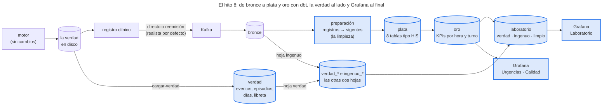

# Hito 8 — Analítica

> **Estado:** especificación aprobada el 16 de noviembre de 2026; la implementación empieza con la etiqueta `v0.7-hito7`. El original está en este repositorio.

Al terminar el hito 8, EDsim tiene lo que un laboratorio de analítica necesita encima de los datos: **las tablas con las que trabaja un analista de hospital**, **un cuadro de mando que se mueve con el directo** y **la medida de cuánto se acercan los datos limpiados a la verdad**. dbt transforma bronce en plata (ocho tablas con la forma de un HIS, sin duplicados y con las correcciones aplicadas) y en oro (los KPIs por hora y por turno); la verdad entra en Postgres en su propio esquema, con permisos separados; y Grafana enseña a la vez lo que vería el hospital y, aparte, la tabla «verdad, ingenuo y limpio».

Es una especificación didáctica, con el formato de las de los hitos 5 a 7: cada pieza explica para qué sirve, cómo funciona, cómo se usa en EDsim y cómo aprender más. Las decisiones son candidatas (H8-n) y su número definitivo es 99 + n (H8-1 = 100, H8-13 = 112); la tarea de cierre escribe sus ADR 0100 a 0112. La sesión conceptual fue el 15 y el 16 de noviembre de 2026.

## Objetivo y alcance

Al cerrar el hito 8:

```bash
uv run edsim motor simular --run-id r2026                       # la verdad, como hoy
uv run edsim registro generar r2026 --perfil realista           # lo registrado y su libreta
docker compose --profile analitica up --wait                    # Kafka, Postgres y, nuevo, Grafana
uv run edsim almacen preparar                                   # migraciones: bronce y, nueva, la 002 (verdad y roles)
uv run edsim directo reemitir r2026 --velocidad max             # nuevo: publica lo registrado realista por defecto
uv run edsim almacen consumir --run r2026_realista_s2026        # a bronce, como en el hito 7
uv run edsim almacen cargar-verdad r2026                        # nuevo: la verdad, a su esquema
cd analitica && uv run dbt build                                # nuevo: bronce → preparación → plata → oro, con sus tests
uv run dbt build --vars '{hoja: verdad}'                        # la misma transformación sobre la verdad
uv run dbt build --vars '{hoja: ingenuo}'                       # y sobre lo registrado sin limpiar
uv run dbt build --select tag:laboratorio                       # la tabla de tres columnas
cd ..
# Grafana en http://127.0.0.1:3000: «Urgencias», «Calidad del dato» y «Laboratorio»
uv run edsim analitica refrescar                                # nuevo: micro-lotes de dbt durante un directo
```

**Por qué ahora.** El hito 7 dejó lo registrado en bronce, tal como llega, y dijo cuánto se desvían los indicadores calculados sin limpiar. Faltan tres cosas para que EDsim sea un laboratorio: la capa con la que trabaja de verdad un analista (tablas limpias con la forma de un HIS), un cuadro de mando que se pueda mirar y la medida que ningún hospital puede hacer, porque no tiene solucionario: cuánto recupera la limpieza y cuánto se queda sin recuperar. Con este hito se cierra la fase 3 de la hoja de ruta, cuyo criterio es «KPIs en Grafana en tiempo real».

**Dentro del alcance**

- **dbt** (H8-2, H8-3): un proyecto en `analitica/`, con su propio lock, que construye preparación, plata y oro en Postgres.
- **La limpieza** (H8-4): conservadora; arregla lo que tiene una regla segura, señala lo detectable y no inventa datos.
- **Plata** (H8-5): ocho tablas con la forma de un HIS (las seis de la decisión 94, más `ubicacion` y `plantilla`).
- **La verdad en Postgres** (H8-6): cuatro tablas en el esquema `verdad`, con `edsim almacen cargar-verdad`, y tres roles.
- **Oro** (H8-7): tres familias de KPIs por hora y por turno (flujo, boxes y recursos, calidad del dato).
- **Tres construcciones** (H8-8): el mismo proyecto sobre lo registrado limpio (el hospital), sobre la verdad y sobre lo registrado sin limpiar (el ingenuo), cada una en sus esquemas, y la tabla de tres columnas.
- **Grafana** (H8-9): en `compose.yaml` con el perfil `analitica`, aprovisionado desde el repositorio.
- **Tiempo real** (H8-10): micro-lotes de dbt cada minuto durante el directo, con los paneles en el reloj de la ejecución.
- **El directo publica lo registrado por defecto** (H8-11): la verdad, con `--verdad`.
- **Tests** (H8-12): unit tests de dbt por regla, tests de datos, una sola prueba de punta a punta contra la verdad y contra Python.
- **Notebook** `08_analitica.ipynb`, ADR 0100 a 0112 y etiqueta `v0.8-hito8` (H8-13).

**Fuera del alcance**

| Qué | Adónde va |
| --- | --- |
| Quix Streams: KPIs por ventana con el tiempo del evento y eventos tardíos | Versiones posteriores (H8-1): su `main` pide `confluent-kafka>=2.8.2,<2.12` y EDsim fija la 2.16 |
| Modelos incrementales con ventana de revisión | Versiones posteriores (H8-3), por interés didáctico |
| Esperas por nivel y su percentil 90 frente al tiempo objetivo de cada nivel | Versiones posteriores (H8-7) |
| Reingresos en el motor y el KPI de retorno en 72 h | Versiones posteriores (H8-5) |
| Retención y compresión de Timescale | Versiones posteriores (H8-1) |
| Un orquestador (Airflow, Dagster o Prefect) y la capacidad por ejecución | Hito 9 (H8-10, H8-7) |
| Parquet y DuckDB para el camino por lotes | Hito 9 (H8-1) |
| Cambios en la app | Fase 2 de la app (#122) |
| Un HIS simulado con base de datos transaccional y CDC | Backlog (#123) |

Las implementa Claude Code. Casi todas necesitan Postgres, así que van en local; la del directo y el notebook van en la nube. Claude Code ejecuta git (rama, commits, push y PR) y Pedro siempre fusiona.

## Cómo encajan las piezas

El motor y el registro clínico no cambian (salvo el valor por defecto del directo). Lo nuevo está después de bronce.



En azul, lo nuevo del hito 8. El rol `hospital` solo lee plata y oro; el rol `laboratorio` lo lee todo.

## Sesión conceptual resumida

La sesión conceptual está escrita en las piezas 1 a 7; estas tablas son el resumen de referencia.

| Concepto | Qué hay que entender | Pieza |
| --- | --- | --- |
| ELT y transformación como código | Los datos se cargan tal cual y se transforman dentro de la base de datos con SQL versionado, probado y documentado | 1 |
| Modelo, `ref()` y grafo | Cada modelo es un `SELECT`; `ref()` dice de qué depende, y dbt construye en orden | 1 |
| Materialización | Vista (se calcula al consultar), tabla (al construir) o incremental (solo lo nuevo) | 1 |
| Qué arregla la limpieza y qué no | Duplicados y correcciones, sí; reloj desajustado y valores erróneos sin corregir, no | 2 |
| Dos clases de duplicados | La relectura de Kafka (el mismo `event_id`) y el doble clic del hospital (dos registros) | 2 |
| El grano | «Una fila por qué»: si está mal, los KPIs se duplican sin avisar | 3 |
| Claves y relaciones | Paciente 1:N episodio; cada tabla hija apunta a su episodio | 3 |
| La verdad como solucionario | Se carga aparte, con su propia llave | 4 |
| Roles y permisos por capa | `hospital` frente a `laboratorio`; `grants` de dbt | 4 |
| Cohorte de llegada | Cada espera se apunta a la hora en que llegó el paciente | 5 |
| La tabla de tres columnas | Verdad, ingenuo y limpio: cuánto recupera la limpieza | 5 |
| Cuadros de mando como código | Grafana lee sus fuentes y sus cuadros de ficheros del repositorio | 6 |
| Micro-lotes | Reconstruir cada minuto en vez de procesar un flujo continuo | 7 |
| El reloj de la ejecución | Los paneles miran el tiempo simulado, no el de la pared | 7 |

### Casos de uso que cubre

| Caso de uso en un hospital | Quién lo tiene | Qué lo cubre |
| --- | --- | --- |
| Cuadro de mando operativo: cuántos hay ahora, esperas, llegadas por hora | Jefe de guardia, supervisión | Grafana, «Urgencias» |
| Informe de indicadores: tiempo hasta el triaje y el médico por turno, reparto por nivel | Dirección, calidad | Oro por hora y por turno |
| Construir los indicadores desde una extracción del HIS | Ingeniero de analítica | El proyecto dbt |
| Calidad del dato: fantasmas, duplicados, correcciones, vacíos | Documentación clínica, sistemas | Tests de dbt y «Calidad del dato» |
| Investigación: cuánto sesgan los errores de registro a los indicadores | Investigadores (la pregunta de Ward, Self y Froehle, 2015) | La tabla de tres columnas, posible solo con la verdad |
| Formación con solucionario | Docencia | Plata y oro para ejercicios, con la verdad aparte |

### Tecnologías frente a alternativas

| Capa | Elegida | Alternativas y por qué no aquí |
| --- | --- | --- |
| Transformación | **dbt-core 1.12 + dbt-postgres 1.11** | dbt v2 (Rust): Postgres aún no es un adaptador soportado sin `DBT_ALLOW_EXPERIMENTAL_ADAPTERS`. SQLMesh: técnicamente atractivo, ecosistema menor, donado por Fivetran a la Linux Foundation. SQL con migraciones: sin grafo, tests de datos ni linaje. Agregados continuos de Timescale: buenos para KPIs en tiempo real de una tabla, pero no limpian |
| Almacén | **Postgres + TimescaleDB** (hito 7) | DuckDB (lotes, hito 9), ClickHouse (gran volumen), Snowflake o BigQuery (nube, de pago): unos 1,4 millones de registros por año simulado caben de sobra |
| Visualización | **Grafana 13.3** | Metabase (preguntas de usuarios no técnicos, AGPL), Superset (BI para equipos técnicos, más pesado), Streamlit (es la app del laboratorio, decisión 97), Power BI o Tableau (propietarios) |
| Tiempo real | **Micro-lotes de dbt** | Quix Streams (choque de versiones, H8-1), agregados continuos, bases de datos de flujo (Materialize, RisingWave) |
| Orquestación | **Un bucle fino** | Airflow 3 (su Docker Compose pide 4 GB, idealmente 8), Dagster (cada modelo de dbt es un activo) o Prefect: al hito 9, donde hay un grafo de réplicas |
| Calidad del dato | **Tests de dbt** | Great Expectations, Soda: los de dbt viven junto a los modelos y bastan |

Contexto: Fivetran y dbt Labs completaron su fusión el 1 de junio de 2026; dbt Core sigue con licencia Apache 2.0. Lo que se aprende con dbt (modelos, `ref`, tests, materializaciones) vale también para SQLMesh y para dbt v2.

## Pieza 1 — dbt: la transformación como código

### Para qué sirve

Bronce guarda lo registrado tal como llegó. Pasar de ahí a tablas limpias y a KPIs se puede hacer con scripts sueltos, pero entonces nadie sabe en qué orden se ejecutan, qué tabla depende de cuál ni si el resultado sigue siendo correcto después de un cambio. dbt convierte esa transformación en un proyecto con dependencias, tests y documentación, como el resto del código.

### Cómo funciona

Un **modelo** es un fichero con un `SELECT`. dbt lo convierte en una tabla o una vista de Postgres:

```sql
-- models/plata/triaje.sql
select run_id, episode_id, nivel, motivo, fin as hora_triaje
from {{ ref('registros_vigentes') }}
where event_type = 'triage_completed'
```

`ref()` le dice a dbt que este modelo depende de `registros_vigentes`; con todas las dependencias arma un **grafo** y construye cada modelo después de los que necesita. `dbt build` construye y prueba en ese orden; `dbt docs generate` produce un catálogo con el grafo de linaje (de qué tabla sale cada columna).

**Materializar** es decidir qué crea dbt para cada modelo: una **vista** se calcula de nuevo en cada consulta; una **tabla** se calcula al construir; una tabla **incremental** solo añade o actualiza lo nuevo.

**Tests.** De dos clases: los **tests de datos** comprueban la tabla construida (`unique`, `not_null`, `relationships`, `accepted_values`, o una consulta propia que no debe devolver filas); los **unit tests** (desde dbt 1.8) dan unas pocas filas de entrada inventadas y la salida esperada de un modelo, sin datos reales.

**El nombre de los esquemas.** Por defecto, dbt no crea el esquema `plata`, sino uno con el esquema del destino delante (`edsim_plata`). Para que se llamen exactamente `preparacion`, `plata` y `oro` se sustituye la macro `generate_schema_name`.

### En EDsim

- El proyecto vive en `analitica/`, un proyecto uv **aparte**, con su propio `pyproject.toml` y su propio `uv.lock`, fuera del workspace y en el mismo repositorio (H8-2). Las dependencias de dbt (psycopg2-binary, agate, protobuf…) no tocan el lock del núcleo, y subir dbt no arrastra nada más.
- Sin paquetes de dbt Hub: ni `dbt deps` ni red al ejecutar. Bastan los tests de serie y los escritos en SQL.
- `profiles.yml` versionado en `analitica/`, con `env_var()` y los valores de compose por defecto: no hay secretos nuevos.
- Un solo repositorio (H8-2): los cambios que cruzan capas (el catálogo de eventos y el staging de dbt) van en un PR, y la prueba de punta a punta corre en un solo CI. Tendría sentido separarlo si otro equipo se hiciera cargo, o para usar el proyecto contra un HIS real.

### Para aprender más

- [dbt: modelos](https://docs.getdbt.com/docs/build/models), [materializaciones](https://docs.getdbt.com/docs/build/materializations), [unit tests](https://docs.getdbt.com/docs/build/unit-tests), [tests de datos](https://docs.getdbt.com/docs/build/data-tests) y [esquemas personalizados](https://docs.getdbt.com/docs/build/custom-schemas).
- [dbt: cómo estructurar un proyecto](https://docs.getdbt.com/best-practices/how-we-structure/1-guide-overview) (staging, intermediate y marts, el equivalente de preparación, plata y oro).

## Pieza 2 — La limpieza: qué se arregla y qué no

### Para qué sirve

Un analista de hospital no tiene la verdad. Para cada despiste solo puede arreglarlo con una regla segura, señalarlo para que se vea o dejarlo pasar porque no se puede detectar. Esta pieza es la lección del hito: la tabla de tres columnas medirá cuánto recupera la limpieza, y esta tabla explica por qué no lo recupera todo.

### Cómo funciona

| Despiste (hito 7) | Qué deja en bronce | Qué hace plata (H8-4) |
| --- | --- | --- |
| Duplicado | Una copia con el mismo `event_time` y el mismo payload, anotada de 0,5 a 2 min después **de la anotación del original** (`record.py`: el `sim_time` del duplicado parte del del original, que ya lleva el retraso) | **Arregla:** se queda con el anotado primero, que es el original y el que recibe la corrección |
| Corrección tardía | Un `record_corrected` con `corrige` (el `event_id` del registro erróneo) y `campos` | **Arregla:** aplica la última corrección de cada registro |
| Desorden | Registros que llegan fuera de orden | **Arregla por diseño:** plata usa `event_time` |
| Retraso | `recorded_time` tarde; `event_time` es la hora declarada | **Arregla por diseño:** plata usa `event_time`; en el directo, lo que llega tarde entra en el siguiente micro-lote |
| Campo vacío | Un `null` en el payload | **Señala:** se queda `NULL`; en oro, «sin nivel» es una categoría |
| Olvido | Falta el registro | **Señala a medias:** sin salida, el episodio queda abierto («fantasma»); sin llegada, no hay hora de llegada |
| Reloj desajustado | `event_time` desplazado por sistema (triaje, +2 min en el perfil realista) | **No se arregla.** Deja rastro solo con un tiempo negativo (triaje antes de la llegada), que se cuenta como aviso de calidad |
| Valor erróneo sin corregir | Un nivel, una edad, un motivo o un destino plausibles | **No se detecta:** el registro clínico elige valores verosímiles |

**Dos clases de duplicados** (las del notebook 07): la **relectura de Kafka** o una reemisión repetida dejan en bronce el mismo `event_id` dos veces, con distinta `ingest_time`; la preparación se queda con una. El **doble clic** del hospital son dos registros con distinto `event_id`; lo quita la regla de duplicados.

**Alternativas consideradas:** una limpieza agresiva (rellenar vacíos con la moda o la mediana, cerrar fantasmas pasadas X horas, estimar el desfase de cada reloj) quizá acerque algún KPI, pero inventa datos; queda como ejercicio del laboratorio. Una limpieza mínima (solo duplicados y correcciones) pierde la mitad de la lección.

### En EDsim

- La limpieza vive en **un solo modelo**, `preparacion.registros_vigentes` (H8-3); las ocho tablas de plata lo leen.
- Cada regla lleva en la documentación del modelo su «por qué» y lo que no cubre.
- Antes de fijar la clave de duplicados, la 8.1 mide que en la verdad de `r2026` ningún par de hechos reales comparte (`run_id`, `episode_id`, `event_type`, `event_time`, payload). Si hay alguno, para.

### Para aprender más

- Ward, Self y Froehle, «Effects of Common Data Errors in Electronic Health Records on Emergency Department Operational Performance Metrics: A Monte Carlo Simulation», *Academic Emergency Medicine*, 2015, la fuente del hito 7 sobre el sesgo de los datos de registro.
- [PostgreSQL: funciones de ventana](https://www.postgresql.org/docs/17/tutorial-window.html) (`row_number()` para quedarse con el primero).

## Pieza 3 — El modelo de un HIS: grano, claves y relaciones

### Para qué sirve

En un hospital, analítica casi nunca recibe eventos: recibe una extracción de las tablas del HIS (decisión 94). Plata imita esas tablas para que los ejercicios del laboratorio se parezcan al trabajo real.

### Cómo funciona

El **grano** de una tabla responde a «¿una fila por qué?». Lucía tiene una llegada, un triaje, dos valoraciones y una analítica con dos pruebas: `episodio` tiene 1 fila; `triaje`, 1; `valoracion`, 2; `prueba`, 2. Si el grano está mal, los KPIs se duplican sin avisar; por eso cada grano tiene su test `unique`.

Las **claves** relacionan las tablas:

```
paciente   PK (run_id, patient_id)
   │ 1
   │ N
episodio   PK (run_id, episode_id)   FK (run_id, patient_id) → paciente
   ├─ 1 : 0..1  triaje      PK (run_id, episode_id)
   ├─ 1 : N     valoracion  PK (run_id, episode_id, n)
   ├─ 1 : N     prueba      PK (run_id, episode_id, ronda, prueba)
   ├─ 1 : N     ubicacion   PK (run_id, episode_id, n)
   └─ 1 : 0..1  destino     PK (run_id, episode_id)
plantilla  PK (run_id, recurso, desde)   sin episodio: viene de RRHH
```

«0..1» porque quien se va sin ser visto puede no tener triaje ni destino. `relationships` comprueba cada flecha.

### En EDsim

- **Paciente y episodio, 1:N** (H8-5, a pregunta de Pedro): ningún test ni modelo da por hecho el 1:1. Pero hoy los datos son 1:1, porque el motor no simula reingresos: `patient_id` y `episode_id` llevan el mismo número de llegada (`engine/events.py`). Es una diferencia con la realidad, escrita a propósito.
- **Valoraciones, pruebas y ubicaciones no tienen identificador propio:** el inicio y el fin se emparejan **por tiempo** dentro del episodio, sin mirar el tipo (D2 de la 8.3). Cada fin va con la apertura abierta justo antes. Funciona porque las valoraciones de un paciente no se solapan, ni sus estancias en box, y las dos fichas son del mismo sistema. Un olvido rompe una pareja, y la señal `sin_pareja` lo enseña. Emparejar por orden lo haría peor: con un inicio olvidado al principio, junta un inicio con un fin anterior, y la duración sale negativa.
- **`plantilla` viene del sistema `rrhh`**, no del HIS (`staffing_changed` es el único evento de recursos). Los eventos de recursos no pasan por los despistes (`record.py`), así que esta tabla llega limpia.
- Todas las ejecuciones de bronce, con `run_id` en cada clave: cada ejecución es como un hospital, y lo registrado de cada perfil ya llega con su `run_id` derivado.

### Para aprender más

- Kimball y Ross, *The Data Warehouse Toolkit*, capítulos 1 a 3 (el grano y las tablas de hechos).
- [HL7 FHIR: Encounter](https://hl7.org/fhir/encounter.html), cómo modela un estándar clínico el episodio.

## Pieza 4 — La verdad en Postgres y los permisos por capa

### Para qué sirve

Para poner nota hacen falta el examen y el solucionario en la misma mesa, pero el alumno no debe ver el solucionario. La verdad entra en Postgres para comparar con SQL y verla en Grafana, con una llave que el «hospital» no tiene.

### Cómo funciona

Una ejecución guardada trae cuatro cosas útiles: los eventos de la verdad (`eventos.jsonl`), la ficha de cada episodio (`ground_truth_episodios.csv`, 65 columnas), las llegadas de cada día (`ground_truth_dias.csv`) y la libreta de cada perfil registrado (`registros/<perfil>-s<semilla>/defectos.csv`).

**La ficha no trae los tiempos vividos.** Trae lo que el motor sorteó (duraciones, nivel asignado y nivel real, gravedad, paciencia) y los parámetros (`engine/report.py`); cuánto esperó cada paciente solo está en los eventos. Por eso el oro de la verdad sale de sus eventos, pasando por los mismos modelos (pieza 5). La ficha aporta otra cosa: `nivel_real` frente a `nivel`, la calidad del triaje que ningún hospital ve.

`COPY` es la carga masiva de Postgres: mucho más rápida que insertar fila a fila.

Los **roles** son las llaves de Postgres: cada conexión entra con uno, y cada esquema dice qué roles pueden leerlo (`GRANT`).

### En EDsim

- `edsim almacen cargar-verdad RUN_ID` carga las cuatro tablas de `verdad`; ejecutarlo dos veces deja lo mismo (H8-6). La verdad no pasa por Kafka (H7-2).
- Tres roles: `edsim` (dueño: migraciones, cargas y dbt), `hospital` (lee plata y oro de lo registrado) y `laboratorio` (lo lee todo).
- dbt vuelve a crear las tablas en cada construcción, y con ellas se perderían los permisos dados a mano: los de plata y oro van en la configuración `grants` de dbt, que los aplica en cada construcción.
- Es un candado contra mirar la solución sin querer, no seguridad: las contraseñas de desarrollo están en el repositorio, como las de compose.

### Para aprender más

- [PostgreSQL: roles y privilegios](https://www.postgresql.org/docs/17/user-manag.html) y [`COPY`](https://www.postgresql.org/docs/17/sql-copy.html).
- [dbt: `grants`](https://docs.getdbt.com/reference/resource-configs/grants).

## Pieza 5 — Oro y la tabla de tres columnas

### Para qué sirve

Oro es la hoja que querría ver el jefe de guardia cada hora, y el informe de dirección de cada turno. La tabla de tres columnas, la del laboratorio, pone al lado de cada KPI su valor en la verdad, en lo registrado sin limpiar y en lo limpiado.

### Cómo funciona

**Tres familias de KPIs** (H8-7), por hora y por turno:

- **Flujo:** llegadas, pacientes dentro a la hora en punto (censo), mediana hasta el triaje y hasta el médico, reparto por nivel, los que se van sin ser vistos y la estancia.
- **Boxes y recursos:** ocupación de boxes, tiempo en box, desplazamientos, salidas a esperar resultados y pacientes por médico.
- **Calidad del dato:** episodios sin salida, valoraciones sin pareja, tiempos negativos, campos vacíos, correcciones aplicadas y duplicados quitados.

**La cohorte de llegada.** Cada espera se apunta a la hora en que llegó el paciente: «los que llegaron a las 16:00 esperaron tanto». En el directo tiene un efecto curioso: en la hora en curso solo cuentan los ya triados, los rápidos, así que la mediana de la última hora sale mejor de lo que será. Grafana enseña al lado los **pendientes**.

**Tres construcciones del mismo proyecto** (H8-8), con la variable `hoja`:

| Hoja | Lee de | Limpieza | Escribe en | Quién la lee |
| --- | --- | --- | --- | --- |
| `hospital` (por defecto) | `bronce.eventos` | Sí | `preparacion`, `plata`, `oro` | `hospital` y `laboratorio` |
| `verdad` | `verdad.eventos` | Sí (no hay nada que limpiar: es una comprobación) | `verdad_preparacion`, `verdad_plata`, `verdad_oro` | `laboratorio` |
| `ingenuo` | `bronce.eventos` | No: el primero de cada tipo, sin correcciones, como `compare.py` | `ingenuo_preparacion`, `ingenuo_plata`, `ingenuo_oro` | `laboratorio` |

El mismo código corrige las tres hojas, así que las diferencias de la tabla vienen de los datos y no de haber programado dos veces. La tabla de tres columnas es otro modelo, en el esquema `laboratorio`.

### En EDsim

- Los cinco indicadores del hito 7 llevan **las mismas definiciones** que `edsim.clinical_record.compare` (decisión 96), para comprobar que el SQL y el Python dan lo mismo (H8-12).
- La capacidad no está en los datos: los 36 boxes y las horas de los turnos viven en `config/centro.toml`. Van en dos **semillas** de dbt (`maestro_boxes.csv` y `turnos.csv`), tablas pequeñas y fijas, el caso de uso de las semillas; un test comprueba que coinciden con `centro.toml`. La capacidad por ejecución, que importará cuando los experimentos cambien los boxes, es del hito 9.

### Para aprender más

- [dbt: semillas](https://docs.getdbt.com/docs/build/seeds) y [variables](https://docs.getdbt.com/docs/build/project-variables).
- Welch y otros, «Emergency Department Operational Metrics, Measures and Definitions» (Annals of Emergency Medicine, 2011), las definiciones de consenso de los indicadores de urgencias.

## Pieza 6 — Grafana y el aprovisionamiento

### Para qué sirve

Un cuadro de mando hecho a mano en la pantalla vive solo en esa pantalla: no se revisa en un PR, el CI no lo comprueba y se pierde al borrar un volumen. Con el **aprovisionamiento**, Grafana lee al arrancar sus fuentes de datos y sus cuadros de ficheros del repositorio.

### Cómo funciona

Grafana es una aplicación web que consulta fuentes de datos (aquí, Postgres con SQL) y dibuja paneles que se refrescan solos. Al arrancar lee `provisioning/datasources/*.yaml` (las conexiones) y `provisioning/dashboards/*.yaml` (dónde están los cuadros en JSON). Cada cuadro lleva un `uid` fijo. Si se cambia un panel en la pantalla, se exporta su JSON y se sube al repositorio: el repositorio manda.

Desde la 13.2, la fuente de PostgreSQL es un plugin aparte, preinstalado en la edición OSS.

### En EDsim

- `grafana/grafana:13.3.1` (OSS), con el perfil `analitica` y en `127.0.0.1:3000` (H8-9).
- Dos fuentes de datos: «Hospital» (rol `hospital`) y «Laboratorio» (rol `laboratorio`). Tres cuadros: **Urgencias**, **Calidad del dato** y **Laboratorio**.
- Sin volumen: su estado es el repositorio. Acceso anónimo de solo lectura, en un laboratorio local.

### Para aprender más

- [Grafana: aprovisionamiento](https://grafana.com/docs/grafana/latest/administration/provisioning/) y [la fuente de PostgreSQL](https://grafana.com/docs/grafana/latest/datasources/postgres/).

## Pieza 7 — Tiempo real por micro-lotes

### Para qué sirve

Hasta bronce, el directo ya llega en segundos (hito 7). Pero plata y oro son tablas: solo cambian cuando alguien construye. Es como un periódico impreso: la redacción recibe noticias sin parar, pero el lector solo ve la última edición.

### Cómo funciona

**Micro-lotes:** un bucle lanza la construcción del hospital cada N segundos. Con dbt cada 60 s y Grafana refrescando cada 30 s, lo que pasa en el hospital simulado aparece en uno o dos minutos (estimación por medir).

**El reloj de la ejecución.** El directo ancla `event_time` al reloj de pared (`anchored_start` en `live/directo.py`): a velocidad 1, «las últimas 6 h» de Grafana funcionan; a ×60 el tiempo simulado se adelanta y los datos caen en el futuro; una reemisión de `r2026` cae en enero. Los paneles no usan el reloj de la pared sino el de la ejecución: se elige la ejecución en un desplegable y se ven sus últimas 24 horas simuladas, contadas desde su último dato.

**Por qué no un orquestador** (a pregunta de Pedro): un orquestador lanza un grafo de tareas con calendario, reintentos e historial; brilla con lotes, no con una reconstrucción cada minuto, y el consumidor de Kafka es un servicio que no termina. Encaja en el hito 9 (réplicas en paralelo). En este hito, cada paso es un comando que deja lo mismo si se repite: listo para orquestar.

**Por qué no Quix Streams** (H8-1): su valor es una lección (ventanas y eventos tardíos), no una pieza que el producto necesite, y hoy choca con la versión de `confluent-kafka` de EDsim.

### En EDsim

- `edsim analitica refrescar [--cada 60]` construye la hoja del hospital (sin tests) hasta Ctrl+C (H8-10).
- En un directo, oro llega hasta el **fin del dato**, la última anotación, y no hasta el horizonte: sin horas aún por llegar con un censo congelado (D1 de la 8.7).
- La 8.7 mide cuánto tarda una construcción con un año (`r365`) en bronce. Si pasa del intervalo, para y se decide el plan B: un incremental «por ejecución» que borra y reescribe solo el `run_id` del directo.

### Para aprender más

- Kleppmann, *Designing Data-Intensive Applications*, capítulos 10 (lotes) y 11 (flujos).
- [Apache Airflow](https://airflow.apache.org/docs/) y [Dagster](https://docs.dagster.io/) (su integración `dagster-dbt` convierte cada modelo de dbt en un activo), para el hito 9.

## Especificación: el proyecto dbt

### Estructura

```
analitica/
├── pyproject.toml          # dbt-core>=1.12,<1.13; dbt-postgres>=1.11,<1.12; requires-python >=3.13
├── uv.lock                 # propio; fuera del workspace del núcleo
├── dbt_project.yml         # nombre edsim_analitica; vars: hoja (hospital)
├── profiles.yml            # target dev con env_var() y los valores de compose
├── macros/
│   ├── generate_schema_name.sql   # esquemas exactos, con el prefijo de la hoja
│   └── fuente_registros.sql       # bronce.eventos o verdad.eventos según la hoja
├── models/
│   ├── fuentes.yml         # bronce.eventos, bronce.ejecuciones, verdad.*
│   ├── preparacion/        # registros (vista), registros_vigentes (tabla)
│   ├── plata/              # las ocho tablas
│   ├── oro/                # kpi_hora, kpi_turno, kpi_ejecucion, calidad
│   └── laboratorio/        # tres_columnas (tag laboratorio)
├── seeds/                  # maestro_boxes.csv, turnos.csv
└── tests/                  # tests de datos escritos en SQL
```

- **La carpeta.** `analitica/` no es un paquete de Python ni un miembro del workspace (`[tool.uv.workspace]` del `pyproject.toml` raíz solo tiene `members = ["app"]`). dbt busca `dbt_project.yml` en la carpeta de trabajo, así que sus órdenes se lanzan desde dentro: `cd analitica && uv run dbt …`. `edsim analitica refrescar` lanza su subproceso con esa carpeta de trabajo.
- **Conexión.** `profiles.yml` lee `EDSIM_PG_HOST` (`localhost`), `EDSIM_PG_PUERTO` (`5432`), `EDSIM_PG_USUARIO` (`edsim`), `EDSIM_PG_CLAVE` (`edsim`) y `EDSIM_PG_BASE` (`edsim`), con esos valores por defecto. Las pruebas dan su propia base con `EDSIM_PG_BASE`; dbt nunca prueba contra `edsim`.
- **Comprobado en la 8.1:**
  - `uv lock` resuelve con Python 3.13: dbt-core 1.12.7 y dbt-postgres 1.11.0, 62 paquetes, y el `uv.lock` raíz no cambia;
  - dbt encuentra `profiles.yml` en la carpeta del proyecto sin `--profiles-dir`;
  - `dbt parse` no necesita conexión: pasa con `EDSIM_PG_PUERTO=1`.

### Esquemas y la variable `hoja`

`generate_schema_name` devuelve el nombre exacto del esquema del modelo (`preparacion`, `plata`, `oro`, `laboratorio`) y, con `hoja` distinta de `hospital`, le pone delante `<hoja>_`. Los modelos con la etiqueta `laboratorio` se construyen aparte (`--select tag:laboratorio`) y las tres hojas los excluyen.

Lo registrado y la verdad se enlazan por el `run_id`: el mensaje `inicio` de cada ejecución registrada, en `bronce.ejecuciones`, lleva `registro.origen` (el `run_id` de la verdad), `perfil` y `semilla`.

## Especificación: preparación y limpieza

### `preparacion.registros` (vista)

Una fila por registro, con los tipos puestos y sin las columnas de Kafka: `event_id`, `event_type`, `run_id`, `episode_id`, `patient_id`, `source_system`, `event_time`, `recorded_time`, `payload` (y `ingest_time` en las hojas que leen de bronce). Sin lógica salvo una: **una fila por (`run_id`, `event_id`)**, la de menor `ingest_time`. Una reemisión repetida o una relectura deja en bronce el mismo registro dos veces (la segunda clase de duplicado del notebook 07).

### `preparacion.registros_vigentes` (tabla)

Las reglas, en este orden, en las hojas `hospital` y `verdad`:

1. **Los `record_corrected` no son hechos:** se usan en el paso 3 y no pasan a la salida.
2. **Duplicados:** entre los registros con la misma clave (`run_id`, `episode_id`, `event_type`, `event_time`, `payload`), se queda el de menor `recorded_time` (y, si empatan, el de menor `event_id`). Columna `duplicados_quitados` con cuántos se quitaron.
3. **Correcciones:** para cada registro al que apunta algún `corrige`, se aplican los `campos` de la corrección con mayor `recorded_time` sobre el payload. Columna `corregido`. Una corrección que apunta a un registro que no está (porque se olvidó, por ejemplo) se cuenta como aviso de calidad.

En la hoja `ingenuo`, `registros_vigentes` es `registros` sin los `record_corrected`: ni se quitan duplicados ni se aplican correcciones, como los indicadores ingenuos del hito 7 («el primero de cada tipo, correcciones nunca aplicadas»).

Los eventos de recursos (`staffing_changed`) pasan tal cual: no tienen despistes.

### Unit tests (8.1), sobre el escenario L del hito 7

El escenario L está en [hito-7.md](hito-7.md#escenario-l-para-los-tests-de-la-71): siete registros, con un triaje (registro 4, nivel 4) corregido a nivel 3 por el registro 7 y una valoración (registro 5) duplicada en el 6.

| Caso | Entrada | Esperado | Qué pilla que no pille otro |
| --- | --- | --- | --- |
| L | Los siete registros del escenario L | Cinco filas: 1, 2, 3, 4 con nivel 3 y `corregido`, 5; ni el 6 ni el 7 | Las tres reglas juntas, en su orden |
| D | L, con el registro 4 duplicado (un 4′ anotado 1 min después, con nivel 4) | Una sola fila de triaje: el 4, con nivel 3 | Quedarse con la copia: la corrección apunta al original y se perdería |
| C | L, con una segunda corrección del 4 a nivel 2, anotada después del 7 | El 4 con nivel 2 | Aplicar la primera corrección en vez de la última |
| H | Dos `test_ordered` del mismo episodio a la misma hora con distinto payload | Las dos filas | Una clave de duplicados sin el payload, que borraría hechos reales |
| K | El registro 5 dos veces, con el mismo `event_id` y distinta `ingest_time` | Una fila, la primera llegada | La preparación sin quitar la relectura |
| I | L en la hoja `ingenuo` | Seis filas: el 6 se queda; el 4 con nivel 4 | Que la hoja ingenua limpie |
| E | Dos dobles clics anotados en el mismo instante, y dos correcciones del mismo registro anotadas en el mismo instante (añadido en la revisión de la 8.1) | Se queda el duplicado de menor `event_id`; gana la corrección de mayor `event_id` | Los desempates al revés |
| R | Dos `staffing_changed` iguales, sin `episode_id` (añadido en la revisión de la 8.1) | Las dos filas | Que los eventos de recursos entren en la regla de duplicados (sus nulos caerían en el mismo grupo) o se pierdan |

Cada valor esperado sale de un cálculo ejecutado en el plan, con código independiente de los modelos.

### La medida previa (8.1)

Con Python sobre `eventos.jsonl` de `r2026` (sin Postgres): cuántos pares de hechos reales comparten la clave de duplicados. Se espera 0; si no lo es, la tarea para y se decide la clave. El test «oro limpio = oro verdad» de la 8.5 lo vigila después para siempre.

## Especificación: plata

Ocho tablas (H8-5). Cada fila lleva `run_id`, la hora del acto (`event_time`) y la del registro (`recorded_time`) de los eventos de los que sale. Los nombres de las columnas nuevas, en español, como bronce y las claves TOML; los identificadores del sobre (`run_id`, `episode_id`, `patient_id`), tal cual.

| Tabla | Grano y clave | Sale de | Columnas principales | Señales |
| --- | --- | --- | --- | --- |
| `paciente` | uno por paciente: (`run_id`, `patient_id`) | todos los eventos de pacientes; edad y sexo, de `patient_registered` (D1 de la 8.3) | edad, sexo | — |
| `episodio` | uno por episodio: (`run_id`, `episode_id`); FK a `paciente` | todos los eventos de pacientes; las columnas, de `patient_arrived`, `patient_registered`, `patient_departed` y `patient_left_wbs` (D1) | llegada, medio, registro, salida, abandono, espera al abandonar | `sin_llegada`, `sin_salida` |
| `triaje` | uno por episodio: (`run_id`, `episode_id`) | `triage_started`, `triage_completed` | inicio, fin, circuito, nivel, motivo, `corregido` | `tiempo_negativo` (fin antes de la llegada) |
| `valoracion` | una por valoración: (`run_id`, `episode_id`, `n`), `n` por orden de inicio (o del fin, si no hay inicio) | `assessment_started` con `assessment_ended`, emparejados por tiempo dentro del episodio, sin mirar el tipo (D2) | tipo, pool, box, inicio, fin, interrumpida | `sin_pareja` |
| `prueba` | una por prueba y ronda: (`run_id`, `episode_id`, `ronda`, `prueba`) | `test_ordered` y `test_resulted`, emparejados por tiempo, con la lista pedida y las claves del resultado desplegadas juntas (D4) | prueba, pedida, resultado, hora del resultado | `sin_resultado`, `sin_peticion` |
| `destino` | uno por episodio: (`run_id`, `episode_id`) | `disposition_decided`, `bed_requested`, `bed_assigned` y la salida | destino decidido, petición y asignación de cama, servicio, destino real | — |
| `ubicacion` | una por estancia en un box: (`run_id`, `episode_id`, `n`) | `box_assigned` hasta `box_released`, `patient_displaced`, `patient_departed` o `patient_left_wbs`, emparejados por tiempo (D2) | box, entrada, salida, motivo de la salida (`espera_resultados`, `desplazado`, `salida`, `abandono`; D3) | `sin_pareja` |
| `plantilla` | un tramo por recurso: (`run_id`, `recurso`, `desde`) | `staffing_changed` | recurso, número, desde, hasta | — |

«El primero de cada tipo» se toma por orden de anotación, como `compare.py`; en la hoja del hospital ya no hay duplicados, así que el primero es el único.

**Las cuatro decisiones de la 8.3** (notas del chat del #142). Ninguna arregla un defecto: evitan que un defecto rompa o estropee una tabla y lo dejan señalado, como la limpieza conservadora (decisión 103).

- **D1.** `paciente` y `episodio` salen de todos los `patient_id` y `episode_id` de los eventos de pacientes. Si no, un olvido de admisión haría fallar `relationships` de episodio a paciente y tumbaría el `dbt build` del hospital, y ninguna tabla hija queda colgando.
- **D2.** Las valoraciones se emparejan por tiempo dentro del episodio y sin mirar el tipo, en el orden de `event_time`, `recorded_time` y `event_id`. Un fin sin apertura justo antes queda `sin_pareja`, y una apertura seguida de otra apertura, también. La última apertura sin cierre lleva `sin_pareja` si el episodio tiene salida (el cierre se olvidó) y no la lleva si sigue en curso. `ubicacion` se empareja igual, con `box_assigned` como apertura. Sus dos salidas (`patient_departed` y `patient_left_wbs`) solo cierran una estancia abierta: quien es desplazado mientras espera cama sale desde el pasillo, sin box.
- **D3.** `ubicacion` tiene cuatro motivos de salida. `abandono` es `patient_left_wbs` desde el box. `salida` sustituye a `alta`, porque quien sale ingresado o trasladado no se va de alta, y `alta` ya es uno de los destinos.
- **D4.** `prueba` despliega la lista pedida y las claves del resultado juntas. `sin_resultado` marca una prueba sin resultado, y `sin_peticion`, una que no está en la lista pedida. Así, una `pruebas` vacía no hace desaparecer la ronda. Si faltan las dos, no hay prueba que nombrar, y la ronda no da filas.

**Tests de datos:** clave única en cada tabla y `not_null` en las claves; relación de cada tabla hija con `episodio` y de `episodio` con `paciente`; `accepted_values` en nivel (1 a 5), tipo de valoración (`inicial`, `reevaluacion`), motivo de salida de `ubicacion` (los cuatro de D3) y recurso de `plantilla` (`enfermeria_triaje`, `medicos`). La unicidad y la relación son de clave compuesta, porque todas llevan `run_id`. `unique` y `relationships` de dbt solo admiten una columna, así que la 8.3 escribe dos tests genéricos, `clave_unica` y `relacion`. Ninguno da por hecho que paciente y episodio van 1 a 1.

**Unit tests (8.3)**, cada uno con un error que no pilla ningún otro:

| Test | Entrada | Debe salir | Pilla |
| --- | --- | --- | --- |
| Inicio olvidado al final | inicio, fin, fin | `n=1` bien emparejada; el segundo fin, `sin_pareja` | emparejar sin la señal (V6) |
| Inicio olvidado al principio | fin, inicio, fin | el primer fin, `sin_pareja`; el inicio con el segundo fin | emparejar por orden en vez de por tiempo |
| Estancias en box | asignado → liberado · asignado → desplazado · asignado → salida | tres estancias con `espera_resultados`, `desplazado` y `salida` | un motivo mal asignado o una estancia mal cerrada |
| Tramos de plantilla | tres `staffing_changed` de médicos y uno de enfermería | `hasta` de cada tramo = `desde` del siguiente del mismo recurso; el último, abierto | un `hasta` mal calculado |
| Lista y resultado juntos (añadido en la revisión de la 8.3) | una ronda con la lista vacía y su resultado; otra con un resultado de menos | las pruebas del resultado, con `sin_peticion`; la que falta, con `sin_resultado` | desplegar solo la lista pedida o solo el resultado (D4) |

Los tres últimos tienen razón propia: los indicadores de boxes y recursos no están en `compare.py`, y las señales de las pruebas tampoco, así que la prueba de punta a punta de la 8.5 (SQL frente a Python) no los vería.

## Especificación: la verdad en Postgres

### Migración `002_verdad.sql`

- El esquema `verdad` con cuatro tablas:
  - `verdad.eventos`: las columnas de `bronce.eventos` menos las de Kafka, `valor` y `recibido`, con clave (`run_id`, `event_id`). Una tabla normal, no una hypertable: Timescale exigiría la columna de partición en la clave, y la verdad se carga entera y no crece en directo.
  - `verdad.episodios`: las 65 columnas de `ground_truth_episodios.csv`, con sus nombres; los tipos los decide el plan. Clave (`run_id`, `episodio`).
  - `verdad.dias`: las columnas de `ground_truth_dias.csv`; clave (`run_id`, `dia`).
  - `verdad.libreta`: `run_id_origen` (la ejecución verdadera, por la que se borra y se recarga), `run_id` derivado, `perfil`, `semilla` y las once columnas de `defectos.csv` (`registro`, `hecho`, `clase`, `retraso_min`, `desfase_min`, `campo_vacio`, `campo_erroneo`, `valor_verdadero`, `valor_registrado`, `duplicado_de`, `corrige`).
- Los roles `hospital` y `laboratorio`, con contraseñas de desarrollo iguales a su nombre. Los roles son de todo el servidor, no de una base: la migración los crea solo si no existen, porque las bases de prueba de cada sesión comparten servidor.
- `laboratorio` lee `bronce` y `verdad`; `hospital`, ninguno de los dos. Los permisos de los esquemas de dbt los pone dbt: `grants` da `SELECT` en cada tabla al crearla, y el `on-run-end` (`dar_uso_de_esquemas`, 8.5) da `USAGE` en los esquemas, que `grants` no da.

### `edsim almacen cargar-verdad RUN_ID [--ejecuciones DIR] [--postgres URL]`

- Lee la ejecución guardada con `edsim.runs` y carga sus cuatro tablas; la libreta, de cada carpeta `registros/<perfil>-s<semilla>/` que exista (las escribe `edsim registro generar`; una reemisión no las escribe).
- Una transacción por ejecución: borra lo que haya de ese `run_id` y escribe con `COPY` de psycopg. Ejecutarla dos veces deja lo mismo.
- Lógica en `edsim.store` (lectura y filas, sin conectar; la carga, con la conexión), con la CLI fina.
- **Medido en la 8.4** (año `r365`, semilla 2026): 1.386.002 eventos, 109.910 episodios y 1.395.175 filas de libreta con el perfil realista; se cargan en 56,6 s con 153 MiB de memoria pico y ocupan 577 MB en Postgres. Detalle en el anexo.

## Especificación: oro

### Las tablas

| Tabla | Grano | Para qué |
| --- | --- | --- |
| `oro.kpi_hora` | (`run_id`, hora) | Las series de Grafana |
| `oro.kpi_turno` | (`run_id`, fecha, turno) | El informe por turno |
| `oro.kpi_ejecucion` | (`run_id`) | Los cinco indicadores del hito 7 en su ventana, para la tabla de tres columnas y la comprobación con Python |
| `oro.calidad` | (`run_id`) | Los avisos de calidad del dato |
| `oro.censo` | (`run_id`, hora) | El censo a cada hora en punto de la ventana (añadida en la 8.5: la comparten `kpi_hora` y `kpi_ejecucion`) |
| `oro.cohorte` | (`run_id`, `episode_id`) | Cada episodio con su hora y su turno de llegada, sus esperas y si sigue dentro (añadida en la 8.5: la comparten `kpi_hora`, `kpi_turno` y `calidad`) |
| `laboratorio.tres_columnas` | (`run_id` de la verdad, perfil, semilla, KPI) | Verdad, ingenuo, limpio y las diferencias |

Los parámetros de cada ejecución (el origen, W y el horizonte) están en `preparacion.parametros` (8.5). En las hojas `hospital` e `ingenuo` salen del último `inicio` de `bronce.ejecuciones`, y en la `verdad`, de `verdad.dias`: el hospital no lee la verdad.

### Las definiciones

**Los cinco del hito 7**, con las definiciones de `compare.py` (`_naive_indicators` y su docstring), que la 8.5 recalcula en su plan:

| KPI | Definición |
| --- | --- |
| Llegadas | Los registros `patient_arrived` de `registros_vigentes`. En la hoja ingenua, los duplicados cuentan, como en Python |
| Censo | A cada hora en punto de la ventana (las horas `k` con calentamiento ≤ 60 k < horizonte), los episodios con llegada ≤ esa hora menos los que salieron (`patient_departed` o `patient_left_wbs`) ≤ esa hora: quien sale justo a la hora en punto ya no está; quien llega justo, sí. Una salida anterior a la llegada (por los relojes) cuenta como salida en la llegada |
| Mediana hasta el triaje | Minutos de la primera llegada al primer `triage_completed` de cada episodio con los dos |
| Mediana hasta el médico | Lo mismo, al primer `assessment_started` de tipo `inicial` |
| Reparto por nivel | Porcentaje de cada nivel entre los `triage_completed` de `registros_vigentes` con nivel legible |

**La ventana** (D1 de la 8.5, notas del chat del #144). En `kpi_ejecucion`, un registro cuenta si su `event_time` es ≥ origen + W: las llegadas, las medianas (con los dos registros dentro) y el reparto por nivel se calculan sobre esos registros, y el censo, con todos. Una reemisión solo deja en bronce, de antes de W, el censo inicial (los eventos de los episodios abiertos en W): sin la ventana, «limpio − verdad» mezclaría los despistes con las llegadas del calentamiento que faltan. La prueba de punta a punta filtra igual en Python antes de llamar a las funciones de `compare.py`, que no cambia.

**Por hora y por turno**, las esperas se apuntan a la hora (o al turno) de llegada, con los **pendientes** (llegados sin triaje o sin médico aún). Los turnos empiezan a las 8, a las 15 y a las 22 (`[turnos].inicio` de `centro.toml`, en la semilla `turnos.csv`). Precisiones de la 8.5:

- las llegadas por hora son registros por la hora de su `event_time`, como en `kpi_ejecucion`;
- la noche pertenece a la fecha en que empieza, y el turno que corta W o el horizonte sale con sus `horas` y `completo` falso;
- un episodio sin salida **sigue dentro** si su última anotación es de las últimas 24 h de la ejecución (`margen_sin_salida_min`); si no, su **salida se olvidó**. Los pendientes son los que siguen dentro. Ningún margen separa del todo, porque las esperas de cama dejan días sin anotar: con 14 días y el perfil realista, el de 24 h clasifica mal 1 de 22 olvidadas y 6 de 57 que siguen dentro (detalle en el anexo).

**Los nuevos:**

| KPI | Definición |
| --- | --- |
| Se van sin ser vistos | Episodios con `patient_left_wbs`, por hora de llegada |
| Estancia | Minutos de la llegada a la salida, por hora de llegada |
| Ocupación de boxes | Boxes ocupados (`ubicacion`) a la hora en punto, entre los de `maestro_boxes` |
| Tiempo en box | Mediana de la duración de cada estancia, por hora de entrada |
| Desplazamientos | Estancias que acaban en `desplazado`, por hora |
| Salidas a esperar resultados | Estancias que acaban en `espera_resultados`, por hora |
| Pacientes por médico | Censo a la hora en punto entre los médicos de `plantilla` en ese momento |
| Calidad del dato | Por ejecución: episodios `sin_salida` y `sin_llegada`, valoraciones y ubicaciones `sin_pareja`, triajes con `tiempo_negativo`, campos vacíos por campo, correcciones aplicadas, correcciones sin registro, duplicados quitados |

**Las semillas** `maestro_boxes.csv` (los 36 boxes) y `turnos.csv` (las tres horas de inicio), con un test en pytest que las compara con `config/centro.toml` (pilla cambiar uno sin el otro).

### La tabla de tres columnas

`laboratorio.tres_columnas` lee `oro.kpi_ejecucion` de las tres hojas como fuentes y las une por la ejecución: el `run_id` derivado de lo registrado se enlaza con el de la verdad por `registro.origen` de `bronce.ejecuciones`. Columnas: el KPI, verdad, ingenuo, limpio, ingenuo − verdad y limpio − verdad.

## Especificación: Grafana

### Compose

```yaml
  grafana:
    image: grafana/grafana:13.3.1      # etiqueta exacta, comprobada en la 8.6 (decisión 62)
    profiles: ["analitica"]
    ports:
      - "127.0.0.1:3000:3000"
    environment:
      GF_AUTH_ANONYMOUS_ENABLED: "true"
      GF_AUTH_ANONYMOUS_ORG_ROLE: Viewer
    volumes:
      - ./grafana/provisioning:/etc/grafana/provisioning:ro
      - ./grafana/dashboards:/var/lib/grafana/dashboards:ro
```

- **El perfil `analitica`** porque `compose.yaml` no usa perfiles («son la base») y `scripts/tests-integracion.sh` hace `docker compose up --wait` sin nombrar servicios: sin perfil, el CI de integración y el notebook 06 levantarían Grafana sin necesitarlo.
- **`127.0.0.1`** desde el principio (la ADR 0062 apuntó que la consola de Redpanda escuchaba en todas las interfaces).
- Grafana se conecta a Postgres por la red de compose (`postgres:5432`).
- **Por comprobar en la 8.6:** que la etiqueta existe y que el plugin de PostgreSQL va dentro de la imagen, sin descargarlo al arrancar.

### Los ficheros

```
grafana/
├── provisioning/
│   ├── datasources/edsim.yaml     # «Hospital» (rol hospital) y «Laboratorio» (rol laboratorio)
│   └── dashboards/edsim.yaml      # el proveedor que lee /var/lib/grafana/dashboards
└── dashboards/
    ├── urgencias.json             # uid edsim-urgencias
    ├── calidad.json               # uid edsim-calidad
    └── laboratorio.json           # uid edsim-laboratorio
```

### Los cuadros

- **Urgencias** (fuente «Hospital»): variable `ejecucion` (las de `oro.kpi_hora`); censo ahora y por hora, llegadas, mediana hasta el triaje y hasta el médico con sus pendientes, reparto por nivel, ocupación de boxes, los que se van sin ser vistos y pacientes por médico. Refresco cada 30 s.
- **Calidad del dato** (fuente «Hospital»): `oro.calidad` de la ejecución elegida.
- **Laboratorio** (fuente «Laboratorio»): `laboratorio.tres_columnas`, y las series de `kpi_hora` de las tres hojas superpuestas.
- **El reloj de la ejecución:** las consultas de serie filtran por la ejecución y por sus últimas 24 horas simuladas, contadas desde la última hora de esa ejecución en `oro.kpi_hora`; no usan el rango de tiempo del cuadro (`$__timeFilter`), que se oculta.

## Especificación: tiempo real

- `edsim analitica refrescar [--cada S] [--analitica DIR]`: cada `S` segundos (60 por defecto) lanza `dbt build` del proyecto `analitica/` en la hoja del hospital, excluyendo `tag:laboratorio` y sin tests (`--exclude-resource-type test unit_test`), hasta Ctrl+C. Es `build` y no `run` (D2 de la 8.7) porque también carga las semillas: funciona en una base recién creada. Imprime en cada vuelta cuánto tardó y avisa si tardó más que el intervalo. El intervalo cuenta desde el inicio de la vuelta; si una se pasa, la siguiente empieza al acabar.
- **Una vuelta que falla** avisa con su código y las últimas líneas de dbt, y la siguiente se lanza a su hora (D3 de la 8.7): un fallo pasajero no tira el directo. Ctrl+C, dentro de una vuelta o en la espera, sale con un resumen.
- La lógica en el paquete (`edsim.analytics`), con la construcción (un subproceso `uv run --locked --project analitica dbt build …`, con `analitica/` como carpeta de trabajo) y el reloj inyectados; se prueba con una construcción y un reloj falsos con tope `RunawayLoop` (`tests/runaway.py`). La base es la de `profiles.yml` (las variables `EDSIM_PG_*`).
- **El fin del dato** (D1 de la 8.7): las horas de `oro.censo` y `oro.kpi_hora`, y lo que cuelga de ellas, acaban en el fin del dato de cada ejecución (`preparacion.parametros`), y `oro.cohorte` cuenta desde él las 24 h de quien sigue dentro. Es el `sim_time` del `fin` si es el último mensaje de `ed.runs` de la ejecución; si no, la última anotación (`recorded_time`); nunca más que el horizonte; en la hoja `verdad`, el horizonte. Es el contrato con los paneles: `kpi_hora` no tiene horas posteriores a la última anotación.
- **La medida (8.7):** cuánto tarda la construcción del hospital con bronce vacío, con un directo de una hora a ×60 y con un año (`r365`) reemitido. Si pasa de 60 s con el año cargado, la tarea para: el plan B es un incremental por ejecución, que se decide entonces con Pedro. **Medido:** con el año entero, una vuelta tarda 60,1 s (dbt 56 s, de ellos 24 s `registros_vigentes`); con un directo de una hora, 3,8 s de mediana. Pedro lo acepta para el hito 8, porque el caso de uso (un directo y pocas reemisiones) queda muy por debajo. El plan B va a un issue nuevo (anexo, tarea 8.7).

## Especificación: el directo por defecto

- `edsim directo lanzar` y `edsim directo reemitir` publican lo registrado con el perfil `realista` si no se dice nada (H8-11). La semilla del registro sigue siendo la de la ejecución por defecto, y el `run_id`, el derivado (`<run_id>_<perfil>_s<semilla>`).
- `--verdad` publica la verdad, como en el hito 6. `--verdad` con `--registro`, `--semilla-registro` o `--registros` es un error de la CLI.
- Los tests que prueban la verdad (`tests/test_cli_directo.py`, `tests_integracion/test_cli_directo.py` y `tests_integracion/test_almacen.py`) y el notebook 06 piden `--verdad` donde lo necesiten; ninguno pierde su caso.
- El directo no guarda su verdad en disco (hito 6, «El directo no guarda una ejecución en `resultados/`»): el cuadro «Laboratorio» funciona con las reemisiones de ejecuciones guardadas.

## CLI

| Orden | Qué hace | Tarea |
| --- | --- | --- |
| `edsim directo lanzar` y `reemitir` | Por defecto, lo registrado realista; `--verdad` para la verdad | 8.2 |
| `edsim almacen preparar` | Aplica también la `002_verdad.sql` | 8.4 |
| `edsim almacen cargar-verdad RUN_ID` | La verdad de una ejecución guardada, a `verdad` | 8.4 |
| `edsim analitica refrescar` | Micro-lotes de la hoja del hospital | 8.7 |
| `cd analitica && uv run dbt build [--vars '{hoja: …}']` | Las tres construcciones y `--select tag:laboratorio` | 8.1 a 8.5 |

## Estructura del repositorio

```
edsim/
├── analitica/                   # nuevo: el proyecto dbt, con su pyproject y su uv.lock (8.1, 8.3, 8.5)
├── grafana/                     # nuevo: aprovisionamiento y cuadros (8.6)
├── compose.yaml                 # cambia: grafana con el perfil analitica (8.6)
├── src/edsim/
│   ├── store/
│   │   ├── sql/002_verdad.sql   # nuevo (8.4)
│   │   └── truth.py             # nuevo: la ejecución guardada → filas de verdad, y su carga (8.4)
│   ├── analytics/               # nuevo: el bucle de micro-lotes (8.7)
│   ├── live/                    # el registro por defecto (8.2)
│   └── cli.py                   # --verdad (8.2), cargar-verdad (8.4), analitica refrescar (8.7)
├── tests/                       # rápidos: CLI, semillas frente a centro.toml, el bucle con un ejecutor falso
├── tests_integracion/           # cargar-verdad, permisos, la prueba de punta a punta, los paneles y Grafana
├── .github/workflows/ci.yml     # analitica/* es código en cambios; dbt en tests-integracion (8.1, 8.5)
└── notebooks/08_analitica.ipynb # nuevo (8.8)
```

**Reglas que se mantienen:** paquete en inglés; tests del núcleo en español; claves TOML, columnas nuevas, opciones de la CLI y textos en español; lógica en el paquete y CLI fina; el núcleo no importa dbt (vive en otro entorno) ni `streamlit`, `pandas` o `edsim_app`; `psycopg` solo en `store/postgres.py`.

## Tests y validación

**La regla del hito (H8-12):** cada test dice qué error pilla que no pille ningún otro; los caros, una sola vez.

### Rápidos, sin Docker

- **8.2:** la CLI del directo: el valor por defecto, `--verdad`, y `--verdad` con las opciones del registro como error.
- **8.4:** de la ejecución guardada a las filas de `verdad`, sin conectar (con una ejecución corta de `tests/data`).
- **8.5:** las semillas frente a `config/centro.toml`.
- **8.7:** el bucle con un ejecutor y un reloj falsos: el intervalo, el aviso cuando tarda más, la parada.

dbt no entra en el job `tests` (D1 de la 8.1, que cambia la decisión 111): ese job es el camino crítico del CI (de 16 a 24 min) y no debe crecer. `tests-integracion` corre en paralelo y dura de 1 a 2 min, así que lo que se le añade no alarga la espera. Un `dbt build` hace también el parse, así que un `ref()` a un modelo que no existe o un error de Jinja se pillan allí.

### dbt, con Postgres y sin datos

- **Unit tests** de las reglas de limpieza (8.1, la tabla de arriba), del emparejamiento (8.3), del censo a la hora en punto y de la cohorte de llegada (8.5: quien llega a las 16:58 y se tria a las 17:04 cuenta en la hora de las 16). Corren en el job `tests-integracion` desde la 8.1: `tests_integracion/test_analitica.py` lanza `dbt build` sobre la base de prueba de la sesión. Las construcciones de la prueba de punta a punta (8.5) van con `--exclude-resource-type unit_test`, para no ejecutarlos dos veces.
- **Tests de datos** en cada `dbt build` (8.3, 8.5). El bucle del directo no los pasa.

### Integración, contra Postgres real (job `tests-integracion`)

- **dbt construye la preparación y pasa sus unit tests** (8.1): `dbt build --select preparacion` (la 8.3 y la 8.5 amplían la selección) sobre la base de la sesión, preparada con `edsim almacen preparar`. Comprueba en `run_results.json` que los unit tests corrieron, porque dbt sale con 0 si no ejecuta nada, y el esquema y la materialización de cada modelo. `scripts/tests-integracion.sh` sincroniza antes el entorno de `analitica/`, con su tiempo en el resumen.

- **`cargar-verdad` dos veces** (8.4): los recuentos cuadran con los ficheros y no se duplican.
- **Permisos** (8.4): `hospital` no puede leer `verdad` ni `bronce`; `laboratorio`, sí.
- **Una sola prueba de punta a punta** (8.5), con una fixture de sesión: una ejecución corta (3 días), lo registrado con los perfiles `limpio` y `realista` escrito en bronce sin Kafka (`KafkaMessage` construidos en el test, `to_row` y `PostgresBronze`, como en `test_almacen.py`), `cargar-verdad` y las cuatro construcciones, una vez. Cuatro comprobaciones:
  - oro del perfil `limpio` = oro de la verdad, salvo los identificadores (pilla una regla que estropea datos limpios);
  - `kpi_ejecucion` de la hoja `verdad` = los indicadores de la verdad de `compare` (pilla que una definición se separe entre SQL y Python);
  - `kpi_ejecucion` de la hoja `ingenuo` con el perfil realista = los indicadores de lo registrado de `compare` (lo mismo, por el camino sin limpieza);
  - los duplicados quitados = las filas `duplicado` de la libreta (pilla que la limpieza quite de menos o de más con datos realistas).
- **Las consultas de los paneles** (8.6), sobre la base de la prueba anterior, con las variables sustituidas: pilla un panel que pide una columna que oro ya no tiene.
- **Grafana arranca y lista sus tres cuadros** (8.6), con el perfil `analitica`: pilla un aprovisionamiento mal escrito.

### A mano (Pedro)

- **8.6:** los tres cuadros en el navegador con la reemisión de `r2026`.
- **8.7:** un directo a ×60 con `edsim analitica refrescar`: «Urgencias» se mueve.
- **8.9:** la memoria con todo levantado (`docker stats`) en el WSL de 7 GB.

### Versiones incorrectas (temporales, con predicción firme)

| # | Tarea | Versión incorrecta | Predicción de partida |
| --- | --- | --- | --- |
| V1 | 8.1 | Duplicados: quedarse con el último anotado | Fallan L (sale el 6 en vez del 5) y D (el triaje sale con nivel 4) |
| V2 | 8.1 | Aplicar la primera corrección | Falla C (nivel 3 en vez de 2) |
| V3 | 8.1 | La clave de duplicados sin el payload | Falla H (una fila en vez de dos) |
| V4 | 8.1 | La preparación no quita la relectura | Falla K (dos filas) |
| V5 | 8.1 | La hoja ingenua aplica las correcciones | Falla I (nivel 3 en vez de 4) |
| V6 | 8.3 | Emparejar valoraciones sin la señal: cada fin con el último inicio anterior, aunque ya tenga pareja | Falla solo el unit test del inicio olvidado al final |
| V7 | 8.4 | `cargar-verdad` sin borrar antes | Falla el test de cargar dos veces (recuentos dobles) |
| V8 | 8.4 | `hospital` con lectura en `verdad` | Falla el test de permisos |
| V9 | 8.5 | El censo cuenta al que sale justo a la hora en punto | Falla solo el unit test del censo. La predicción de partida decía también «verdad SQL = verdad Python», pero en la ejecución de 3 días ninguna de las 1035 salidas cae justo en una hora en punto (medido en el plan de la 8.5): solo un dato fabricado vigila esa frontera |
| V10 | 8.5 | Las esperas por hora del triaje | Falla el unit test de la cohorte (la espera cae en la hora de las 17) |
| V11 | 8.5 | Las llegadas desde `plata.episodio` | Falla «ingenuo SQL = ingenuo Python» con el perfil realista (los duplicados de llegada no cuentan) |
| V12 | 8.2 | `--verdad` con `--registro` aceptado | Falla el test de la CLI |

## Decisiones del hito

Trece decisiones candidatas, tomadas con Pedro una a una en la sesión conceptual del 15 y el 16 de noviembre de 2026, cada una con la recomendación de Claude salvo donde se dice. Su número definitivo es 99 + n; la tarea 8.9 escribe sus ADR 0100 a 0112, con las alternativas descartadas y cuándo tendrían sentido, y las añade al [registro de decisiones](../diseno.md#registro-de-decisiones-y-preguntas-abiertas) de `docs/diseno.md`.

| # | Decisión | Motivo |
| --- | --- | --- |
| 100 (H8-1) | Dentro: dbt con plata y oro, la verdad con permisos, Grafana y el registro por defecto en el directo. Fuera: Quix Streams (reconsiderado a pregunta de Pedro: se eligió dentro y, al ver el choque de versiones y lo que aportaba, se sacó), retención y compresión de Timescale, Parquet y DuckDB (hito 9) y la app | El criterio de la fase 3 se cumple con dbt por micro-lotes; Quix pide `confluent-kafka<2.12` y su valor es una lección, no una pieza; la retención no enseña nada con datos simulados (una reemisión de un año cae en un solo trozo de 7 días) |
| 101 (H8-2) | dbt-core 1.12 y dbt-postgres 1.11 en `analitica/`, un proyecto uv con su propio lock en el mismo repositorio, sin paquetes de dbt Hub, con `profiles.yml` versionado | dbt v2 aún no admite Postgres; aislar dependencias no exige separar repositorios. Alternativas descartadas: dbt en el lock común, `uvx` sin lock, repositorios separados |
| 102 (H8-3) | `preparacion.registros` (vista) → `registros_vigentes` (tabla) → plata y oro (tablas), reconstrucción completa; macro `generate_schema_name`. Lo incremental, a versiones posteriores, por interés didáctico de Pedro | La limpieza en un solo sitio; medir antes de optimizar |
| 103 (H8-4) | Limpieza conservadora: arreglar duplicados y correcciones, señalar vacíos, olvidos y tiempos negativos, no tocar el reloj ni los valores erróneos sin corregir | No inventar datos; la lección es lo que no se puede arreglar |
| 104 (H8-5) | Ocho tablas en plata (las seis de la decisión 94, `ubicacion` y `plantilla`), paciente–episodio 1:N, todas las ejecuciones con `run_id` en cada clave. A pregunta de Pedro (1:N, boxes y recursos) | La forma de un HIS y los KPIs de boxes y recursos; los reingresos, para después |
| 105 (H8-6) | Cuatro tablas en `verdad` (eventos, episodios, días y libreta) con `edsim almacen cargar-verdad`; migración `002_verdad.sql`; roles `edsim`, `hospital` y `laboratorio`; `grants` de dbt | La ficha no trae los tiempos vividos; la libreta evalúa cada regla. Alternativas descartadas: solo los eventos, semillas de dbt |
| 106 (H8-7) | Oro con tres familias de KPIs por hora y por turno, las definiciones de `compare.py`, la cohorte de llegada con pendientes, y el maestro de boxes y los turnos como semillas | Comparar con Python; el informe realista por nivel, para después |
| 107 (H8-8) | Tres construcciones del mismo proyecto con la variable `hoja` (hospital, verdad e ingenuo), cada una en sus esquemas, y la tabla de tres columnas en `laboratorio` | El hospital no puede ver la verdad por error; el mismo código corrige las tres hojas. Alternativas descartadas: una columna `hoja` con seguridad por filas, la verdad solo en Python |
| 108 (H8-9) | `grafana/grafana:13.3.1` con el perfil `analitica`, en `127.0.0.1:3000`, aprovisionado desde `grafana/`, sin volumen y con acceso anónimo de solo lectura | Cuadros revisables y comprobables en el CI; sin arrancarlo en la integración que no lo usa |
| 109 (H8-10) | Micro-lotes cada 60 s con `edsim analitica refrescar`, Grafana cada 30 s, paneles en el reloj de la ejecución; medir con un año y, si no llega, plan B por ejecución. El orquestador, al hito 9 (a pregunta de Pedro) | Cumple el criterio sin otro motor; cada paso queda listo para orquestar |
| 110 (H8-11) | `lanzar` y `reemitir` publican lo registrado realista por defecto; la verdad, con `--verdad` | Un olvido ya no llena «Urgencias» con la verdad |
| 111 (H8-12) | Unit tests de dbt por regla, tests de datos en cada construcción, todo dbt en `tests-integracion` (los unit tests desde la 8.1; nada nuevo en el job `tests`, D1 de la 8.1), una sola prueba de punta a punta con cuatro comprobaciones, los paneles y Grafana en `tests-integracion`, y `analitica/*` como código en `cambios` | Cada test pilla un error que no pilla otro; el caro, una vez; el job `tests` es el camino crítico y no crece. Alternativas descartadas: un job aparte, sin punta a punta, `dbt parse` en el job `tests` |
| 112 (H8-13) | Notebook `08_analitica.ipynb` con modo rápido; la app sin cambios; ADR 0100 a 0112; etiqueta `v0.8-hito8`; nueve tareas en dos pistas | El material paso a paso; el CI lo ejecuta |

## Tareas, ramas y orden de ejecución

| Tarea | Contenido | Pista | Dónde | Modelo y esfuerzo | Rama | Crítica |
| --- | --- | --- | --- | --- | --- | --- |
| 8.1 (#140) | Proyecto dbt (`analitica/`, lock, `profiles.yml`, macros, fuentes), `preparacion.registros` y `registros_vigentes` con sus unit tests; la medida de la clave de duplicados; CI: dbt con los unit tests en `tests-integracion` y `analitica/*` en `cambios` | A | Local (Postgres) | Opus, alto | `feat/h8-dbt-limpieza` | **Sí** |
| 8.2 (#141) | El directo publica lo registrado por defecto; `--verdad`; tests del hito 6 y notebook 06 al día | B | Nube | Sonnet, alto | `feat/h8-directo-registro` | No |
| 8.3 (#142) | Plata: las ocho tablas, emparejamientos, señales y tests de datos | A | Local | Opus, alto | `feat/h8-plata` | No |
| 8.4 (#143) | La verdad en Postgres: `002_verdad.sql`, roles, `cargar-verdad`, permisos y la medida de un año | B | Local (Postgres) | Sonnet, alto | `feat/h8-verdad` | No |
| 8.5 (#144) | Oro, las semillas, las tres construcciones, `grants`, la tabla de tres columnas y la prueba de punta a punta (sus construcciones, con `--exclude-resource-type unit_test`) | A | Local | Opus, alto | `feat/h8-oro` | **Sí** |
| 8.6 (#145) | Grafana: compose, aprovisionamiento, los tres cuadros, el reloj de la ejecución, el test de los paneles y el de arranque | B | Local (Docker y navegador) | Sonnet, alto | `feat/h8-grafana` | No |
| 8.7 (#146) | Tiempo real: `edsim analitica refrescar` y la medida con un año; si pasa de 60 s, para | A | Local | Sonnet, alto | `feat/h8-tiempo-real` | No |
| 8.8 (#147) | Notebook `08_analitica.ipynb`: Lucía paso a paso, la tabla de tres columnas, lo que no se arregla y cada regla frente a la libreta; modo rápido sin Docker | — | Nube (Pedro lo ejecuta entero en local) | Sonnet, medio | `feat/h8-notebook` | No |
| 8.9 (#148) | Cierre con `/cerrar-hito`: ADR 0100 a 0112, diario, `docs/diseno.md` (capas, registro de decisiones y hoja de ruta, con el orquestador en el hito 9), `AGENTS.md`, `portabilidad.md`, la memoria medida, balance, Release y `v0.8-hito8` | — | Local | Opus, alto | `docs/h8-cierre` | No |

**Dependencias:**

| Tarea | Depende de | Por qué |
| --- | --- | --- |
| 8.1 (#140) | — | |
| 8.2 (#141) | — | Solo toca `live/` y la CLI del directo |
| 8.3 (#142) | 8.1 | Plata lee `registros_vigentes` |
| 8.4 (#143) | — | La migración y la carga no necesitan dbt |
| 8.5 (#144) | 8.3, 8.4 | Los roles, `cargar-verdad` y plata |
| 8.6 (#145) | 8.5 | Las columnas de oro y la base de la prueba de punta a punta |
| 8.7 (#146) | 8.5 | Construye la hoja del hospital entera |
| 8.8 (#147) | 8.6, 8.7 | Junta todo |
| 8.9 (#148) | Todas | |

**Calendario en dos pistas:**

| Tramo | Pista A (`analitica/`) | Pista B (`live/`, `store/`, `compose.yaml`, `grafana/`) |
| --- | --- | --- |
| 1 | 8.1 | 8.2 (nube) |
| 2 | 8.3 | 8.4 |
| 3 | 8.5 | — (la 8.5 junta las dos pistas) |
| 4 | 8.7 | 8.6 |
| 5 | 8.8, después 8.9 | |

**Precisiones:**

- **Dos ramas abiertas como mucho**, una por pista, como en el hito 7.
- **Dos sesiones locales a la vez** (tramos 2 y 4): Pedro levanta compose **a mano** antes de abrirlas. `scripts/tests-integracion.sh` baja al salir lo que él levantó; si las dos sesiones lo encuentran parado, la primera que termina se lo tira a la otra. Con compose ya en marcha, ninguna lo baja.
- Cada prueba usa su propia base de datos (los tests de integración ya crean `edsim_test_<uuid8>`); dbt nunca prueba contra `edsim`.
- **Ficheros compartidos:** `cli.py` (8.2 y 8.4; 8.7 después), `ci.yml` (8.1 y 8.5), `tests_integracion/` y `AGENTS.md`. Si al fusionar una la otra tiene conflictos o tocó ficheros compartidos, su agente trae `main` con un merge (no con rebase: el push forzado está prohibido) y espera al CI.
- **Sesiones en la nube:** Pedro elige la rama del issue y mueve la ficha del tablero.
- Las tareas con Postgres ejecutan `scripts/tests-integracion.sh` antes del push, además de la N3.

## Flujo de git y reparto entre agentes

Todo lo implementa Claude Code. Cada tarea sale de su issue de GitHub y sigue el ciclo de [docs/proceso/tarea.md](../proceso/tarea.md), con la entrada del anexo de esta especificación en el mismo PR y la fusión, siempre de Pedro. El manual del flujo para personas está en [docs/proceso/flujo.md](../proceso/flujo.md).

Lo propio de este hito:

- `@codex review` en la 8.1 y la 8.5, las tareas con la etiqueta `critica`; en ellas, también el revisor del plan.
- Dos ramas abiertas como mucho, con el procedimiento de «Precisiones».
- Esta especificación se cambia en el repositorio, en el mismo PR que el código que la cambia.

## Criterios de aceptación

- `uv run pytest` pasa, incluidos los `slow`; los tests de la app y de integración pasan; el CI está en verde, con dbt (sus unit tests y la prueba de punta a punta) en `tests-integracion`.
- Las huellas de los logs y del ground truth de los hitos 3 a 7 no cambian: el motor y el registro clínico no se tocan, salvo el valor por defecto del directo.
- Con el perfil limpio, oro del hospital es igual a oro de la verdad salvo los identificadores.
- `kpi_ejecucion` de las hojas `verdad` e `ingenuo` da lo mismo que `compare` del hito 7, con el perfil realista.
- Los duplicados que quita la limpieza son exactamente los de la libreta.
- `edsim almacen cargar-verdad` deja lo mismo si se repite, y el rol `hospital` no lee `verdad`.
- `docker compose --profile analitica up --wait` deja Grafana con sus dos fuentes y sus tres cuadros, y las consultas de todos los paneles se ejecutan.
- Con un directo a ×60 y `edsim analitica refrescar`, «Urgencias» se actualiza; la duración de una construcción con un año en bronce está medida y anotada.
- `notebooks/08_analitica.ipynb` se ejecuta en el CI en modo rápido.
- Pedro sabe explicar qué es el grano y por qué se prueba, por qué la limpieza no arregla el reloj desajustado, por qué hay tres construcciones y no una columna, por qué la mediana de la última hora sale mejor en el directo, qué hace `generate_schema_name` y por qué micro-lotes en vez de Quix Streams o un orquestador.
- `docs/` contiene esta especificación con su anexo y su balance, las ADR 0100 a 0112 y la entrada del diario; la etiqueta `v0.8-hito8` y su Release existen en GitHub.

## Para versiones posteriores

Lo que este hito aplaza a propósito, con su destino, y las alternativas que se descartaron y cuándo tendrían sentido. La tarea de cierre lo lleva a la [hoja de ruta](../diseno.md#hoja-de-ruta) de `docs/diseno.md`.

| Qué | Adónde | Nota |
| --- | --- | --- |
| Modelos incrementales con ventana de revisión | Versiones posteriores | Interés didáctico de Pedro (H8-3). Las correcciones llegan de 120 a 720 min después (`correccion.minutos` del perfil realista): la ventana debe cubrir al menos 12 h, con un test de una corrección a las 13 h que demuestre lo que se pierde con una más corta |
| Esperas por nivel y su percentil 90, frente al tiempo objetivo de cada nivel | Versiones posteriores | Opción C de la H8-7, pedida por Pedro: el informe más realista; Python no tiene su comparación |
| Quix Streams: KPIs por ventana con el tiempo del evento | Cuando admita `confluent-kafka` 2.16 | Medir qué fracción de registros cae fuera del margen según la ventana, frente a oro y la verdad; los topics usan `LogAppendTime`, así que habría que extraer `event_time` del mensaje |
| Reingresos en el motor y el KPI de retorno en 72 h | Versiones posteriores | Paciente–episodio ya es 1:N en plata (H8-5) |
| Pacientes duplicados (dos historias para la misma persona) | Versiones posteriores | Ya estaba aplazado en el hito 7 |
| Un orquestador (Airflow, Dagster o Prefect) | Hito 9 | Con réplicas en paralelo hay un grafo de verdad |
| La capacidad por ejecución (boxes y plantilla de la configuración usada) | Hito 9 | Cuando los experimentos cambien los boxes |
| Parquet y DuckDB para el camino por lotes | Hito 9 | |
| Retención y compresión de Timescale (`add_retention_policy`, `add_columnstore_policy`) | Versiones posteriores | Con un directo de semanas a velocidad real |
| Alertas de Grafana («más de 40 en urgencias») | Versiones posteriores | |
| Limpieza agresiva: rellenar vacíos, cerrar fantasmas, estimar el desfase de cada reloj | Ejercicios del laboratorio | H8-4 |
| La séptima tabla de un HIS más allá de `ubicacion`: órdenes clínicas, tratamientos | Si hace falta | |
| `analitica/` en un repositorio aparte | Si otro equipo se hace cargo, o contra un HIS real | H8-2 |
| dbt v2 | Cuando su adaptador de Postgres sea estable | Los modelos no cambian |

## Fuentes y para aprender más

- Sesión conceptual del 15 y 16 de noviembre de 2026; versiones consultadas ese día: dbt v1.12 (16 de julio de 2026, soporte hasta el 15 de julio de 2027) y dbt v2.0 (14 de septiembre de 2026), sin Postgres soportado en v2; dbt-postgres 1.11.0 (exige dbt-core < 2.0); Grafana 13.3.1 (10 de noviembre de 2026); Quix Streams 3.28.1 y su `requirements.txt` en `main` (`confluent-kafka>=2.8.2,<2.12`); Airflow 3.3 (julio de 2026; su guía de Docker Compose pide al menos 4 GB); Dagster 1.13.
- [docs.getdbt.com](https://docs.getdbt.com/), [grafana.com/docs](https://grafana.com/docs/grafana/latest/) y la [documentación de TimescaleDB](https://www.tigerdata.com/docs/).
- Las de cada pieza.

## Balance del hito

Se escribe al cerrar el hito (8.9).

## Anexo: guía de referencia del hito 8

Una entrada por tarea, escrita en su PR.

### Tarea 8.1: Proyecto dbt, preparación y limpieza

**Qué se hizo**

Issue #140, rama `feat/h8-dbt-limpieza`, Claude Code (Opus, en local, con Postgres). Tarea crítica: revisor del plan, `/code-review high` y `@codex review`. Un commit por paso, más los de la revisión:

- **Esqueleto** (`ba67148`): `analitica/pyproject.toml` y su `uv.lock`, fuera del workspace; `.gitignore` con `analitica/target/` y `analitica/logs/`.
- **Proyecto** (`2f00249`): `dbt_project.yml`, `profiles.yml`, las macros `generate_schema_name` y `fuente_registros`, `models/fuentes.yml` y el README.
- **`registros`** (`ecd56c9`) y **`registros_vigentes`** (`ed62608`), con su documentación en `preparacion.md`.
- **Unit tests** (`552e31c`): L, D, C, H, K e I.
- **Integración y CI** (`5e047ac`): `tests_integracion/test_analitica.py`, el `uv sync` de `analitica/` en `tests-integracion.sh`, `analitica/*` como código en el job `cambios` y fuera de la N2 en `sello.sh`.
- **Especificación** (`ddc9458`): D1 en este documento y los comandos de dbt en `AGENTS.md`.
- **Revisión** (`e3caf26`, `de7bdbc`, `ff2f348`): la macro `columnas_registro`, una sola lectura de la vista, los unit tests E y R, la hoja fijada en cada unit test, el entorno del test de integración y el README.

**Las piezas de dbt, tal como quedan en `analitica/`**

- **Modelo:** un fichero `.sql` con un `SELECT`. dbt lo envuelve en un `CREATE VIEW` o un `CREATE TABLE` según su **materialización** (`config(materialized=…)`): `registros` es una vista, que se recalcula en cada consulta; `registros_vigentes` es una tabla, que se calcula al construir.
- **`ref()` y `source()`:** `ref('registros')` dice que `registros_vigentes` depende de `registros`; `source('bronce', 'eventos')`, que lee una tabla que dbt no construye (declarada en `fuentes.yml`). Con ellos dbt arma el grafo y construye en orden.
- **Jinja:** el SQL pasa antes por plantillas. `` elige la rama de la hoja, `` escribe la lista de columnas y las macros (`fuente_registros()`, `columnas_registro()`) son funciones de Jinja reutilizables.
- **`generate_schema_name`:** dbt la llama para cada modelo. La de serie pondría `public_preparacion`; la nuestra da `preparacion` en la hoja del hospital y `ingenuo_preparacion` o `verdad_preparacion` en las otras.
- **`profiles.yml`:** la conexión, versionada y sin secretos. `env_var('EDSIM_PG_BASE', 'edsim')` lee la variable o usa el valor de compose. dbt lo busca primero en la carpeta de trabajo.
- **Unit test frente a test de datos:** un unit test (`preparacion_unit_tests.yml`) da filas inventadas a un modelo y compara su salida, sin datos reales. Prueba la lógica. Un test de datos (`unique`, `not_null`…) mira la tabla construida con datos reales: prueba los datos. Llegan en la 8.3 y la 8.5.

**Decisiones del diff**

- **Los recursos se apartan por `episode_id is null`,** que es justo el problema: en un `PARTITION BY`, los nulos caen todos en el mismo grupo. En `r2026` son los `staffing_changed`, y nada más.
- **Desempates:** en duplicados, el menor `event_id` (lo dice la especificación); en correcciones con el mismo `recorded_time`, el mayor `event_id` (no lo cubría). Los prueba E. Los `event_id` se comparan como texto, que equivale a compararlos como número: llevan nueve dígitos con ceros.
- **La corrección se une por (`run_id`, `corrige`)** y se aplica con `payload || coalesce(campos, '{}')`. Un registro sin corrección queda con `corregido = false`, no `NULL`.
- **Las hojas tienen la misma forma:** `ingenuo` lleva `corregido` falso y `duplicados_quitados` a 0. `verdad` no lleva `ingest_time` ni la ventana de la relectura (no pasa por Kafka); en la 8.1 solo se declara y se compila.
- **De `verdad.*`, solo `eventos`** en `fuentes.yml`: las otras tres tablas llegan con la 8.4.
- **Columnas de `registros`:** las de la especificación; se quedan fuera `schema_version` y `sim_time`.
- **Esquema del destino:** `public`, para un modelo sin esquema propio (hoy ninguno).
- **Los unit tests corren desde un pytest de `tests_integracion/`,** que lanza `scripts/tests-integracion.sh`: reutiliza la base de la sesión, su borrado y su límite de tiempo. La conexión sale de la URL de esa base, y el test quita las variables `VIRTUAL_ENV` y `DBT_*` heredadas. Como dbt sale con 0 si no ejecuta nada, el test lee `run_results.json` y exige los ocho unit tests y los dos modelos.
- **Cada unit test fija su hoja con `overrides`** (el hospital, o la ingenua en I): con `--vars '{hoja: ingenuo}'`, los del hospital fallaban. La 8.5 construye con `--exclude-resource-type unit_test`, para no ejecutarlos dos veces.
- **`sello.sh`:** `analitica/` no lanza la rápida, que no prueba dbt.

**Valores a mano** (código independiente de los modelos; completo en el PR)

- L: cinco filas; el 4 con `{"motivo": "dolor_toracico", "nivel": 3}` y `corregido`; el 5 con `duplicados_quitados = 1`. D: el 4 con nivel 3, `corregido` y 1 quitado. C: el 4 con nivel 2. H: dos filas. K: 7 de 8, el 5 con su primera llegada. I: seis filas, el 4 con nivel 4. E: se queda el 1, con 1 quitado; el triaje con nivel 1 (gana la corrección 5). R: las dos filas.
- El revisor del plan recalculó L a I y V1 a V5 con su propio código: coinciden.

**Medidas**

- **La clave de duplicados**, en la verdad de `r2026` regenerada con `edsim motor simular --run-id r2026` (esquema 4, 55.054 eventos). El `r2026` del disco era del 3 de noviembre, del modelo provisional (esquema 1): el revisor del plan lo detectó, y la medida se repitió sobre la regenerada.
  - Con la clave completa, **0 pares** de hechos reales.
  - Sin el payload, 43 pares, todos de `staffing_changed`, y 0 de pacientes. Con la clave completa, los recursos tampoco chocan (0 pares): con datos de EDsim basta cualquiera de las dos protecciones, el payload en la clave o apartar los recursos. Las dos se mantienen porque protegen casos distintos en un HIS real (corregido en la 8.3: decía que apartar los recursos era necesario).
- **Versiones resueltas por `uv lock`:** dbt-core 1.12.7, dbt-postgres 1.11.0, dbt-adapters 1.24.5 y psycopg2-binary 2.9.13 (62 paquetes, Python 3.13). El `uv.lock` raíz no cambia.
- **El `uv sync` de `analitica/`:** 121 s en frío en el portátil (la descarga) y 0,07 s con la caché llena; el entorno ocupa 279 MB.
- **`dbt build --select preparacion`:** unos 5 s con diez nodos (dos modelos y ocho unit tests); el test de integración, 5,9 s.
- **Comprobaciones a mano:**
  - `dbt parse` con `EDSIM_PG_PUERTO=1` pasa: no conecta;
  - dbt encuentra `profiles.yml` sin `--profiles-dir`;
  - un `expect` de L con nivel 4 hace fallar el test: la comparación de `jsonb` es real.

**Versiones incorrectas**

Con el subagente `mutante` en paralelo, sobre `5e047ac`, cada uno con su propia base de prueba:

| # | Versión incorrecta | Predicción | Observado |
| --- | --- | --- | --- |
| V1 | Duplicados: el último anotado | Fallan L, D y C (C trae el duplicado 5/6 de L, una diferencia con la especificación) | Fallan L, D y C. En D sale el 8 con nivel 4 y `corregido` falso: la corrección pierde su registro |
| V2 | La primera corrección | Falla C (nivel 3 en vez de 2) | Falla C, con nivel 3; los demás pasan |
| V3 | La clave sin el payload | Falla H (una fila) | Falla H: el 1 con un quitado y sin el 2 |
| V4 | La preparación no quita la relectura | Falla K (ocho filas) | Falla K con el 5 de más; los demás, con su entrada simulada, pasan |
| V5 | La hoja ingenua aplica las correcciones | Falla I (nivel 3 en vez de 4) | Falla I, con nivel 3; los demás pasan |

Tras el primer fallo, `dbt build` salta (SKIP) los unit tests hermanos y el modelo. Los mutantes comprobaron que los demás seguían pasando con `dbt test --select test_type:unit` o con `--exclude`. En el CI no cambia el veredicto, pero si fallan dos reglas a la vez, el informe solo enseña la primera.

E y R se añadieron en la revisión. Cada uno falla con su mutación (los desempates al revés; los recursos dentro de la regla de duplicados) y con ninguna otra.

**Revisión**

`/code-review high main...feat/h8-dbt-limpieza`, nueve hallazgos:

- **Corregidos:**
  - los recursos sin unit test (R);
  - los desempates sin unit test (E);
  - la vista se leía dos veces (`e3caf26`);
  - la lista de columnas, repetida (macro `columnas_registro`);
  - el README lanzaba `dbt build` contra la base `edsim`;
  - las variables `DBT_*` heredadas en el test;
  - el límite de tiempo justo frente al sync en frío.
- **Explicados:**
  - el test pasa a dbt el servidor, el puerto, el usuario, la clave y la base de la URL, sin sus parámetros (`sslmode`, un socket): con ellos el test fallaría de forma visible, y EDsim usa la URL de compose;
  - `exclude = ["analitica"]` en el workspace raíz: `members` es una lista fija y uv trata `analitica/` como proyecto aparte (`uv lock` crea su propio lock y el raíz no cambia). Tocar el `pyproject.toml` raíz movería las dos suites a cambio de proteger un cambio hipotético.

**Pendiente**

- **La 8.3** (#142): plata lee `registros_vigentes`, y amplía la selección del test de integración.
- **La 8.5** (#144): `oro.calidad` cuenta las correcciones sin registro, desde `registros` (D3), y las construcciones de punta a punta van con `--exclude-resource-type unit_test`.
- **La medida de D1 en el CI:** lo que añade el sync de `analitica/` al job `tests-integracion`, en el PR.


### Tarea 8.2: El directo publica lo registrado por defecto

**Qué se hizo**

Issue #141, rama `feat/h8-directo-registro`, Claude Code (Sonnet, en la nube, sin Docker). Tarea no crítica: `/code-review medium`. Un commit por paso, más el de la revisión:

- **La CLI y sus tests** (`19b85f2`): `--verdad` en `lanzar` y `reemitir`; sin `--verdad` ni `--registro`, el perfil pasa a `realista`; `--verdad` con `--registro`, `--semilla-registro` o `--registros` es un error de uso.
- **Integración** (`40ce669`): `--verdad` en `LAUNCH`, `LAUNCH_H5` y la reemisión que se compara con el log, y en el docstring de `test_almacen.py`.
- **Documentación y notebook 06** (`69ea91a`): `--verdad` en la celda del modo normal, `README.md` y `AGENTS.md`.
- **Revisión** (`d9b5bde`): `reemitir` también sugiere `--verdad` si el `run_id` derivado no cabe.

**Decisiones del diff**

- **Solo cambia `src/edsim/cli.py`.** `prepare_live`, `with_recording` y `prepare_replay` siguen recibiendo el perfil explícito: las huellas de los hitos 3 a 7, los notebooks que llaman al paquete y la app no se ven afectados.
- **`--registro` conserva `default=None`** para distinguir «no escrito» de «`realista` escrito». `_check_record_options` guarda `args.registro_por_defecto` y pone `realista` si falta; con `--verdad`, `args.registro` queda en `None` (la verdad), como antes.
- **D1, la cabecera avisa:** sin `--registro` escrito, `perfil realista (por defecto; la verdad, con --verdad)`; con `--registro realista` escrito, la línea de siempre (la fija el `startswith` del test explícito).
- **Un `--run-id` de más de 49 caracteres falla con el valor por defecto** (el derivado pasa de 64). El mensaje no habla de un `--registro` que nadie escribió y apunta a `--verdad`, en `lanzar` y en `reemitir`.
- **Tests:** `LAUNCH` se queda (lo usan los de errores de uso, los de `--registro` y los del valor por defecto) y `LAUNCH_VERDAD` lo lleva a la verdad; los de solo-error siguen en `LAUNCH`. Las tres filas `*-sin-registro` pasan a ser las tres de `--verdad`. Dos tests nuevos del valor por defecto (`lanzar` con `--semilla 9`, para que una semilla fija de 2026 no pase, y `reemitir`) y uno del `run_id` largo. D3: sin test nuevo para `--verdad`; lo cubren los tests de la verdad.
- **Notebook 06:** `--verdad` solo en el modo normal (D2: nadie lo ejecuta; leído a mano). El 07 ya pasaba `--registro realista`.

**Valores a mano** (código independiente del paquete; completo en el PR)

- Los `run_id` derivados: `d1_realista_s2026` (17), `rcli_realista_s9` y, con el automático, `r2026_20261116T153000_realista_s2026` (36 caracteres, como decían las notas). Con `x` * 49 el derivado mide 64 y cabe; con 50, 65 y no.

**Medidas**

- `lanzar --memoria --velocidad max` con los 14 días de `config/`: 5,7 s con `--verdad` y 7,7 s por defecto (el registro de toda la ejecución se calcula al arrancar).
- A mano: por defecto `d1_realista_s2026` con su aviso; `--verdad`, `d1`; `--registro hostil --semilla-registro 7`, `d1_hostil_s7`; `--verdad --registro hostil`, código 2.
- Los de `tests_integracion/` no se pueden ejecutar en la nube (sin Docker): los comprueba el job `tests-integracion` del CI.

**Versiones incorrectas**

Con el subagente `mutante`, sobre `69ea91a`:

| # | Versión incorrecta | Predicción | Observado |
| --- | --- | --- | --- |
| V12 | `--verdad` con `--registro` aceptado | Falla solo `lanzar-verdad-y-registro` | Falla solo esa fila (72 de 73 pasan). Falla con un `TypeError` al cargar perfiles con `None`, no con «conectó con Kafka»: el test lo detecta igual |
| El valor por defecto solo en `lanzar` | Falla solo `test_reemitir_por_defecto_publica_solo_lo_registrado_realista` | Falla solo `test_reemitir_por_defecto_publica_solo_lo_registrado_realista`: `reemitir` publicaba la verdad con el `run_id` sin derivar (72 de 73 pasan) |

**Revisión**

`/code-review medium main...feat/h8-directo-registro`, cinco hallazgos:

- **Corregidos:** `reemitir` no daba la pista de `--verdad` con un `run_id` largo; su test no comprobaba la pista (`d9b5bde`).
- **Explicados:** el arranque de `lanzar` calcula todo el registro (+2 s en 14 días, medido, y es el diseño de H8-11); `registro_por_defecto` en el `Namespace` lo fija la comprobación que pasan los dos comandos; `--semilla-registro` sin `--registro` ya no es un error, porque el valor por defecto está activo, y la especificación lo pide.

**Pendiente**

- Nada. La 8.9 escribe el ADR de la decisión 110.

### Tarea 8.3: Plata, las ocho tablas con la forma de un HIS

**Qué se hizo**

Issue #142, rama `feat/h8-plata`, Claude Code (Opus, en local, con Postgres), en paralelo con la 8.4. Tarea no crítica: `/code-review medium`. Un commit por paso, más los de la revisión:

- **Las ocho tablas** (`b63edad`): `models/plata/` con su documentación (`plata.md`) y sus tests de datos (`plata.yml`); las macros `primero` y `emparejar`; los tests genéricos `clave_unica` y `relacion`.
- **Unit tests** (`ad0f481`): el inicio olvidado al final y al principio, las estancias en box y los tramos de plantilla.
- **Integración** (`c77fe64`): `test_analitica.py` construye `preparacion plata` y exige los unit tests, los diez modelos, los tests de datos en verde y las ocho tablas en `plata`.
- **Especificación** (`59b08c0`): D1 a D4 en este documento, V6 precisada, la frase del anexo de la 8.1 corregida y el comando de dbt en `AGENTS.md` y en el README.
- **Revisión** (`c4ca5cc`, `ebb90c2`): un solo booleano para el cierre en `emparejar`, y el unit test de `prueba` (D4).

**Decisiones del diff**

- **Todos los modelos leen solo `registros_vigentes`**, con un CTE `vigentes`: el grafo de plata es plano, y cada unit test da una sola entrada. `triaje` busca la llegada él mismo, en vez de leerla de `episodio`.
- **Dos macros.**
  - `primero(tipo)` da el primer registro de un tipo por orden de anotación (`recorded_time`, `event_id`); una por tipo, para que cada modelo se lea como una lista de CTE con nombre.
  - `emparejar` empareja con `lag` y `lead` sobre el papel de cada evento (apertura, cierre o salida). Sin solapes, «el fin con la apertura abierta justo antes» es «el fin con la apertura que tiene justo antes». La usan `valoracion`, `ubicacion` y `prueba` (las rondas), así que las tres emparejan con la misma regla.
- **Lo que el plan interpretó** (D2 a D4 no lo cubrían):
  - la última apertura sin cierre lleva `sin_pareja` si el episodio tiene salida, y no si sigue en curso;
  - en `ubicacion`, las salidas solo cierran una estancia abierta: en la verdad de `h8demo`, un desplazado que esperaba cama sale desde el pasillo;
  - si una ronda de pruebas no tiene lista ni resultado, no da filas;
  - el `event_time` de una fila es el menor de sus eventos, y su `recorded_time`, el mayor.
- **Tests de clave compuesta propios:** `unique` y `relationships` de dbt solo admiten una columna, y H8-2 no deja usar `dbt_utils`. Los argumentos van bajo `arguments:`, la sintaxis de dbt 1.10 o posterior: `dbt parse` no da avisos.
- **`episodio` agrupa también por `patient_id`:** un episodio con dos pacientes saldría dos veces y lo cazaría `clave_unica`.

**Valores a mano** (un oráculo en Python con una variable «abierta», sin `lag` ni `lead`; completo en el PR)

- Inicio olvidado al final: `n=1` de 17:40 a 17:55; `n=2`, el fin de las 19:20 suelto, con `sin_pareja`. Al principio: `n=1`, el fin de las 17:55 suelto; `n=2`, de 19:05 a 19:20.
- Estancias: box 3 (`espera_resultados`), 5 (`desplazado`) y 7 (`salida`). Tramos: médicos 3, 5 y 4, el último abierto; enfermería 2, abierto.
- Prueba: con la lista vacía, analítica y ECG con `sin_peticion`; con un resultado de menos, la radiografía con `sin_resultado`.

**Medidas**

- **`dbt build` con datos reales** (nota 8 de las notas del chat). `h8demo` (14 días, esquema 4) reemitida a una base de prueba con `realista` y `hostil`: 47.070 y 46.750 registros. Los 40 tests de datos, en verde con los dos. Los recuentos de plata, frente a un oráculo en Python que lee `bronce.eventos` sin dbt, con 0 diferencias en las 15 medidas:

  | Medida | `realista` | `hostil` |
  | --- | --- | --- |
  | paciente / episodio | 3.776 | 3.799 |
  | `sin_llegada` / `sin_salida` | 21 / 79 | 194 / 268 |
  | triaje (`tiempo_negativo`) | 3.768 (0) | 3.761 (0) |
  | valoración (`sin_pareja`) | 6.277 (65) | 6.263 (607) |
  | ubicación (`sin_pareja`) | 4.747 (6) | 4.572 (93) |
  | prueba (`sin_resultado` / `sin_peticion`) | 4.752 (83 / 71) | 4.694 (503 / 452) |
  | destino | 3.612 | 3.614 |
  | plantilla | 86 | 86 |

  Con `hostil`, 30 rondas no dan filas porque les faltan la lista y el resultado (con `realista`, 0). `tiempo_negativo` no salta, como se esperaba.
- **Tiempos:** `dbt build --select preparacion plata` con las dos ejecuciones, 2,5 s (6 s con el arranque); el test de integración, 9,9 s.
- **Empates:** en `h8demo`, ya sin duplicados, ninguna apertura comparte instante con otro evento de su secuencia, en la verdad, en `realista` ni en `hostil`.

**Versiones incorrectas**

Con el subagente `mutante`, en paralelo, cada uno con su base de prueba y `dbt test --select test_type:unit`:

| # | Versión incorrecta | Predicción | Observado |
| --- | --- | --- | --- |
| V6 | Un fin suelto lleva `sin_pareja` solo si no hay ningún inicio antes | Falla solo el del inicio olvidado al final | Falla solo ese (11 de 12 pasan) |
| V6b | `sin_pareja` siempre falso | Fallan los dos de valoración | Fallan esos dos (10 de 12 pasan) |
| V-orden | El k-ésimo inicio con el k-ésimo cierre | Falla solo el del inicio olvidado al principio | Falla solo ese: el inicio de las 19:05 sale con el fin de las 17:55 |
| V-motivo | Un desplazamiento como `espera_resultados` | Falla solo el de las estancias | Falla solo ese |
| V-hasta | `hasta = desde` | Falla solo el de los tramos | Falla solo ese |
| V-lista | `prueba` despliega solo la lista pedida (`left join`) | Falla solo el de prueba | Falla solo ese: faltan las dos filas con `sin_peticion` (12 de 13 pasan) |

Con todas ellas, los 40 tests de datos siguen en verde: comprueban la forma, no la lógica.

**Revisión**

`/code-review medium main...feat/h8-plata`, ocho hallazgos:

- **Corregidos:**
  - D4 sin unit test (`ebb90c2`);
  - el `case` del cierre, repetido cuatro veces (`c4ca5cc`).
- **Explicados:**
  - una salida cierra la estancia aunque se olvidara su `box_released` o su `patient_displaced`. Un `box_released` olvidado ya se ve como dos aperturas seguidas, porque tras los resultados el paciente vuelve a un box. Queda el desplazamiento olvidado de quien después sale desde el pasillo: 4 desplazamientos en 14 días con un 0,5 % de olvidos;
  - el desempate por `recorded_time` antes que `event_id`: en lo registrado dan el mismo orden, y no hay aperturas empatadas (medido);
  - `sin_pareja` del final mira si el episodio tiene salida, no si es posterior: la valoración y la salida son del mismo sistema y del mismo reloj, y `prueba` no publica `sin_pareja`;
  - `tiempo_negativo` no compensa los relojes: así lo quiere la decisión 103, y la señal es su rastro;
  - los tests de datos corren sobre una base vacía en el CI, y por eso la medida con datos reales; la 8.5 los ejercita con datos;
  - el CTE `vigentes` se materializa una vez por modelo: 2,5 s con dos ejecuciones de 14 días.

**Pendiente**

- **La 8.5** (#144): su prueba de punta a punta construye plata con datos, y con ella sus tests de datos en el CI.
- **La 8.7** (#146): mide un año. Si plata pesa, el primer candidato es leer `registros_vigentes` una sola vez por modelo y agrupar por tipo con `filter`.

### Tarea 8.4: La verdad en Postgres y los roles

**Qué se hizo**

Issue #143, rama `feat/h8-verdad`, Claude Code (Sonnet, en local, con Postgres), en paralelo con la 8.3. Tarea no crítica: `/code-review medium`. Un commit por paso, más el de la revisión:

- **Migración** (`88ee95d`): `002_verdad.sql` con el esquema `verdad` (eventos, episodios, dias y libreta), los roles `hospital` y `laboratorio` y los permisos. `edsim almacen preparar` la aplica.
- **`RunStore.open_file`** (`bbef315`): la lectura en flujo de un fichero de la ejecución, con las comprobaciones de `read_file`.
- **`store/truth.py`** (`fd06d87`): de la ejecución guardada a las filas de las cuatro tablas, sin conectar.
- **`load_truth`** (`45f8f8e`): borra y copia con `COPY`, todo en una transacción.
- **`edsim almacen cargar-verdad`** (`6dde459`).
- **Integración** (`2c82eaf`): `tests_integracion/test_verdad.py`.
- **Revisión** (`f792a67`): un error de lectura durante la carga es un error de datos.

**Decisiones del diff**

- **La libreta lleva `run_id_origen`.** La especificación da el `run_id` derivado; con solo ese, recargar una ejecución no sabe qué filas borrar si desapareció una carpeta de `registros/`. Es el nombre que ya usa `registro.json`.
- **Tipos de `verdad.episodios`**, clasificados con los datos de `h8demo`: `bigint` para `llegada` (llega a 10^12) y `semilla`; `boolean` para `pruebas`, `pedida_*` y `alterada_*`; `double precision` para el resto de los sorteos; `respuesta_pruebas`, la única anulable (siempre vacía con el modelo clínico). `text` en `valor_verdadero` y `valor_registrado` de la libreta: son enteros o textos según el campo.
- **Las filas se dan de una en una** (generadores) y las celdas de los CSV se pasan a `COPY` como texto: Postgres las lee por el tipo de su columna. `''` es `NULL`. Solo se comprueban la cabecera exacta, el número de celdas y el `run_id` de cada fila; los eventos pasan por `from_json`.
- **D1:** una ejecución de otro esquema es un `TruthError` antes de conectar, con su esquema y «regenérala con `edsim motor simular`». **D2:** `ALTER DEFAULT PRIVILEGES` para que lo que cree `edsim` después nazca legible para `laboratorio`.
- **Roles:** se captura `duplicate_object` y también `unique_violation`, el error de dos `CREATE ROLE` cruzados. `hospital` no tiene `USAGE` en `bronce` ni en `verdad`: un esquema nuevo no lo da a `PUBLIC`.
- **`laboratorio` lee las tablas de bronce que ya tenían chunks** (comprobado a mano con una hypertable con una fila anterior a la 002): el `GRANT` sobre la hypertable llega a sus chunks.
- **La CLI separa dos fases:** hasta tener las filas listas, un error de la ejecución es de uso (código 2); después de conectar, un fichero que falla al leerse es un error de datos (código 1).

**Valores a mano**

Un recuento independiente de los ficheros de `h8demo` (14 días, `registros/realista-s2026`), con `csv` y `open`: 55.054 eventos, 4.439 episodios (65 columnas), 14 días (15 columnas) y 55.397 filas de libreta (11 columnas). `cargar-verdad` cargó esas cuatro cifras, y las del año `r365` coinciden con el recuento de sus ficheros.

**Medidas**

Un año (`r365`, semilla 2026, `edsim motor simular --run-id r365 --dias 365`), medido con `/usr/bin/time -v` en un WSL de 7 GB, con Kafka y Postgres levantados:

| Paso | Tiempo | Memoria pico |
| --- | --- | --- |
| `motor simular` | 3 min 28 s | 2,0 GiB |
| `registro generar --perfil realista` | 2 min 44 s | 4,3 GiB |
| `cargar-verdad` (base vacía) | 56,6 s | 153 MiB |
| `cargar-verdad` (recarga: borra y escribe) | 62,1 s | 152 MiB |

- **Recuentos de `r365`:** 1.386.002 eventos (la estimación de la especificación era 1,4 millones; la proyección desde los 14 días daba 1.435.336), 109.910 episodios, 365 días y 1.395.175 filas de libreta con el perfil realista.
- **Ficheros:** 588 MB la ejecución y 644 MB la carpeta `registros/`.
- **En Postgres** (`pg_total_relation_size`): eventos 279 MB, libreta 235 MB, episodios 63 MB, días 128 kB; **577 MB** `verdad` y 586 MB la base entera.
- **El WSL aguanta la carga con holgura** (153 MiB). El paso caro en memoria es `registro generar` (4,3 GiB), de la 7.2: es lo que habría que vigilar con la memoria de todo levantado (8.9).
- **El contrato con la 8.1:** con `h8demo` cargada en una base de prueba, `dbt build --select preparacion --vars '{hoja: verdad}' --exclude-resource-type unit_test` construye `verdad_preparacion.registros` y `registros_vigentes`, las dos con 55.054 filas. Sin `--exclude-resource-type unit_test`, el unit test `l_escenario_completo` falla («column ingest_time does not exist»): sus datos son de bronce y no valen con `hoja: verdad`.

**Versiones incorrectas**

Cada una aplicada con el árbol limpio, observada y deshecha con `git restore`:

| # | Versión incorrecta | Predicción | Observado |
| --- | --- | --- | --- |
| V7 | `cargar-verdad` sin el `DELETE` previo | Falla `test_cargar_verdad_dos_veces…` | Falla ese y también `test_cargar_otra_ejecucion…`, que recarga la primera al final (no lo había previsto); `test_permisos…` pasa. La segunda carga sale con error de clave duplicada en `verdad.eventos`, no con «recuentos dobles» |
| V8 | `hospital` con `USAGE` y `SELECT` en `verdad` | Falla `test_permisos…` | Falla solo ese; los dos de carga pasan |
| M3 | Dos columnas de `episodios` intercambiadas | Falla el test rápido de episodios | Falla solo ese (20 de 21 pasan); en integración, `dos_veces` falla también: el tipo de la columna no admite el valor |
| M4 | El `DELETE` sin `WHERE run_id` | Falla `test_cargar_otra_ejecucion…` | Falla solo ese (con `WHERE %s IS NOT NULL`, mi primer intento, todo falló por el tipo del parámetro; repetido con un `DELETE` sin `WHERE`) |
| M5 | La 002 sin `ALTER DEFAULT PRIVILEGES` | Falla `test_permisos…` | Falla solo ese |
| M6 | `CREATE ROLE` sin proteger | Falla `test_dos_bases…` | Falla ese y `test_permisos…`: los dos preparan su propia base en la fixture y el error sale ahí |
| M7 | Una transacción por tabla | Falla `test_una_carga_que_falla…` | Falla solo ese (3 de 4 pasan) |

**Revisión**

`/code-review medium main...feat/h8-verdad`, ocho hallazgos:

- **Corregidos** (`f792a67`): un byte que no es UTF-8 durante la carga salía como `UnicodeDecodeError` suelto y, con la conexión abierta, con código 2. Ahora es un `TruthError` con el fichero y la línea a partir de la que falla (Python descodifica por bloques) y código 1.
- **Explicados:**
  - los eventos se leen dos veces (`from_json` y `json.loads`): el año entero carga en 56,6 s con 153 MiB; quitar la validación del catálogo es lo único que lo evitaría;
  - `''` es `NULL`, también en la libreta: `defectos.csv` escribe `None` como `''` y `read_notebook_csv` lo lee igual, así que no hay otra cosa que conservar; en una columna `NOT NULL`, Postgres nombra la columna en su error;
  - una deriva entre las constantes de columnas y la migración daría un `UndefinedColumn` con su detalle; `dos_veces` carga las cuatro tablas y lo cazaría;
  - la cabecera se mira antes de conectar y otra vez al leer: es lo que impide que un CSV roto toque la base;
  - las contraseñas de desarrollo y el `CREATE ROLE` son los de la especificación: un candado, no seguridad; en compose, `edsim` es superusuario;
  - una carpeta que no es `<perfil>-s<semilla>` en `registros/` es un error (decisión del plan, §2.8): el mensaje nombra la entrada.

**Pendiente**

- **La 8.5** (#144): el paso al final de cada construcción que dé `USAGE` sobre `plata` y `oro` a `hospital` (la configuración `grants` de dbt no lo hace); y sus construcciones llevan `--exclude-resource-type unit_test`.
- **La 8.9** (#148): la memoria de `registro generar` con un año (4,3 GiB) al medir todo levantado; la base `edsim_medida` y la ejecución `r365` quedan en el equipo de Pedro (586 MB y 1,2 GB) hasta que decida borrarlas.

### Tarea 8.5: Oro, las tres construcciones y la prueba de punta a punta

**Qué se hizo**

Issue #144, rama `feat/h8-oro`, Claude Code (Opus, en local, con Postgres). Tarea crítica: revisor del plan, `/code-review high` y `@codex review`. Un commit por paso, más los de la revisión:

- **Parámetros** (`29d714c`): `preparacion.parametros`, el origen, W y el horizonte de cada ejecución, del `inicio` de bronce o de `verdad.dias`; `tests_integracion/dbt_testing.py` con lo común de los tests de dbt.
- **El censo y los cinco** (`4b21e6a`): `oro.censo` y `oro.kpi_ejecucion` con la ventana; `primero` admite una lista de tipos y una condición; unit test del censo.
- **El resto de oro** (`8309a5a`): las semillas con su test frente a `centro.toml`, `oro.cohorte`, `kpi_hora`, `kpi_turno` y `calidad`; unit tests de la cohorte y de quien sigue dentro.
- **Permisos** (`a68fc24`): `grants` según la hoja y el `USAGE` de los esquemas en el `on-run-end`.
- **`laboratorio.tres_columnas`** (`e54be5f`).
- **Punta a punta** (`cdad75d`): la fixture de sesión y siete tests.
- **Documentación** (`c73714e`).
- **Revisión** (`0f869cb`, `3817ac0`, `21497f9`, `32f62ce`, `8249b4c`).

**Decisiones del diff**

- **La ventana (D1 de las notas del chat):** los cinco indicadores cuentan los registros con `event_time` ≥ origen + W; el censo, todos. Sin la ventana, las llegadas del calentamiento, que una reemisión no deja en bronce, sesgarían «limpio − verdad». La referencia de Python filtra igual y llama a las funciones de `compare.py`, que no cambia.
- **El censo, como un torniquete:** una suma acumulada de llegadas (+1) y salidas (−1) por la primera hora en punto que las ve, no un cruce de cada hora con cada estancia, que con un año serían ~10⁹ comparaciones. La ocupación de boxes despliega cada estancia en sus horas, que son pocas, para contar boxes distintos.
- **La cohorte** (`oro.cohorte`) tiene una fila por episodio con su hora y su turno de llegada. `kpi_hora` y `kpi_turno` agrupan por ella, y V10 vive ahí. La hora y el turno salen de aritmética entera sobre `k`, las horas desde el origen (una medianoche), y no dependen de la zona de la sesión.
- **Sigue dentro o salida olvidada:** sin salida, sigue dentro si su última anotación es de las últimas 24 h de la ejecución. Medido con 14 días de `config/` y el perfil realista, con la semilla 2026 del registro (79 sin salida):

  | Margen | Olvidadas (abiertas de verdad) | Dentro (ya salidas de verdad) |
  | --- | --- | --- |
  | 12 h | 23 (2) | 56 (6) |
  | 24 h | 22 (1) | 57 (6) |
  | 48 h | 20 (0) | 59 (7) |

  Con la semilla 7: 59 sin salida; a 24 h, 25 olvidadas (0 abiertas) y 34 dentro (0 salidas). La verdad, que no olvida nada, da 1 olvidada a 24 h con la semilla 2026 y 0 con la 7. El plan llevaba otra tabla, calculada por error con la semilla 1 del registro; la cazó el revisor del plan.
- **Los permisos:** `+grants` en `dbt_project.yml` con Jinja que dbt renderiza a una lista, y que necesita el valor por defecto (`var('hoja', 'hospital')`), porque el fichero se lee antes que sus propias `vars`. El `USAGE` lo da `dar_uso_de_esquemas` con los `schemas` de cada construcción.
- **`tres_columnas` es una tabla larga** de nueve KPI, con `run_id_registrado`, y lee las tres hojas como fuentes.
- **Las medias de oro, con aritmética exacta:** un `avg` de `double precision` depende del orden de las filas, y la misma ejecución en dos hojas daba distinto el último bit.
- **`greatest` ignora los nulos en Postgres:** traducido sin más del `max(salida, llegada)` de Python, quien no tenía salida salía al llegar. La comparación con Python lo cazó (censo medio 62,4 frente a 67,375).

**Valores a mano**

Los del plan, ejecutados con código independiente de los modelos y recalculados por el revisor del plan:

- el censo `{16: 2, 17: 2, 18: 3}`;
- la cohorte: P en la hora de las 16, tarde del 5, con 6 y 32 min; R en la noche del 5; S en la mañana del 6;
- quien sigue dentro: U olvidada, V y Z dentro;
- la ocupación de boxes (añadida en la revisión): 2, 1 y 2 boxes.

La referencia de la punta a punta (3 días, semilla 2026, horas 24 a 71):

| Hoja | Llegadas | Censo medio | Triaje (min) | Médico (min) |
| --- | --- | --- | --- | --- |
| verdad | 705 | 67,375 | 13,926008 | 44,585617 |
| realista, ingenuo | 705 | 68,791667 | 15,935433 | 44,585617 |

La hoja del hospital da 702 llegadas con el realista: quita los 3 dobles clics de la ventana. En la ingenua, esos 3 tapan por casualidad 3 llegadas perdidas.

**Medidas**

- La fixture de la punta a punta (ejecución, registro, bronce, `cargar-verdad` y las cuatro construcciones): 39 s en el portátil; el módulo, 50 s. Con cinco mutantes en paralelo, unos 250 s cada uno.
- `test_analitica.py` (la hoja del hospital con sus 17 unit tests): 8,4 s.
- Una hoja entera, con sus tests de datos, sobre los 3 días: unos 9 s.
- N3 (`scripts/tests-completos.sh`): 17 min 45 s (núcleo 13:12, app 3:22, notebooks 1:11).
- `scripts/tests-integracion.sh`: 3 min 56 s, 47 tests (pytest 3:45).

**Versiones incorrectas**

Con el subagente `mutante`, cada una en su worktree y sobre lo commiteado:

| # | Versión incorrecta | Predicción | Observado |
| --- | --- | --- | --- |
| V9 | El censo cuenta al que sale justo a la hora en punto | Falla solo `censo_a_la_hora_en_punto`; la punta a punta pasa | Así: 3 en vez de 2 a las 17:00; los 7 de la punta a punta pasan |
| V10 | Las esperas, por la hora del triaje | Falla solo `cohorte_de_llegada` | Así: P a las 17:00; la punta a punta pasa |
| V11 | Las llegadas, desde `plata.episodio` | Falla solo la comparación ingenua, 702 frente a 705 | Así |
| M1 | `dar_uso_de_esquemas` sin `USAGE` para `hospital` | Falla solo el test de permisos | Así: `preparacion.registros` denegado |
| M2 | `sigue_dentro` con `event_time` | Falla solo `cohorte_sigue_dentro` | Así: V olvidada |

La corrección de la ocupación se comprobó también a mano: sin la condición de que el episodio siga dentro, falla `ocupacion_de_boxes`.

**Revisión**

`/code-review high main...feat/h8-oro`, diez hallazgos:

- **Corregidos:**
  - el filtro de `fecha_inicio` antes de elegir el último `inicio`, y la consulta copiada en `tres_columnas` (`0f869cb`, macro `ultimo_inicio`);
  - las ejecuciones sin parámetros, que desaparecían sin aviso: `calidad.sin_parametros` (`0f869cb`);
  - el box de una salida olvidada, ocupado para siempre, y las estancias anteriores a la ventana desplegadas para nada (`3817ac0`, con unit test);
  - las copias del nivel legible y de las estancias (`3817ac0`, macros);
  - la documentación de `tres_columnas` con una hoja sin construir (`21497f9`);
  - el test de permisos, que no veía un `SELECT` de más tapado por el `USAGE`, y `ORO` definido dos veces (`8249b4c`).
- **Al corregir apareció otro defecto:** las medias de `kpi_turno` dependían del orden de las filas (`32f62ce`).
- **Explicados:**
  - en un directo, `kpi_hora` tiene filas de las horas aún futuras (declarado en el plan; va a la 8.7);
  - `with_user` se importa de `test_verdad`, como ya importa `test_verdad` de `test_almacen`.
- **La regla de quien sigue dentro también tiene un coste en la ocupación:** un paciente de verdad en un box, esperando cama más de 24 h sin anotar nada, deja de contar. En la verdad de la punta a punta, la ocupación máxima pasa de 36 a 35. Se prefirió a que las salidas olvidadas llenen los 36 boxes en un año.

**Pendiente**

- **La 8.6** (#145): sus paneles sobre la base de la fixture `analitica` de `conftest.py`.
- **La 8.7** (#146):
  - `censo` y `kpi_hora` tienen todas las horas de la ventana, también las futuras de un directo, con el censo y la ocupación del momento: hay que cortarlas en el ahora de la ejecución o dejar que Grafana no las pida;
  - la duración de las construcciones con un año, sobre todo la de la ocupación, que despliega las estancias en horas.

### Tarea 8.7: Tiempo real, micro-lotes de dbt

**Qué se hizo**

Issue #146, rama `feat/h8-tiempo-real`, Claude Code (Opus, en local, con Postgres y Kafka). No es crítica: `/code-review medium`. Un commit por paso, más los de la revisión:

- **El fin del dato** (`6e341f1`): `fin_dato_min` y `fin_dato` en `preparacion.parametros`; `oro.censo` corta sus horas ahí y `oro.cohorte` cuenta desde ahí; unit tests `fin_del_dato` y `censo_hasta_el_fin_del_dato`.
- **El bucle** (`c1ffd59`): `edsim.analytics.refresh`, con la construcción y el reloj inyectados.
- **La CLI** (`cdef1e2`): `edsim analitica refrescar [--cada S] [--analitica DIR]`.
- **Documentación** (`b41df14`) y el resumen en singular (`c45bda0`, visto en la primera medida).
- **Revisión** (`bd9e58d`, `0ccb595`, `97ca332`).

**Decisiones del diff**

- **El fin del dato (D1 de las notas del chat):**
  - el `sim_time` del `fin` si es el último mensaje de `ed.runs` de la ejecución (macro `ultimo_fin`, con el mismo orden que `ultimo_inicio`, en la macro `ultimo_mensaje`);
  - si no, la última anotación, `max(recorded_time)` de `registros_vigentes`;
  - nunca más que el horizonte; en la hoja `verdad`, el horizonte;
  - `least` ignora los nulos, así que una guarda deja sin fin del dato, y sin horas, la ejecución sin `fin` ni registros.
- **Las horas** son las k con W ≤ 60 k < fin del dato, la regla del horizonte con otro final. `kpi_hora`, `kpi_turno`, `kpi_ejecucion` y la ocupación cuelgan de ellas.
- **Quien sigue dentro** se cuenta desde el mismo fin (nota 6). En una ejecución acabada, desde su `fin` y no desde su última anotación: unos minutos de diferencia, y la punta a punta no cambia.
- **`dbt build` sin tests, no `dbt run` (D2):** carga también las semillas y funciona en una base recién creada.
- **El intervalo** cuenta desde el inicio de la vuelta.
- **Si una vuelta dura más que el intervalo,** no se solapa con la siguiente, que no se salta: empieza al acabar, con un aviso (`refresh.py`, líneas 174 a 186).
- **Si una vuelta falla,** se ve su código y las 20 últimas líneas, y el bucle sigue (D3).
- **Con Ctrl+C**, en una vuelta o en la espera, sale con un resumen, y la vuelta espera a que dbt acabe. `subprocess.run` mataba a `uv` a los 0,25 s y dejaba a dbt sin su tubería (de la revisión).

**Valores a mano**

Del plan, con un script independiente:

- el bucle: vueltas de 10 s esperan 50 s; con 75 s, aviso y la siguiente en 135 s; con justo 60 s, ni aviso ni espera;
- el fin del dato: 1140, 1050, 1040, 1140 y nulo;
- las horas: {16, 17, 18}, {16, 17}, {16, 17} y ninguna; con ≤, sobran la 19 y la 18;
- quien sigue dentro: U olvidada, V y Z dentro; con la última anotación como ahora, U dentro.

**Medidas**

En una base dedicada, `edsim_h87`, borrada al acabar. Una vuelta de `refrescar`:

| Bronce | Registros | Vuelta | dbt |
| --- | --- | --- | --- |
| Vacío | 0 | 5 a 7 s | 1,8 s |
| Directo de una hora a ×60 | hasta 11.685 | mediana 3,8 s | 2,6 s |
| `r365` al 83 % y el directo | 1.151.683 | 62,6 s | 56,7 s |
| `r365` entero y el directo | 1.391.949 | 60,1 s | 56,0 s |

**Con un año, la vuelta pasa de 60 s** (decisión 109). Pedro lo acepta para el hito 8, porque el caso de uso, un directo y pocas reemisiones, queda muy por debajo; el plan B, incremental por ejecución, va a un issue nuevo.

- **Dónde se va el tiempo:** `registros_vigentes`, 24 s; después, plata (`episodio` 12 s, `prueba` 12 s, `ubicacion`, `destino`, `valoracion`, `paciente` y `triaje`, de 6 a 8 s cada una), `calidad` y `cohorte`. La ocupación de boxes, 4,5 s.
- **Memoria y swap:**
  - `reemitir r365` llevó el WSL a 6,5 de 6,8 GiB (4,4 GiB el proceso) y dejó 2,3 GiB en swap;
  - durante la vuelta del año, Postgres llegó a 2,1 GiB.
- **El consumidor del año** se frena con bronce grande, de ~840 a ~180 eventos/s: 74 min en dos pasadas.
- **D1 en vivo**, en el directo: la última hora de `kpi_hora` siempre antes de la última anotación; tras `parar`, las horas acaban en el `sim_time` del `fin` (6802,53).
- **N3:** 22 min 18 s (núcleo 17:13, app 3:39, notebooks 1:25), con compose en marcha. **Integración:** 4 min 14 s, 47 tests, tras recrear Kafka: el primer intento, con 1,4 millones de mensajes de las medidas en los topics, dio 5 fallos por tiempo.

Detalle, por modelo y por fase, en el PR.

**Versiones incorrectas**

Con el subagente `mutante`:

| # | Versión incorrecta | Predicción | Observado |
| --- | --- | --- | --- |
| V13 | Cualquier `fin` vale | Falla solo `fin_del_dato` | Así (republicada 1140) |
| V14 | `least` sin guarda | Falla solo `fin_del_dato` | Así (sin_registros 1140) |
| V15 | `censo` corta en el horizonte | Falla solo `censo_hasta_el_fin_del_dato` | Así; la punta a punta pasa |
| V16 | `censo` con ≤ | Los dos unit tests del censo y la punta a punta de verdad e ingenuo | Así, en dos pasadas |
| V17 | `cohorte` con la última anotación | Falla solo `cohorte_sigue_dentro` | Así; la punta a punta pasa (segunda pasada) |
| V18 | Espera S tras cada vuelta | 5 tests del bucle | Así |
| V19 | Espera sin guarda ni aviso | El del aviso y el de justo el intervalo | Así |
| V20 | Un fallo para el bucle | Solo el del fallo | Así |

En un `dbt build`, lo que cuelga de un unit test que falla queda SKIP. Las predicciones de V18 y V19 se rehicieron antes de lanzarlas, porque los tests comprueban también los inicios de las vueltas.

**Revisión**

`/code-review medium main...feat/h8-tiempo-real`, diez hallazgos:

- **Corregidos:**
  - Ctrl+C espera a dbt y una sola tubería para uv y dbt (`bd9e58d`);
  - código 1 si fallaron todas las vueltas (`0ccb595`);
  - un solo orden para el último mensaje de `ed.runs` (`97ca332`).
- **Explicados:**
  - una republicación en curso tiene en bronce los registros de la anterior, que son datos reales;
  - un reloj adelantado (a «Pendiente»);
  - un fin nulo con episodios no puede darse;
  - `ingest_time` es el `LogAppendTime` del broker y `ed.runs` tiene una partición;
  - `parametros` solo alimenta a oro;
  - el protocolo del reloj es el subconjunto de `live.clock.Clock`.

**Pendiente**

- **El plan B, incremental por ejecución:** issue nuevo, con el texto en el PR.
- **El fin del dato con `bronce.eventos.sim_time`,** sin el desfase de los relojes. Cambia el contrato con la 8.6; para decidir con Pedro.
- **Una reemisión a `max`** pone el fin del dato en el horizonte antes de que llegue lo registrado: `ed.runs` se consume al momento.
- **El consumidor se frena con bronce grande.**
