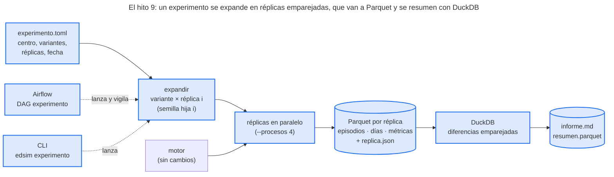

# Hito 9 — Experimentos

> **Estado:** especificación aprobada el 18 de noviembre de 2026, tras la sesión conceptual de ese día; la implementación empieza con la etiqueta `v0.8-hito8`. El original está en este repositorio.

Al terminar el hito 9, EDsim responde a preguntas del tipo **«¿qué pasa si…?»**. Un fichero describe el experimento: el hospital de partida, las variantes y cuántas réplicas tiene cada una. EDsim simula todas las réplicas en paralelo, con **los mismos pacientes en todas las variantes** (números aleatorios comunes), guarda lo necesario de cada una en **Parquet** y da un informe con **DuckDB**: cuánto cambia cada indicador y con qué intervalo de confianza. **Airflow** lanza y vigila el mismo experimento como un grafo: expandir, las réplicas mapeadas en paralelo y el resumen.

Es una especificación didáctica, con el formato de las de los hitos 5 a 8: cada pieza explica para qué sirve, cómo funciona, cómo se usa en EDsim y cómo aprender más. Las decisiones son candidatas (H9-n) y su número definitivo es 112 + n (H9-1 = 113, H9-13 = 125); la tarea de cierre escribe sus ADR 0113 a 0125. La sesión conceptual fue el 18 de noviembre de 2026.

## Objetivo y alcance

Al cerrar el hito 9:

```bash
uv run edsim experimento validar config/experimentos/medico_tarde.toml   # nuevo: comprueba el fichero y dice qué sorteos cambian
uv run edsim experimento lanzar config/experimentos/medico_tarde.toml --procesos 4   # nuevo: 2 variantes × 30 réplicas, a Parquet
uv run edsim experimento informe medico_tarde                            # nuevo: diferencias emparejadas con su intervalo
cd orquestacion && uv run airflow …                                      # nuevo: el mismo experimento como DAG (el modo de arranque lo fija la 9.4)
# Airflow en http://127.0.0.1:8081: el DAG «experimento», con una tarea mapeada por réplica
```

**Por qué ahora.** Hasta el hito 8, una ejecución responde a «qué pasa en este hospital con esta semilla». Una sola ejecución es una tirada de dados: si la variante sale 3 minutos mejor, no se sabe si es el cambio o el azar. Media parte ya existe desde los hitos 2 a 5, sin el nombre de experimento: las semillas hijas (`child_streams`), las réplicas emparejadas de la calibración (`simulate_replicas`, en serie y en memoria), el contrato de sorteos de `compare.py` (`DRAW_EFFECTS`) y el intervalo t de `stats.summarize`. Falta el formato del experimento, lanzar las réplicas en paralelo, guardarlas y compararlas, y un orquestador: con 60 réplicas y un resumen hay, por fin, un grafo de verdad (decisión 109). Con este hito se cumple la primera mitad del criterio de la fase 4: «A/B emparejado».

**Dentro del alcance**

- **El experimento** (H9-1, H9-2, H9-3): un fichero TOML con el centro de partida, las variantes del centro, las réplicas, los días y la fecha de inicio; se valida y se expande en réplicas con números aleatorios comunes.
- **Las réplicas en paralelo** (H9-4, H9-9): cada réplica deja sus episodios, sus días y sus métricas en Parquet, con una ficha para rehacerla; la CLI las lanza con `--procesos` y no repite las hechas.
- **Parquet y DuckDB** (H9-5): DuckDB 2.0 LTS como dependencia del núcleo, para escribir y para leer.
- **El informe** (H9-1): las diferencias emparejadas frente a la variante de referencia, con su intervalo t, y el intervalo que saldría sin emparejar.
- **Airflow** (H9-6, H9-7): en `orquestacion/`, un proyecto uv aparte; primero una prueba de memoria con criterio de corte, después el DAG `experimento`.
- **Proceso** (H9-12, H9-13): las fragilidades de los tests en local (#158) y tres propuestas de velocidad del balance del hito 8.
- **Notebook** `09_experimentos.ipynb`, ADR 0113 a 0125 y etiqueta `v0.9-hito9`.

**Fuera del alcance**

| Qué | Adónde va |
| --- | --- |
| Shocks (el catálogo de `docs/diseno.md`) y variantes que cambian a los pacientes (la gripe, las llegadas) | Hito 10, Shocks, nuevo (H9-2) |
| MLflow | Hito 11, Modelos (H9-8) |
| El DAG del laboratorio del hito 8 (simular → registro → `cargar-verdad` → bronce → dbt → tres columnas) con Cosmos | Ejercicio futuro (H9-1) |
| PySpark | Caso de uso futuro, con dos lecciones (H9-1) |
| La capacidad por ejecución en oro | Backlog (#169) (H9-10) |
| El plan B del tiempo real (#156) | Backlog (H9-11) |
| La variable de Grafana y el fin del dato (#159) | Backlog (H9-12) |
| Convertir una réplica en una ejecución del catálogo (para la app o para reemitirla) | Versiones posteriores (H9-4) |
| Cambios en la app | Fase 2 de la app (#122) |

Las implementa Claude Code. El paquete de experimentos va en la nube (no necesita Docker); el proceso y Airflow, en local (WSL, Kafka y el navegador). Claude Code ejecuta git (rama, commits, push y PR) y Pedro siempre fusiona.

## Cómo encajan las piezas

El motor, el registro clínico y la analítica del hito 8 no cambian. Lo nuevo es el camino por lotes, al lado del directo.



En azul, lo nuevo del hito 9. La CLI y Airflow son dos capas finas sobre las mismas funciones del paquete: cada réplica se simula, se reduce y se escribe en el paquete, con sus tests, y ninguna de las dos capas tiene lógica propia.

**Postgres y Parquet, cada uno en su camino.** Postgres con dbt es el camino en directo: el hospital, lo registrado y Grafana. Parquet con DuckDB es el camino por lotes: los experimentos. Las réplicas no pasan por bronce: un año ocupa 577 MB en Postgres y su vuelta de `refrescar` tarda 60,1 s (hito 8); 60 réplicas de un mes serían unos cinco años más.

## Sesión conceptual resumida

La sesión conceptual está escrita en las piezas 1 a 5; esta tabla es el resumen de referencia.

| Concepto | Qué hay que entender | Pieza |
| --- | --- | --- |
| Experimento | Un centro de partida, variantes y R réplicas por variante; la pregunta es «qué cambia si…» | 1 |
| Réplica | Una simulación con su semilla hija; R réplicas dan la dispersión que produce el azar | 1 |
| Números aleatorios comunes | La réplica i de cada variante tiene los mismos pacientes: solo cambia lo que cambia la variante | 1 |
| Contrato de sorteos | Qué claves del centro cambian algún sorteo (`DRAW_EFFECTS`): con el modelo clínico, solo `destino.probabilidad_ingreso` | 1 |
| Paralelismo | Varias réplicas a la vez, una por proceso; el resultado no depende de cuántos procesos ni del orden | 2 |
| Idempotencia | Relanzar un experimento no repite las réplicas hechas con la misma configuración | 2 |
| Reproducibilidad | Una réplica se rehace bit a bit con su semilla: no hace falta guardarla entera | 2 |
| Formato por columnas | Parquet guarda cada columna junta, con tipos y comprimida: se lee solo lo que se pide | 3 |
| Base de datos embebida | DuckDB es una biblioteca, no un servidor: SQL sobre los Parquet, sin Docker | 3 |
| Particiones de Hive | Carpetas `variante=…/replica=…` que DuckDB lee como columnas | 3 |
| Diferencia emparejada | dᵢ = variante − referencia en la réplica i; el efecto del día se cancela | 4 |
| Intervalo t | d̄ ± t₍ₙ₋₁₎ · s_d / √n; con 30 réplicas, t₂₉ = 2,045 | 4 |
| DAG | El grafo de tareas con sus dependencias; Airflow lo lee de un fichero de Python | 5 |
| Mapeo dinámico | `.expand()` crea una copia de la tarea por cada entrada, al ejecutar | 5 |
| Scheduler y ejecutor | Quién decide qué tarea toca y quién la ejecuta; el límite de tareas a la vez | 5 |

### Casos de uso que cubre

| Caso de uso en un hospital | Quién lo tiene | Qué lo cubre |
| --- | --- | --- |
| Dimensionado de plantilla por turno: ¿un médico más por la tarde? | Dirección, supervisión | Variantes de `recursos.medicos`, comparación emparejada |
| ¿Me compensan cuatro boxes más? | Dirección, obras | Variantes de `recursos.boxes` |
| La enfermería de triaje por turno | Supervisión de enfermería | Variantes de `recursos.enfermeria_triaje` |
| Qué pasa si cambia la probabilidad de ingreso | Gestión de camas | `destino.probabilidad_ingreso`: el informe avisa de que cambia el sorteo `admitted` |
| Formación en diseño de experimentos | Docencia | El notebook 09: emparejar frente a no emparejar |

Los planes de contingencia y los experimentos de estrés (un brote de gripe, un accidente con muchas víctimas) necesitan los shocks: hito 10.

### Tecnologías frente a alternativas

| Capa | Elegida | Alternativas y por qué no aquí |
| --- | --- | --- |
| Paralelismo | **`concurrent.futures` del estándar**, en el paquete | Ray o Dask: un clúster para un portátil; joblib: otra dependencia para lo mismo |
| Formato | **Parquet** | CSV (sin tipos, sin compresión por columnas), el JSONL del log (60 réplicas, unos 3 GB), Postgres (es el camino en directo; cinco años más en bronce) |
| Motor de consulta | **DuckDB 2.0 LTS** (H9-5) | Postgres (servidor, filas), pandas (prohibido en el núcleo), Polars (bueno, pero otra API además de SQL), PySpark (un clúster y una JVM para unos GB: caso de uso futuro, H9-1) |
| Escribir Parquet | **DuckDB** (`COPY … TO … (FORMAT parquet)`) | pyarrow 26: una segunda pieza para lo mismo |
| Orquestador | **Airflow 3.4** (H9-6) | Dagster 1.13 (activos y particiones por réplica; la alternativa si la prueba de memoria falla), Prefect 3.9 (el más ligero, el menos didáctico), ninguno (la CLI ya paraleliza: falta el historial, los reintentos y la interfaz) |
| Registro de experimentos | **Parquet, `experimento.json` y el informe** | MLflow 3.18: al hito 11, donde los modelos lo necesitan (H9-8) |

Contexto: Prefect anunció el 13 de julio de 2026 que compra Dagster Labs; Dagster mantiene su nombre, su licencia y su hoja de ruta. Airflow es el orquestador que más se usa en las empresas, y lo que se aprende con él (DAG, tareas, dependencias, reintentos, mapeo) vale para los demás.

## Pieza 1 — El experimento y los números aleatorios comunes

### Para qué sirve

Comparar dos versiones del hospital con una ejecución de cada una no dice nada: la diferencia mezcla el efecto del cambio con el azar de esos días. Con R réplicas por variante se ve la dispersión. Y si la réplica i de cada variante tiene exactamente los mismos pacientes, la diferencia de cada pareja es el efecto del cambio, sin el ruido de «ese día llegó más gente».

### Cómo funciona

Un **experimento** tiene una variante de **referencia** (el control) y una o más variantes. Cada una se simula R veces. La réplica i usa la **semilla hija i** de la semilla del experimento, la misma en todas las variantes: los mismos instantes de llegada, los mismos motivos, la misma gravedad y las mismas duraciones. Es lo que hace ya `simulate_replicas` de la calibración (`calibration/evaluate.py`): «replication `i` uses child `i` of `seed` (`child_streams`): the same patients for every center».

No todo cambio del centro deja los pacientes intactos. El **contrato de sorteos** (`DRAW_EFFECTS` y `CLINICAL_DRAW_EFFECTS` de `runs/compare.py`) dice qué sorteos puede cambiar cada clave. Con el modelo clínico del hito 5, los recursos, los turnos y las camas no cambian ningún sorteo; `destino.probabilidad_ingreso` cambia el sorteo `admitted`.

**Por qué importa, con cifras del propio EDsim.** En el hito 4, el reloj A de los niveles 2 a 5 iba de 26,8 a 33,9 min entre bloques de 14 días con el factor mensual neutro; en enero, de 57 a 62 min; en febrero, de 34 a 43 min. Un efecto de 2 minutos se pierde en ese ruido si las variantes ven pacientes distintos. Con parejas, el efecto del día se cancela, porque las dos variantes viven el mismo día.

### En EDsim

- **Solo variantes del centro** (H9-2): claves de `config/centro.toml` que estén en el contrato. Los cambios de pacientes (la gripe, las llegadas) y los shocks van al hito 10.
- **Una fecha de inicio para todas las réplicas** (H9-3), en el fichero (`inicio`, por defecto la `fecha_inicio` de `config/llegadas.toml`). Para comparar el invierno con el verano se lanzan dos experimentos.
- **Se reutiliza la simulación de la calibración** (`clinical_run`, `replica_table`, `with_start_date`): no hay un camino de simulación nuevo, y las huellas de los hitos 3 a 8 no cambian.

### Para aprender más

- Law, *Simulation Modeling and Analysis*, capítulos de comparación de sistemas y reducción de varianza (números aleatorios comunes).
- [NumPy: `SeedSequence` y `spawn`](https://numpy.org/doc/stable/reference/random/parallel.html), la base de `child_streams`.

## Pieza 2 — Réplicas en paralelo e idempotencia

### Para qué sirve

Lo medido con el año `r365`: `motor simular` tarda 3 min 28 s y llega a 2,0 GiB de memoria. Extrapolado (a medir en la 9.2), una réplica de 31 días (28 + 2 de calentamiento + 1 de vaciado) tarda unos 18 s y ocupa unos 0,2 GiB de eventos, más el intérprete. 60 réplicas son unos 18 min en serie y unos 5 min con 4 procesos.

### Cómo funciona

- **Un proceso por réplica**, con `ProcessPoolExecutor` del estándar. Cada réplica es independiente: lee su configuración, simula con su semilla hija y escribe sus ficheros. El resultado no depende del número de procesos ni del orden en que acaban: la semilla sale del índice de la réplica, nunca del orden de llegada.
- **Idempotencia:** una réplica está hecha si existe su `replica.json` con la misma huella. Relanzar el experimento salta las hechas y rehace las que faltan; si el experimento existe con otra configuración, es un error claro.
- **Escritura atómica:** los Parquet se escriben primero y `replica.json`, al final. Una réplica interrumpida a medias no tiene ficha y se rehace.
- **Reproducibilidad:** con la misma semilla y la misma configuración, una réplica se rehace bit a bit. Por eso no se guarda el log entero (H9-4).

### En EDsim

- 4 procesos por defecto, con `--procesos` (H9-9). Los experimentos se lanzan **con compose parado**: con todo levantado, WSL usa 4,2 GiB de 6,8 (balance del hito 8) y no caben las réplicas encima.
- Las réplicas van a `resultados/experimentos/<nombre>/`, no a `resultados/ejecuciones/`: no son ejecuciones del catálogo y no pasan por `simulate_run` (la regla de las revisiones se refiere a las ejecuciones).

### Para aprender más

- [`concurrent.futures`](https://docs.python.org/3/library/concurrent.futures.html) y los [contextos de `multiprocessing`](https://docs.python.org/3/library/multiprocessing.html#contexts-and-start-methods) (`fork`, `spawn`, `forkserver`).

## Pieza 3 — Parquet y DuckDB

### Para qué sirve

Una réplica de 31 días ocuparía unos 50 MB como ejecución normal (JSONL y CSV; extrapolado de los 588 MB del año). 60 réplicas son unos 3 GB por experimento. Para el informe basta una tabla de pacientes y otra de días, y hace falta consultarlas juntas sin levantar un servidor.

### Cómo funciona

**Parquet** es un formato de fichero por columnas: guarda cada columna junta, con su tipo, comprimida. Para la espera hasta el médico lee esa columna sin las otras; una columna se parece a sí misma (el nivel es 1 a 5, una y otra vez) y comprime muy bien. Se escribe una vez y no se modifica.

**DuckDB** es una base de datos analítica embebida: una biblioteca dentro del proceso, sin servidor, que consulta los Parquet directamente con SQL. Con carpetas en formato Hive (`variante=control/replica=07/`), las partes de la ruta salen como columnas:

```sql
select variante, replica, median(espera_medico) as mediana
from read_parquet('resultados/experimentos/medico_tarde/variante=*/replica=*/episodios.parquet',
                  hive_partitioning = true)
group by all;
```

DuckDB también escribe Parquet: `copy (select …) to 'episodios.parquet' (format parquet)`.

### En EDsim

- **DuckDB 2.0 LTS, dependencia del núcleo** (H9-5), solo en `src/edsim/experiments/` (como `psycopg` solo en `store/postgres.py`). No tiene dependencias propias.
- **Tipos explícitos:** cada tabla se crea con su esquema antes de escribirse; ninguna columna se deja a la inferencia.
- **Cómo pasan las filas de Python a DuckDB** lo decide el plan de la 9.2, midiendo (inserción por lotes con `executemany` o un CSV temporal y `COPY`), sin pandas ni pyarrow.

### Para aprender más

- [Documentación de DuckDB](https://duckdb.org/docs/): [Parquet](https://duckdb.org/docs/data/parquet/overview), [particiones de Hive](https://duckdb.org/docs/data/partitioning/hive_partitioning) y la API de Python.
- [Apache Parquet: el formato](https://parquet.apache.org/docs/file-format/) (grupos de filas, páginas, codificación por diccionario).

## Pieza 4 — El informe: la diferencia emparejada y su intervalo

### Para qué sirve

La pregunta es «cuánto cambia el indicador y con qué seguridad». La respuesta es un número con su intervalo: «la espera hasta el médico baja 2,1 min, entre 1,3 y 2,9».

### Cómo funciona

Para cada indicador, cada variante v y cada réplica i: dᵢ = valor de v en la réplica i − valor de la referencia en la réplica i. Con n réplicas, la media d̄ y la desviación s_d de las diferencias dan el intervalo t al 95 %: d̄ ± t₍ₙ₋₁₎ · s_d / √n (con 30 réplicas, t₂₉ = 2,045). Es `stats.summarize` aplicado a las diferencias.

El informe enseña además el **intervalo que saldría sin emparejar** (las dos variantes como muestras independientes, con el intervalo de Welch): la diferencia de anchos es lo que aportan los números aleatorios comunes.

### En EDsim

- Los indicadores son los del paquete, calculados en Python con los boxes y la plantilla de cada variante (`window_kpis`, `window_compliance` y los del hito 5); la lista exacta, con su función, la fija el plan de la 9.2.
- Una pareja con un valor indefinido (sin episodios completos) se excluye, y el informe dice cuántas parejas usó.
- Para cada variante, el informe dice qué sorteos cambia según el contrato.

### Para aprender más

- Law, capítulo de comparación de dos sistemas (intervalo t emparejado y de Welch).

## Pieza 5 — Airflow: DAG, mapeo dinámico y scheduler

### Para qué sirve

La CLI ya lanza réplicas en paralelo. Un orquestador añade lo que la CLI no tiene: el grafo declarado (expandir → réplicas → resumen), un límite de tareas a la vez, reintentos, un historial con la duración y los mensajes de cada réplica, y una interfaz para mirarlo. En el hito 8 no hacía falta: `refrescar` es un bucle cada minuto (decisión 109). Con 60 réplicas y un resumen, sí.

### Cómo funciona

Un **DAG** es un fichero de Python con tareas y sus dependencias. El **dag-processor** lo lee; el **scheduler** decide qué tarea toca; el **ejecutor** la ejecuta (`LocalExecutor`: procesos en la misma máquina); el **api-server** sirve la interfaz; el **triggerer** solo sirve para tareas diferidas. Las tareas se pasan cosas pequeñas por **XCom** (aquí, rutas), nunca tablas.

El **mapeo dinámico** crea, al ejecutar, una copia de la tarea por cada entrada de una lista que devuelve otra tarea:

```python
from airflow.sdk import dag, task

@dag(schedule=None, params={"experimento": "config/experimentos/medico_tarde.toml"})
def experimento():
    @task
    def expandir(params=None) -> list[dict]:
        ...  # el paquete: variantes × réplicas

    @task(max_active_tis_per_dagrun=4, retries=1)
    def replica(spec: dict) -> str:
        ...  # el paquete: simula, reduce y escribe; si ya está hecha, no repite

    @task
    def resumen(rutas: list[str]) -> str:
        ...  # el paquete: DuckDB y el informe

    resumen(replica.expand(spec=expandir()))

experimento()
```

(Esbozo de la sesión; los nombres los fija la 9.5.)

**La idempotencia no es de Airflow.** Airflow puede relanzar las tareas que fallaron dentro de una ejecución, pero no sabe que el Parquet de la réplica 7 ya existe con la misma configuración: eso lo garantiza el paquete (pieza 2), y se prueba sin Airflow.

### En EDsim

- **Airflow 3.4** (H9-6), en `orquestacion/`, un proyecto uv aparte con su propio lock, como `analitica/` (H9-7). Importa `edsim` por ruta; sus dependencias no tocan el núcleo ni la app.
- **Sin Docker.** Su guía de Docker Compose pide al menos 4 GB, idealmente 8, para Postgres, Redis y Celery; en local, Airflow corre como procesos con SQLite. La **prueba de la 9.4** compara formas ligeras de arrancarlo y mide la memoria con un **criterio de corte fijado antes de medir**: con compose parado, Airflow y 4 réplicas, WSL no pasa de 5,5 GiB de 6,8. Si no cabe, Dagster, con el mismo paquete.
- **La interfaz en `127.0.0.1:8081`:** el 8080 es la consola de Redpanda (`compose.yaml`).
- Lo que Airflow guarda en disco (su base, sus logs) queda fuera de git.

### Para aprender más

- [Airflow: conceptos](https://airflow.apache.org/docs/apache-airflow/stable/core-concepts/index.html), [mapeo dinámico de tareas](https://airflow.apache.org/docs/apache-airflow/stable/authoring-and-scheduling/dynamic-task-mapping.html) y [`dag.test()`](https://airflow.apache.org/docs/apache-airflow/stable/core-concepts/debug.html).
- [Astronomer: tareas dinámicas](https://www.astronomer.io/docs/learn/dynamic-tasks).

## Especificación: el fichero del experimento

En `config/experimentos/` (las reglas `ask` de `config/` piden confirmación al escribirlos):

```toml
# config/experimentos/medico_tarde.toml
nombre = "medico_tarde"            # la carpeta de resultados/experimentos/
centro = "config/centro.toml"      # el centro de partida
llegadas = "config/llegadas.toml"
perfiles = "config/perfiles.toml"  # el modelo clínico del hito 5; el provisional no vale
semilla = 2026
replicas = 30                      # al menos 2
dias = 28
calentamiento = 2
inicio = 2026-01-05                # opcional; por defecto, fecha_inicio de llegadas.toml
referencia = "control"

[variantes.control]                # sin cambios: el centro de partida

[variantes.medico_extra_tarde]
"recursos.medicos" = [12, 12, 4]   # mañana, tarde y noche; el centro real tiene [12, 11, 4]
```

- **Claves de variante:** solo las del contrato de sorteos (`CLINICAL_DRAW_EFFECTS`), con su valor entero (la lista completa, no «+1»). Cualquier otra clave es un error que la nombra.
- **Cada variante se valida** construyendo su centro (el mecanismo de `runs/variants.py`) y cargándolo con las validaciones de `CenterConfig`.
- **La referencia** tiene que ser una de las variantes; hay al menos dos.
- `edsim experimento validar` dice, por variante, qué cambia frente a la referencia (`center_diff`) y qué sorteos cambia según el contrato.
- Las rutas son relativas al repositorio; el experimento copia los ficheros que usa (pieza siguiente).

## Especificación: la réplica

```
resultados/experimentos/medico_tarde/
├── experimento.toml                 # copia exacta del fichero
├── experimento.json                 # la huella, las variantes resueltas, las versiones y la fecha
├── config/                          # copias de llegadas.toml, perfiles.toml y el centro de cada variante
├── variante=control/
│   ├── replica=00/
│   │   ├── episodios.parquet        # un episodio por fila: la ficha de la verdad (replica_table)
│   │   ├── dias.parquet             # un día por fila
│   │   ├── metricas.parquet         # una fila por indicador (y nivel)
│   │   └── replica.json             # la semilla hija (spawn_key), la huella y las versiones; se escribe al final
│   └── replica=01/ …
├── variante=medico_extra_tarde/ …
├── resumen.parquet                  # el informe en tabla (9.3)
└── informe.md                       # el informe legible (9.3)
```

- **La réplica i** usa `child_streams(semilla, replicas)[i]` en todas las variantes, la fecha `inicio` (`with_start_date`), el calentamiento y el vaciado de la calibración (`DRAIN_DAYS`).
- **La huella** de una réplica cubre los bytes del centro de su variante, de las llegadas y de los perfiles, la semilla, el índice, los días, el calentamiento, la fecha y las versiones del esquema de eventos y del paquete. La del experimento cubre el fichero y las huellas de sus variantes.
- **El índice** va con ceros a la izquierda, con el ancho de `replicas - 1` (`00` a `29`).
- **Nada del log:** ni el JSONL ni los CSV (H9-4).

## Especificación: el lanzador y la CLI

- `edsim experimento validar FICHERO`: carga, valida, enseña las variantes, sus diferencias y los sorteos que cambian. Sin simular.
- `edsim experimento lanzar FICHERO [--procesos N] [--resultados DIR]`: crea o retoma la carpeta, lanza las réplicas que faltan con N procesos (4 por defecto; H9-9) y escribe el informe al acabar. Avisa de cuántas réplicas salta por estar hechas.
- `edsim experimento informe NOMBRE [--resultados DIR]`: rehace el informe desde los Parquet, sin simular.
- La lógica vive en `src/edsim/experiments/`; la CLI solo traduce opciones y mensajes.
- **El contexto de `multiprocessing`** es explícito (el plan de la 9.2 elige entre `spawn` y `forkserver`): no depende del valor por defecto de cada versión de Python.

## Especificación: el informe

`resumen.parquet` tiene una fila por indicador, nivel (si lo tiene) y variante distinta de la referencia, con: la media de la referencia, la media de la variante, d̄, s_d, n (parejas usadas), el intervalo emparejado al 95 % (`stats.summarize` sobre las diferencias), el intervalo independiente de Welch y los sorteos que cambia la variante. `informe.md` lo enseña en una tabla, con la configuración y la huella del experimento. Las consultas a los Parquet son de DuckDB y viven en el paquete.

## Especificación: Airflow

### La prueba (9.4)

Antes de construir encima:

1. **`orquestacion/`:** `pyproject.toml` con `apache-airflow` 3.4 (Python 3.13, admitido desde Airflow 3.1) y `edsim` por ruta, y su `uv.lock`. Se comprueba primero si uv resuelve sin el fichero de restricciones de Airflow; si no, se usa.
2. **Formas ligeras, medidas una a una:**
   - `airflow standalone`, con SQLite;
   - los componentes a mano y recortados: el api-server con un proceso, sin triggerer y con paralelismo 4;
   - `airflow dags test`: el DAG en un solo proceso, sin scheduler ni interfaz, con la interfaz después solo para el historial (probablemente ejecuta las réplicas en serie: se comprueba).
3. **Si el `LocalExecutor` funciona con SQLite** en paralelo. Si no, la base de metadatos es una base `airflow` en el Postgres de compose, y la medida se repite con ese contenedor levantado.
4. **La medida:** memoria de WSL en reposo y con un DAG de 4 réplicas a la vez (las reales de la 9.2 si ya está fusionada; si no, tareas de juguete que reservan 0,3 GiB durante 18 s). **Criterio de corte:** con compose parado, WSL ≤ 5,5 GiB. Si ninguna forma cumple, la tarea para y se decide con Pedro (Dagster, H9-6).
5. **El resultado:** la forma elegida y sus órdenes en `AGENTS.md` y en `docs/proceso/portabilidad.md`, el puerto 8081 y las medidas en el anexo.

### El DAG del experimento (9.5)

- `orquestacion/dags/experimento.py`: `expandir` → `replica.expand(…)` con `max_active_tis_per_dagrun` (4) y un reintento → `resumen`. Solo llama al paquete.
- **El test (el único de Airflow):** `dag.test()` con un experimento mínimo (2 variantes × 2 réplicas × 1 día). Pilla lo que los tests del paquete no ven: el mapeo (4 tareas, no 2), lo que se pasa por XCom y que el resumen espera a todas. Relanzarlo no resimula (las fichas no cambian).
- **El CI:** un job `tests-orquestacion` que sincroniza `orquestacion/` y ejecuta ese test cuando el PR cambia `orquestacion/` o `src/edsim/experiments/`; `orquestacion/*` cuenta como código en `cambios`. Si es obligatorio en `main` lo decide la 9.5, con su duración medida.
- **La medida a mano (Pedro):** `medico_tarde` entero (2 × 30 réplicas × 28 días) desde la interfaz, con compose parado: el tiempo y la memoria de WSL.

## Especificación: proceso (9.0)

- **#158, la integración con los topics llenos:** los tests de integración no leen una reemisión vieja: topics propios por sesión o un aviso claro en `scripts/tests-integracion.sh` (el plan elige lo más sencillo).
- **#158, la N2 con una N3 en marcha** (propuesta a): el hook Stop no lanza la rápida mientras `scripts/tests-completos.sh` corre en el mismo clon (por ejemplo, con un fichero de bloqueo en `.cache/edsim/`).
- **#158, el reloj de Docker Desktop:** `scripts/tests-integracion.sh` compara el reloj de WSL con el del contenedor al empezar y, si se desfasan, avisa de que se reinicie Docker Desktop (nunca `wsl --shutdown` con sesiones abiertas). Ninguna tolerancia cambia.
- **`/tarea-edsim` sin «Notas del chat»** (propuesta b): si el issue no tiene el comentario de notas, para y lo dice antes de planear.
- **Opus por defecto** (propuesta d): `docs/proceso/flujo.md` dice que las tareas con código nuevo van con Opus y Sonnet queda para lo mecánico.
- La propuesta c (integración con topics limpios) es el primer punto.

## CLI

| Orden | Qué hace | Tarea |
| --- | --- | --- |
| `edsim experimento validar FICHERO` | Valida el experimento; variantes, diferencias y sorteos que cambian | 9.1 |
| `edsim experimento lanzar FICHERO [--procesos N]` | Las réplicas que faltan, en paralelo, y el informe | 9.2, 9.3 |
| `edsim experimento informe NOMBRE` | Rehace el informe desde los Parquet | 9.3 |
| `cd orquestacion && uv run airflow …` | Airflow con la forma elegida en la 9.4; el DAG `experimento` | 9.4, 9.5 |

## Estructura del repositorio

```
edsim/
├── config/experimentos/medico_tarde.toml   # nuevo: el experimento de ejemplo (9.1)
├── orquestacion/                           # nuevo: Airflow, con su pyproject y su uv.lock (9.4, 9.5)
│   ├── dags/experimento.py
│   └── tests/
├── src/edsim/
│   ├── experiments/                        # nuevo: fichero, expansión, réplica, lanzador e informe (9.1 a 9.3)
│   └── cli.py                              # edsim experimento (9.1 a 9.3)
├── tests/                                  # el experimento, las réplicas y el informe, sin Docker
├── scripts/                                # tests-integracion.sh y el hook (9.0)
├── .github/workflows/ci.yml                # orquestacion/* en cambios; job tests-orquestacion (9.5)
└── notebooks/09_experimentos.ipynb         # nuevo (9.6)
```

**Reglas que se mantienen:** paquete en inglés; tests del núcleo en español; claves TOML, columnas, opciones de la CLI y textos en español; lógica en el paquete y CLI fina; el núcleo no importa Airflow (vive en otro entorno) ni `streamlit`, `pandas` o `edsim_app`; `duckdb` solo en `src/edsim/experiments/`.

## Tests y validación

**La regla del hito:** cada test dice qué error pilla que no pille ningún otro; los caros, una sola vez. Con valores a mano calculados en el plan con código independiente del paquete.

### Rápidos, sin Docker (job `tests`)

- **9.1, el fichero:** una clave fuera del contrato, una referencia que no existe, una sola variante, menos de 2 réplicas y el modelo provisional dan cada uno su error. Pilla un experimento que se lanza con una configuración imposible.
- **9.1, la expansión:** la réplica i de cada variante lleva el mismo `spawn_key` y la misma fecha; y, simulando 1 día, los instantes de llegada y los motivos de la réplica i son iguales en el control y en «médico extra de tarde». Pilla la pérdida de los números aleatorios comunes (el error que hace mentir al informe sin que se note).
- **9.1, los sorteos:** `validar` dice que `recursos.medicos` no cambia ningún sorteo y que `destino.probabilidad_ingreso` cambia `admitted`.
- **9.2, la réplica:** sus tres Parquet tienen el esquema fijado y sus filas coinciden con `replica_table` de la misma simulación. Pilla una columna perdida o con otro tipo.
- **9.2, paralelo = serie:** un experimento mínimo con 1 proceso y con 2 da las mismas filas. Pilla una semilla que depende del orden de llegada.
- **9.2, idempotencia:** relanzar no rehace nada (fichas sin cambiar); cambiar el centro de una variante con el mismo nombre de experimento es un error; una réplica sin `replica.json` (interrumpida, con un fallo inyectado entre los Parquet y la ficha) se rehace.
- **9.3, el informe:** con métricas a mano (n = 3), d̄, s_d, el intervalo emparejado (t₂ = 4,303) y el de Welch coinciden con el cálculo del plan; una pareja indefinida se excluye y n baja.
- **9.3, DuckDB frente a Python:** la media por variante que da la consulta de DuckDB es la de las métricas en Python. Pilla una consulta que lee la partición equivocada.

### Orquestación (job `tests-orquestacion`)

- **9.5:** `dag.test()` con 2 × 2 × 1 día (lo de arriba). Nada más: lo que hace cada réplica ya lo prueba el paquete.

### Notebooks (job `notebooks`)

- **9.6:** `09_experimentos.ipynb` en modo rápido (2 variantes × 3 réplicas × 2 días).

### A mano (Pedro)

- **9.4:** la medida de memoria de cada forma de arrancar Airflow, en su WSL.
- **9.5:** `medico_tarde` entero desde la interfaz de Airflow, con compose parado: tiempo y memoria.

### Versiones incorrectas (temporales, con predicción firme)

| # | Tarea | Versión incorrecta | Predicción de partida |
| --- | --- | --- | --- |
| V1 | 9.1 | La réplica i de cada variante usa la semilla hija de (variante, i) | Falla el test de los mismos pacientes (los instantes de llegada difieren) |
| V2 | 9.1 | Aceptar cualquier clave del centro | Falla el test de la clave fuera del contrato |
| V3 | 9.2 | La semilla sale del orden en que el pool entrega las tareas | Falla «paralelo = serie» |
| V4 | 9.2 | Saltar una réplica si existe su carpeta, sin mirar la huella | Falla el test del centro cambiado con el mismo nombre |
| V5 | 9.2 | Escribir `replica.json` antes que los Parquet | Falla el test de la réplica interrumpida (se da por hecha) |
| V6 | 9.3 | El intervalo con la desviación de cada variante en vez de la de las diferencias | Falla el test con valores a mano (el intervalo emparejado) |
| V7 | 9.3 | t con n grados de libertad en vez de n − 1 | Falla el test con valores a mano (con n = 3, t₃ = 3,182 en vez de t₂ = 4,303) |
| V8 | 9.5 | Mapear por variantes en vez de por réplicas | Falla `dag.test()` (2 tareas mapeadas en vez de 4) |

## Decisiones del hito

Trece decisiones candidatas, tomadas con Pedro una a una en la sesión conceptual del 18 de noviembre de 2026, cada una con la recomendación de Claude salvo donde se dice. Su número definitivo es 112 + n; la tarea 9.7 escribe sus ADR 0113 a 0125, con las alternativas descartadas y cuándo tendrían sentido, y las añade al [registro de decisiones](../diseno.md#registro-de-decisiones-y-preguntas-abiertas) de `docs/diseno.md`.

| # | Decisión | Motivo |
| --- | --- | --- |
| 113 (H9-1) | Dentro: el experimento, las réplicas en paralelo en el paquete y la CLI, Parquet y DuckDB, el informe emparejado, Airflow con el DAG `experimento` y el notebook 09. Fuera: el DAG del laboratorio del hito 8 con Cosmos (ejercicio futuro, a petición de Pedro) y PySpark (caso de uso futuro, a pregunta de Pedro, con dos lecciones: la misma consulta en DuckDB y en PySpark, y Structured Streaming sobre Kafka con *watermarks*) | Tres piezas nuevas bastan; el DAG del laboratorio necesita compose, dbt y Airflow a la vez, el caso de memoria más justo; PySpark ocupa el sitio de DuckDB con una JVM y un volumen que no lo pide |
| 114 (H9-2) | Solo variantes del centro, con las claves del contrato de sorteos. Los cambios de pacientes y los shocks, a un hito propio, el 10 (Shocks); Modelos pasa al 11. A pregunta de Pedro | Emparejamiento exacto y comprobable; el código de variantes del centro ya existe. Los shocks son trabajo de motor y los modelos los necesitan para el caso de «robustez ante drift» |
| 115 (H9-3) | Una fecha de inicio para todas las réplicas, en el fichero | Cada experimento responde a una pregunta clara; la rotación por meses obliga a R múltiplo de 12 y mezcla efectos que cambian con la estación |
| 116 (H9-4) | De cada réplica, Parquet de episodios, días y métricas, y `replica.json` para rehacerla; nada del log | Unos 3 GB por experimento con el log; una réplica se rehace bit a bit. Convertir una réplica en ejecución, para después |
| 117 (H9-5) | DuckDB 2.0 LTS como dependencia del núcleo, para escribir y leer Parquet, solo en `src/edsim/experiments/` | Una pieza sin dependencias; el camino por lotes es del núcleo y sus tests corren en el job `tests`. Alternativas descartadas: un extra `lotes`, pyarrow para escribir |
| 118 (H9-6) | Airflow 3.4 como orquestador, en local y sin Docker, condicionado a una prueba de memoria con criterio de corte (WSL ≤ 5,5 GiB con compose parado, Airflow y 4 réplicas); si no cabe, Dagster. Pedro quería aprender Airflow; la prueba compara formas ligeras de arrancarlo, a petición suya | El experimento es el caso de libro del mapeo dinámico; es el orquestador más usado. La guía de Docker Compose pide 4 GB y no cabe. Alternativas descartadas: Dagster (mejor encaje con activos y particiones, no es el que se quiere aprender), Prefect, ninguno |
| 119 (H9-7) | `orquestacion/`, un proyecto uv con su propio lock, que importa `edsim` por ruta; su estado, fuera de git; su interfaz en `127.0.0.1:8081` | Las dependencias de Airflow no tocan el núcleo; el 8080 es la consola de Redpanda. Alternativa descartada: miembro del workspace |
| 120 (H9-8) | MLflow, al hito 11 (Modelos) | En el hito 9 duplica el informe y los Parquet; con los modelos es imprescindible. Convivir con las dependencias de Airflow, sin comprobar |
| 121 (H9-9) | 4 procesos por defecto, con `--procesos` y `max_active_tis_per_dagrun`; los experimentos, con compose parado. Siguiendo el criterio de Claude | Cifras extrapoladas del año: unos 18 s y 0,3 GiB por réplica; se miden en la 9.2 y la 9.5 |
| 122 (H9-10) | La capacidad por ejecución en oro, al Backlog (#169) | Las réplicas no pasan por Postgres; el informe calcula la ocupación con los boxes de cada variante |
| 123 (H9-11) | El plan B del tiempo real (#156), en el Backlog | Los experimentos no pasan por dbt; basta con no dejar un año en bronce durante un directo |
| 124 (H9-12) | El #158 entra en la 9.0; el #159, en el Backlog | Las tareas locales del hito sufren el #158; el hito no toca Grafana |
| 125 (H9-13) | Las cuatro propuestas de velocidad del hito 8: la N2 no compite con una N3, `/tarea-edsim` avisa sin «Notas del chat», la integración con topics limpios (las tres en la 9.0) y Opus por defecto en las tareas con código nuevo. Ocho tareas en dos pistas | En el hito 8, dos timeouts falsos, una tarea lanzada sin sesión conceptual y tres de cinco tareas planeadas con Sonnet que acabaron en Opus |

## Tareas, ramas y orden de ejecución

| Tarea | Contenido | Pista | Dónde | Modelo y esfuerzo | Rama | Crítica |
| --- | --- | --- | --- | --- | --- | --- |
| 9.0 (#161) | Proceso: el #158 (topics llenos, la N2 con una N3, el reloj de Docker Desktop), `/tarea-edsim` sin notas y Opus por defecto en `flujo.md` | B | Local (Kafka) | Opus, alto | `chore/h9-proceso` | No |
| 9.1 (#162) | El fichero del experimento: carga, validación con el contrato, expansión en réplicas con números aleatorios comunes, `edsim experimento validar` y `config/experimentos/medico_tarde.toml` | A | Nube | Opus, alto | `feat/h9-experimento` | **Sí** |
| 9.2 (#163) | La réplica: simulación con la semilla hija, Parquet con DuckDB, `replica.json` y la huella, idempotencia, `edsim experimento lanzar --procesos`, la lista de indicadores y la medida de tiempo y memoria por réplica | A | Nube | Opus, alto | `feat/h9-replicas` | **Sí** |
| 9.3 (#164) | El informe: diferencias emparejadas e intervalo de Welch con DuckDB, `resumen.parquet`, `informe.md` y `edsim experimento informe` | A | Nube | Opus, alto | `feat/h9-informe` | No |
| 9.4 (#165) | La prueba de Airflow: `orquestacion/`, las formas ligeras de arrancarlo, la memoria frente al criterio de corte; para si no cabe | B | Local (WSL y navegador) | Opus, alto | `feat/h9-airflow-prueba` | No |
| 9.5 (#166) | El DAG `experimento`, `dag.test()`, el job `tests-orquestacion` y `orquestacion/*` en `cambios`; la medida de `medico_tarde` entero | B | Local (navegador) | Opus, alto | `feat/h9-dag` | No |
| 9.6 (#167) | Notebook `09_experimentos.ipynb`: la pregunta, el fichero, lanzar, DuckDB sobre los Parquet, el informe, y emparejar frente a no emparejar; modo rápido | A | Nube | Sonnet, alto | `feat/h9-notebook` | No |
| 9.7 (#168) | Cierre con `/cerrar-hito`: ADR 0113 a 0125, diario, `docs/diseno.md` (capas, pila, registro de decisiones y hoja de ruta), `AGENTS.md`, `portabilidad.md`, balance, Release y `v0.9-hito9` | — | Local | Opus, alto | `docs/h9-cierre` | No |

**Dependencias:**

| Tarea | Depende de | Por qué |
| --- | --- | --- |
| 9.0 (#161) | — | Solo scripts, hooks, skills y documentación del proceso |
| 9.1 (#162) | — | |
| 9.2 (#163) | 9.1 | Simula lo que la 9.1 expande |
| 9.3 (#164) | 9.2 | Lee sus Parquet |
| 9.4 (#165) | — | Usa réplicas de juguete si la 9.2 no está fusionada |
| 9.5 (#166) | 9.3, 9.4 | El DAG llama al lanzador y al informe, con la forma de arrancar elegida |
| 9.6 (#167) | 9.3 | Junta el experimento entero |
| 9.7 (#168) | Todas | |

**Calendario en dos pistas:**

| Tramo | Pista A (`src/edsim/experiments/`, nube) | Pista B (proceso y `orquestacion/`, local) |
| --- | --- | --- |
| 1 | 9.1 | 9.0 |
| 2 | 9.2 | 9.4 |
| 3 | 9.3 | — |
| 4 | 9.6 | 9.5 |
| 5 | 9.7 | |

**Precisiones:**

- **Dos ramas abiertas como mucho**, una por pista. Nunca hay dos sesiones locales a la vez: la pista A va en la nube.
- **Ficheros compartidos:** `cli.py` (9.1 a 9.3, en serie), `ci.yml` (9.5), `AGENTS.md` (9.0, 9.4 y 9.7) y `pyproject.toml` del núcleo (9.2, por DuckDB: `uv sync` necesita red y permiso). Si al fusionar una la otra tiene conflictos, su agente trae `main` con un merge (no con rebase: el push forzado está prohibido) y espera al CI.
- **Sesiones en la nube:** Pedro elige la rama del issue y mueve la ficha del tablero. Las medidas de memoria de la nube no valen como medida de WSL: la de WSL es de la 9.4 y la 9.5.
- La 9.4 y la 9.5 se ejecutan con compose parado, salvo la medida con el Postgres de compose si el `LocalExecutor` no funciona con SQLite.

## Flujo de git y reparto entre agentes

Todo lo implementa Claude Code. Cada tarea sale de su issue de GitHub y sigue el ciclo de [docs/proceso/tarea.md](../proceso/tarea.md), con la entrada del anexo de esta especificación en el mismo PR y la fusión, siempre de Pedro. El manual del flujo para personas está en [docs/proceso/flujo.md](../proceso/flujo.md).

Lo propio de este hito:

- La revisión de Codex en la 9.1 y la 9.2, las tareas con la etiqueta `critica`; en ellas, también el revisor del plan.
- Ninguna tarea se lanza sin su sesión conceptual y sus «Notas del chat» en el issue (desde la 9.0, `/tarea-edsim` lo comprueba).
- Esta especificación se cambia en el repositorio, en el mismo PR que el código que la cambia.

## Criterios de aceptación

- `uv run pytest` pasa, incluidos los `slow`; los tests de la app, de integración y de orquestación pasan; el CI está en verde.
- Las huellas de los logs y del ground truth de los hitos 3 a 8 no cambian: el motor, el registro clínico y la analítica no se tocan.
- La réplica i de cada variante tiene los mismos pacientes; con 1 proceso y con 2, el experimento da las mismas filas; relanzarlo no rehace nada.
- `edsim experimento lanzar config/experimentos/medico_tarde.toml` deja 60 réplicas en Parquet y un informe con el intervalo emparejado y el independiente de cada indicador.
- La memoria de Airflow está medida frente al criterio de corte, con la forma de arrancarlo elegida y sus órdenes en `AGENTS.md`; el DAG `experimento` lanza `medico_tarde` desde la interfaz en `127.0.0.1:8081`, con el tiempo y la memoria anotados.
- `notebooks/09_experimentos.ipynb` se ejecuta en el CI en modo rápido.
- Las fragilidades del #158 están resueltas o avisadas, y `/tarea-edsim` para sin «Notas del chat».
- Pedro sabe explicar qué son los números aleatorios comunes y por qué estrechan el intervalo; por qué una réplica no se guarda entera; qué aporta Parquet frente a CSV y DuckDB frente a Postgres; qué es el mapeo dinámico y qué hace el scheduler; por qué la idempotencia la garantiza el paquete y no Airflow; y por qué los experimentos no pasan por Postgres.
- `docs/` contiene esta especificación con su anexo y su balance, las ADR 0113 a 0125 y la entrada del diario; la etiqueta `v0.9-hito9` y su Release existen en GitHub.

## Para versiones posteriores

Lo que este hito aplaza a propósito, con su destino, y las alternativas que se descartaron y cuándo tendrían sentido. La tarea de cierre lo lleva a la [hoja de ruta](../diseno.md#hoja-de-ruta) de `docs/diseno.md`.

| Qué | Adónde | Nota |
| --- | --- | --- |
| Shocks: el catálogo, `shock_started` y `shock_ended`, `ed.system.events`, la orden en el directo y los experimentos de estrés; los cambios de pacientes como variante (la gripe, las llegadas) | Hito 10, Shocks | H9-2. El campo `shocks` del fichero de experimento del diseño entra entonces |
| MLflow | Hito 11, Modelos | H9-8. Allí también puede registrar los experimentos |
| El DAG del laboratorio del hito 8 con Cosmos (`dbt_executable_path` al entorno de `analitica/`) | Ejercicio futuro | H9-1, a petición de Pedro. Necesita compose, dbt y Airflow a la vez: medir antes la memoria |
| PySpark: la misma consulta de un experimento en DuckDB y en PySpark (evaluación perezosa, particiones, *shuffle*, *driver* y *executors*); Structured Streaming sobre Kafka para los KPIs por ventana con eventos tardíos (*watermarks*), la lección que quedó fuera con Quix Streams | Caso de uso futuro | H9-1, a pregunta de Pedro. Spark 4 pide Java 17 y una JVM de 1 a 2 GB |
| Dagster | Si la prueba de la 9.4 no cabe, o para comparar | H9-6: activos y particiones por réplica, integración con dbt |
| Convertir una réplica en una ejecución del catálogo (para verla en la app o reemitirla) | Versiones posteriores | H9-4; entonces sí hace falta la capacidad por ejecución |
| La capacidad por ejecución en oro (boxes y plantilla del centro usado) | Backlog (#169) | H9-10 |
| La rotación de las réplicas por meses (la ventana anual) | Si hace falta | H9-3: R múltiplo de 12 |
| Barridos (por ejemplo, de 10 a 14 médicos por la tarde) con una sintaxis propia, y el número de réplicas adaptativo (añadir hasta una precisión) | Versiones posteriores | Hoy, un barrido es una lista de variantes |
| El plan B del tiempo real (#156) | Backlog | H9-11 |
| La variable de Grafana, el fin del dato (#159) | Backlog | H9-12 |
| Modelos incrementales de dbt con ventana de revisión | Versiones posteriores | Decisión 102, por interés didáctico |

## Fuentes y para aprender más

- Sesión conceptual del 18 de noviembre de 2026. Versiones consultadas ese día en PyPI y en sus anuncios: Apache Airflow 3.4.0 (6 de noviembre de 2026; Python 3.10 a 3.13 desde la 3.1); Dagster 1.13.30 (12 de noviembre de 2026) y la compra de Dagster Labs por Prefect (anunciada el 13 de julio de 2026); Prefect 3.9.3 (13 de noviembre de 2026, con `ProcessPoolTaskRunner`); DuckDB 2.0.0 LTS (21 de octubre de 2026); MLflow 3.18.0 (3 de noviembre de 2026; SQLite por defecto desde la 3.7); pyarrow 26.0.1 (3 de noviembre de 2026); PySpark 4.3.0 (30 de octubre de 2026).
- Medidas del repositorio: el año `r365` (`motor simular`, 3 min 28 s y 2,0 GiB; la carpeta, 588 MB; en Postgres, 577 MB) y la memoria con todo levantado (balance del hito 8); el reloj A por bloques y por mes (hito 4).
- Las de cada pieza.
